<div align="center">

# Community video editing skills for AI agents

**Ready-made video editing workflows for Claude Code, Codex, Cursor and the in-app agent of the [Subclip AI video editor](https://www.subclip.app).**

[](https://www.subclip.app/agent-skills/community)
[](CONTRIBUTING.md)
[](LICENSE)

</div>

Each skill teaches an agent one way of making videos on an editable Subclip timeline: explainers, motion graphics, slides, 3D, pixel art, captions, music and more. Skills adapted from other projects credit their original authors and keep their licenses.

## Install a skill

- **In the Subclip app:** open **Skills > Browse Community**, choose a skill and install it.
- **From a link:** paste a skill page link (for example `https://www.subclip.app/agent-skills/community/vox-explainer`) or a skill folder link from this repo in **Skills > Add skill**.

Subclip scans the files, your own agent reviews them, and you confirm the install. No Subclip credits are used for the check.

## Skill directory

Generated from each folder's `skill.yml` by `npm run build`.

<!-- skills:start -->

<p><b>43</b> skills in 12 categories.</p>

### Explainers

<table>
<tr>
<td width="33%" valign="top">
<a href="skills/anatomy">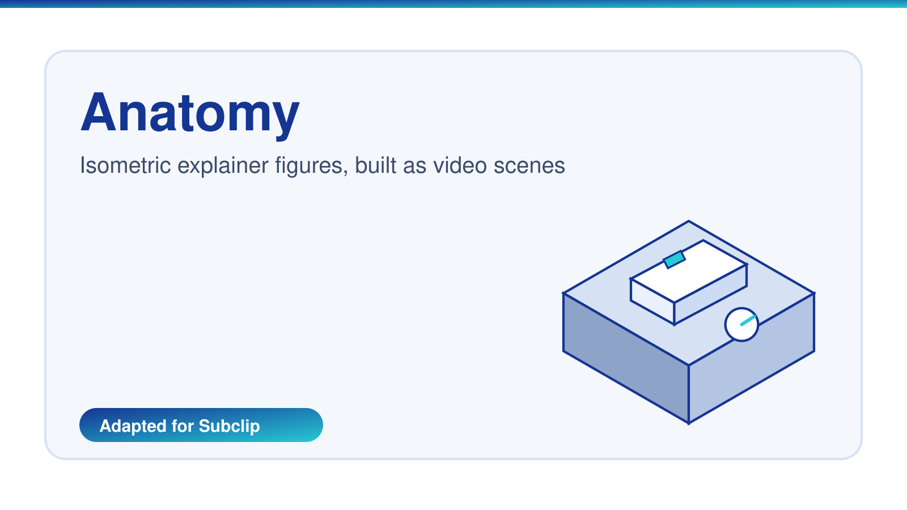</a><br>
<a href="skills/anatomy"><b>Anatomy isometric figures</b></a><br>
<sub>Isometric explainer figures for video: a real object, many small parts and calm motion, built as HyperFrames scenes with optional narration.</sub><br>
<sub>Adapted from <a href="https://github.com/wheresryan22/anatomy">wheresryan22/anatomy</a> by Ryan</sub>
</td>
<td width="33%" valign="top">
<a href="skills/documentary-case-file">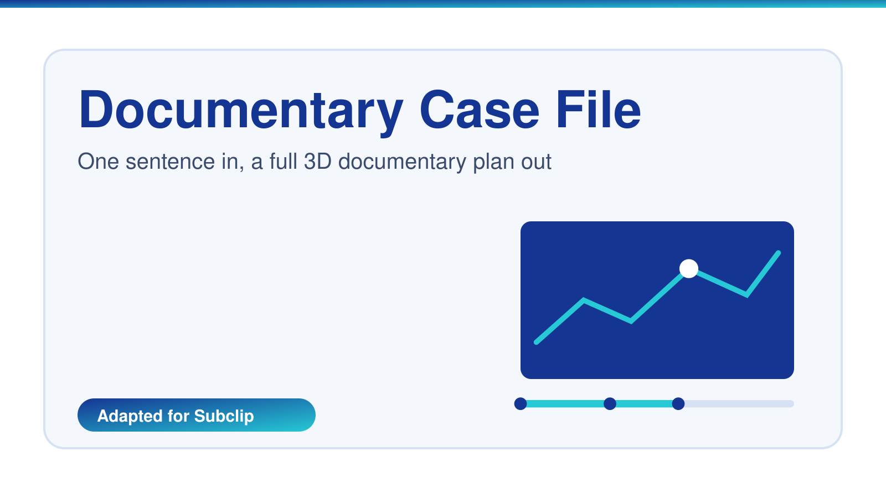</a><br>
<a href="skills/documentary-case-file"><b>Documentary case file</b></a><br>
<sub>One sentence in, a documentary plan with chapters, locked stills, scene clips and a narrator, assembled on the Subclip timeline.</sub><br>
<sub>Adapted from <a href="https://app.notion.com/p/Claude-Creative-Skill-Library-Vol-2-3ffb5f1fde2d81938bb9eb76ea6c60d1">app.notion.com/p/Claude-Creative-Skill-Library-Vol-2-3ffb5f1fde2d81938bb9eb76ea6c60d1</a> by PYNK Society</sub>
</td>
<td width="33%" valign="top">
<a href="skills/manim-composer">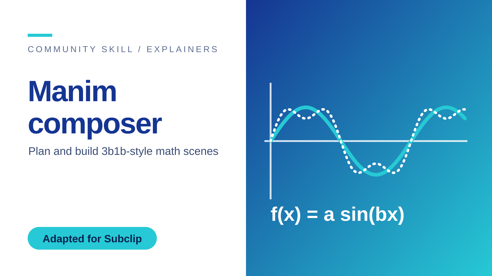</a><br>
<a href="skills/manim-composer"><b>Manim composer</b></a><br>
<sub>Plan and build a 3Blue1Brown-style math explainer as animated, narrated motion-layer scenes.</sub><br>
<sub>Adapted from <a href="https://github.com/OpenMontageInc/OpenMontage">OpenMontageInc/OpenMontage</a> by OpenMontageInc</sub>
</td>
</tr>
<tr>
<td width="33%" valign="top">
<a href="skills/vox-director">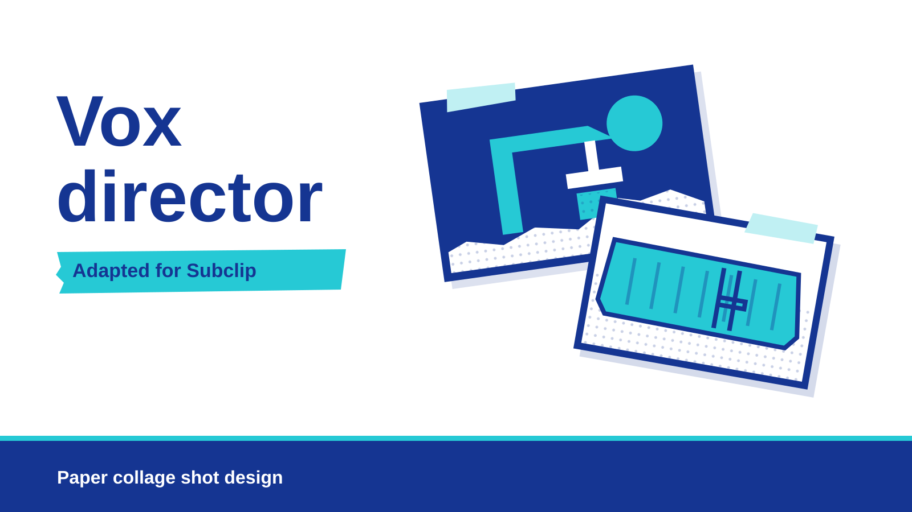</a><br>
<a href="skills/vox-director"><b>Vox director</b></a><br>
<sub>Direct paper-collage explainers with beat maps, theme comparisons, wide-to-detail shot plans and editable motion in Subclip.</sub><br>
<sub>Adapted from <a href="https://github.com/Alisa0808/vox-director">Alisa0808/vox-director</a> by Alisa0808</sub>
</td>
<td width="33%" valign="top">
<a href="skills/vox-explainer"></a><br>
<a href="skills/vox-explainer"><b>Vox explainer</b></a><br>
<sub>One topic in, a finished Vox-style explainer.</sub><br>
<sub>Adapted from <a href="https://github.com/CK42BB/vox-explainer-skill">CK42BB/vox-explainer-skill</a> by Kingsley</sub>
</td>
<td width="33%"></td>
</tr>
</table>

### Slides

<table>
<tr>
<td width="33%" valign="top">
<a href="skills/frontend-slides">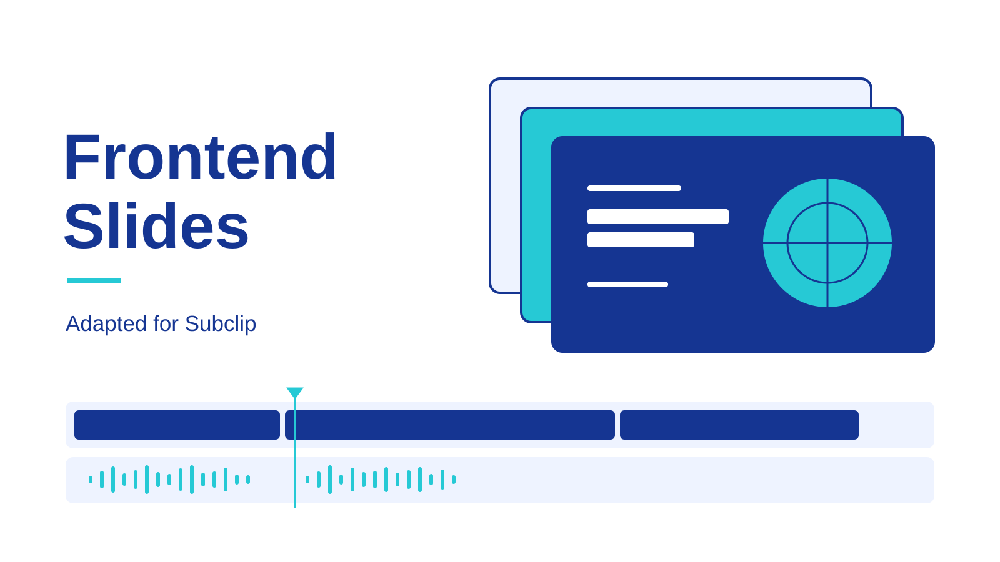</a><br>
<a href="skills/frontend-slides"><b>Frontend Slides</b></a><br>
<sub>Turn a slide outline into editable animated scenes with optional narration and captions, ready to export as video.</sub><br>
<sub>Adapted from <a href="https://github.com/zarazhangrui/frontend-slides">zarazhangrui/frontend-slides</a> by zarazhangrui</sub>
</td>
<td width="33%"></td>
<td width="33%"></td>
</tr>
</table>

### Motion graphics

<table>
<tr>
<td width="33%" valign="top">
<a href="skills/bang-motion">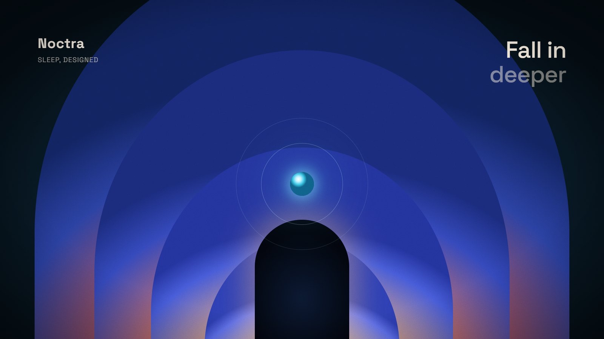</a><br>
<a href="skills/bang-motion"><b>Bang Motion</b></a><br>
<sub>Brand-led openers, kinetic type, product demos and six explainer styles as editable Subclip motion layers.</sub><br>
<sub>Adapted from <a href="https://github.com/bangtutorial/bang-motion">bangtutorial/bang-motion</a> by bangtutorial</sub>
</td>
<td width="33%" valign="top">
<a href="skills/code-motion-styles">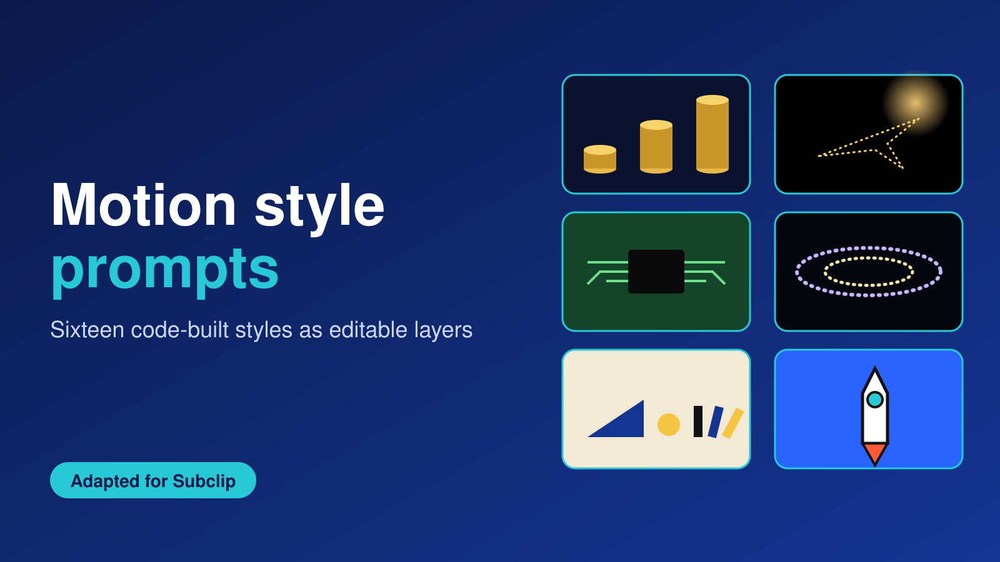</a><br>
<a href="skills/code-motion-styles"><b>Motion style prompts</b></a><br>
<sub>Sixteen new code-built motion styles (3D charts, line-art diagrams, glow sketch, cel anime, brick world, galaxy, glitch cut) as editable layers.</sub><br>
<sub>Adapted from <a href="https://www.its-applied-ai.com/r/styles">www.its-applied-ai.com/r/styles</a> by Applied AI</sub>
</td>
<td width="33%" valign="top">
<a href="skills/huashu-art-motion">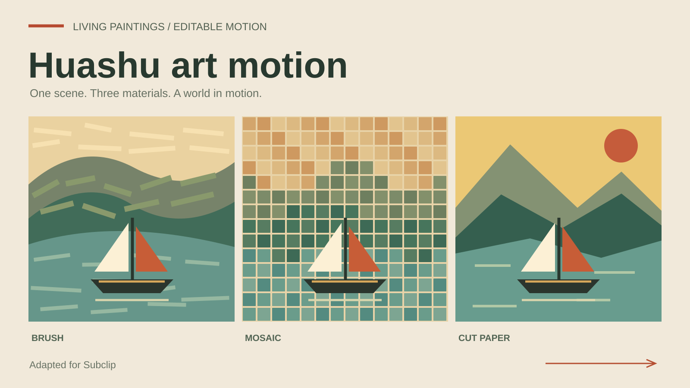</a><br>
<a href="skills/huashu-art-motion"><b>Huashu art motion</b></a><br>
<sub>Living paintings, art-history journeys and nine explainer animation grammars on an editable Subclip timeline.</sub><br>
<sub>Adapted from <a href="https://github.com/alchaincyf/huashu-art-motion">alchaincyf/huashu-art-motion</a> by alchaincyf</sub>
</td>
</tr>
<tr>
<td width="33%" valign="top">
<a href="skills/open-design-motion">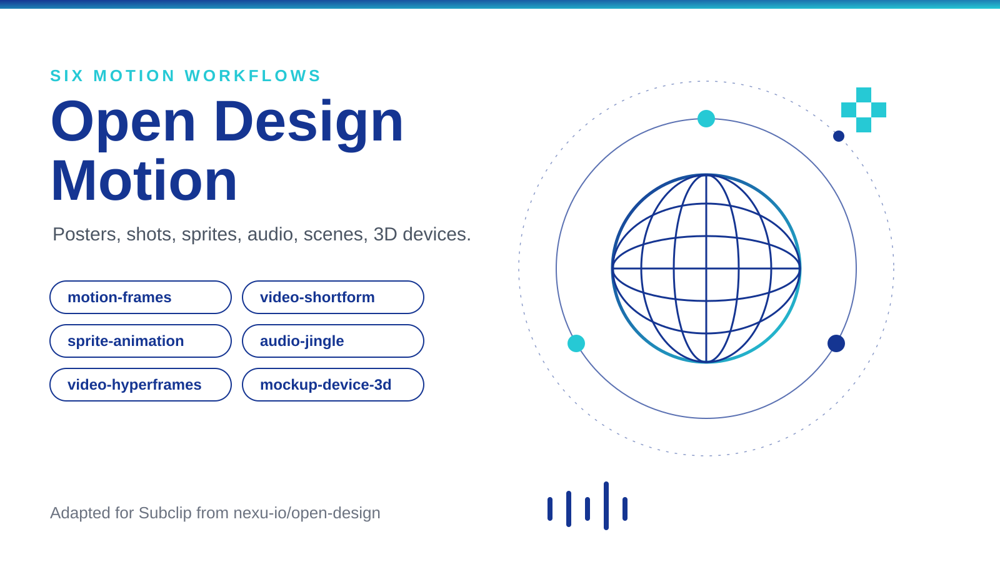</a><br>
<a href="skills/open-design-motion"><b>Open Design Motion</b></a><br>
<sub>Six editable Subclip workflows for animated posters, short shots, pixel sprites, audio, explainers and 3D device showcases.</sub><br>
<sub>Adapted from <a href="https://github.com/nexu-io/open-design">nexu-io/open-design</a> by nexu-io</sub>
</td>
<td width="33%"></td>
<td width="33%"></td>
</tr>
</table>

### 3D

<table>
<tr>
<td width="33%" valign="top">
<a href="skills/3d-myth-short">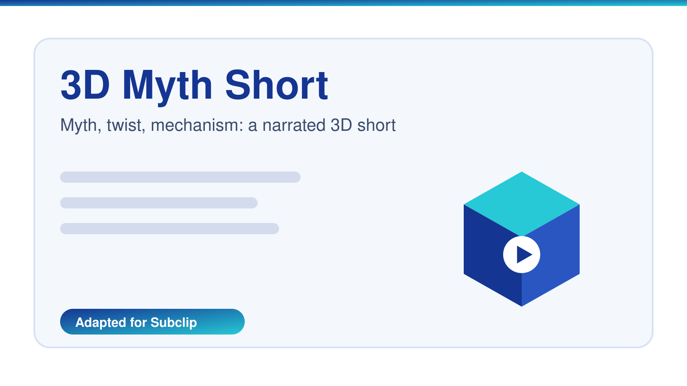</a><br>
<a href="skills/3d-myth-short"><b>3D myth short</b></a><br>
<sub>One idea in, a narrated 30 second 3D animated short: the myth, the twist and the real mechanism, built on the timeline.</sub><br>
<sub>Adapted from <a href="https://app.notion.com/p/Claude-Creative-Skill-Library-Vol-2-3ffb5f1fde2d81938bb9eb76ea6c60d1">app.notion.com/p/Claude-Creative-Skill-Library-Vol-2-3ffb5f1fde2d81938bb9eb76ea6c60d1</a> by PYNK Society</sub>
</td>
<td width="33%" valign="top">
<a href="skills/blender-to-subclip">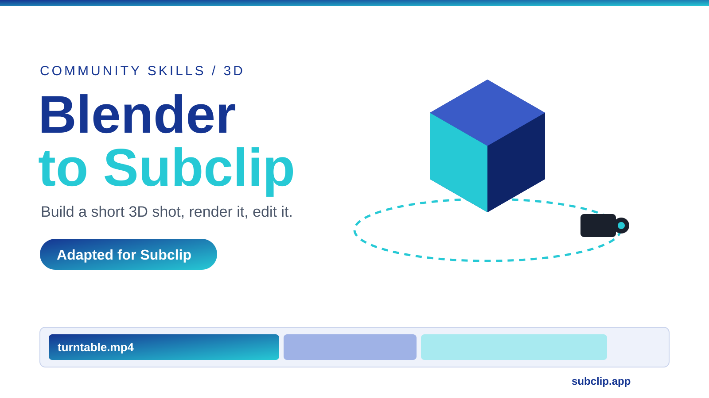</a><br>
<a href="skills/blender-to-subclip"><b>Blender to Subclip</b></a><br>
<sub>Build and review a short Blender shot, then place the rendered clip or stills on an editable Subclip timeline.</sub><br>
<sub>Adapted from <a href="https://github.com/ahujasid/mcp-for-blender">ahujasid/mcp-for-blender</a> by Siddharth Ahuja</sub>
</td>
<td width="33%" valign="top">
<a href="skills/r3f-physics-and-effects">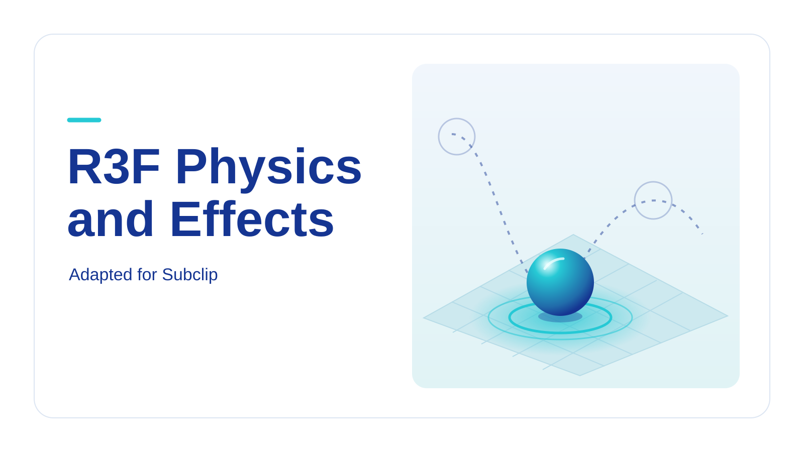</a><br>
<a href="skills/r3f-physics-and-effects"><b>R3F Physics and Effects</b></a><br>
<sub>Build editable 3D impact shots with bouncing bodies, contact cues, and luminous accents.</sub><br>
<sub>Adapted from <a href="https://github.com/pmndrs/react-three-rapier">pmndrs/react-three-rapier</a> by Poimandres</sub>
</td>
</tr>
<tr>
<td width="33%" valign="top">
<a href="skills/threejs-3d-scenes">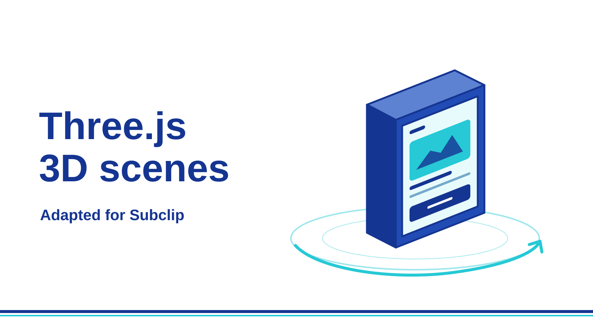</a><br>
<a href="skills/threejs-3d-scenes"><b>Three.js 3D scenes</b></a><br>
<sub>Build editable 3D device reveals, camera moves, and product turntables in Subclip.</sub><br>
<sub>Adapted from <a href="https://github.com/mrdoob/three.js">mrdoob/three.js</a> by mrdoob and the three.js contributors</sub>
</td>
<td width="33%"></td>
<td width="33%"></td>
</tr>
</table>

### Pixel art

<table>
<tr>
<td width="33%" valign="top">
<a href="skills/pixelfx">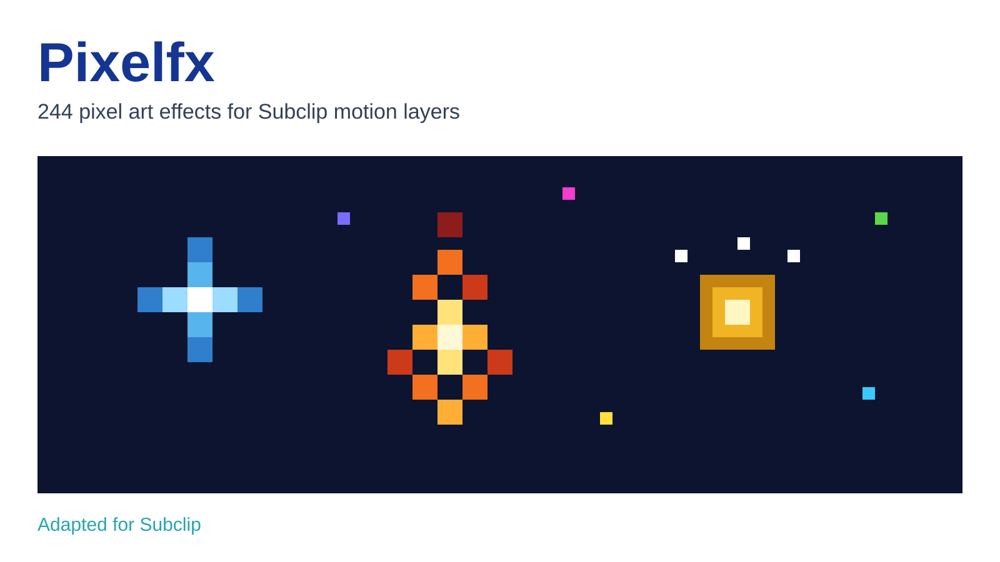</a><br>
<a href="skills/pixelfx"><b>Pixelfx</b></a><br>
<sub>244 pixel art effect recipes (fire, magic, impacts, weather, UI, transitions) for canvas motion layers in Subclip.</sub><br>
<sub>Adapted from <a href="https://github.com/patch-gg/pixelfx">patch-gg/pixelfx</a> by patch-gg</sub>
</td>
<td width="33%"></td>
<td width="33%"></td>
</tr>
</table>

### Animation

<table>
<tr>
<td width="33%" valign="top">
<a href="skills/ai-style-atlas">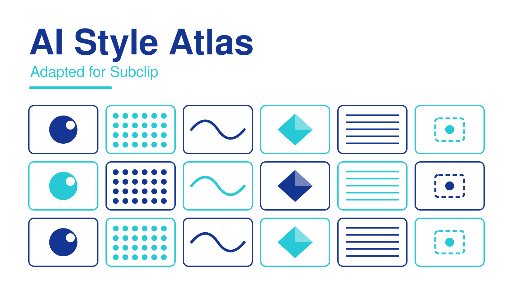</a><br>
<a href="skills/ai-style-atlas"><b>AI Style Atlas</b></a><br>
<sub>Pick any of 86 visual styles by name or mood and restyle an explainer on your topic in that look, built as editable layers.</sub><br>
<sub>Adapted from <a href="https://www.futurepedia.io/resources/ai-style-atlas/view">www.futurepedia.io/resources/ai-style-atlas/view</a> by Futurepedia</sub>
</td>
<td width="33%" valign="top">
<a href="skills/cartoon-animation">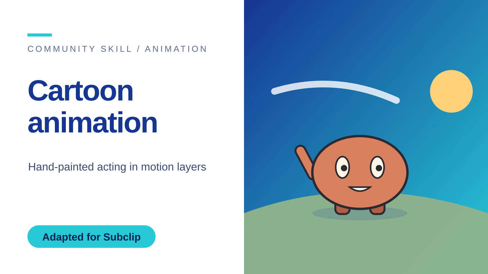</a><br>
<a href="skills/cartoon-animation"><b>Cartoon animation</b></a><br>
<sub>Hand-painted cartoon shots with boiling ink linework, acted emotions and brush-wipe transitions in motion layers.</sub><br>
<sub>Adapted from <a href="https://github.com/JohnHeibel/ClaudeAnimationBase">JohnHeibel/ClaudeAnimationBase</a> by JohnHeibel</sub>
</td>
<td width="33%" valign="top">
<a href="skills/cartoon-episodes">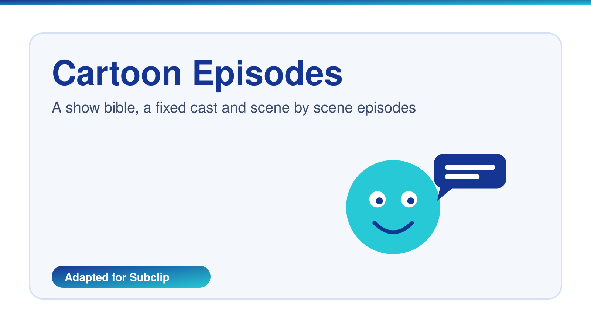</a><br>
<a href="skills/cartoon-episodes"><b>Cartoon episodes</b></a><br>
<sub>Define a show once, then turn one-sentence scenes into consistent AI cartoon clips and cut them into an episode.</sub><br>
<sub>Adapted from <a href="https://app.notion.com/p/Claude-Creative-Skill-Library-Vol-2-3ffb5f1fde2d81938bb9eb76ea6c60d1">app.notion.com/p/Claude-Creative-Skill-Library-Vol-2-3ffb5f1fde2d81938bb9eb76ea6c60d1</a> by PYNK Society</sub>
</td>
</tr>
<tr>
<td width="33%" valign="top">
<a href="skills/character-animation-qa">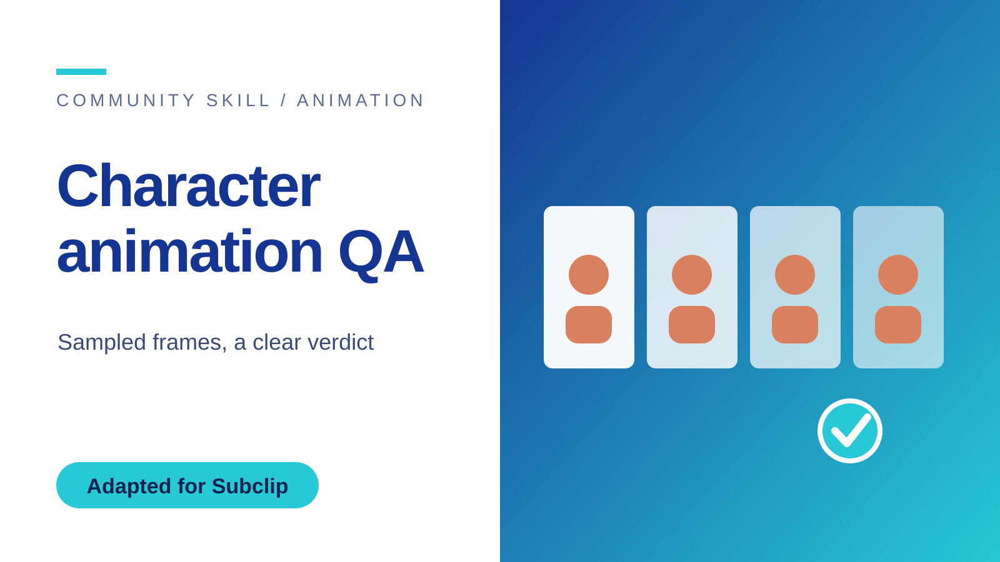</a><br>
<a href="skills/character-animation-qa"><b>Character animation QA</b></a><br>
<sub>Review a character animation with sampled frames, motion checks and a pass, revise or fail verdict.</sub><br>
<sub>Adapted from <a href="https://github.com/OpenMontageInc/OpenMontage">OpenMontageInc/OpenMontage</a> by OpenMontageInc</sub>
</td>
<td width="33%" valign="top">
<a href="skills/claude-drawing-skill">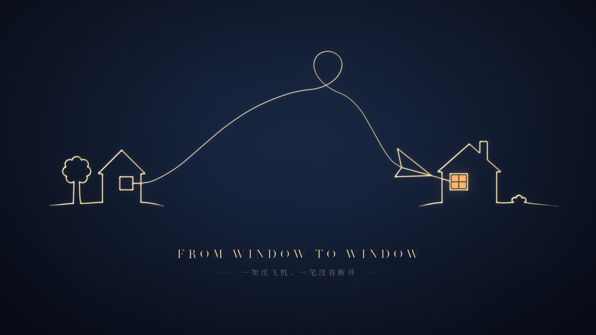</a><br>
<a href="skills/claude-drawing-skill"><b>Claude Drawing</b></a><br>
<sub>Draw ink washes, paper collages and line art in code, then reveal the marks in editable Subclip motion layers.</sub><br>
<sub>Adapted from <a href="https://github.com/cloveric/claude-drawing-skill">cloveric/claude-drawing-skill</a> by cloveric</sub>
</td>
<td width="33%" valign="top">
<a href="skills/motion-polish">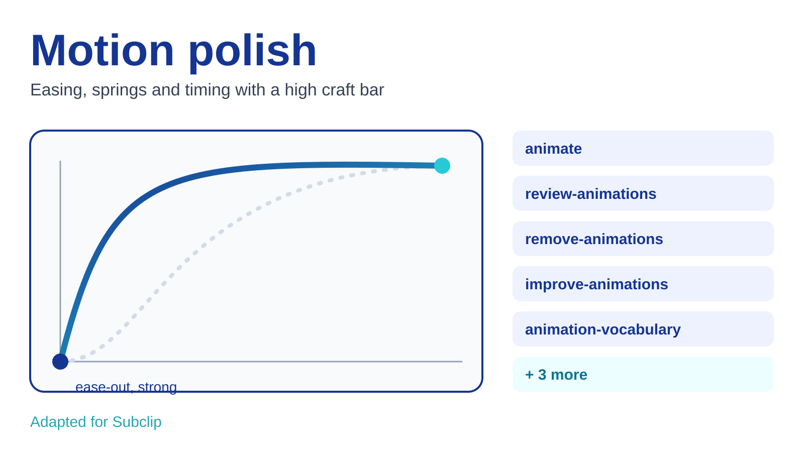</a><br>
<a href="skills/motion-polish"><b>Motion polish</b></a><br>
<sub>Eight skills to animate, review, simplify and name motion on video layers, text and transitions with a high craft bar.</sub><br>
<sub>Adapted from <a href="https://github.com/emilkowalski/skills">emilkowalski/skills</a> by Emil Kowalski</sub>
</td>
</tr>
<tr>
<td width="33%" valign="top">
<a href="skills/paper-cut-motion">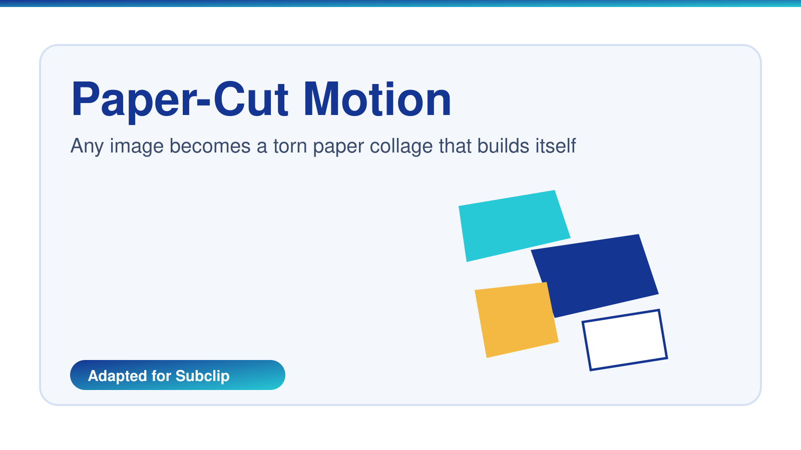</a><br>
<a href="skills/paper-cut-motion"><b>Paper-cut motion</b></a><br>
<sub>Turn any image into a torn paper collage and a video where the scene assembles piece by piece, finished on the Subclip timeline.</sub><br>
<sub>Adapted from <a href="https://app.notion.com/p/Claude-Creative-Skill-Library-Vol-2-3ffb5f1fde2d81938bb9eb76ea6c60d1">app.notion.com/p/Claude-Creative-Skill-Library-Vol-2-3ffb5f1fde2d81938bb9eb76ea6c60d1</a> by PYNK Society</sub>
</td>
<td width="33%" valign="top">
<a href="skills/svg-character-animation">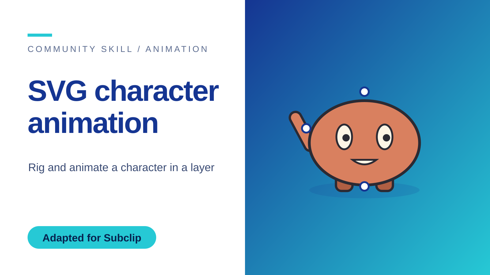</a><br>
<a href="skills/svg-character-animation"><b>SVG character animation</b></a><br>
<sub>Rig and animate an SVG character in an editable Subclip motion layer with readable acting.</sub><br>
<sub>Adapted from <a href="https://github.com/OpenMontageInc/OpenMontage">OpenMontageInc/OpenMontage</a> by OpenMontageInc</sub>
</td>
<td width="33%" valign="top">
<a href="skills/wan-animation-styles">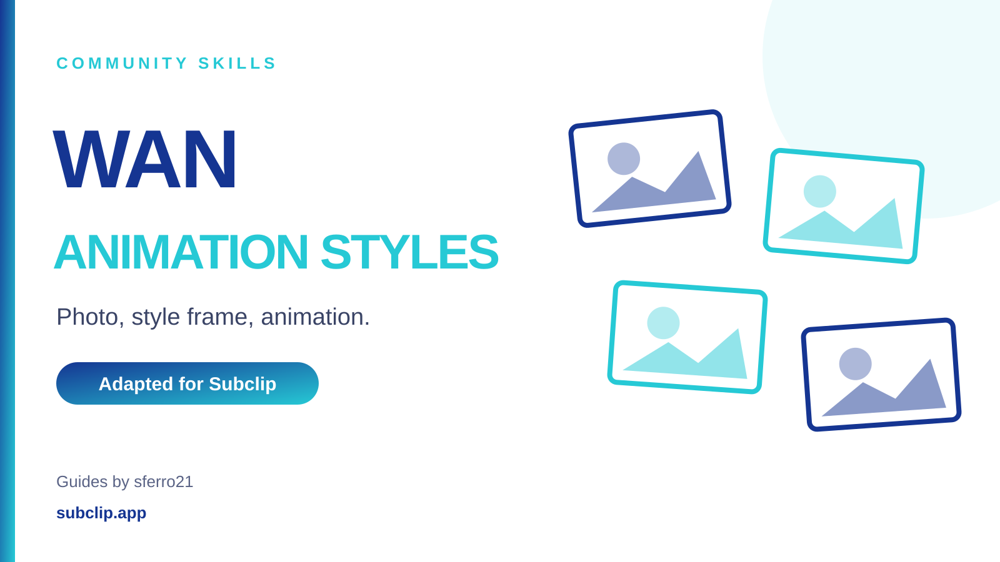</a><br>
<a href="skills/wan-animation-styles"><b>Wan animation styles</b></a><br>
<sub>Photo to style frame to animation in five looks (Expressionism, rubber hose, gothic toon, surreal cartoon, PS1) with Wan 3, plus a multi-shot scene recipe.</sub><br>
<sub>Adapted from <a href="https://www.instagram.com/sferro21">www.instagram.com/sferro21</a> by sferro21</sub>
</td>
</tr>
</table>

### Audio and music

<table>
<tr>
<td width="33%" valign="top">
<a href="skills/cut-to-the-beat">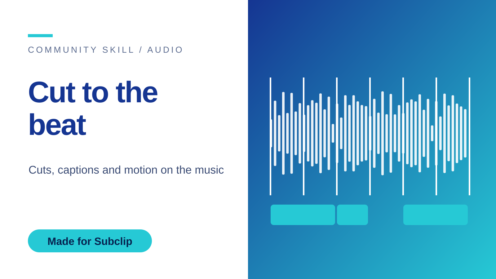</a><br>
<a href="skills/cut-to-the-beat"><b>Cut to the beat</b></a><br>
<sub>Cut footage, captions and motion graphics to the music's beat with a beat map, a frame-snapped cut list and checks.</sub><br>
<sub>Written for Subclip</sub>
</td>
<td width="33%" valign="top">
<a href="skills/earshot">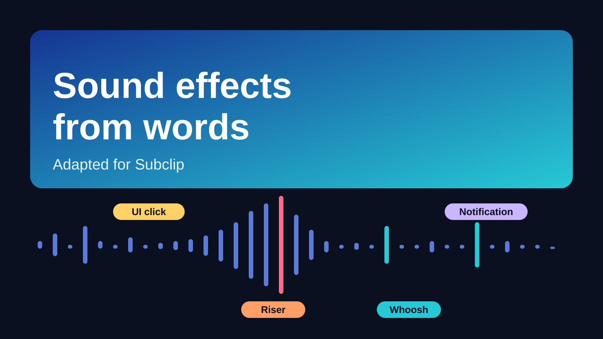</a><br>
<a href="skills/earshot"><b>Sound effects from words</b></a><br>
<sub>Ask for UI clicks, whooshes, risers, impacts and typing in plain words, then place them on the timeline with levels and ducking.</sub><br>
<sub>Adapted from <a href="https://github.com/Leonxlnx/earshot">Leonxlnx/earshot</a> by Leon Lin</sub>
</td>
<td width="33%" valign="top">
<a href="skills/music-to-video">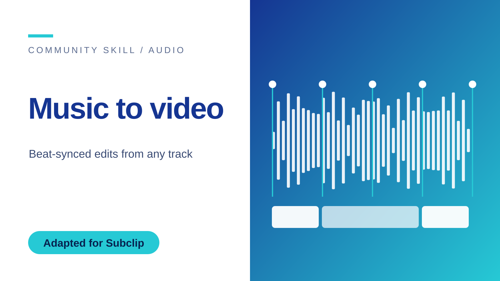</a><br>
<a href="skills/music-to-video"><b>Music to video</b></a><br>
<sub>Turn a music track into a beat-synced video with kinetic type, your own clips and editable motion layers.</sub><br>
<sub>Adapted from <a href="https://github.com/OpenMontageInc/OpenMontage">OpenMontageInc/OpenMontage</a> by OpenMontageInc</sub>
</td>
</tr>
</table>

### Promos

<table>
<tr>
<td width="33%" valign="top">
<a href="skills/ai-ad-formats">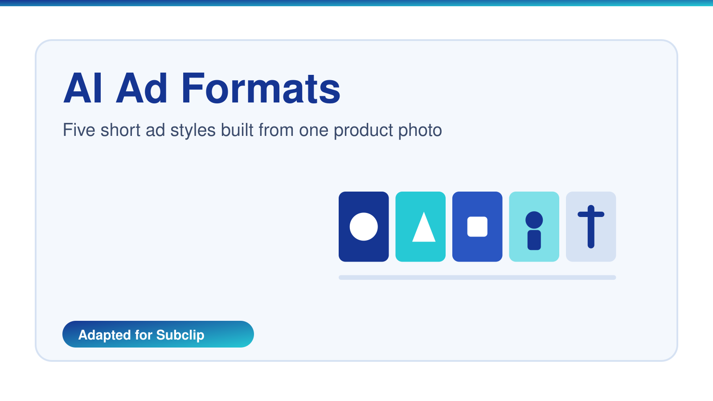</a><br>
<a href="skills/ai-ad-formats"><b>AI ad formats</b></a><br>
<sub>Five ad formats from one product photo: claymation (4 styles), paper animation (5 styles), singing ad, talking object and skeleton progression.</sub><br>
<sub>Adapted from <a href="https://app.notion.com/p/Claude-Creative-Skill-Library-Vol-2-3ffb5f1fde2d81938bb9eb76ea6c60d1">app.notion.com/p/Claude-Creative-Skill-Library-Vol-2-3ffb5f1fde2d81938bb9eb76ea6c60d1</a> by PYNK Society</sub>
</td>
<td width="33%" valign="top">
<a href="skills/commercial-pipeline">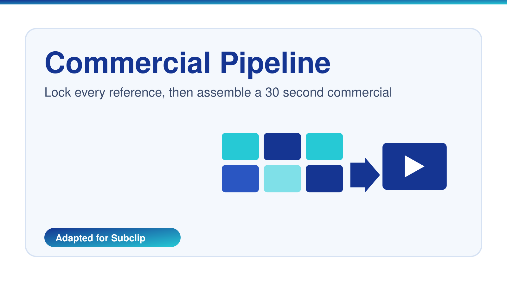</a><br>
<a href="skills/commercial-pipeline"><b>Commercial pipeline</b></a><br>
<sub>Plan 5 to 8 locked reference images, then assemble a 30 second multi-cut AI commercial and fix only what broke.</sub><br>
<sub>Adapted from <a href="https://app.notion.com/p/Claude-Creative-Skill-Library-Vol-2-3ffb5f1fde2d81938bb9eb76ea6c60d1">app.notion.com/p/Claude-Creative-Skill-Library-Vol-2-3ffb5f1fde2d81938bb9eb76ea6c60d1</a> by PYNK Society</sub>
</td>
<td width="33%" valign="top">
<a href="skills/trendjack-animator">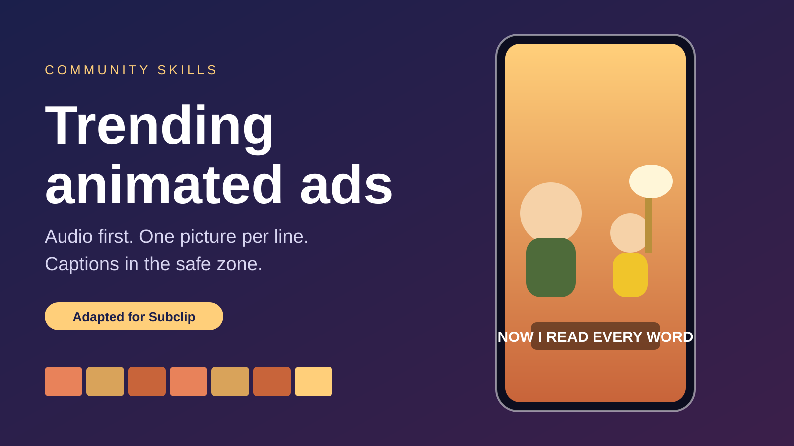</a><br>
<a href="skills/trendjack-animator"><b>Trending animated ads</b></a><br>
<sub>Make trending vertical animated ads (song ad, cartoon story, 3D explainer, skeleton) with audio-first timing and safe-zone captions.</sub><br>
<sub>Adapted from <a href="https://github.com/holy-templar/drama-song-ad">holy-templar/drama-song-ad</a> by Maxfusion AI s.r.o</sub>
</td>
</tr>
<tr>
<td width="33%" valign="top">
<a href="skills/video-shotcraft">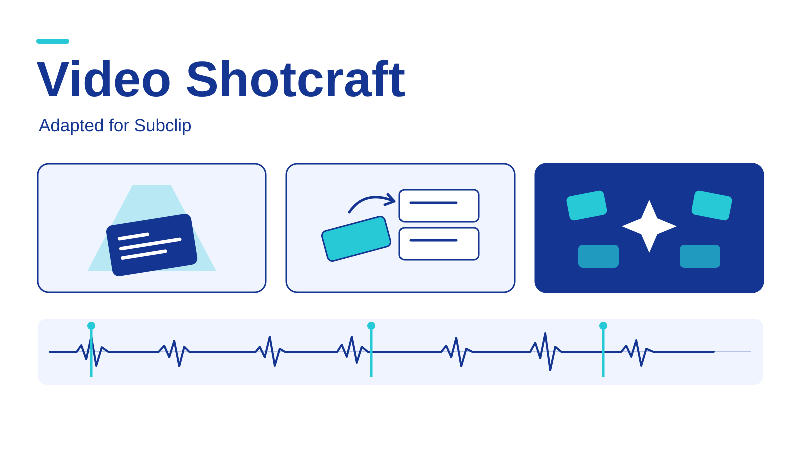</a><br>
<a href="skills/video-shotcraft"><b>Video Shotcraft</b></a><br>
<sub>Build product promos from shot recipes, real product captures, beat-aligned cuts, and editable music and sound effects.</sub><br>
<sub>Adapted from <a href="https://github.com/Vincentwei1021/video-shotcraft">Vincentwei1021/video-shotcraft</a> by Vincentwei1021</sub>
</td>
<td width="33%" valign="top">
<a href="skills/website-to-video">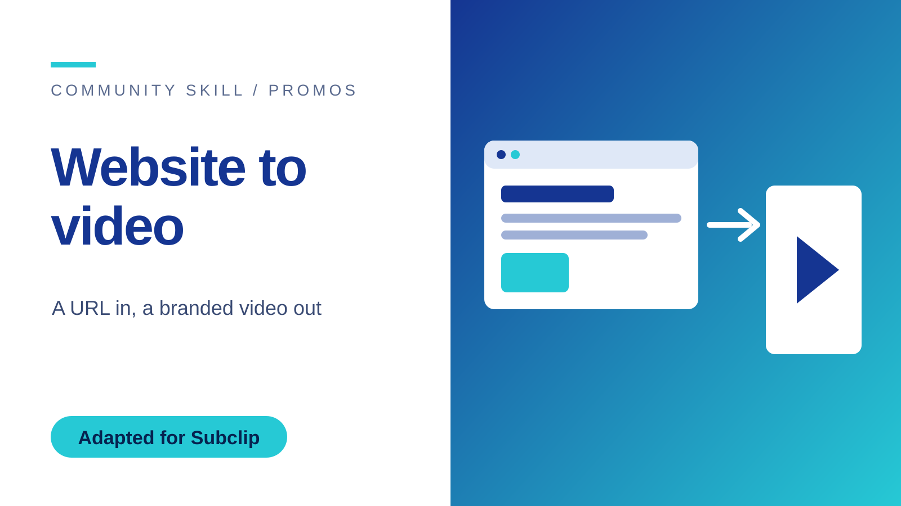</a><br>
<a href="skills/website-to-video"><b>Website to video</b></a><br>
<sub>Turn any public website into a branded video: capture, storyboard, voice, sound and editable motion layers.</sub><br>
<sub>Adapted from <a href="https://github.com/OpenMontageInc/OpenMontage">OpenMontageInc/OpenMontage</a> by OpenMontageInc</sub>
</td>
<td width="33%"></td>
</tr>
</table>

### Templates

<table>
<tr>
<td width="33%" valign="top">
<a href="skills/ai-illustration-styles">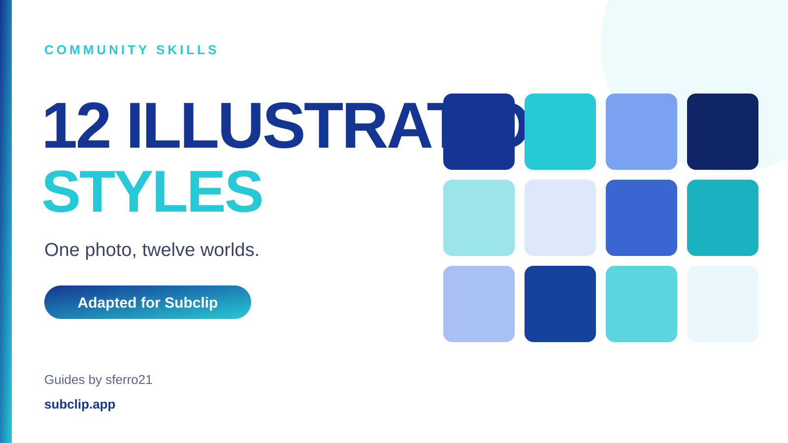</a><br>
<a href="skills/ai-illustration-styles"><b>AI illustration styles</b></a><br>
<sub>Restyle any photo or video frame into 12 illustration looks (UPA, noir, superflat, risograph, anime, gouache and more) with one reusable prompt wrapper.</sub><br>
<sub>Adapted from <a href="https://www.instagram.com/sferro21">www.instagram.com/sferro21</a> by sferro21</sub>
</td>
<td width="33%" valign="top">
<a href="skills/open-design-video-templates">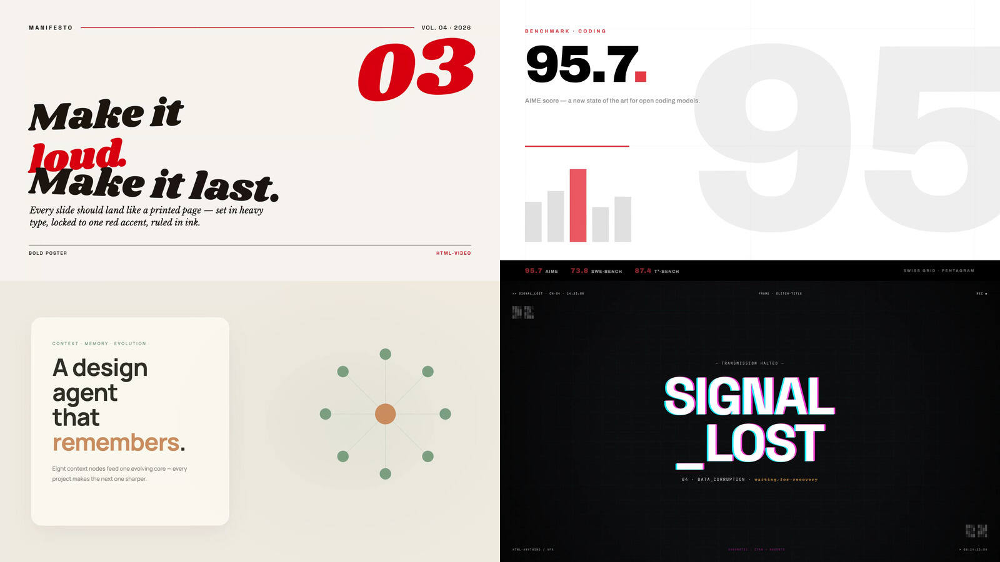</a><br>
<a href="skills/open-design-video-templates"><b>Open Design Video Templates</b></a><br>
<sub>22 editable Subclip motion recipes for kinetic type, editorial data, product promos, diagrams and brand frames.</sub><br>
<sub>Adapted from <a href="https://github.com/nexu-io/open-design">nexu-io/open-design</a> by nexu-io</sub>
</td>
<td width="33%" valign="top">
<a href="skills/portrait-style-prompts">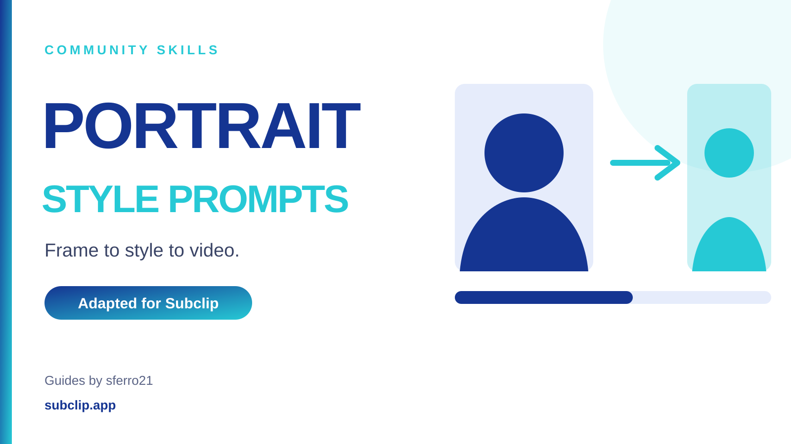</a><br>
<a href="skills/portrait-style-prompts"><b>Portrait style prompts</b></a><br>
<sub>Turn a frame of your video into a styled portrait (anime, watercolour, pixel art, noir, paper cut) with a seven-slot prompt, then make a video in that style.</sub><br>
<sub>Adapted from <a href="https://www.instagram.com/sferro21">www.instagram.com/sferro21</a> by sferro21</sub>
</td>
</tr>
</table>

### Workflows

<table>
<tr>
<td width="33%" valign="top">
<a href="skills/ai-edit-battle">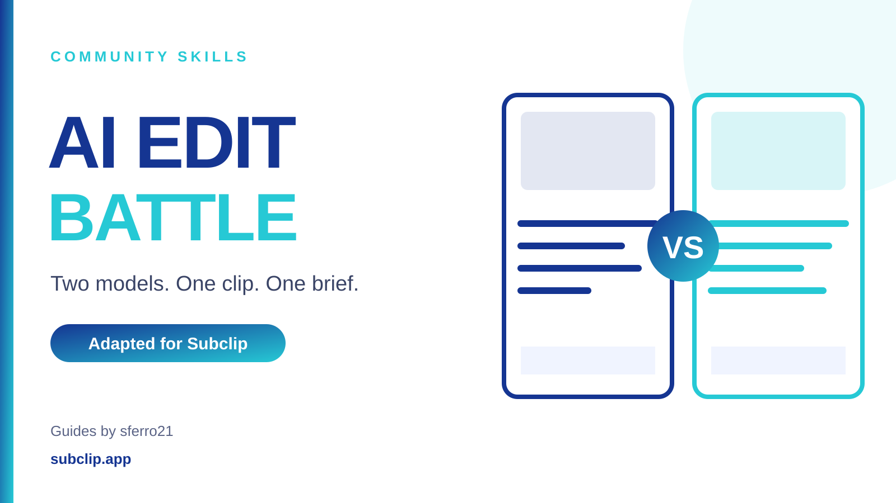</a><br>
<a href="skills/ai-edit-battle"><b>AI edit battle</b></a><br>
<sub>Two AI models or agents edit the same clip from the same brief in cloned projects. Compare, score and pick a winner.</sub><br>
<sub>Adapted from <a href="https://www.instagram.com/sferro21">www.instagram.com/sferro21</a> by sferro21</sub>
</td>
<td width="33%" valign="top">
<a href="skills/ai-video-editor-cooked">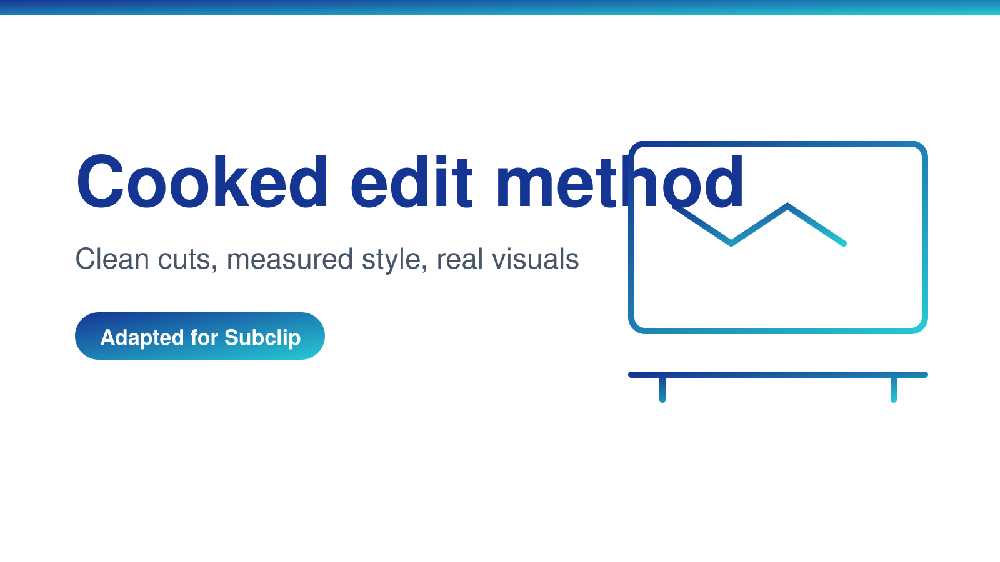</a><br>
<a href="skills/ai-video-editor-cooked"><b>Cooked edit method</b></a><br>
<sub>A talking-head edit method: retake-aware cuts, a measured reference style, real visuals timed to the words, and a ban list of AI-made looks.</sub><br>
<sub>Adapted from <a href="https://github.com/nextwork-projects/ai-video-editor-cooked">nextwork-projects/ai-video-editor-cooked</a> by NextWork</sub>
</td>
<td width="33%" valign="top">
<a href="skills/code-video-recipes">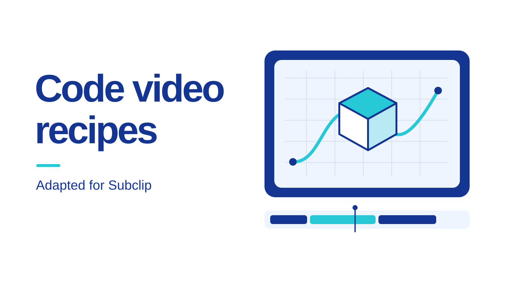</a><br>
<a href="skills/code-video-recipes"><b>Code video recipes</b></a><br>
<sub>Turn code-made video references into editable Subclip motion graphics, explainers, 3D shots and scripted demos.</sub><br>
<sub>Adapted from <a href="https://github.com/yihui-dev/awesome-opus5-5-videos">yihui-dev/awesome-opus5-5-videos</a> by yihui-dev</sub>
</td>
</tr>
<tr>
<td width="33%" valign="top">
<a href="skills/higgsfield-to-subclip">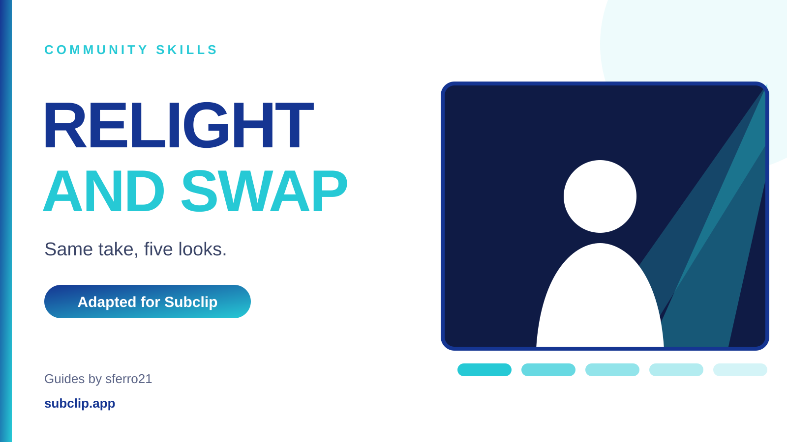</a><br>
<a href="skills/higgsfield-to-subclip"><b>Relight and background swap</b></a><br>
<sub>Change the background or lighting of real footage and keep face, lips and timing. Five relight looks, edit by prompt and a stacked reel, all in Subclip.</sub><br>
<sub>Adapted from <a href="https://www.instagram.com/sferro21">www.instagram.com/sferro21</a> by sferro21</sub>
</td>
<td width="33%" valign="top">
<a href="skills/video-translate">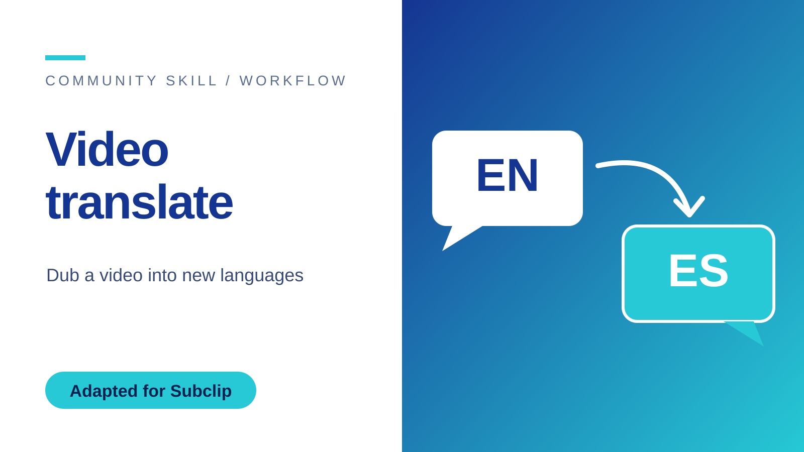</a><br>
<a href="skills/video-translate"><b>Video translate</b></a><br>
<sub>Translate and dub a video into one or more languages with per-speaker voices, timing checks and optional lip-sync.</sub><br>
<sub>Adapted from <a href="https://github.com/OpenMontageInc/OpenMontage">OpenMontageInc/OpenMontage</a> by OpenMontageInc</sub>
</td>
<td width="33%"></td>
</tr>
</table>

### B-roll

<table>
<tr>
<td width="33%" valign="top">
<a href="skills/ai-camera-shots">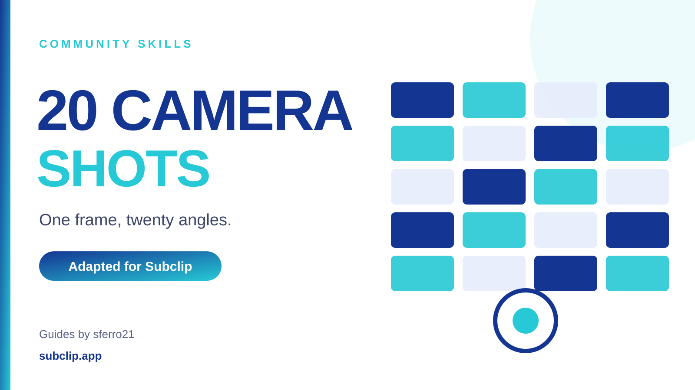</a><br>
<a href="skills/ai-camera-shots"><b>AI camera shots</b></a><br>
<sub>One frame, twenty camera angles. Prompt formula, a catalog of 20 shots, Subclip video models and native keyframe fakes, cut to the beat.</sub><br>
<sub>Adapted from <a href="https://www.instagram.com/sferro21">www.instagram.com/sferro21</a> by sferro21</sub>
</td>
<td width="33%" valign="top">
<a href="skills/gbro-collage-broll">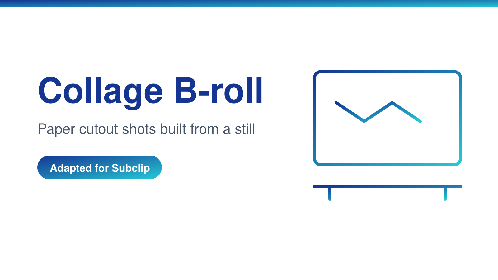</a><br>
<a href="skills/gbro-collage-broll"><b>Collage B-roll</b></a><br>
<sub>Turn one spoken line into a halftone paper-collage B-roll clip, approved at two gates before any video credits are spent.</sub><br>
<sub>Adapted from <a href="https://github.com/pyang5166/gbro-collage-broll">pyang5166/gbro-collage-broll</a> by pyang5166</sub>
</td>
<td width="33%"></td>
</tr>
</table>

### Clipping

<table>
<tr>
<td width="33%" valign="top">
<a href="skills/long-to-shorts">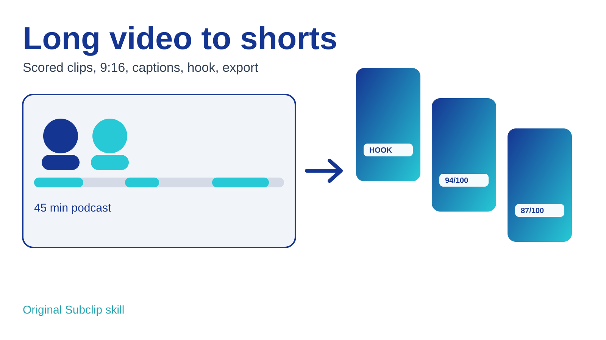</a><br>
<a href="skills/long-to-shorts"><b>Long video to shorts</b></a><br>
<sub>Turn a long video into several ready-to-post vertical shorts with hooks, captions and music.</sub><br>
<sub>Written for Subclip</sub>
</td>
<td width="33%"></td>
<td width="33%"></td>
</tr>
</table>

<!-- skills:end -->

## Install it yourself

Some upstream licenses do not allow us to adapt and redistribute a skill for commercial use. See [Install it yourself](INSTALL_YOURSELF.md) for links to the originals and installation steps. Those projects are separate from this curated directory.

## Submit your video editing skill

[Submit your video editing skill](CONTRIBUTING.md). You can write one for Subclip or convert an existing skill with the instructions in [AGENTS.md](AGENTS.md).

## Develop this directory

Use Node.js 22. No dependency installation is needed.

```sh
npm run build
npm run check
npm run scan
npm test
```

`registry.json` and the table above are generated files. Include their updated versions with your pull request. CI checks metadata, media and licenses, detects stale output, and runs the desktop skill scanner's rules.

## References and credits

Outside sources that inspired skills here, without a licensed adaptation, are listed in [REFERENCES.md](REFERENCES.md).

## License and credits

Our repository files use the [MIT license](LICENSE). Each skill folder keeps its own `LICENSE`, which governs that skill and its adaptations. Some folders may use AGPL-3.0 or Apache-2.0; check the folder before using or redistributing it. Upstream authors are credited in each listing and skill. The first skill, Vox explainer, is MIT.
