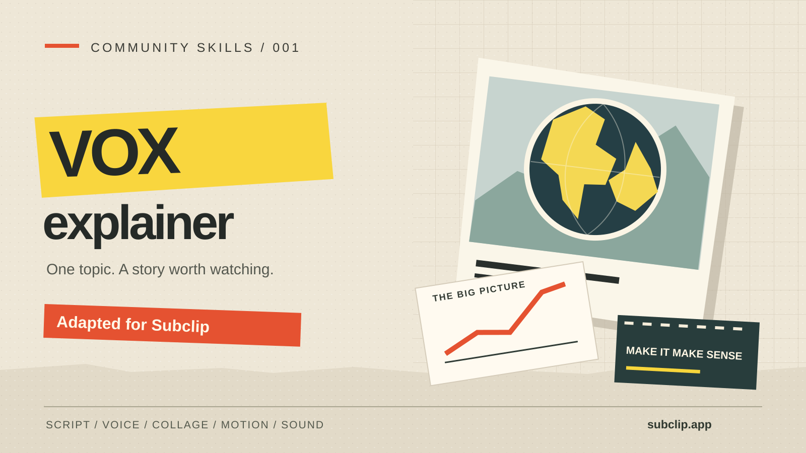

<div align="center">

# Community video editing skills for AI agents

**Ready-made video editing workflows for Claude Code, Codex, Cursor and the in-app agent of the [Subclip AI video editor](https://www.subclip.app).**

[](https://www.subclip.app/agent-skills/community)
[](CONTRIBUTING.md)
[](LICENSE)

</div>

Each skill teaches an agent one way of making videos on an editable Subclip timeline: explainers, motion graphics, slides, 3D, pixel art, captions, music and more. Skills adapted from other projects credit their original authors and keep their licenses.

## Install a skill

- **In the Subclip app:** open **Skills > Browse Community**, choose a skill and install it.
- **From a link:** paste a skill page link (for example `https://www.subclip.app/agent-skills/community/vox-explainer`) or a skill folder link from this repo in **Skills > Add skill**.

Subclip scans the files, your own agent reviews them, and you confirm the install. No Subclip credits are used for the check.

## Skill directory

Generated from each folder's `skill.yml` by `npm run build`.

<!-- skills:start -->

<p><b>3</b> skills in 2 categories.</p>

### Explainers

<table>
<tr>
<td width="33%" valign="top">
<a href="skills/vox-explainer"></a><br>
<a href="skills/vox-explainer"><b>Vox explainer</b></a><br>
<sub>One topic in, a finished Vox-style explainer.</sub><br>
<sub>Adapted from <a href="https://github.com/CK42BB/vox-explainer-skill">CK42BB/vox-explainer-skill</a> by Kingsley</sub>
</td>
<td width="33%"></td>
<td width="33%"></td>
</tr>
</table>

### Motion graphics

<table>
<tr>
<td width="33%" valign="top">
<a href="skills/bang-motion"></a><br>
<a href="skills/bang-motion"><b>Bang Motion</b></a><br>
<sub>Brand-led openers, kinetic type, product demos and six explainer styles as editable Subclip motion layers.</sub><br>
<sub>Adapted from <a href="https://github.com/bangtutorial/bang-motion">bangtutorial/bang-motion</a> by bangtutorial</sub>
</td>
<td width="33%" valign="top">
<a href="skills/huashu-art-motion"></a><br>
<a href="skills/huashu-art-motion"><b>Huashu art motion</b></a><br>
<sub>Living paintings, art-history journeys and nine explainer animation grammars on an editable Subclip timeline.</sub><br>
<sub>Adapted from <a href="https://github.com/alchaincyf/huashu-art-motion">alchaincyf/huashu-art-motion</a> by alchaincyf</sub>
</td>
<td width="33%"></td>
</tr>
</table>

<!-- skills:end -->

## Install it yourself

Some upstream licenses do not allow us to adapt and redistribute a skill for commercial use. See [Install it yourself](INSTALL_YOURSELF.md) for links to the originals and installation steps. Those projects are separate from this curated directory.

## Submit your video editing skill

[Submit your video editing skill](CONTRIBUTING.md). You can write one for Subclip or convert an existing skill with the instructions in [AGENTS.md](AGENTS.md).

## Develop this directory

Use Node.js 22. No dependency installation is needed.

```sh
npm run build
npm run check
npm run scan
npm test
```

`registry.json` and the table above are generated files. Include their updated versions with your pull request. CI checks metadata, media and licenses, detects stale output, and runs the desktop skill scanner's rules.

## License and credits

Our repository files use the [MIT license](LICENSE). Each skill folder keeps its own `LICENSE`, which governs that skill and its adaptations. Some folders may use AGPL-3.0 or Apache-2.0; check the folder before using or redistributing it. Upstream authors are credited in each listing and skill. The first skill, Vox explainer, is MIT.
