Adapted for Subclip from the Notion list Claude Creative Skill Library Vol 2 (https://app.notion.com/p/Claude-Creative-Skill-Library-Vol-2-3ffb5f1fde2d81938bb9eb76ea6c60d1) by PYNK Society

# AI ad formats

Five short ad formats for e-commerce brands in one skill: claymation, paper animation, a singing ad with an original song, a talking object, and a skeleton "what happens if" progression. Each format has its own beats, prompts and edit.

## Use it

Tell your agent: "Use ai-ad-formats, claymation, for <product>" and attach a clean product photo. Name another format to switch.

The five formats and the original commands: claymation (`/claymation`, four sub-styles from goofy clay to premium studio plasticine), paper animation (`/paper-animation`, five sub-styles from layered papercraft to origami, plus paper transitions), singing ad (`/song-style-ad`), talking object (`/talking-object`) and skeleton progression (`/skeleton-ads`, four skeleton styles). Each has its own file in `references/` and the skill starts with a format picker.

## What changed for Subclip

The original skill runs in Claude Code and hands you prompts to paste into outside generators, then cuts with ffmpeg. This version keeps the creative method and does the work in Subclip: generation through `generate_ai_media` (or your own Codex CLI for images), voice through Subclip speech tools, and assembly on the editable timeline. Nothing here needs an outside key, ffmpeg or a script.

<!-- examples:start -->

## Examples

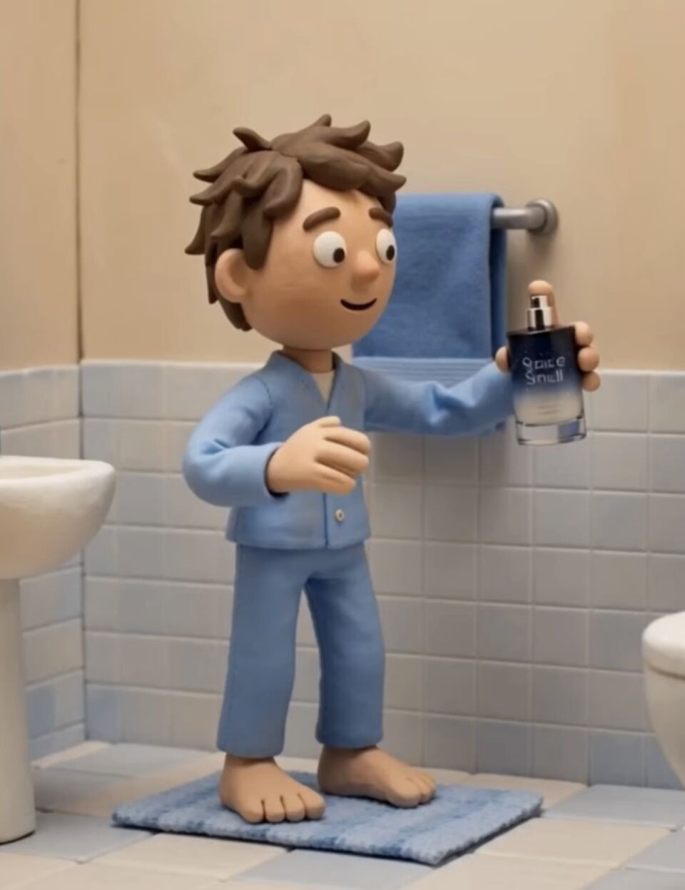 From the creator's list: claymation ad, a clay character holding the product in a clay bathroom.

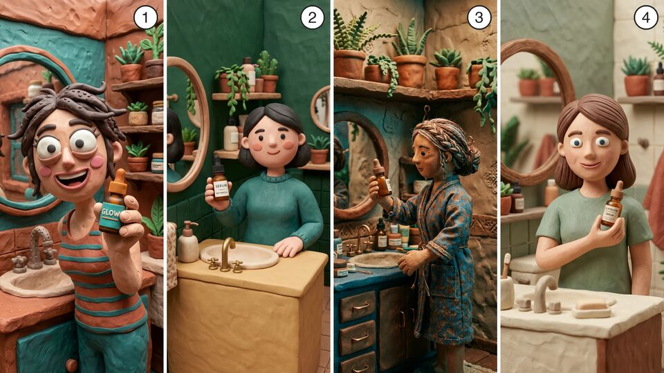 From the creator's list: the four claymation sub-styles side by side, goofy to premium studio plasticine.

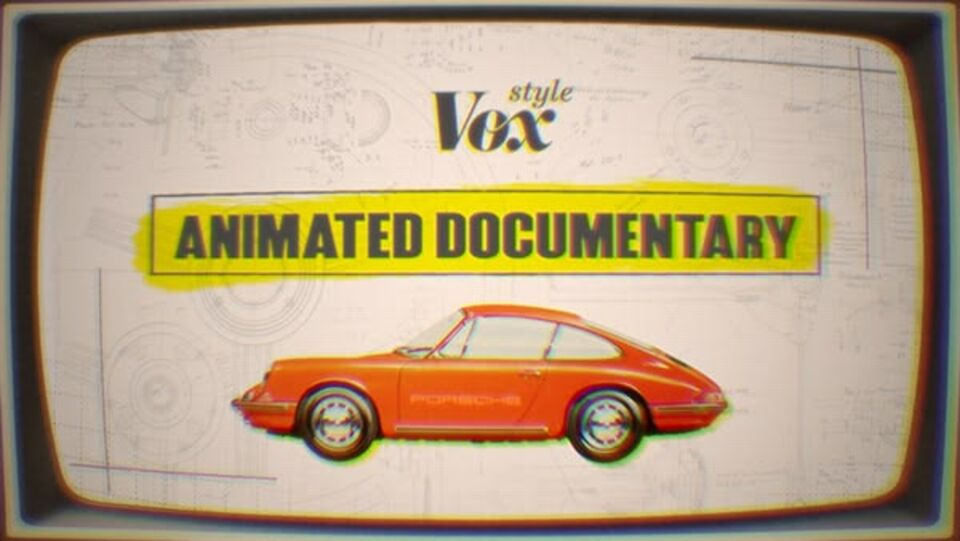 From the creator's list: paper animation entry, a Vox-style animated documentary title card.

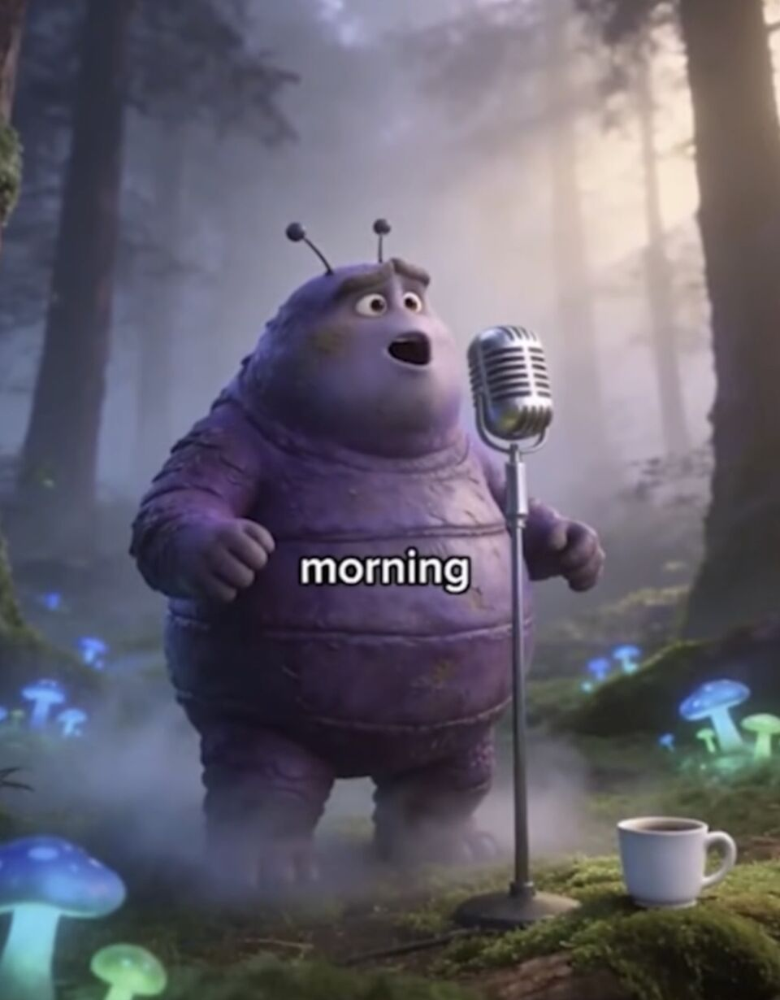 From the creator's list: singing ad, an animated purple creature sings into a mic in a misty forest.

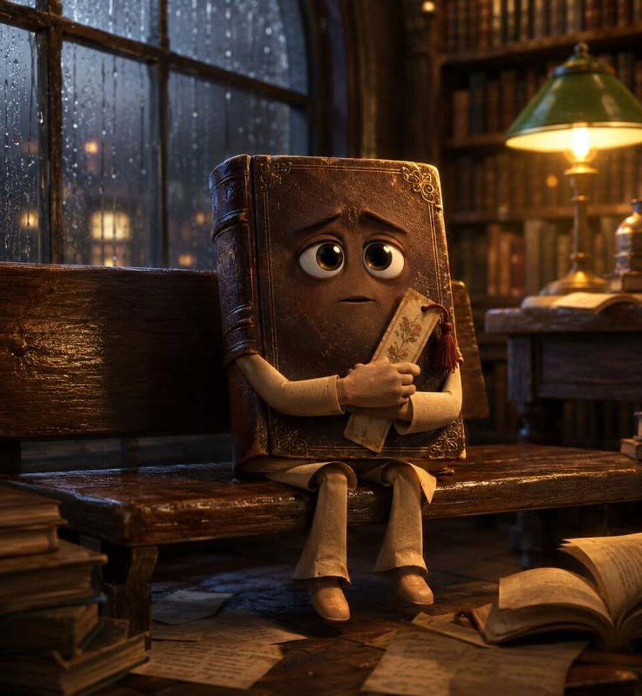 From the creator's list: talking object, an old leather book with a face sitting on a rainy library bench.

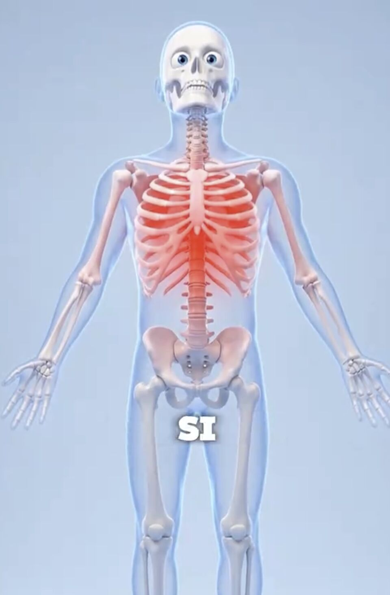 From the creator's list: skeleton progression ad, a see-through body with a cartoon-eyed skeleton.

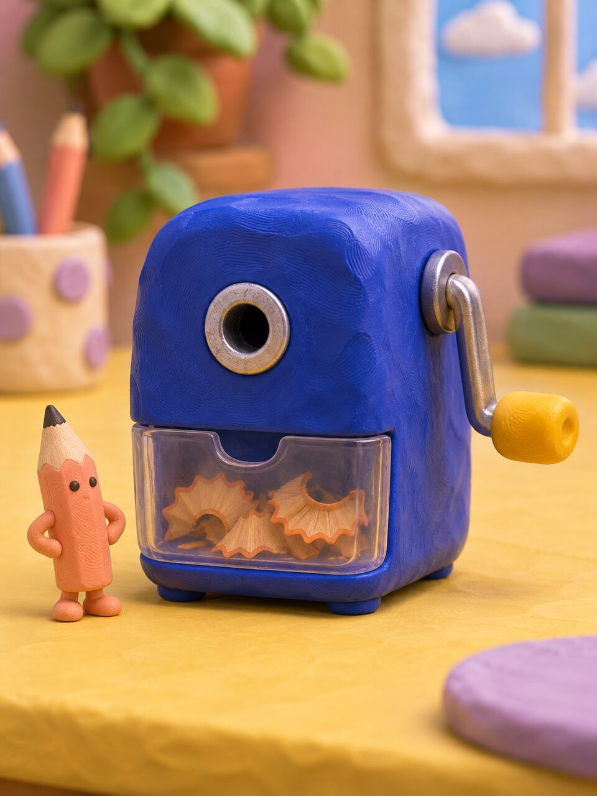 Test output: claymation style lock with a cobalt hand-crank sharpener and a pencil character. Image: gpt-image-2.

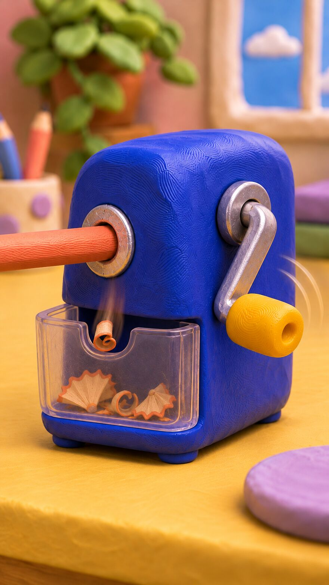 Test output: use beat with the crank, the inserted pencil and shavings falling into the drawer. Image: gpt-image-2.

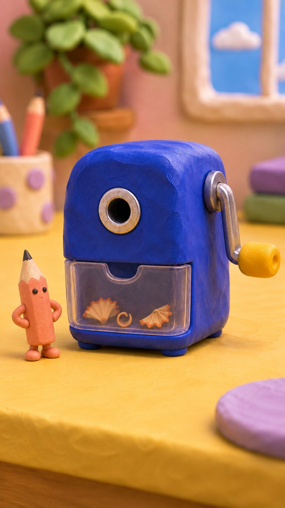 Test output: payoff beat with the sharpened pencil beside the same clay sharpener. Image: gpt-image-2.

 Test output: a clay pencil meets the crank sharpener, then returns with a freshly sharpened tip. Clip: push-in, no video model. <a href="examples/sharpener-in-action.mp4">Play with sound</a>

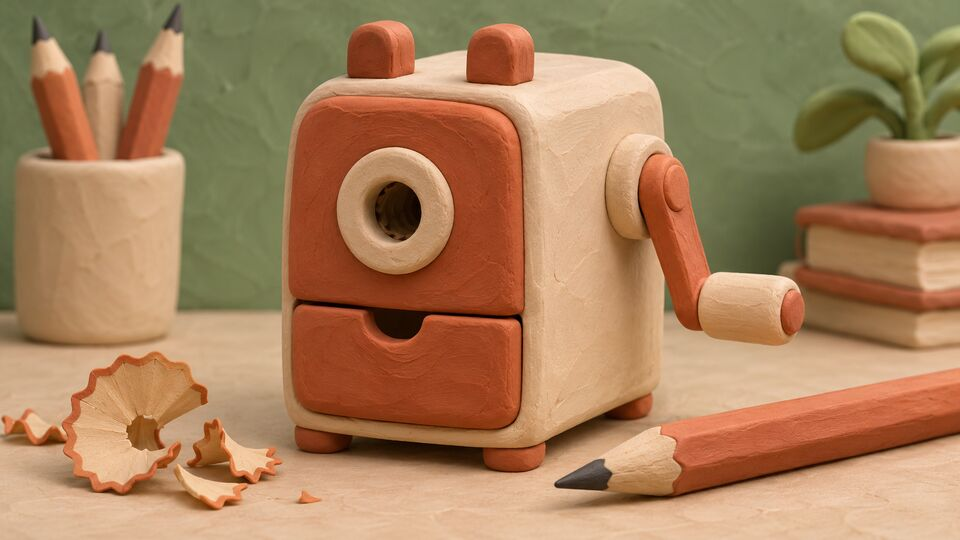 Test output: claymation in premium studio plasticine, with a hand-crank sharpener and a freshly sharpened pencil. Image: gpt-image-2.

 Test output: claymation in premium studio plasticine, with a slow push toward the sharpener. Clip: push-in, no video model. <a href="examples/claymation-clip.mp4">Play with sound</a>

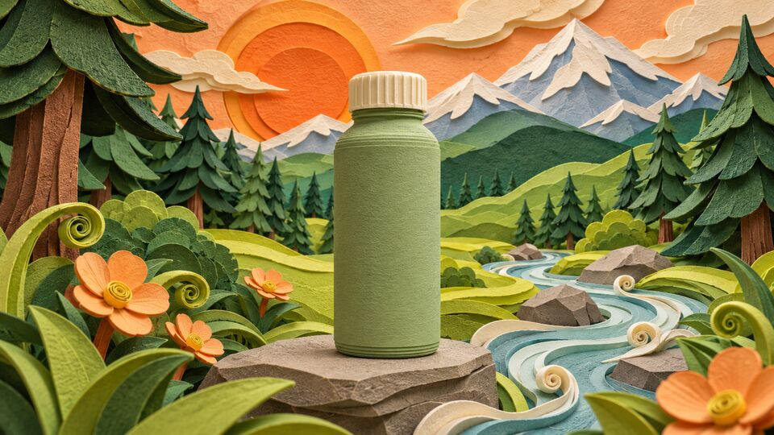 Test output: paper animation in layered papercraft, with a sage bottle in a stacked card landscape. Image: gpt-image-2.

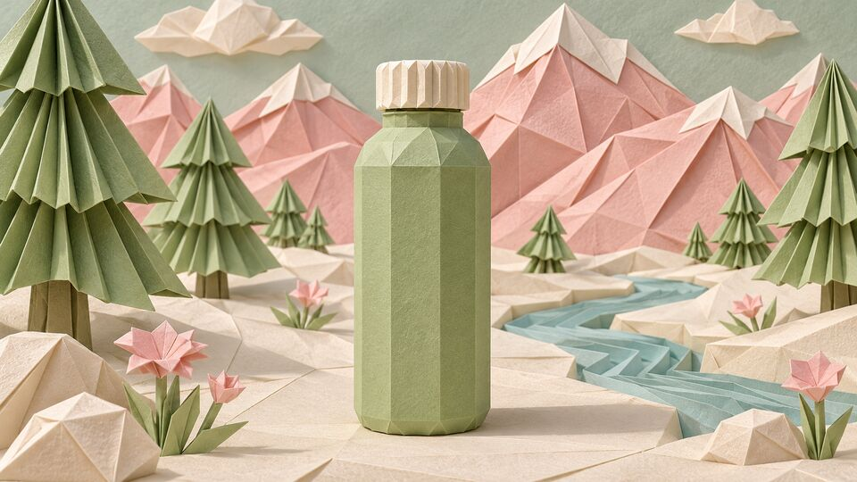 Test output: paper animation in origami, with the same sage bottle in a folded paper landscape. Image: gpt-image-2.

 Test output: paper animation, with a slow push and crossfade from layered papercraft to origami. Clip: push-in, no video model. <a href="examples/paper-animation-clip.mp4">Play with sound</a>

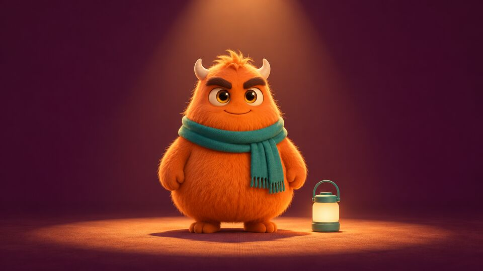 Test output: singing ad in stylized 3D, with the lead creature and its lantern under a spotlight. Image: gpt-image-2.

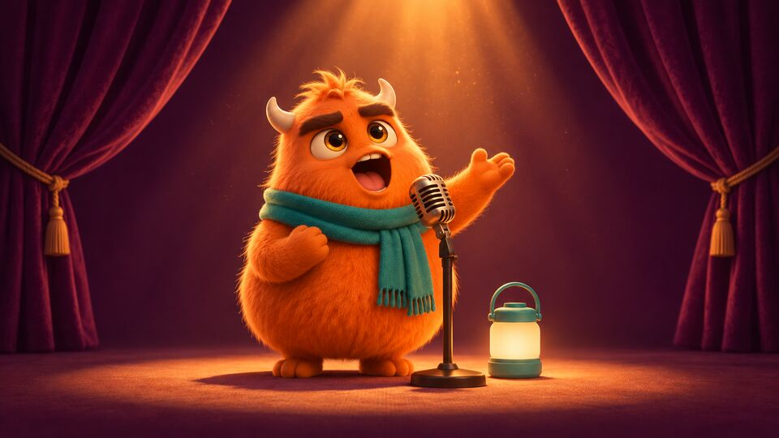 Test output: singing ad in stylized 3D, with the lead creature singing into a microphone. Image: gpt-image-2.

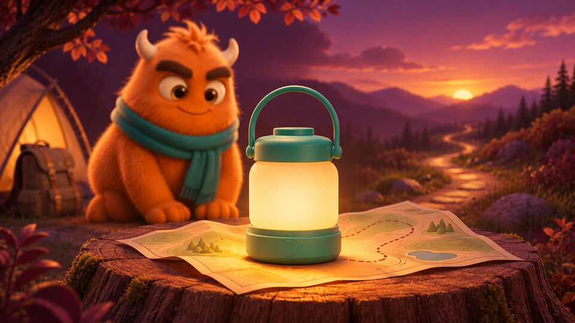 Test output: singing ad in stylized 3D, with the lantern lighting a campsite map. Image: gpt-image-2.

 Test output: singing ad in stylized 3D, with three silent storyboard beats from lead to lantern payoff. <a href="examples/singing-ad-clip.mp4">Play with sound</a>

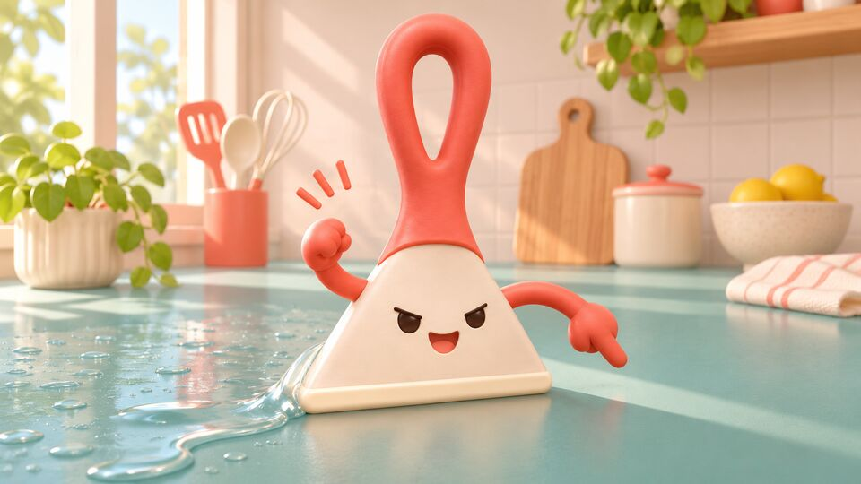 Test output: talking object in stylized 3D. I am a squeegee. I sweep water away. So your counter stays dry. Image: gpt-image-2.

 Test output: talking object in stylized 3D, with a silent push in on a squeegee clearing a spill. Clip: push-in, no video model. <a href="examples/talking-object-clip.mp4">Play with sound</a>

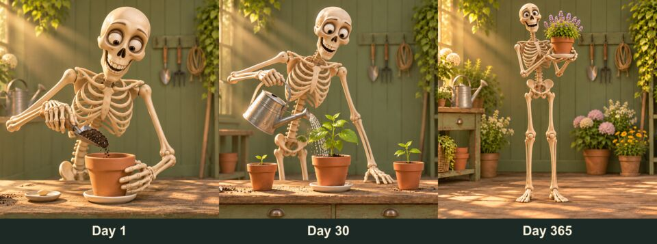 Test output: skeleton progression in cinematic 3D, with a garden growing from Day 1 to Day 365. Image: gpt-image-2.

 Test output: skeleton progression in cinematic 3D, with Day 1, Day 30 and Day 365 shown in sequence. Clip: push-in, no video model. <a href="examples/skeleton-progression-clip.mp4">Play with sound</a>

Notion images from the Claude Creative Skill Library Vol 2 by PYNK Society. Our own test outputs made with this skill in Subclip: images gpt-image-2 (Codex CLI image generation); clips are crossfades and push-ins of those stills, no video model; silent.

<!-- examples:end -->

## Source and license

The skill's own page on the list: https://app.notion.com/p/3b5b5f1fde2d81928e67dfee2cfb6d6c

The list shows no license for this skill. The skill's page and its download pack were read, and this folder describes the method in new words; no upstream text or code is copied. The example images marked "From the creator's list" are the author's own pictures from the skill's page, shown with credit at the request of the Subclip owner. See LICENSE for the notice.

Examples: images from the [Claude Creative Skill Library Vol 2](https://app.notion.com/p/Claude-Creative-Skill-Library-Vol-2-3ffb5f1fde2d81938bb9eb76ea6c60d1) by PYNK Society, plus our own test outputs made with this skill in Subclip.

## Credits: Claude Creative Skill Library Vol 2

This skill comes from the Notion list Claude Creative Skill Library Vol 2: https://app.notion.com/p/Claude-Creative-Skill-Library-Vol-2-3ffb5f1fde2d81938bb9eb76ea6c60d1

Author shown on the list: PYNK Society (PYNK Society - AI Creative Lab, https://www.skool.com/pynk-society/about).
