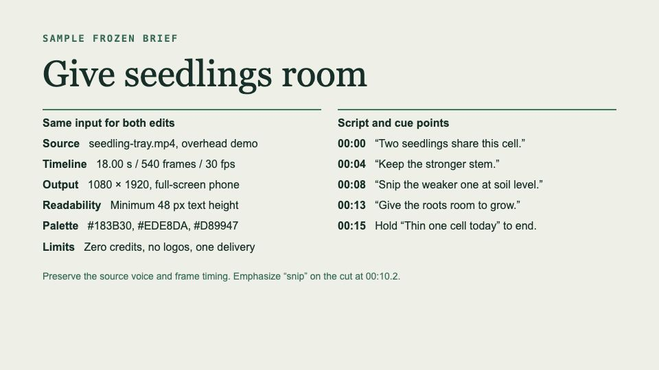
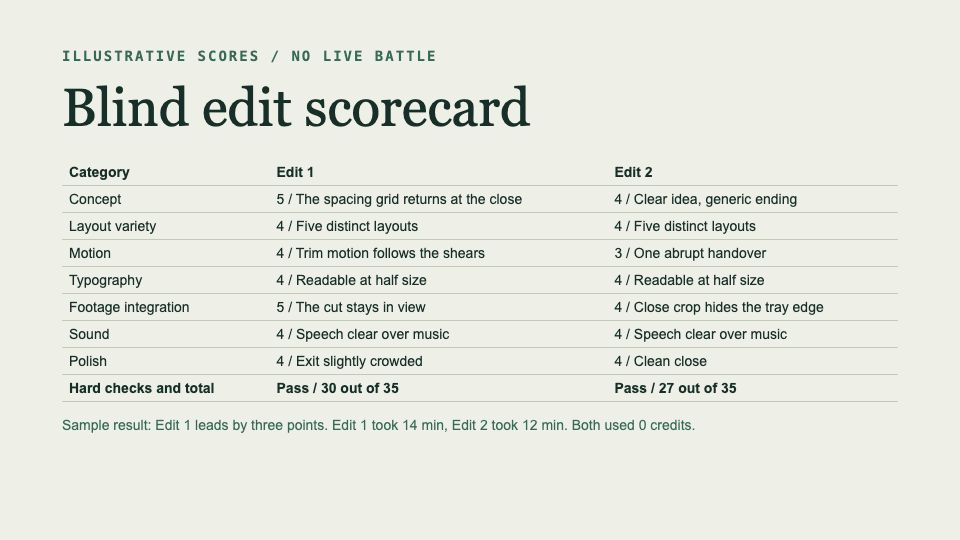

Adapted for Subclip from guides by sferro21 (https://www.instagram.com/sferro21)

# AI edit battle (Subclip edition)

A head-to-head format for any two AI contenders. Each edits the same raw clip from the same brief, alone, in its own cloned Subclip project. You then compare the exports with hard checks and a scorecard and the creator picks a winner. Built from a guide that ran Fable 5.2 against Opus 5.5, rewritten so it works for any two models or agents.

Fair setup, native edits, a scorecard and a side-by-side reveal.

## Install

Add this skill from **Skills > Community** in Subclip, or point your agent at this folder. It works with Claude Code, Codex, Cursor and the in-app agent through Subclip's MCP tools.

## Files

- `SKILL.md`: the workflow the agent follows.
- `references/edit-brief-template.md`: the frozen brief with the craft standards and the fields to fill.
- `references/contender-playbook.md`: the native Subclip tools each contender uses.
- `references/scorecard.md`: hard checks, scored categories and the result sheet.

## How it differs from the original guide

- Outside services, accounts and keys are replaced by Subclip's own generation tools and models. Image generation offers the creator's own Codex CLI first.
- Every model name the guide used is kept when Subclip's live catalog offers it. Where it does not, the closest model is named with the swap.
- Credits are quoted before anything is generated, and edits run one at a time on the native timeline.

<!-- examples:start -->

## Examples

 Sample frozen brief with a shared source, voice cues, and delivery constraints.

 Illustrative blind scorecard with pass checks, seven scored categories, and evidence.

 Seven scoring rows appear before the sample totals for the two blind edits. <a href="examples/blind-scorecard-reveal.mp4">Play with sound</a>

Test outputs made with this skill in Subclip. Rendered in code (HTML, SVG or canvas, HyperFrames, ffmpeg): no image, video or audio model.

<!-- examples:end -->

## Credit and license

Adapted for Subclip from guides by sferro21 (https://www.instagram.com/sferro21). Rewritten in our own words. The creator's guides state no license, so please confirm permission with the creator before relying on this skill.
