Adapted for Subclip from guides by sferro21 (https://www.instagram.com/sferro21)

# AI illustration styles (Subclip edition)

<!-- cli:start -->
> Install from your terminal: `npx @subclip/community-skills install ai-illustration-styles`
<!-- cli:end -->

A reusable restyle prompt and twelve style recipes. Take a frame from your video, pick a look, and optionally animate the result or restyle the whole clip over your original footage.

A prompt wrapper and twelve style recipes.

## Install

Add this skill from **Skills > Community** in Subclip, or point your agent at this folder. It works with Claude Code, Codex, Cursor and the in-app agent through Subclip's MCP tools.

## Files

- `SKILL.md`: the workflow the agent follows.
- `references/styles.md`: the wrapper and all twelve style recipes with their ban lists.

## How it differs from the original guide

- Outside services, accounts and keys are replaced by Subclip's own generation tools and models. Image generation offers the creator's own Codex CLI first.
- Every model name the guide used is kept when Subclip's live catalog offers it. Where it does not, the closest model is named with the swap.
- Credits are quoted before anything is generated, and edits run one at a time on the native timeline.

<!-- examples:start -->

## Examples

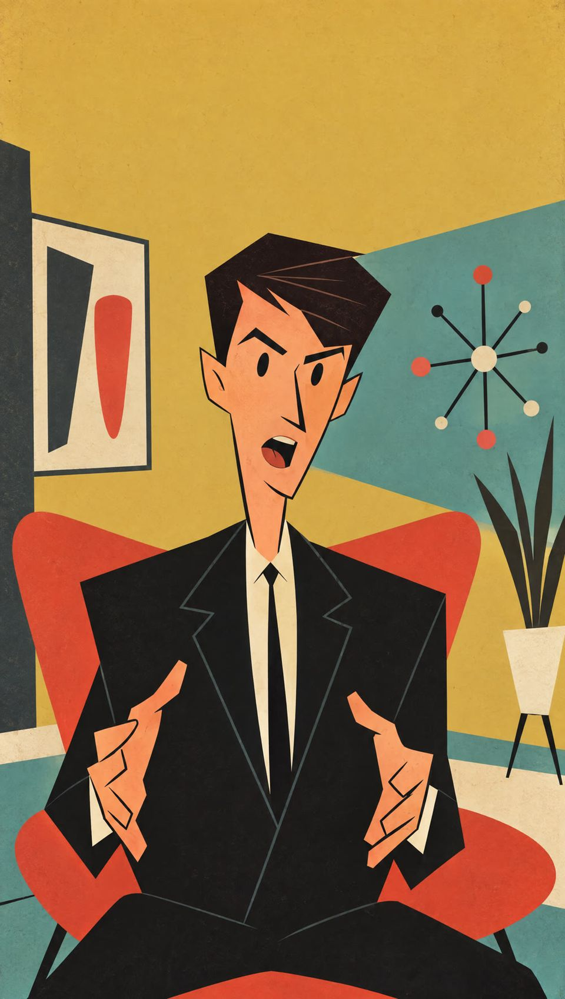 Cartoon Modern (UPA)

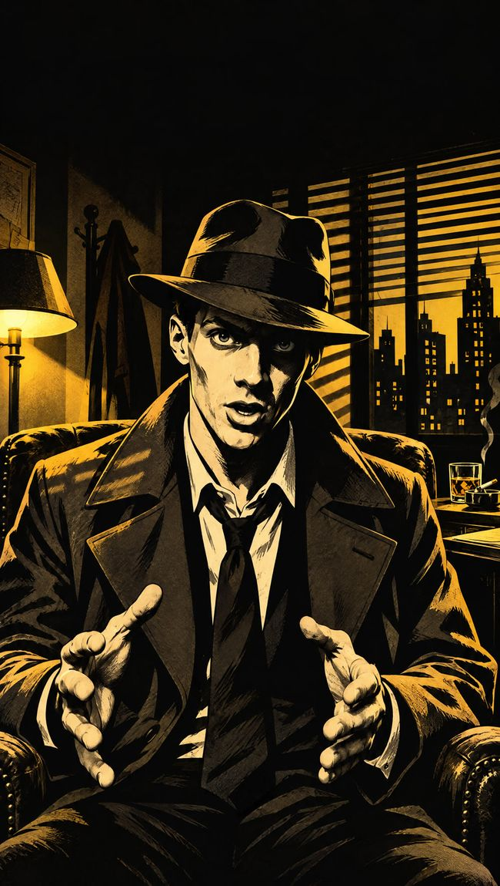 Graphic Noir

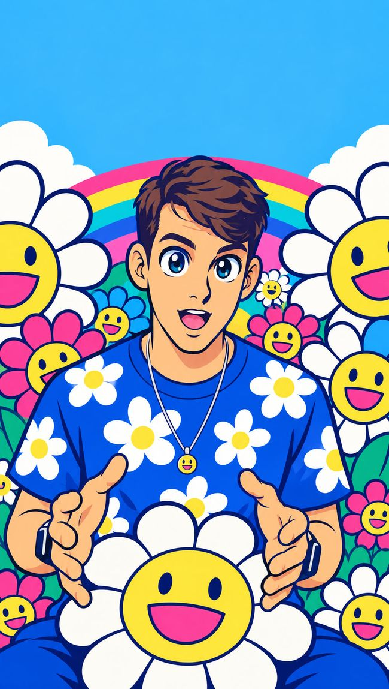 Superflat

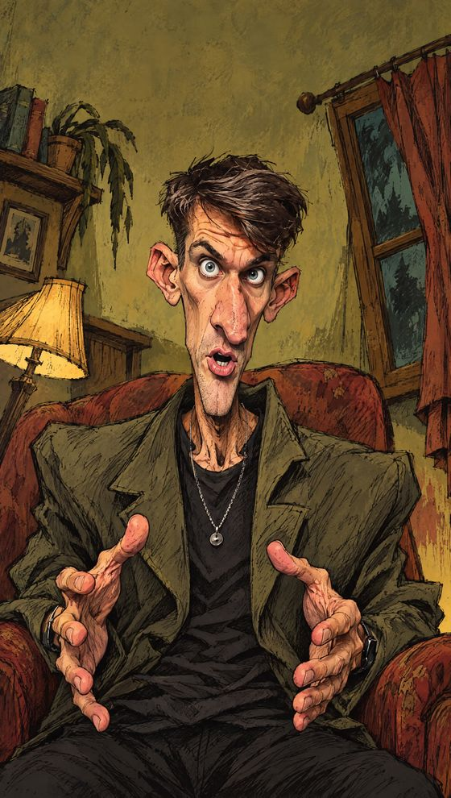 Caricature

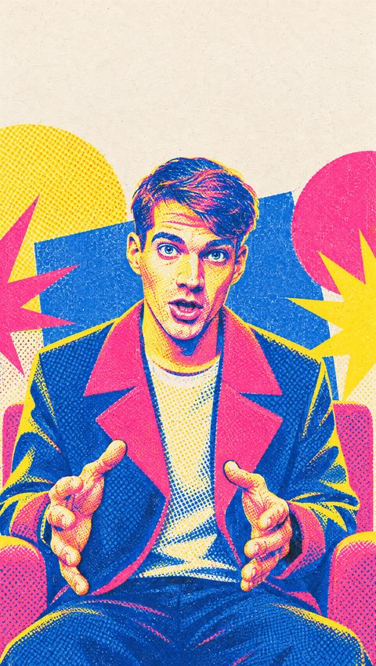 Risograph

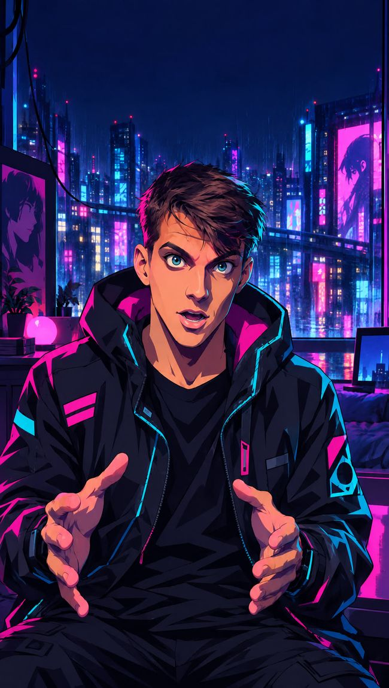 Neon Punk Anime

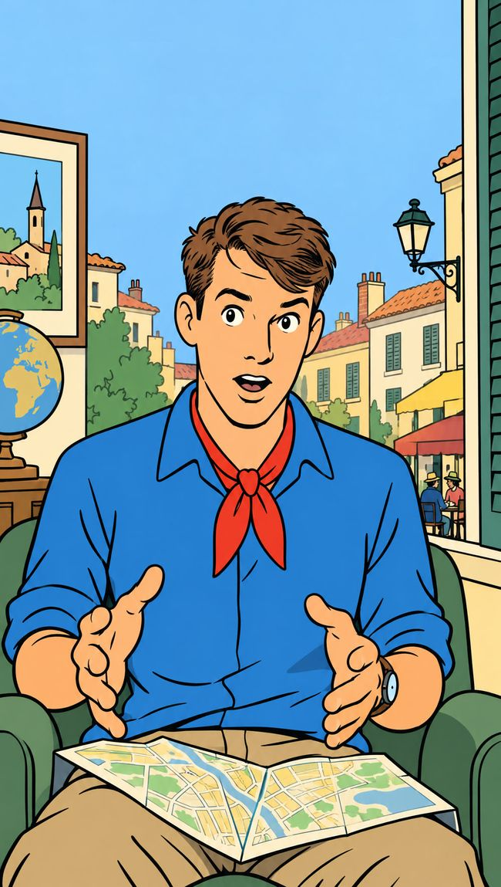 Ligne claire

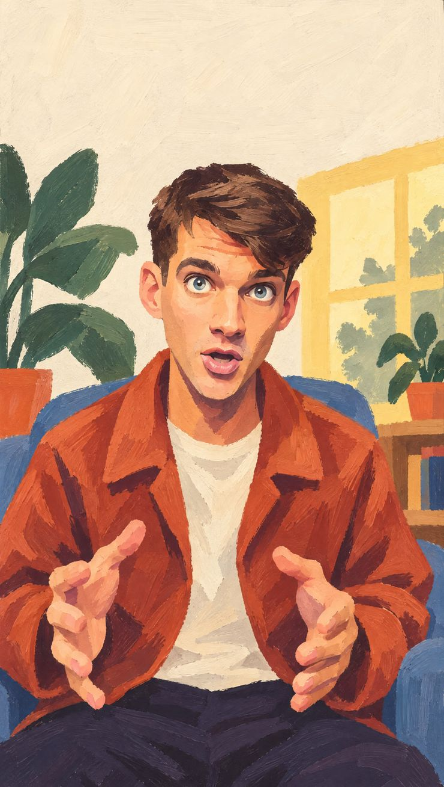 Gouache Illustration

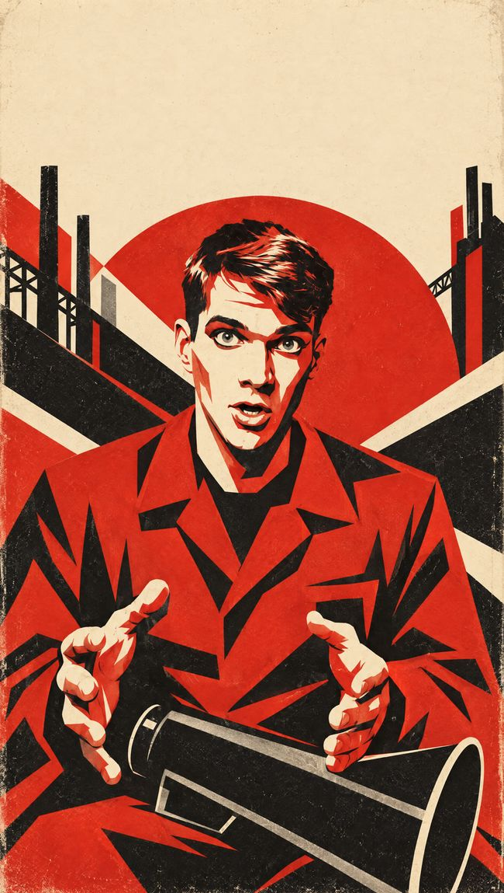 Constructivism

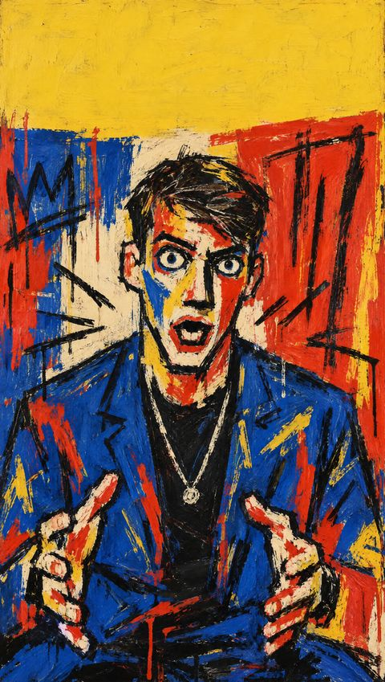 Neo-expressionism

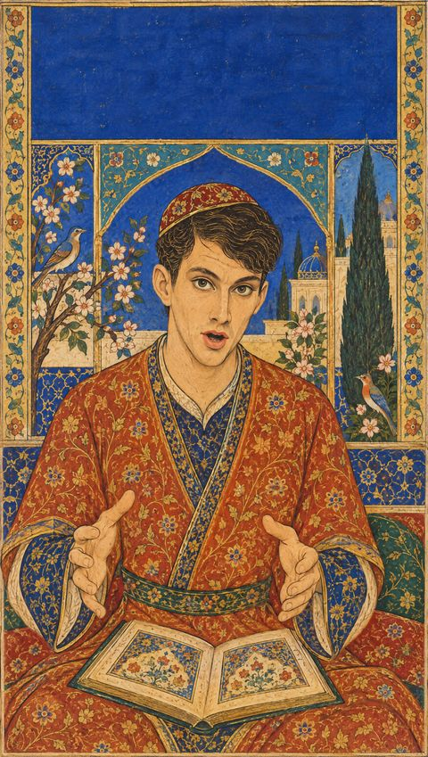 Persian Miniature

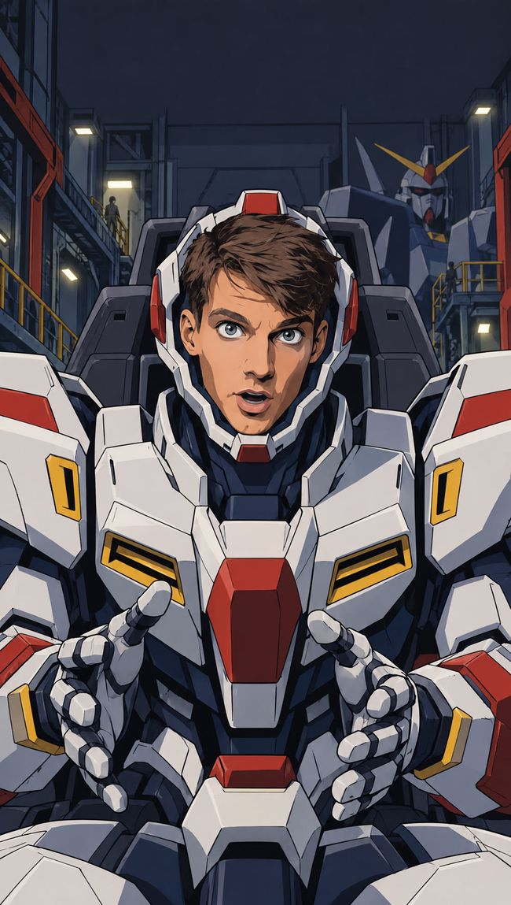 Cel-shaded Mecha

Example images from the guides by sferro21 (instagram.com/sferro21)

<!-- examples:end -->

## Credit and license

Adapted for Subclip from guides by sferro21 (https://www.instagram.com/sferro21). Rewritten in our own words. The creator's guides state no license, so please confirm permission with the creator before relying on this skill.
