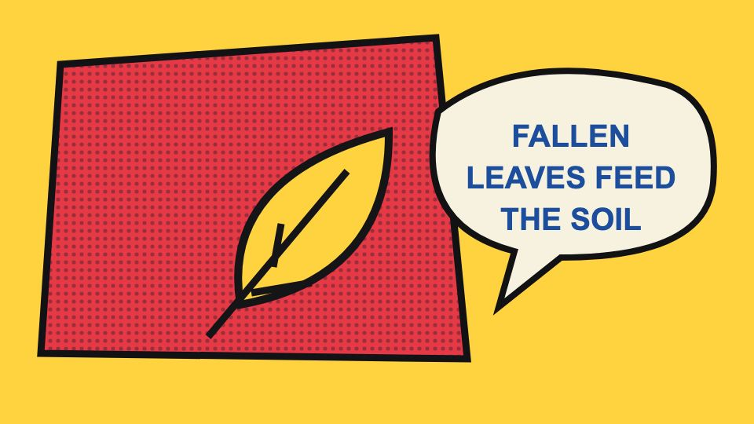

Adapted for Subclip from the AI Style Atlas by Futurepedia (https://www.futurepedia.io/resources/ai-style-atlas/view)

# AI Style Atlas for Subclip

Pick a visual style by name or mood, and the agent restyles an explainer on your topic in that look inside Subclip: a storyboard in the style, scenes as editable layers or generated images, narration, captions and export.

The catalog in `references/` lists styles by category with our own short description and a Subclip recipe for each. Every entry links to the original atlas page.

Coverage: this first version lists 15 of the atlas's 86 styles. The rest are added as they become readable. See SKILL.md.

No license is stated by the source. Nothing is copied from the atlas; see LICENSE.

Adapted for Subclip from the AI Style Atlas by Futurepedia (https://www.futurepedia.io/resources/ai-style-atlas/view)

## Examples

Original SVG scenes built from two atlas recipes and rendered in headless Chrome.

[Watch the clip](examples/shadow-puppet.mp4)

[Watch the clip](examples/halftone-pop-panel.mp4)
