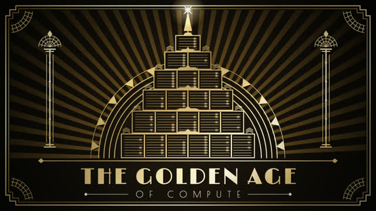
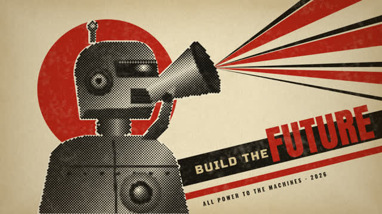
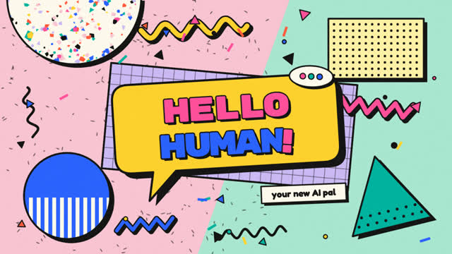
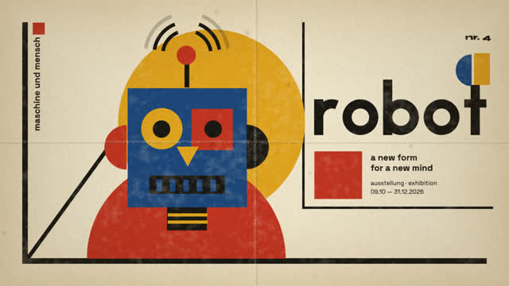
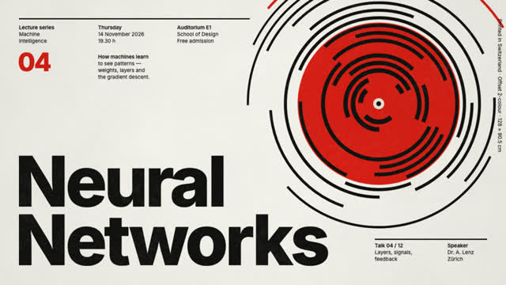

# Art & Design Movements (6 styles)

Styles from the AI Style Atlas by Futurepedia (https://www.futurepedia.io/resources/ai-style-atlas/view). Prompts and posters are reproduced with credit at the Subclip owner's request. Each entry has the atlas style card in a code block, a link to the full Copy prompt text, and our own Subclip recipe.

## 21. Ukiyo-e Woodblock


An Edo-period woodblock print in the manner of Hokusai: Prussian-blue bokashi gradients, a towering wave with claw-like foam whose spray breaks into data cubes, a cargo ship stacked with server racks in the trough, flat colour blocks with carved keyblock outlines, wood grain and washi fibre, a vertical-text cartouche and vermilion seal.

```text
Look: An Edo-period woodblock print in the manner of Hokusai: Prussian-blue bokashi gradients, a towering wave with claw-like foam whose spray breaks into data cubes, a cargo ship stacked with server racks in the trough, flat colour blocks with carved keyblock outlines, wood grain and washi fibre, a vertical-text cartouche and vermilion seal.
Motion: Printed like a real woodblock: the black keyblock lands first, then each colour block is pressed in turn (sky ochre, pale blue, mid blue, vermilion, Prussian) and the bokashi sky is wiped on last, while the wave swells, its claws lean and data-cube spray tumbles onto the rolling ship.
How it explains: An emaki handscroll unrolled right-to-left: golden kasumi clouds divide the scenes, a river of labelled prints floats to an Edo karakuri automaton, flow is drawn as currents with claw-foam heads, the learning loop is a Naruto whirlpool, numbers sit in paper cartouches and every judgement is a vermilion seal stamp.
```

Full Copy prompt text (reference animation source and sound kit included): [prompts/21-ukiyo-e-woodblock.txt](prompts/21-ukiyo-e-woodblock.txt)

Make it in Subclip: Generated print-style art for the wave and ship plus HyperFrames paper grain and a red seal text layer. Palette: Prussian blue, cream, vermilion. Motion: slow horizontal drift with a wave surge.
Check: gradients step in soft bands, not smooth digital fades.

Source: [Futurepedia AI Style Atlas #21](https://www.futurepedia.io/resources/ai-style-atlas/view)

## 51. Art Deco Foil



A 1920s Art Deco poster in black lacquer and stamped gold foil: a symmetrical stepped ziggurat skyscraper built from server racks, sunburst fans radiating behind it, a stepped geometric border, and Limelight / Poiret One lettering with cream accents.

```text
Look: A 1920s Art Deco poster in black lacquer and stamped gold foil: a symmetrical stepped ziggurat skyscraper built from server racks, sunburst fans radiating behind it, a stepped geometric border, and Limelight / Poiret One lettering with cream accents.
Motion: Like a gilded title sequence: the stepped border inscribes itself, the server ziggurat rises floor by floor with its LEDs waking, halo arcs close symmetrically and the sunburst fans open, the spire extends and its beacon ignites, the title is foil-stamped letter by letter, then one slow glint sweeps across the gold.
How it explains: A gilded picture-palace sequence: scenes change behind closing and opening gold elevator doors, cameos glide on a gold rail with cream name plaques, arrows are stepped chevron arrows, numbers roll on an odometer and fill a sunburst gauge, and the key moments get a spotlight ring or a beacon glint.
```

Full Copy prompt text (reference animation source and sound kit included): [prompts/51-art-deco-foil.txt](prompts/51-art-deco-foil.txt)

Make it in Subclip: HyperFrames SVG with symmetric stepped shapes, sunburst fans and gold gradient strokes on black. Palette: black #0B0B0B, gold #D4AF37, cream. Motion: sunburst rays reveal in turn.
Check: layout is mirror symmetric and gold stays a gradient, not flat yellow.

Source: [Futurepedia AI Style Atlas #51](https://www.futurepedia.io/resources/ai-style-atlas/view)

## 58. Constructivist Propaganda



A 1920s Rodchenko / El Lissitzky agitprop poster: red, black and cream only, a halftone photomontage robot bellowing through a megaphone, beams radiating from its voice, a red disc and hard diagonal bars, and heavy condensed lettering set on the slant - litho ink mottle on cheap paper.

```text
Look: A 1920s Rodchenko / El Lissitzky agitprop poster: red, black and cream only, a halftone photomontage robot bellowing through a megaphone, beams radiating from its voice, a red disc and hard diagonal bars, and heavy condensed lettering set on the slant - litho ink mottle on cheap paper.
Motion: Agitprop staccato: the red disc rolls in, the halftone robot slides up the diagonal, beams punch out of the megaphone two frames at a time, the slogan bars shoot across and the words slam down on the beat; in the hold the beam fan pulses with each shout.
How it explains: Agitprop sequence: Lissitzky's red wedge drives across the sheet between scenes, slogans and labels slam onto slanted bars on twos, arrows are heavy bars with wedge heads, the counter is stencil-tall Anton, and the key moments get a stamped red cross or a burst of beams.
```

Full Copy prompt text (reference animation source and sound kit included): [prompts/58-constructivist-propaganda.txt](prompts/58-constructivist-propaganda.txt)

Make it in Subclip: HyperFrames SVG with diagonal layouts, halftone photomontage shapes and bold sans type. Palette: red #D62718, black, cream. Motion: slams in at an angle.
Check: only three colors appear and type is bold and angled.

Source: [Futurepedia AI Style Atlas #58](https://www.futurepedia.io/resources/ai-style-atlas/view)

## 67. Memphis Group



Early-80s Memphis Milano maximalism: pastel grounds clashing with bold primaries, thick black outlines and hard offset shadows, squiggles, zigzags, dot grids, terrazzo chips and confetti triangles, all orbiting a chunky tilted chat-bubble headline.

```text
Look: Early-80s Memphis Milano maximalism: pastel grounds clashing with bold primaries, thick black outlines and hard offset shadows, squiggles, zigzags, dot grids, terrazzo chips and confetti triangles, all orbiting a chunky tilted chat-bubble headline.
Motion: Cut-out cel timing on twos: the mint wedge slides in, shapes pop on one by one with springy overshoot, squiggles and zigzags draw themselves, the chat bubble squash-and-stretches in, the words pop on the beat, confetti bursts out and the sticker slaps on; then everything bobs off-beat and the typing dots bounce.
How it explains: Memphis cut-out animation on twos: examples hop into a funnel-topped totem computer, scenes change with a striped polka-dot band that swipes across, arrows are fat outlined shapes with hard shadows, counters are stickers that pop on each tick, and the key moments get a spinning starburst.
```

Full Copy prompt text (reference animation source and sound kit included): [prompts/67-memphis-group.txt](prompts/67-memphis-group.txt)

Make it in Subclip: HyperFrames SVG with bold shapes, squiggles, terrazzo dots and hard offset shadows. Palette: pastel grounds with primary red, yellow, blue and black. Motion: shapes bounce in.
Check: every shape has a thick outline and a hard offset shadow.

Source: [Futurepedia AI Style Atlas #67](https://www.futurepedia.io/resources/ai-style-atlas/view)

## 74. Bauhaus Poster



A 1920s Bauhaus exhibition poster: primary red, yellow and blue plus black on aged cream stock, a robot face built only from circles, squares, semicircles and triangles on a strict grid, with constructed geometric lettering and lithographic ink mottle.

```text
Look: A 1920s Bauhaus exhibition poster: primary red, yellow and blue plus black on aged cream stock, a robot face built only from circles, squares, semicircles and triangles on a strict grid, with constructed geometric lettering and lithographic ink mottle.
Motion: Built like a workshop paste-up: grid rules draw out, the halo and head drop in and snap with a little overshoot, features stamp on one by one, then the constructed letters are set block by block and the type follows; in the hold the pupils swivel and the antenna waves pulse.
How it explains: Told as one long Bayer-style info-design sheet the camera tracks along and finally pulls back from, with thick bar-and-triangle arrows, tags that drop onto what they name, stamped Space Grotesk counters and a red ring drawn round the key moment.
```

Full Copy prompt text (reference animation source and sound kit included): [prompts/74-bauhaus-poster.txt](prompts/74-bauhaus-poster.txt)

Make it in Subclip: HyperFrames SVG built only from circles, squares and triangles in red, yellow, blue and black on cream. Motion: shapes rotate into position.
Check: only primary colors plus black and cream are used.

Source: [Futurepedia AI Style Atlas #74](https://www.futurepedia.io/resources/ai-style-atlas/view)

## 83. International Typographic Style



A 1960s Zürich-school concert-style poster: strict 12-column modular grid, enormous flush-left grotesk set tight, an asymmetric field of rotating concentric arc segments over a red disc, and small precise info blocks hung from the grid - red, black and white only.

```text
Look: A 1960s Zürich-school concert-style poster: strict 12-column modular grid, enormous flush-left grotesk set tight, an asymmetric field of rotating concentric arc segments over a red disc, and small precise info blocks hung from the grid - red, black and white only.
Motion: Rules draw out along the grid, the red disc opens and the ring segments spin in and decelerate until they lock onto a 22.5° module; the headline rises line by line out of its baseline masks and the info blocks step in column by column, then the rings drift like a slow mechanical score.
How it explains: A Zürich-school information sequence on the same 12-column grid: the headline shrinks into a running header, pages change with a column-by-column red wipe, hairline rules with solid heads carry cause and flow, numbers count in Inter 800 and the key result gets a red block slammed behind it.
```

Full Copy prompt text (reference animation source and sound kit included): [prompts/83-international-typographic-style.txt](prompts/83-international-typographic-style.txt)

Make it in Subclip: HyperFrames SVG with a 12-column grid, flush-left large sans type and rotating arcs. Palette: red, black, white. Motion: arcs rotate steadily and slowly.
Check: text aligns to grid columns and has tight leading.

Source: [Futurepedia AI Style Atlas #83](https://www.futurepedia.io/resources/ai-style-atlas/view)
