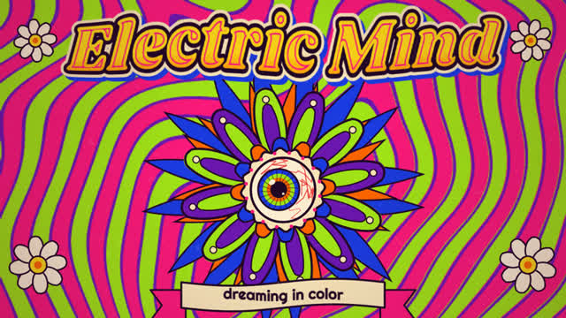
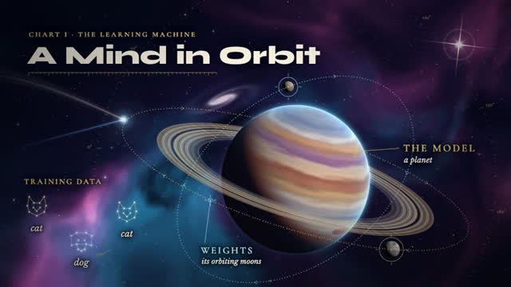

# Cosmic & Psychedelic (2 styles)

Styles from the AI Style Atlas by Futurepedia (https://www.futurepedia.io/resources/ai-style-atlas/view). Prompts and posters are reproduced with credit at the Subclip owner's request. Each entry has the atlas style card in a code block, a link to the full Copy prompt text, and our own Subclip recipe.

## 05. Psychedelic Poster



1960s San Francisco concert-poster psychedelia: full-strength inks in vibrating complementary pairs, liquid churning ring bands, sunbursts and a mirror-symmetric eye-flower, with bulbous melting Shrikhand lettering on worn poster stock.

```text
Look: 1960s San Francisco concert-poster psychedelia: full-strength inks in vibrating complementary pairs, liquid churning ring bands, sunbursts and a mirror-symmetric eye-flower, with bulbous melting Shrikhand lettering on worn poster stock.
Motion: Colour ripples out from the centre, petals unfurl and the eye opens, then the lettering melts into place while the liquid bands keep slowly churning.
How it explains: The model is a giant eye-flower whose petals are its weights: examples ride striped ribbons into it, the wrong guess makes the inks clash and jitter, the correction folds the swirl into a symmetric mandala, 97% bursts into a kaleidoscope sunburst; scenes change by kaleidoscope rotation, a liquid melt and an iris ripple.
```

Full Copy prompt text (reference animation source and sound kit included): [prompts/05-psychedelic-poster.txt](prompts/05-psychedelic-poster.txt)

Make it in Subclip: HyperFrames SVG layer with rotating ring bands and mirrored shapes; a bold rounded display font for titles. Palette: orange vs blue, magenta vs green, full strength. Motion: slow rotation and a breathing scale.
Check: keep photosensitive safety: no flashing faster than 3 times per second.

Source: [Futurepedia AI Style Atlas #05](https://www.futurepedia.io/resources/ai-style-atlas/view)

## 34. Cosmic Star Chart



Deep-space illustration crossed with an engraved celestial atlas: fbm nebulae in teal, violet, rose and gold, a lit ringed gas giant with cratered moons, comets and a diffraction-spiked star, overlaid with hairline gold and pale-cyan chart work (dotted orbits with arrowheads, degree rings, ring markers, small-caps serif labels).

```text
Look: Deep-space illustration crossed with an engraved celestial atlas: fbm nebulae in teal, violet, rose and gold, a lit ringed gas giant with cratered moons, comets and a diffraction-spiked star, overlaid with hairline gold and pale-cyan chart work (dotted orbits with arrowheads, degree rings, ring markers, small-caps serif labels).
Motion: The sky fades up star by star while the camera drifts in, the key star flares, the planet lights up, then the chart engraves itself over it: degree ring sweeping round, orbits dotting on, markers and labels landing, a comet streaking past.
How it explains: Told as one celestial chart overlaid on deep space: the model is a ringed planet whose moons are its weights, cat/dog examples arrive as constellation-headed comets, a warp streak changes scene, the guess is a chart beam to a labelled star that turns red with a red ring marker, the weights’ orbit visibly tilts, the camera tilts up to an atlas chart where the accuracy constellation forms and flares at 97%; numbers are big Syne figures over graduated sextant scales.
```

Full Copy prompt text (reference animation source and sound kit included): [prompts/34-cosmic-star-chart.txt](prompts/34-cosmic-star-chart.txt)

Make it in Subclip: HyperFrames canvas or generated nebula stills with fine star charts and labeled constellation lines. Palette: teal, violet, rose, gold on deep space. Motion: slow drift and twinkle.
Check: labels remain readable over the nebula.

Source: [Futurepedia AI Style Atlas #34](https://www.futurepedia.io/resources/ai-style-atlas/view)
