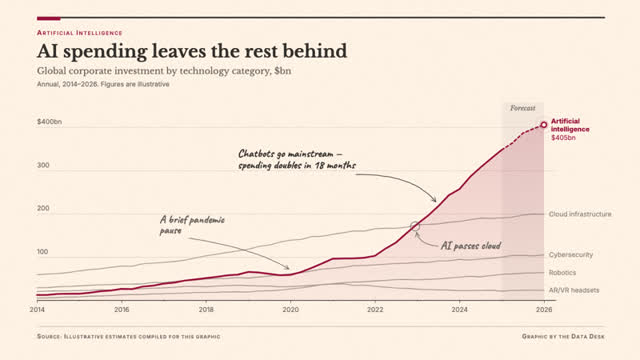
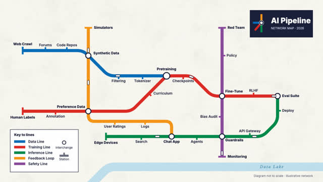
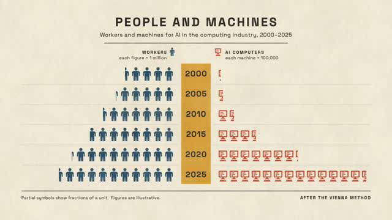
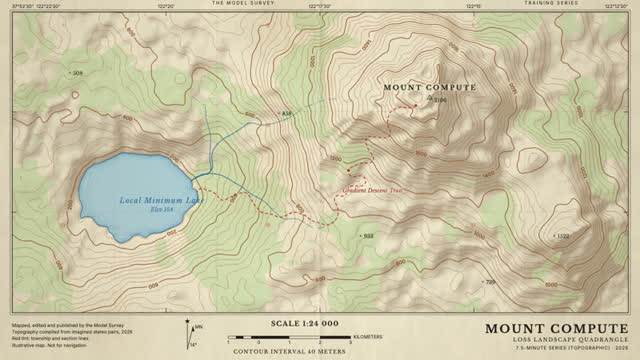
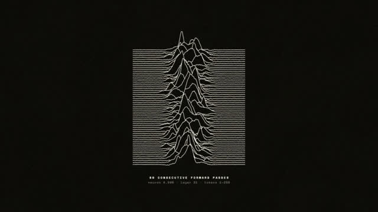
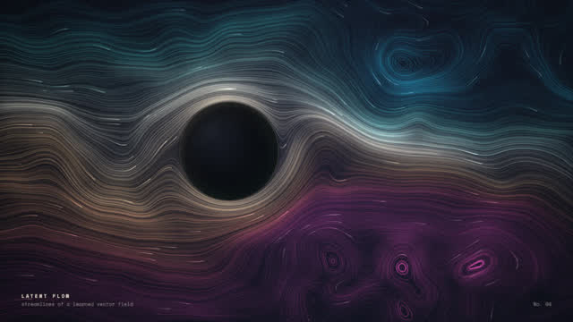

# Data & Information (6 styles)

Styles from the AI Style Atlas by Futurepedia (https://www.futurepedia.io/resources/ai-style-atlas/view). Prompts and posters are reproduced with credit at the Subclip owner's request. Each entry has the atlas style card in a code block, a link to the full Copy prompt text, and our own Subclip recipe.

## 26. Editorial Chart



[Watch the style clip](../examples/26-editorial-chart.mp4)

A prestige-newspaper data graphic on FT salmon: serif headline and dek, hairline grid, one claret highlight series against quiet greys, direct labels and hand-annotated callouts, small-caps source line.

```text
Look: A prestige-newspaper data graphic on FT salmon: serif headline and dek, hairline grid, one claret highlight series against quiet greys, direct labels and hand-annotated callouts, small-caps source line.
Motion: Headline sets, gridlines rule across, grey context lines settle, then the claret line draws left to right with its wash filling behind it and handwritten notes inking in as the line reaches them; a slow push and a soft pulse on the end point hold the shot.
How it explains: Told as a scrolling newspaper story: the page scrolls panel to panel under a sticky serif header, hand-drawn Caveat arrows and rings carry the cause and emphasis, a waffle chart and set numerals count the data, and the accuracy line draws itself like the still.
```

Full Copy prompt text (reference animation source and sound kit included): [prompts/26-editorial-chart.txt](prompts/26-editorial-chart.txt)

Make it in Subclip: HyperFrames SVG chart on a salmon background with one highlighted line and grey context lines, direct labels and a serif headline. Palette: #FFF1E5, claret #990F3D, greys. Motion: gridlines then the line draws on.
Check: labels sit on the data, no legend box, and the highlight line is the only strong color.

Source: [Futurepedia AI Style Atlas #26](https://www.futurepedia.io/resources/ai-style-atlas/view)

## 48. Transit Map



[Watch the style clip](../examples/48-transit-map.mp4)

A Beck-style metro diagram of an AI pipeline: fat coloured lines locked to 0/45/90 degrees with rounded bends, line-colour station ticks, black-ringed interchanges, a river and a boxed legend, all in clean sans lettering.

```text
Look: A Beck-style metro diagram of an AI pipeline: fat coloured lines locked to 0/45/90 degrees with rounded bends, line-colour station ticks, black-ringed interchanges, a river and a boxed legend, all in clean sans lettering.
Motion: Title and key settle, then each line draws out from its terminus in turn with stations ticking on and interchanges popping as the line passes; once the network is complete, small trains glide along every route.
How it explains: The lesson is a journey on the network: the camera rides along a Data Line into the Model interchange, round a Training Loop line (Guess, Check, Adjust stations) and out along an Accuracy Line, while an amber dot-matrix departure board counts examples and accuracy and finally flips to the takeaway.
```

Full Copy prompt text (reference animation source and sound kit included): [prompts/48-transit-map.txt](prompts/48-transit-map.txt)

Make it in Subclip: HyperFrames SVG with thick lines at 0, 45 and 90 degrees only, round stations and interchange rings. Palette: bold line colors on white. Motion: lines draw station by station.
Check: no line segment uses any other angle.

Source: [Futurepedia AI Style Atlas #48](https://www.futurepedia.io/resources/ai-style-atlas/view)

## 55. ISOTYPE Pictograms



[Watch the style clip](../examples/55-isotype-pictograms.mp4)

Vienna Method pictorial statistics: rows of identical flat pictograms where each symbol is a fixed quantity, partial symbols for remainders, three muted litho inks on a strict grid with geometric sans lettering.

```text
Look: Vienna Method pictorial statistics: rows of identical flat pictograms where each symbol is a fixed quantity, partial symbols for remainders, three muted litho inks on a strict grid with geometric sans lettering.
Motion: Title and key set first, the year column drops in, then symbols are stamped out row by row from the centre in stepped, rubber-stamp timing, the 2025 row of machines racing ahead; the litho paper breathes in the hold.
How it explains: A Vienna-Method picture-statistic told across one long chart sheet the camera pans along: symbols are stamped in stepped 12 fps timing, flat Isotype arrows show flow, numerals are stamped and re-stamped, and accuracy is counted in rows of tick symbols with partial symbols for fractions.
```

Full Copy prompt text (reference animation source and sound kit included): [prompts/55-isotype-pictograms.txt](prompts/55-isotype-pictograms.txt)

Make it in Subclip: HyperFrames SVG rows of identical pictograms, one symbol per fixed quantity and cut pieces for remainders. Palette: three muted inks on cream. Motion: icons appear row by row.
Check: symbols have equal size and the chart total matches the data.

Source: [Futurepedia AI Style Atlas #55](https://www.futurepedia.io/resources/ai-style-atlas/view)

## 70. Topographic Survey



[Watch the style clip](../examples/70-topographic-survey.mp4)

A vintage survey quadrangle of a "loss landscape": brown contour lines with heavier labelled index contours, soft hillshade and woodland tint, a water-lined lake, a red dashed switchback trail and a full printed collar with scale bar and north arrow.

```text
Look: A vintage survey quadrangle of a "loss landscape": brown contour lines with heavier labelled index contours, soft hillshade and woodland tint, a water-lined lake, a red dashed switchback trail and a full printed collar with scale bar and north arrow.
Motion: Printed plate by plate: the black frame and collar, then the grey hillshade, the green woodland sliding into register, the blue lake, then brown contours rising from the shore like a tide; streams trace downhill, names land, and the red trail walks itself down the switchbacks while the camera eases in.
How it explains: The loss landscape is literally the map: survey points (examples) raise the terrain, a red hiker guesses, checks the slope and steps down a dashed switchback trail while the camera pans along it, and accuracy is lettered in a map cartouche like an elevation figure.
```

Full Copy prompt text (reference animation source and sound kit included): [prompts/70-topographic-survey.txt](prompts/70-topographic-survey.txt)

Make it in Subclip: HyperFrames SVG with contour lines, index labels, hill shading and a legend. Palette: map brown, forest green, water blue on cream. Motion: contours draw outward.
Check: every fifth contour is heavier and labeled.

Source: [Futurepedia AI Style Atlas #70](https://www.futurepedia.io/resources/ai-style-atlas/view)

## 77. Ridgeline



[Watch the style clip](../examples/77-ridgeline.mp4)

Sixty stacked traces of noisy signal, each filled black so it occludes the one behind, drawn as thin white lines in a perfectly centred block with a tiny typographic caption.

```text
Look: Sixty stacked traces of noisy signal, each filled black so it occludes the one behind, drawn as thin white lines in a perfectly centred block with a tiny typographic caption.
Motion: Traces are plotted one after another from the top, each swept left to right like a pen recorder and occluding the ones behind; once the stack is complete the peaks ripple like a live signal and the caption types in.
How it explains: Each white trace is one training round: a recorder tape feeds labelled pulses into the empty stack, three magnified traces act out guess / check / adjust (the peak lands on "dog", a dashed target shows "cat", the peak slides over), then the camera pulls back and sixty rounds plot themselves as the noisy peaks align into one clean ridge, captioned in Space Mono.
```

Full Copy prompt text (reference animation source and sound kit included): [prompts/77-ridgeline.txt](prompts/77-ridgeline.txt)

Make it in Subclip: HyperFrames SVG or canvas with many stacked white signal lines on black, each filled black to hide the ones behind. Palette: black and white. Motion: slow ripples travel across the stack.
Check: lines properly occlude each other and no color is used.

Source: [Futurepedia AI Style Atlas #77](https://www.futurepedia.io/resources/ai-style-atlas/view)

## 84. Flow Field



[Watch the style clip](../examples/84-flow-field.mp4)

Thousands of hairline streamlines traced through a curl-noise field that parts around an unseen core; additive colour from a refined gradient builds luminous braids on dark paper.

```text
Look: Thousands of hairline streamlines traced through a curl-noise field that parts around an unseen core; additive colour from a refined gradient builds luminous braids on dark paper.
Motion: The dark core appears first, then particles are released in a wave from left to right and trace their streamlines outward until the braids glow; in the hold the field slowly breathes while bright sparks ride the currents.
How it explains: The model is the dark core of a flow field: labelled particles spiral into it as data, the camera pushes in as a new particle is carried out the wrong exit ("dog?"), a coral counter-current carries the error back, the circulation re-combs the whole field so the next one exits "cat", and training is shown as the turbulent field combing into smooth order, all captioned in hairline Space Mono.
```

Full Copy prompt text (reference animation source and sound kit included): [prompts/84-flow-field.txt](prompts/84-flow-field.txt)

Make it in Subclip: HyperFrames canvas that draws thousands of hairline curves following a noise vector field with additive blending. Palette: dark ground with a gradient of one hue family. Motion: lines extend over time.
Check: lines never cross hard edges and brightness builds where they overlap.

Source: [Futurepedia AI Style Atlas #84](https://www.futurepedia.io/resources/ai-style-atlas/view)
