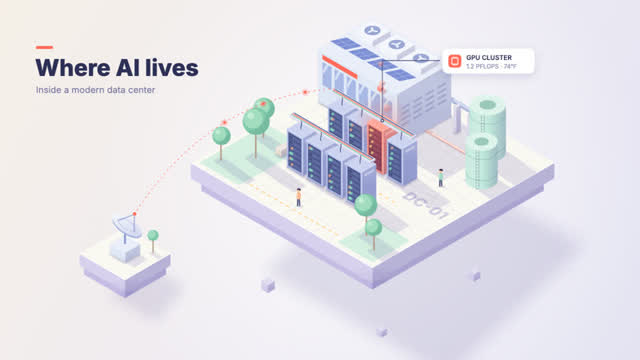
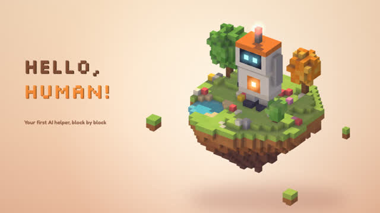
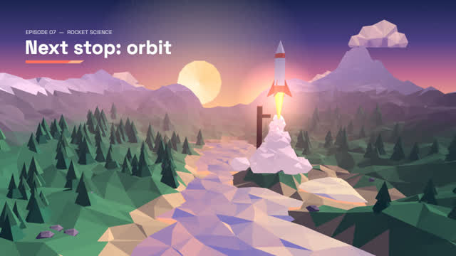
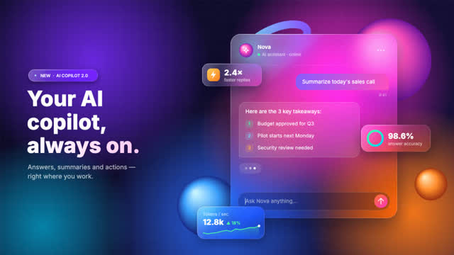
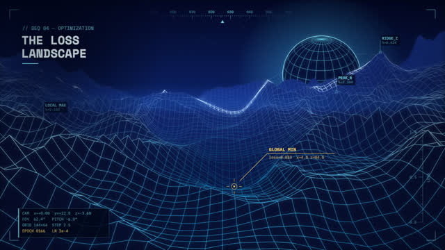

# Dimensional (6 styles)

Styles from the AI Style Atlas by Futurepedia (https://www.futurepedia.io/resources/ai-style-atlas/view). Prompts and posters are reproduced with credit at the Subclip owner's request. Each entry has the atlas style card in a code block, a link to the full Copy prompt text, and our own Subclip recipe.

## 15. Isometric Pastel



[Watch the style clip](../examples/15-isometric-pastel.mp4)

Clean vector isometric illustration: true 30° projection, flat three-tone face shading, soft pastel palette with a single coral accent, tiny people for scale and long soft shadows on a floating tile.

```text
Look: Clean vector isometric illustration: true 30° projection, flat three-tone face shading, soft pastel palette with a single coral accent, tiny people for scale and long soft shadows on a floating tile.
Motion: The floating tile rises into frame, buildings, tanks and racks pop up one by one on springy overshoot, then LEDs blink, fans spin, data cubes stream up and tiny workers stroll during a slow camera push.
How it explains: One long isometric factory floor (data shelves → conveyor → glass-top neural machine → monitor → bar chart) that the camera glides along beat to beat, with white label tags pinned to objects, curved dashed connectors, a counting billboard and an accuracy tag riding the newest bar.
```

Full Copy prompt text (reference animation source and sound kit included): [prompts/15-isometric-pastel.txt](prompts/15-isometric-pastel.txt)

Make it in Subclip: HyperFrames SVG using a 30 degree projection, three tones per box (top, left, right). Palette: pastel mint, lavender, sand with coral #FF6B5E. Motion: pieces rise into place one at a time, slow tile rotation of a few degrees.
Check: all edges follow the same 30 degree angle.

Source: [Futurepedia AI Style Atlas #15](https://www.futurepedia.io/resources/ai-style-atlas/view)

## 31. Voxel Diorama



[Watch the style clip](../examples/31-voxel-diorama.mp4)

MagicaVoxel-style diorama: a floating voxel island with a waving robot, chunky trees and a pond - three-tone cube faces, per-vertex ambient occlusion in the creases, ray-marched soft shadows and a warm toy palette.

```text
Look: MagicaVoxel-style diorama: a floating voxel island with a waving robot, chunky trees and a pond - three-tone cube faces, per-vertex ambient occlusion in the creases, ray-marched soft shadows and a warm toy palette.
Motion: Voxels rain down and stack layer by layer from the island’s rocky underside up to the robot’s antenna while the camera orbits; the robot’s eyes flicker on, it starts waving, and the pixel title drops in block by block.
How it explains: One long voxel island the camera trucks along while each zone is rebuilt from falling voxels; arrows are chains of little cubes, cards and the ✗/✓ verdict are real voxel pixel-art, the robot’s chest equaliser re-levels as its weights adjust, and numbers tick in Silkscreen on extruded block tags.
```

Full Copy prompt text (reference animation source and sound kit included): [prompts/31-voxel-diorama.txt](prompts/31-voxel-diorama.txt)

Make it in Subclip: Generated isometric voxel stills, or HyperFrames canvas with cube faces in three tones. Palette: warm toy colors with a pond blue. Motion: voxels drop in layer by layer.
Check: every cube has three consistent face tones.

Source: [Futurepedia AI Style Atlas #31](https://www.futurepedia.io/resources/ai-style-atlas/view)

## 40. Low-Poly Faceted



[Watch the style clip](../examples/40-low-poly-faceted.mp4)

Faceted low-poly 3D: a triangulated noise terrain with flat per-face Lambert shading, atmospheric depth fog, cone trees and a faceted rocket lifting off into a dawn gradient sky.

```text
Look: Faceted low-poly 3D: a triangulated noise terrain with flat per-face Lambert shading, atmospheric depth fog, cone trees and a faceted rocket lifting off into a dawn gradient sky.
Motion: Terrain facets flip into place from the camera out to the horizon, trees and the launch pad pop up, then the rocket ignites and lifts off on a faceted flame and smoke column while the camera dollies forward.
How it explains: A continuous camera flight through one faceted valley (overview → river of labelled example cards → floating crystal model whose facets realign → pillar chart on a plateau → pull back), with angular two-tone ribbon arrows, cut-corner tags pinned to objects and Space Grotesk counters.
```

Full Copy prompt text (reference animation source and sound kit included): [prompts/40-low-poly-faceted.txt](prompts/40-low-poly-faceted.txt)

Make it in Subclip: HyperFrames canvas with flat-shaded triangles and a light direction, or generated low-poly stills. Palette: dawn gradient with cool foreground. Motion: slow camera glide.
Check: each triangle has one flat tone, no smooth gradients inside faces.

Source: [Futurepedia AI Style Atlas #40](https://www.futurepedia.io/resources/ai-style-atlas/view)

## 46. Glassmorphism UI



[Watch the style clip](../examples/46-glassmorphism-ui.mp4)

Frosted-glass UI: translucent panels that genuinely blur the vivid gradient blobs and orbs behind them, with 1px light borders, a diagonal specular sheen, fine frost grain and crisp Inter type.

```text
Look: Frosted-glass UI: translucent panels that genuinely blur the vivid gradient blobs and orbs behind them, with 1px light borders, a diagonal specular sheen, fine frost grain and crisp Inter type.
Motion: Color blobs bloom up under the glass, the frosted card rises in, then the chat plays out (user bubble pops, the AI reply types itself line by line) while stat chips float in glass-over-glass and their ring and sparkline draw on; blobs keep drifting so the frost shimmers.
How it explains: The camera glides and zooms across one big frosted dashboard (data feed → network card → output chat → accuracy chart → pull back) while the live colour blobs drift behind, so every panel re-frosts as it moves; connectors are glowing gradient lines with travelling light dots, labels are glass pills, numbers count in big Inter 800.
```

Full Copy prompt text (reference animation source and sound kit included): [prompts/46-glassmorphism-ui.txt](prompts/46-glassmorphism-ui.txt)

Make it in Subclip: HyperFrames HTML with `backdrop-filter: blur` panels over moving gradient blobs, 1 px light borders. Palette: vivid blobs, white translucent glass. Motion: blobs drift slowly.
Check: background blobs show blurred through each panel.

Source: [Futurepedia AI Style Atlas #46](https://www.futurepedia.io/resources/ai-style-atlas/view)

## 56. Soft 3D Clay


[Watch the style clip](../examples/56-soft-3d-clay.mp4)

Dribbble-style “puffy” 3D icons: pastel matte-clay objects with chunky rounded extrusions, soft core shadows, bright bounce-light rims, glossy specular blobs and blurry contact shadows on a seamless pastel sweep.

```text
Look: Dribbble-style “puffy” 3D icons: pastel matte-clay objects with chunky rounded extrusions, soft core shadows, bright bounce-light rims, glossy specular blobs and blurry contact shadows on a seamless pastel sweep.
Motion: Clay icons drop in one by one on springy squash-and-stretch with their contact shadows growing beneath them, the bulb flickers on, then the cursor flies in and taps the bubble while everything bobs at different depths.
How it explains: The camera dollies across one wide pastel set with parallax depth-of-field (cards → clay chip with weight sliders → answer bubble → clay bar chart → pull back), arrows are puffy clay tubes with blobby heads, labels are squishy pills that spring onto objects, and numbers count inside butter-yellow clay badges.
```

Full Copy prompt text (reference animation source and sound kit included): [prompts/56-soft-3d-clay.txt](prompts/56-soft-3d-clay.txt)

Make it in Subclip: Generated soft 3D icon stills (`generate_ai_media`) with a matte clay prompt of your own. Palette: pastel colors with soft shadows. Motion: gentle float and bob.
Check: icons share one light direction and no hard edges.

Source: [Futurepedia AI Style Atlas #56](https://www.futurepedia.io/resources/ai-style-atlas/view)

## 66. Hidden-Line Wireframe



[Watch the style clip](../examples/66-hidden-line-wireframe.mp4)

Vector-display 3D: a perspective wire-mesh landscape with true hidden-line removal (back-to-front quads filled with the night before stroking), a wireframe moon, phosphor-cyan lines with bloom on deep navy, and HUD coordinate labels.

```text
Look: Vector-display 3D: a perspective wire-mesh landscape with true hidden-line removal (back-to-front quads filled with the night before stroking), a wireframe moon, phosphor-cyan lines with bloom on deep navy, and HUD coordinate labels.
Motion: HUD brackets snap on, the wireframe moon traces itself, then the hidden-line mesh is scanned in row by row from the camera to the horizon behind a bright scan front; markers lock on and labels type out while the camera glides forward and the scan keeps sweeping.
How it explains: Learning is shown as descent over the hidden-line “loss landscape”: the camera flies the mesh from a data-feed HUD streaming into the wireframe-sphere model, down to an amber “model weights” marker whose error becomes a dashed downhill vector, then follows it into the glowing basin; labels are bracketed HUD tags that type on, numbers are big Space Mono readouts.
```

Full Copy prompt text (reference animation source and sound kit included): [prompts/66-hidden-line-wireframe.txt](prompts/66-hidden-line-wireframe.txt)

Make it in Subclip: HyperFrames canvas with a wireframe mesh filled with the background before each stroke to hide lines. Palette: black and phosphor green or cyan. Motion: slow camera forward.
Check: back lines are fully hidden behind front surfaces.

Source: [Futurepedia AI Style Atlas #66](https://www.futurepedia.io/resources/ai-style-atlas/view)
