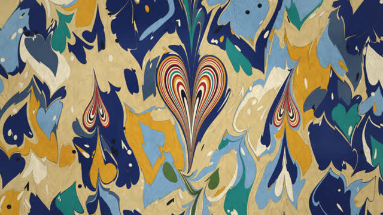
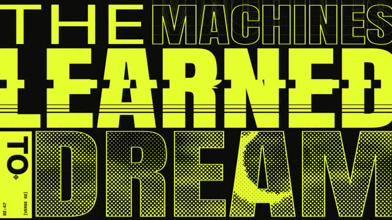
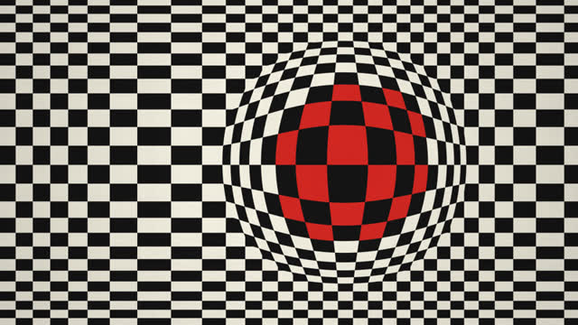
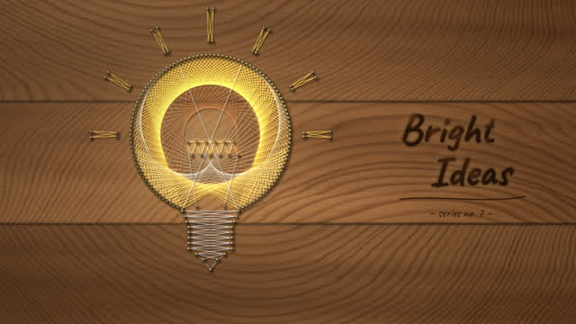
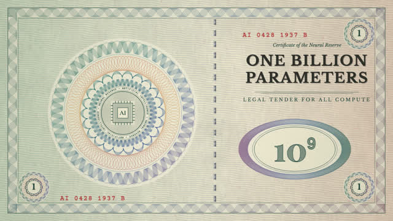
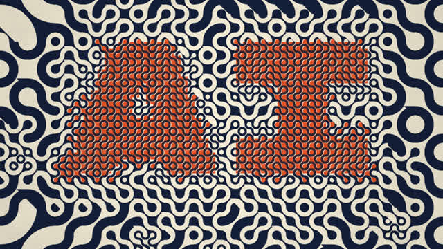

# Generative & Type (6 styles)

Styles from the AI Style Atlas by Futurepedia (https://www.futurepedia.io/resources/ai-style-atlas/view). Prompts and posters are reproduced with credit at the Subclip owner's request. Each entry has the atlas style card in a code block, a link to the full Copy prompt text, and our own Subclip recipe.

## 54. Ebru Paper Marbling



[Watch the style clip](../examples/54-ebru-paper-marbling.mp4)

Turkish ebru on laid paper: a battal stone ground of floated pigments raked into gel-git chevrons and combed, then suminagashi ring-drops pulled by a stylus into tulips - built with the exact drop and tine transforms.

```text
Look: Turkish ebru on laid paper: a battal stone ground of floated pigments raked into gel-git chevrons and combed, then suminagashi ring-drops pulled by a stylus into tulips - built with the exact drop and tine transforms.
Motion: Colour drops rain onto the size and bloom, shoving earlier drops into veins; the rake drags the stone into gel-git flames; ring after ring is dropped at one point; then the stylus pulls the rings into a tulip, and a wet sheen glides over the finished bath.
How it explains: The bath is the model: examples land as colour drops, a new picture is a red probe drop that the flow drags toward its guess, the error is a stylus counter-stroke and the adjustment a comb pass that puts the pattern in order; scenes change by lifting the printed sheet off the bath, labels are bookbinder paper labels and arrows are inked stylus strokes.
```

Full Copy prompt text (reference animation source and sound kit included): [prompts/54-ebru-paper-marbling.txt](prompts/54-ebru-paper-marbling.txt)

Make it in Subclip: Generated marbling stills with an ebru prompt of your own, or HyperFrames canvas with flow-warped ink swirls. Palette: deep blue, red, ochre and cream. Motion: slow raking of patterns.
Check: combed lines stay continuous and patterns do not break.

Source: [Futurepedia AI Style Atlas #54](https://www.futurepedia.io/resources/ai-style-atlas/view)

## 61. Kinetic Type



[Watch the style clip](../examples/61-kinetic-type.mp4)

A typographic music-video frame: condensed words cropped edge to edge with zero leading, filled vs outlined, strobe echoes, a slice glitch and one word stretched and filled with a halftone dreamscape - strictly two colours.

```text
Look: A typographic music-video frame: condensed words cropped edge to edge with zero leading, filled vs outlined, strobe echoes, a slice glitch and one word stretched and filled with a halftone dreamscape - strictly two colours.
Motion: One word per beat at 120 bpm: THE punches in, MACHINES whips in from the right trailing outline echoes, LEARNED slams up with a one-frame inverted flash, the TO tab wipes up, DREAM springs open and its halftone moon develops; then the slice glitch and echoes pulse on every beat.
How it explains: Words slam in on the beat and do the explaining; scenes change with a slice-glitch tear and a whip-pan, arrows are heavy rules with chevrons, labels are inverted mono tags that drop onto their targets, and the counters are huge Anton numerals with a strobe-flash on the key hits.
```

Full Copy prompt text (reference animation source and sound kit included): [prompts/61-kinetic-type.txt](prompts/61-kinetic-type.txt)

Make it in Subclip: HyperFrames text layers cropped edge to edge with one word per beat. Palette: two colors only, such as black and acid yellow. Motion: slams, whip-ins and glitch slices timed to a beat.
Check: never more than three flashes per second and words stay readable.

Source: [Futurepedia AI Style Atlas #61](https://www.futurepedia.io/resources/ai-style-atlas/view)

## 69. Op Art Sphere



[Watch the style clip](../examples/69-op-art-sphere.mp4)

Hard-edged black/ivory checkerboard that swells into a lens-like sphere and ripples at the margins - Vasarely and Riley optical vibration, flat acrylic on primed canvas.

```text
Look: Hard-edged black/ivory checkerboard that swells into a lens-like sphere and ripples at the margins - Vasarely and Riley optical vibration, flat acrylic on primed canvas.
Motion: A flat checkerboard first ripples into Riley folds, then swells into a lens-sphere that pops past its size and settles; red squares flip in cell by cell from the centre, then the field breathes and the folds drift.
How it explains: The model is the Vasarely lens: untrained its grid is melted noise, the error travels back as an optical ripple through the checkerboard and each adjustment combs the sphere toward perfect order; scenes change with a Riley fold that crushes the picture into crowded columns, labels are hard-edged black and red slabs, and the numbers are Archivo Black on ivory bands.
```

Full Copy prompt text (reference animation source and sound kit included): [prompts/69-op-art-sphere.txt](prompts/69-op-art-sphere.txt)

Make it in Subclip: HyperFrames canvas or SVG that bulges a black and white checkerboard into a sphere. Palette: black and ivory only. Motion: slow ripple.
Check: keep the motion slow because the pattern vibrates; avoid fast flashes.

Source: [Futurepedia AI Style Atlas #69](https://www.futurepedia.io/resources/ai-style-atlas/view)

## 76. Nail & Thread String Art



[Watch the style clip](../examples/76-nail-and-thread-string-art.mp4)

Taut cotton threads strung between brass nails on a stained walnut board; every curve is an envelope of straight chords, with thread translucency, sheen and cast shadows, plus pyrography lettering.

```text
Look: Taut cotton threads strung between brass nails on a stained walnut board; every curve is an envelope of straight chords, with thread translucency, sheen and cast shadows, plus pyrography lettering.
Motion: Nails are tapped in around the outline, then thread is wound chord by chord so the glowing envelopes emerge, the filament and base are laced, the rays snap taut, and the title is burned in with a travelling ember while the camera slowly pushes in.
How it explains: The network is literally strung on the board - nails are neurons, a weight is how many wraps of thread a connection has - and learning is re-winding; the camera travels along one long walnut board between scenes, labels are kraft tags nailed on, arrows are threads with nail barbs, counters are nail-and-thread 7-segment digits, and emphasis is a red thread wound round a ring of nails.
```

Full Copy prompt text (reference animation source and sound kit included): [prompts/76-nail-and-thread-string-art.txt](prompts/76-nail-and-thread-string-art.txt)

Make it in Subclip: HyperFrames canvas that draws straight chords between nails to form curves. Palette: brass nails, one or two thread colors on dark wood. Motion: threads appear one chord at a time.
Check: all curves emerge from straight lines only.

Source: [Futurepedia AI Style Atlas #76](https://www.futurepedia.io/resources/ai-style-atlas/view)

## 81. Guilloché Security Print



[Watch the style clip](../examples/81-guilloche-security-print.mp4)

Banknote-grade lathe work: hairline hypotrochoid rosettes and woven sine-ring meshes in split-fountain iris inks on fibred security paper, with engraved serif lettering, microtext and red serials.

```text
Look: Banknote-grade lathe work: hairline hypotrochoid rosettes and woven sine-ring meshes in split-fountain iris inks on fibred security paper, with engraved serif lettering, microtext and red serials.
Motion: Like a geometric lathe plotting the plate: the underprint waves and border ropes trace on, each rosette band is drawn pen-pass by pen-pass, the engraved title is wiped in, the red serials are stamped digit by digit; then the meshes slowly counter-rotate into shimmering moiré and a light glint crosses the note.
How it explains: A sheet of five security-printed notes the camera pans across; the model is a lathe rosette whose passes start out of register and are brought into register by each correction, with engraved double-rule arrows, red numbering-machine counters and rubber cancellation stamps for WRONG / VERIFIED / CERTIFIED.
```

Full Copy prompt text (reference animation source and sound kit included): [prompts/81-guilloche-security-print.txt](prompts/81-guilloche-security-print.txt)

Make it in Subclip: HyperFrames SVG with many thin spirograph curves in gradient strokes plus engraved text. Palette: soft iris gradient on pale paper. Motion: rosettes slowly rotate.
Check: lines are hairline and gradients change smoothly along the stroke.

Source: [Futurepedia AI Style Atlas #81](https://www.futurepedia.io/resources/ai-style-atlas/view)

## 86. Multi-scale Truchet



[Watch the style clip](../examples/86-multi-scale-truchet.mp4)

Bold two-ink multi-scale Truchet tiling of winged quarter-circle tiles whose paths flow continuously across three scales; a third ink fills only the closed regions that fall inside the letters "AI", so the word surfaces from the maze.

```text
Look: Bold two-ink multi-scale Truchet tiling of winged quarter-circle tiles whose paths flow continuously across three scales; a third ink fills only the closed regions that fall inside the letters "AI", so the word surfaces from the maze.
Motion: Big tiles are laid in a diagonal sweep, then each scale subdivides in turn (paths re-routing as detail arrives); then the accent screen is pulled across and slides into register, revealing AI.
How it explains: The model is a Truchet maze whose tiles are its weights: an input band routes to the wrong output, the error runs back along the path and two tiles quarter-turn to re-route it; scenes change by re-laying the tiles in a diagonal sweep, labels are printed blocks with misregistered accent, and the accuracy chart is built from stacked tiles.
```

Full Copy prompt text (reference animation source and sound kit included): [prompts/86-multi-scale-truchet.txt](prompts/86-multi-scale-truchet.txt)

Make it in Subclip: HyperFrames SVG with quarter-circle tiles on a grid at three scales and two inks. Palette: two inks on cream. Motion: tiles flip in waves.
Check: paths stay continuous across tile edges.

Source: [Futurepedia AI Style Atlas #86](https://www.futurepedia.io/resources/ai-style-atlas/view)
