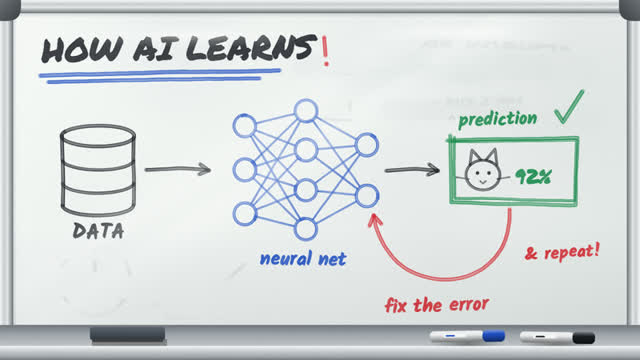
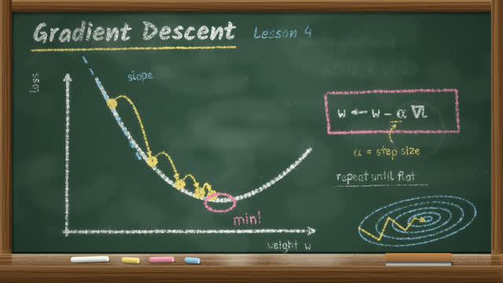
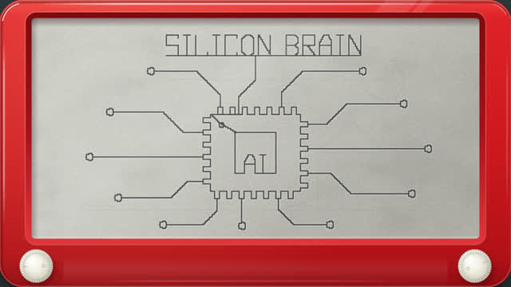
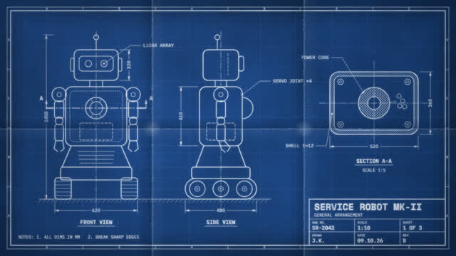
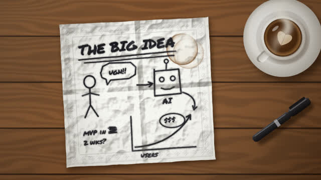
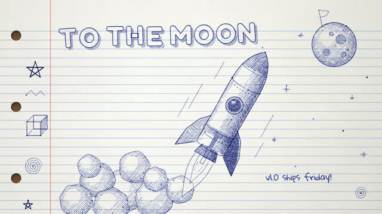
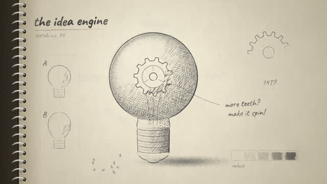

# Hand-Drawn (7 styles)

Styles from the AI Style Atlas by Futurepedia (https://www.futurepedia.io/resources/ai-style-atlas/view). Prompts and posters are reproduced with credit at the Subclip owner's request. Each entry has the atlas style card in a code block, a link to the full Copy prompt text, and our own Subclip recipe.

## 04. Whiteboard Explainer



[Watch the style clip](../examples/04-whiteboard-explainer.mp4)

Dry-erase marker on a glossy whiteboard: streaky chisel-tip strokes with pooled edges, wobbly double-traced boxes and arrows, a ghost of the last erased lesson, and a soft ceiling-light sheen.

```text
Look: Dry-erase marker on a glossy whiteboard: streaky chisel-tip strokes with pooled edges, wobbly double-traced boxes and arrows, a ghost of the last erased lesson, and a soft ceiling-light sheen.
Motion: Each stroke draws on in sequence like a hand drawing it live, with labels written letter by letter and the sheen drifting slightly as the camera breathes.
How it explains: A marker in hand draws the diagram while the camera follows it across one big board; the felt eraser wipes the loop away (leaving ghost residue) to make room for the accuracy chart, and numbers are re-scrawled in marker.
```

Full Copy prompt text (reference animation source and sound kit included): [prompts/04-whiteboard-explainer.txt](prompts/04-whiteboard-explainer.txt)

Make it in Subclip: HyperFrames SVG with wobble paths drawn on via stroke-dashoffset, in one to three marker colors. Palette: white board, black, blue #1F5FBF, red #D33F49. Motion: lines draw in time with narration, key words get a circle.
Check: draw-on ends before the narration moves to the next idea.

Source: [Futurepedia AI Style Atlas #04](https://www.futurepedia.io/resources/ai-style-atlas/view)

## 23. Chalkboard Lesson



[Watch the style clip](../examples/23-chalkboard-lesson.mp4)

Dusty chalk on a green slate: grainy, broken strokes that skip over the board tooth, colored chalk accents, cloudy eraser smears from past lessons, and a worn oak frame with a dusty chalk tray.

```text
Look: Dusty chalk on a green slate: grainy, broken strokes that skip over the board tooth, colored chalk accents, cloudy eraser smears from past lessons, and a worn oak frame with a dusty chalk tray.
Motion: Chalk lines scratch on with a little dust fall, the ball hops down the curve step by step, and old eraser clouds slowly drift as the board is wiped.
How it explains: A teacher-style lesson on one long slate: a chalk stick writes and draws while the camera tracks along the board (the hook is left behind, the chart is on the next stretch of board), arrows are dusty chalk strokes, numbers are re-chalked as they count, and pink chalk rings the key moments.
```

Full Copy prompt text (reference animation source and sound kit included): [prompts/23-chalkboard-lesson.txt](prompts/23-chalkboard-lesson.txt)

Make it in Subclip: HyperFrames SVG with a grain mask so strokes break up, drawn on over a dark green slate with smudge overlays. Palette: slate green #2F4A3C, chalk white, yellow, pink. Motion: write-on in time with narration.
Check: strokes look grainy, not vector smooth, and the board stays dark.

Source: [Futurepedia AI Style Atlas #23](https://www.futurepedia.io/resources/ai-style-atlas/view)

## 33. Etch A Sketch Toy



[Watch the style clip](../examples/33-etch-a-sketch-toy.mp4)

The classic red line-drawing toy: glossy rounded red plastic with hard specular streaks, two white knurled knobs, and a grainy silver aluminium-powder screen where everything is one thin dark line that never lifts: crisp horizontals and verticals, stair-stepped diagonals and curves, and visible travel lines joining every letter and shape.

```text
Look: The classic red line-drawing toy: glossy rounded red plastic with hard specular streaks, two white knurled knobs, and a grainy silver aluminium-powder screen where everything is one thin dark line that never lifts: crisp horizontals and verticals, stair-stepped diagonals and curves, and visible travel lines joining every letter and shape.
Motion: A shake clears the last doodle in patchy streaks, then the single line crawls out at time-lapse speed while the left knob turns with every horizontal move and the right knob with every vertical one.
How it explains: Every word and picture is one continuous stylus line with the knobs turning to match; the scene transition is shaking the toy so the drawing fades in streaks (leaving a faint ghost), arrows and labels are part of the same line (labels ride arrows and bubble edges), and numbers grow as they are written: 1,000,000 gains a zero at a time and the accuracy staircase writes 61%, 70%, 77%, 90% on its treads before a double-traced, boxed 97%.
```

Full Copy prompt text (reference animation source and sound kit included): [prompts/33-etch-a-sketch-toy.txt](prompts/33-etch-a-sketch-toy.txt)

Make it in Subclip: HyperFrames layer with a red toy frame, two knobs and a silver screen where a single continuous line draws on without lifting. Palette: toy red #D1281F, silver, white. Motion: line moves in horizontal and vertical segments only.
Check: the drawing is one unbroken line with right-angle moves.

Source: [Futurepedia AI Style Atlas #33](https://www.futurepedia.io/resources/ai-style-atlas/view)

## 37. Engineering Blueprint



[Watch the style clip](../examples/37-engineering-blueprint.mp4)

A drafted cyanotype: white line-work bleeding slightly into mottled, sun-faded Prussian-blue paper, orthographic front/side views with a hatched section, dimension chains, a zoned border, title block and worn fold creases.

```text
Look: A drafted cyanotype: white line-work bleeding slightly into mottled, sun-faded Prussian-blue paper, orthographic front/side views with a hatched section, dimension chains, a zoned border, title block and worn fold creases.
Motion: Construction and projection lines sweep across first, object lines ink in view by view, then dimensions and lettering pop in as the camera slowly pans along the sheet.
How it explains: One large drafting sheet: a plotter head inks crisp white line-work and stencilled lettering while the camera tracks across and then down the sheet to the chart detail; the model is a gear-and-knob mechanism whose dials turn, arrows are drafted leaders, and numbers tick over in mono lettering inside dimension-style callouts.
```

Full Copy prompt text (reference animation source and sound kit included): [prompts/37-engineering-blueprint.txt](prompts/37-engineering-blueprint.txt)

Make it in Subclip: HyperFrames SVG with white line work on blue, dimension arrows, title block and hatching. Palette: cyanotype blue #1B3A6B, white. Motion: lines plot on in a drafting order.
Check: all lines are white on blue and dimensions use consistent arrowheads.

Source: [Futurepedia AI Style Atlas #37](https://www.futurepedia.io/resources/ai-style-atlas/view)

## 50. Napkin Sketch



[Watch the style clip](../examples/50-napkin-sketch.mp4)

A back-of-the-napkin startup pitch in black Sharpie: ink feathering into soft tissue fibers, an embossed napkin border, quarter-fold creases and crumples, a coffee ring, all lying on a warm wooden cafe table.

```text
Look: A back-of-the-napkin startup pitch in black Sharpie: ink feathering into soft tissue fibers, an embossed napkin border, quarter-fold creases and crumples, a coffee ring, all lying on a warm wooden cafe table.
Motion: The marker scrawls each box and arrow in quick confident strokes while ink slowly feathers outward; the napkin breathes slightly as if just set down.
How it explains: A cafe-table pitch: the camera starts tight on the scrawled question then pulls back to the napkin; when a napkin is full a fresh one is slapped down on top of the pile (with a red Sharpie for the wrong guess and the 97%), arrows and numbers are fast Sharpie scrawls that feather into the tissue.
```

Full Copy prompt text (reference animation source and sound kit included): [prompts/50-napkin-sketch.txt](prompts/50-napkin-sketch.txt)

Make it in Subclip: Generated napkin texture plus HyperFrames SVG sharpie lines with a slight feather filter. Palette: napkin white, black ink, one coffee stain. Motion: sketch draws on at an uneven pace.
Check: ink edges feather softly and the napkin creases show.

Source: [Futurepedia AI Style Atlas #50](https://www.futurepedia.io/resources/ai-style-atlas/view)

## 68. Ballpoint Notebook



[Watch the style clip](../examples/68-ballpoint-notebook.mp4)

A blue Bic doodle in the back of a college-ruled notebook: dense crosshatching for darks, pressure-varied lines with ink blobs where strokes start, bubble lettering with a hatched drop shadow and compulsive margin doodles.

```text
Look: A blue Bic doodle in the back of a college-ruled notebook: dense crosshatching for darks, pressure-varied lines with ink blobs where strokes start, bubble lettering with a hatched drop shadow and compulsive margin doodles.
Motion: Lines scratch on stroke by stroke, then layers of crosshatching build up the shadows pass by pass, while the margin doodles get traced over and over.
How it explains: Doodled down one long college-ruled page: the pen draws while the camera scrolls along and then down the page, headings are bubble letters with crosshatched shadows, boxes get hatched drop-shadows, a red pen marks the wrong guess, and counters are re-inked in bubble numerals.
```

Full Copy prompt text (reference animation source and sound kit included): [prompts/68-ballpoint-notebook.txt](prompts/68-ballpoint-notebook.txt)

Make it in Subclip: HyperFrames SVG with blue pen line wobble, crosshatching and ruled notebook paper. Palette: paper white with blue ruling and #1740C8 ink. Motion: doodles draw on.
Check: only blue ink is used and the lines vary in pressure.

Source: [Futurepedia AI Style Atlas #68](https://www.futurepedia.io/resources/ai-style-atlas/view)

## 78. Sketchbook Graphite



[Watch the style clip](../examples/78-sketchbook-graphite.mp4)

A graphite study in a spiral sketchbook: faint construction circles and axes under confident darker contours, directional hatching that breaks on the paper tooth, smudged tones, kneaded-eraser highlights and a margin note.

```text
Look: A graphite study in a spiral sketchbook: faint construction circles and axes under confident darker contours, directional hatching that breaks on the paper tooth, smudged tones, kneaded-eraser highlights and a margin note.
Motion: Construction lines ghost in first, contours firm up over them, then hatching sweeps across the shadow side while the eraser lifts the highlight.
How it explains: A pencil works across a wide sketchbook spread (faint construction pass first, then a firm contour, crescent hatching for form) while the camera follows, then the page physically turns to a fresh sheet for the progress chart; numbers are pencilled and re-pencilled as they count.
```

Full Copy prompt text (reference animation source and sound kit included): [prompts/78-sketchbook-graphite.txt](prompts/78-sketchbook-graphite.txt)

Make it in Subclip: HyperFrames SVG with pencil texture, construction lines and hatching on cream paper. Palette: graphite grays on cream. Motion: strokes build the form step by step.
Check: construction lines remain faintly visible under the final contours.

Source: [Futurepedia AI Style Atlas #78](https://www.futurepedia.io/resources/ai-style-atlas/view)
