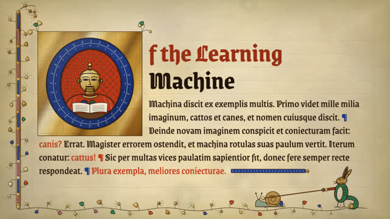
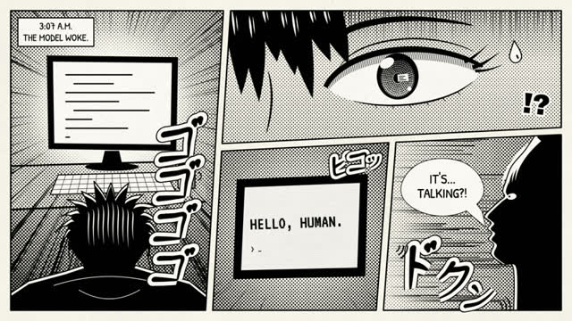
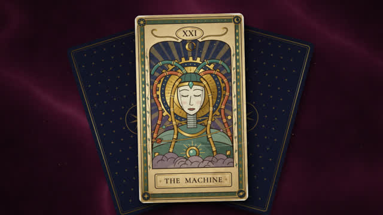
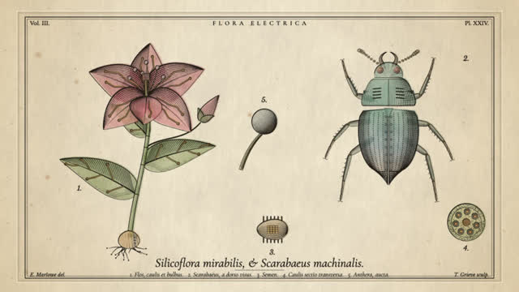
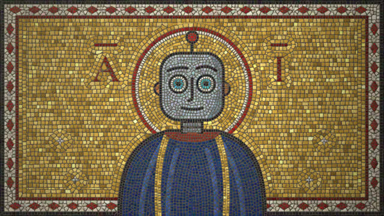
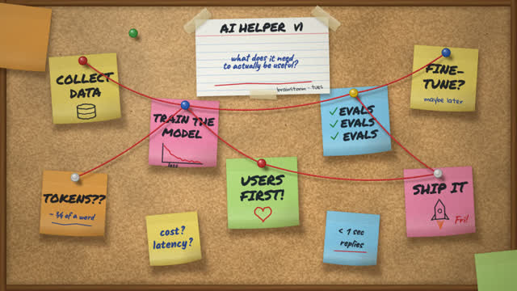
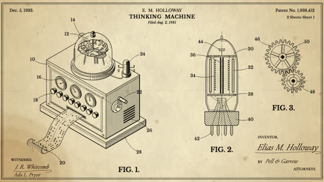

# Illustration (7 styles)

Styles from the AI Style Atlas by Futurepedia (https://www.futurepedia.io/resources/ai-style-atlas/view). Prompts and posters are reproduced with credit at the Subclip owner's request. Each entry has the atlas style card in a code block, a link to the full Copy prompt text, and our own Subclip recipe.

## 10. Illuminated Manuscript



A Book of Hours folio: mottled vellum with ruling and pricking, textura in iron-gall ink with vermilion rubrics, a historiated initial on raised burnished gold, lapis, rose and malachite with white-lead filigree, ivy-leaf rinceaux with gold bezants, and drolleries in the margins.

```text
Look: A Book of Hours folio: mottled vellum with ruling and pricking, textura in iron-gall ink with vermilion rubrics, a historiated initial on raised burnished gold, lapis, rose and malachite with white-lead filigree, ivy-leaf rinceaux with gold bezants, and drolleries in the margins.
Motion: The scribe works the page: gold leaf is laid square by square and burnished to a travelling glint, pigments flood into the pen outlines, and the quill writes the text line by line.
How it explains: Three folios of a manuscript, the leaf turning between them: champ initials bloom in gold, the examples are bestiary roundels flowing along a penwork arrow into a Brazen Head, the learning loop is a wheel of Guess, Check and Adjust where a marginal beast points out the error and the scribe corrects it in red, and accuracy rises as gilded bars until 97% turns to burnished gold.
```

Full Copy prompt text (reference animation source and sound kit included): [prompts/10-illuminated-manuscript.txt](prompts/10-illuminated-manuscript.txt)

Make it in Subclip: generated page art (`generate_ai_media`, prompt of your own) for the decorated letter and borders, with HyperFrames text layers for the lettering so the words stay editable. Palette: parchment #E9DDBF, ink, vermilion, gold #C9A227, lapis. Motion: slow pan across the page, gold shimmer sweep.
Check: body text is real text, not baked into an image.

Source: [Futurepedia AI Style Atlas #10](https://www.futurepedia.io/resources/ai-style-atlas/view)

## 41. Manga Page



A black-and-white manga page: slanted panel gutters, brush-tapered ink, radiating focus lines, true halftone screentone gradients, katakana sound effects with white knock-out borders and hand-lettered speech balloons.

```text
Look: A black-and-white manga page: slanted panel gutters, brush-tapered ink, radiating focus lines, true halftone screentone gradients, katakana sound effects with white knock-out borders and hand-lettered speech balloons.
Motion: Panels land one after another with a camera shake; focus lines "boil" every couple of frames and the ゴゴゴ letters tremble.
How it explains: A three-page manga: panels slam in on twos, page turns carry the story, bold outlined arrows and katakana SFX (ドドド, ブー, カチカチ, ピンポーン, グングン) mark cause and effect, numbers count in narration boxes, and focus-line bursts hit the key beats.
```

Full Copy prompt text (reference animation source and sound kit included): [prompts/41-manga-page.txt](prompts/41-manga-page.txt)

Make it in Subclip: HyperFrames SVG with slanted panels, speed lines, screentone dots and sound effect lettering. Palette: black and white only. Motion: panels slide in, focus lines pulse.
Check: no gray fills, only dot or line patterns.

Source: [Futurepedia AI Style Atlas #41](https://www.futurepedia.io/resources/ai-style-atlas/view)

## 47. Tarot Card



An aged art-nouveau tarot trump on crushed velvet: bold even outlines, flat muted lithograph colours, gold-foil halos and borders, celestial symbols and a worn, foxed cardstock with frayed corners.

```text
Look: An aged art-nouveau tarot trump on crushed velvet: bold even outlines, flat muted lithograph colours, gold-foil halos and borders, celestial symbols and a worn, foxed cardstock with frayed corners.
Motion: The card is dealt and flips onto the velvet; a sheen of light slides across the gold foil while the orbiting planets drift around the automaton.
How it explains: Told as a tarot reading: cards are dealt, flipped and gathered off the velvet as the scene changes, gold filigree arrows link the spread, brass plaques count the examples and the accuracy, and a burst of gold light marks the wrong guess and the 97%.
```

Full Copy prompt text (reference animation source and sound kit included): [prompts/47-tarot-card.txt](prompts/47-tarot-card.txt)

Make it in Subclip: Generated card art (`generate_ai_media`) with an art-nouveau tarot prompt of your own, with HyperFrames text for the title bar. Palette: muted lithograph colors with gold. Motion: slow foil shimmer.
Check: the card title is real editable text, and borders look aged.

Source: [Futurepedia AI Style Atlas #47](https://www.futurepedia.io/resources/ai-style-atlas/view)

## 60. Botanical Plate



A hand-coloured copperplate natural-history plate: swelling engraved hatching that follows every form, loose transparent watercolour tints laid over the print, numbered figures, Latin italic captions and foxed rag paper with a pressed plate mark.

```text
Look: A hand-coloured copperplate natural-history plate: swelling engraved hatching that follows every form, loose transparent watercolour tints laid over the print, numbered figures, Latin italic captions and foxed rag paper with a pressed plate mark.
Motion: The circuit-flower sways on its stem while the copper beetle flexes its antennae; tints bleed in a beat after the engraved lines appear.
How it explains: Three plates from a naturalist's folio, each pulled fresh under the press roller: engraved specimens of cats and dogs feed the circuit-lily "model", a life-cycle plate with fletched engraved arrows shows Guess, Check and Adjust, and a growth-stage plate counts accuracy in an engraved cartouche, with the colourist's red wash ringing the key moments.
```

Full Copy prompt text (reference animation source and sound kit included): [prompts/60-botanical-plate.txt](prompts/60-botanical-plate.txt)

Make it in Subclip: Generated plate art (`generate_ai_media`) with a botanical engraving prompt of your own plus HyperFrames labels. Palette: cream paper, sepia ink, soft watercolor tints. Motion: slow pan across the plate.
Check: hatching follows each form and labels are real text.

Source: [Futurepedia AI Style Atlas #60](https://www.futurepedia.io/resources/ai-style-atlas/view)

## 62. Byzantine Mosaic



A Byzantine wall mosaic built from thousands of hand-cut tesserae laid in rows that echo every contour (andamento), with mortar grout, bevelled tile edges, per-tile colour variation and a glinting gold-smalti ground.

```text
Look: A Byzantine wall mosaic built from thousands of hand-cut tesserae laid in rows that echo every contour (andamento), with mortar grout, bevelled tile edges, per-tile colour variation and a glinting gold-smalti ground.
Motion: Light rakes across the wall so individual gold smalti flash in turn; tiles could be laid row by row outward from the figure.
How it explains: Every scene is a fresh andamento-tessellated wall: tiles are laid element by element (arrows tile by tile along their length), scene changes pry the old tesserae up and re-lay the wall in a sweeping front, counters are live tesserae re-set on a grid, and gold smalti flash on the key moments.
```

Full Copy prompt text (reference animation source and sound kit included): [prompts/62-byzantine-mosaic.txt](prompts/62-byzantine-mosaic.txt)

Make it in Subclip: Generated mosaic art (`generate_ai_media`) with a tesserae prompt of your own, or a HyperFrames canvas of rows of small tiles. Palette: gold, lapis, terracotta. Motion: light sweeps across tiles.
Check: tiles follow the contours and gold tiles glint unevenly.

Source: [Futurepedia AI Style Atlas #62](https://www.futurepedia.io/resources/ai-style-atlas/view)

## 64. Sticky-Note Wall



A brainstorming cork board: curling Post-its with adhesive bands and lifted-corner shadows, marker handwriting and doodles, a taped index card, push pins and red yarn connecting the ideas.

```text
Look: A brainstorming cork board: curling Post-its with adhesive bands and lifted-corner shadows, marker handwriting and doodles, a taped index card, push pins and red yarn connecting the ideas.
Motion: Notes slap onto the board one by one with a tiny bounce, then red yarn unspools from pin to pin linking the ideas.
How it explains: A detective-board camera move across one big cork wall: notes slap in on cue, marker arrows and red yarn draw the flow, numbers are crossed out and rewritten by hand, and red marker circles the key moments.
```

Full Copy prompt text (reference animation source and sound kit included): [prompts/64-sticky-note-wall.txt](prompts/64-sticky-note-wall.txt)

Make it in Subclip: HyperFrames HTML layers with rotated colored notes, shadows and a yarn connection. Palette: yellow, pink, blue notes on cork. Motion: notes stick in with a small rotation.
Check: notes shadow consistently and handwriting stays legible.

Source: [Futurepedia AI Style Atlas #64](https://www.futurepedia.io/resources/ai-style-atlas/view)

## 73. Patent Drawing



A 1930s US patent sheet: ruling-pen black ink line art with shade lines, parallel-line and stipple shading, section hatching, reference numerals on curved leaders, typeset header and inked signatures on yellowed paper.

```text
Look: A 1930s US patent sheet: ruling-pen black ink line art with shade lines, parallel-line and stipple shading, section hatching, reference numerals on curved leaders, typeset header and inked signatures on yellowed paper.
Motion: Lines are inked one stroke at a time like a draughtsman at work - outlines first, then hatching, then numerals - while the FIG. 3 gear train slowly turns.
How it explains: The camera travels along one long patent sheet as FIG. 4–6 are inked stroke by stroke: ruled arrows and leader lines tie labels to parts, odometer drums count the examples and the accuracy, and an examiner's red pencil rings the wrong guess and the 97%.
```

Full Copy prompt text (reference animation source and sound kit included): [prompts/73-patent-drawing.txt](prompts/73-patent-drawing.txt)

Make it in Subclip: HyperFrames SVG with thin black line art, numbered leader lines and figure captions on white paper. Palette: black on cream. Motion: parts draw on in numbered order.
Check: every part has a numeral and a leader line.

Source: [Futurepedia AI Style Atlas #73](https://www.futurepedia.io/resources/ai-style-atlas/view)
