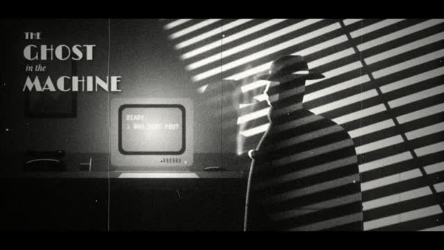
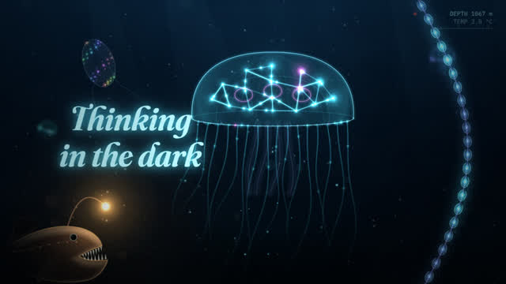
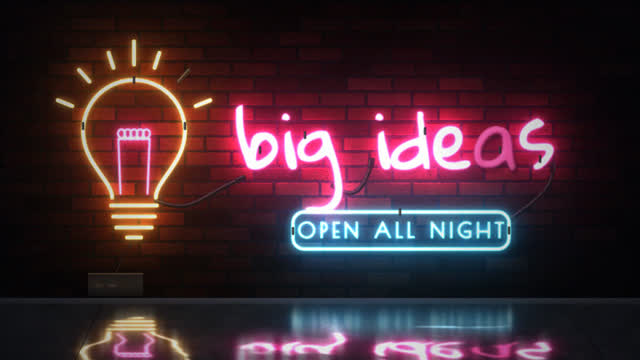
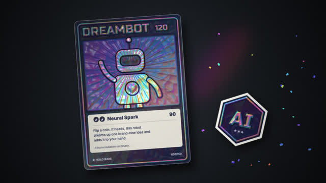
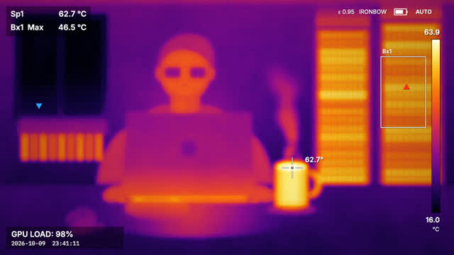
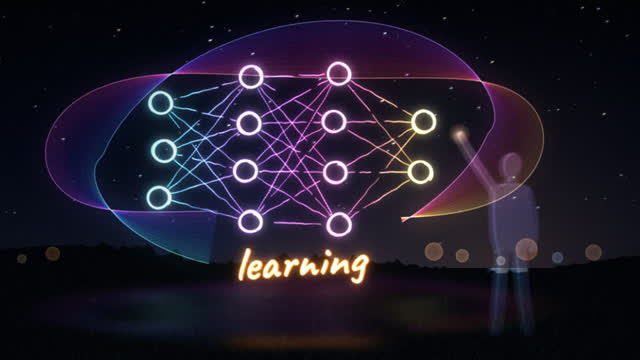
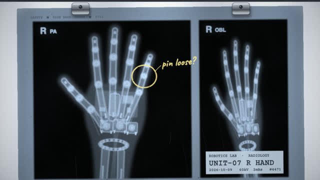

# Light & Imaging (7 styles)

Styles from the AI Style Atlas by Futurepedia (https://www.futurepedia.io/resources/ai-style-atlas/view). Prompts and posters are reproduced with credit at the Subclip owner's request. Each entry has the atlas style card in a code block, a link to the full Copy prompt text, and our own Subclip recipe.

## 08. 1940s Film Noir



A high-contrast black-and-white still from a forties detective picture: venetian-blind light slicing across a fedora silhouette, a glowing terminal as the only other light, cigarette smoke hanging in the beams, with heavy nitrate grain, gate weave, dust and scratches.

```text
Look: A high-contrast black-and-white still from a forties detective picture: venetian-blind light slicing across a fedora silhouette, a glowing terminal as the only other light, cigarette smoke hanging in the beams, with heavy nitrate grain, gate weave, dust and scratches.
Motion: Blinds sway and smoke curls in a dark office; the terminal warms up with a CRT flash, its glow rim-lights the detective, a prompt types out, and the title card dissolves in word by word over projector flicker, weave and dirt.
How it explains: Told as a 1940s newsreel / B-picture montage: spinning-newspaper headlines, iris, wipe and clock-wipe transitions, mugshot booking placards as labels, white newsreel arrows and lettering, a rolling mechanical odometer for numbers and a rubber stamp slammed down as the emphasis, all under heavy grain and gate weave.
```

Full Copy prompt text (reference animation source and sound kit included): [prompts/08-1940s-film-noir.txt](prompts/08-1940s-film-noir.txt)

Make it in Subclip: generated images or video (`generate_ai_media`) with a noir lighting prompt of your own, then grain and dust overlay as a HyperFrames layer. Palette: grayscale only. Motion: light stripes drift slowly, slight frame weave. Captions: white serif, low in frame.
Check: no color pixels remain; blacks stay deep.

Source: [Futurepedia AI Style Atlas #08](https://www.futurepedia.io/resources/ai-style-atlas/view)

## 12. Bioluminescent Deep Sea



The midnight zone: near-black water with parallax marine snow, and nothing lit but living light - a jellyfish whose nerve net glows like a neural network, a siphonophore chain, a rainbow-rippling comb jelly and an anglerfish lure. Additive cyan, teal and electric-blue glow with magenta and amber accents; type is bioluminescent.

```text
Look: The midnight zone: near-black water with parallax marine snow, and nothing lit but living light - a jellyfish whose nerve net glows like a neural network, a siphonophore chain, a rainbow-rippling comb jelly and an anglerfish lure. Additive cyan, teal and electric-blue glow with magenta and amber accents; type is bioluminescent.
Motion: The camera sinks (marine snow streams upward) as animals switch on one by one: bell rims pulse, nerve-net nodes flicker alight, the siphonophore lights segment by segment, the lure blinks on, and the words form out of gathering plankton.
How it explains: A descent through the midnight zone: the question forms from gathering plankton, cat and dog swarms ride a glowing current into a jellyfish model whose nerve net is its weights, the error ripples back through the net in magenta, accuracy climbs a siphonophore chain to a plankton bloom-burst, and transitions are a descent, a sweeping plankton bloom and an anglerfish lure lighting new water.
```

Full Copy prompt text (reference animation source and sound kit included): [prompts/12-bioluminescent-deep-sea.txt](prompts/12-bioluminescent-deep-sea.txt)

Make it in Subclip: HyperFrames canvas or SVG with additive-blended glows and drifting particles, or generated creature stills. Palette: #02060F, cyan #26C9D5, electric blue, small magenta and amber accents. Type glows softly. Motion: slow pulses and parallax drift.
Check: only glowing elements are bright; text stays legible.

Source: [Futurepedia AI Style Atlas #12](https://www.futurepedia.io/resources/ai-style-atlas/view)

## 19. Neon Sign at Night



Hand-bent glass neon on an old brick wall after rain: white-hot tube cores, saturated colour halos, painted-out blockout tube, clips and electrodes, light spilling across the brickwork and smearing in the wet pavement.

```text
Look: Hand-bent glass neon on an old brick wall after rain: white-hot tube cores, saturated colour halos, painted-out blockout tube, clips and electrodes, light spilling across the brickwork and smearing in the wet pavement.
Motion: Tubes buzz on letter by letter with a stutter, one failing letter keeps flickering, and the puddle reflection shivers as drops land.
How it explains: One long brick wall the camera whip-pans along: every beat is a new neon sign that buzzes on tube by tube, arrows are segmented chase-light tubes that ignite toward their target, numbers are neon digits re-lit as they change, and the emphasis is a blinking red tube with a ring.
```

Full Copy prompt text (reference animation source and sound kit included): [prompts/19-neon-sign-at-night.txt](prompts/19-neon-sign-at-night.txt)

Make it in Subclip: Generated brick-wall still plus a HyperFrames text layer with layered blurred glow for the tubes. Palette: dark brick, hot pink, cyan, white-hot cores. Motion: a slight flicker on one tube only.
Check: glow never exceeds three flickers per second and the text stays readable.

Source: [Futurepedia AI Style Atlas #19](https://www.futurepedia.io/resources/ai-style-atlas/view)

## 30. Holographic Foil Card



A holo-rare trading card and die-cut sticker: cracked-ice foil whose rainbow diffraction shifts with angle and surface normals, embossed robot, sunburst and lettering catching specular glints, printed ink sitting on top, glitter flecks and rainbow spill on the desk.

```text
Look: A holo-rare trading card and die-cut sticker: cracked-ice foil whose rainbow diffraction shifts with angle and surface normals, embossed robot, sunburst and lettering catching specular glints, printed ink sitting on top, glitter flecks and rainbow spill on the desk.
Motion: The card is dealt in and settles onto the desk, the sticker slaps down and holo confetti scatters, then the card slowly tilts toward the light so the rainbow band and specular glints sweep across the cracked-ice foil and embossed lettering.
How it explains: Told with holo trading cards on a desk: examples are dealt as CAT/DOG cards onto a pile, arrows and answers are die-cut foil stickers slapped down with an overshoot, the model card\u2019s stat bars are its weights, scene changes are card flips to the stats side and back, and numbers are foil-embossed digits with a glint sweep for emphasis.
```

Full Copy prompt text (reference animation source and sound kit included): [prompts/30-holographic-foil-card.txt](prompts/30-holographic-foil-card.txt)

Make it in Subclip: HyperFrames layer with a conic or angled rainbow gradient masked to the artwork and moved by a slow pointer-like angle. Palette: iridescent spectrum on silver. Motion: a tilt that shifts the sheen.
Check: the rainbow shifts with the tilt and text stays legible above it.

Source: [Futurepedia AI Style Atlas #30](https://www.futurepedia.io/resources/ai-style-atlas/view)

## 36. Thermal Camera



A handheld IR camera frame in ironbow: soft low-res heat field, cold glasses and warm breath, hot coffee and GPU racks, edge-enhanced outlines, sensor noise and the camera’s own HUD with spot meter, box measurement and scale bar.

```text
Look: A handheld IR camera frame in ironbow: soft low-res heat field, cold glasses and warm breath, hot coffee and GPU racks, edge-enhanced outlines, sensor noise and the camera’s own HUD with spot meter, box measurement and scale bar.
Motion: Camera clicks through its shutter calibration, the auto-gain settles, coffee is hot-poured and steam rises, rack bands heat up bottom to top while the spot meter glides onto the mug and the readouts tick live.
How it explains: Everything is filmed through the IR camera: scenes change with the shutter-calibration (NUC) click, heat is activity and a cold wave is the error signal, while the camera\u2019s own HUD does the explaining with spot-meter arrows, measurement-box emphasis, tag labels riding on objects and live readouts.
```

Full Copy prompt text (reference animation source and sound kit included): [prompts/36-thermal-camera.txt](prompts/36-thermal-camera.txt)

Make it in Subclip: Generated thermal-look stills or a HyperFrames canvas with an ironbow color ramp over blurred heat shapes and a crosshair readout. Palette: black, purple, orange, white. Motion: slow sensor noise.
Check: color maps from cold to hot only and the temperature readout stays plausible.

Source: [Futurepedia AI Style Atlas #36](https://www.futurepedia.io/resources/ai-style-atlas/view)

## 43. Light Painting



A 30-second exposure in a dark field: a neural network drawn in the air with an LED wand and a twisting rainbow light-tube ribbon, hand-jittered trails with hot cores and coloured falloff, a ghost of the painter, pinpoint stars, horizon bokeh and colour spill on the grass.

```text
Look: A 30-second exposure in a dark field: a neural network drawn in the air with an LED wand and a twisting rainbow light-tube ribbon, hand-jittered trails with hot cores and coloured falloff, a ghost of the painter, pinpoint stars, horizon bokeh and colour spill on the grass.
Motion: Shot as a live-composite exposure: the wand traces node after node and fans out each layer of connections, the RGB tube sweeps the twisting ribbon around it, the word is written last, while the ghost painter slowly accumulates and star trails lengthen.
How it explains: Each beat is a fresh live long exposure: the wand traces doodles, arrows and handwriting with its glowing tip, orbs leave arcing light trails into the network, numbers come from an LED pixel-stick, the emphasis is a traced ring with a spark burst, and between beats the camera whip-pans so every trail smears into streaks.
```

Full Copy prompt text (reference animation source and sound kit included): [prompts/43-light-painting.txt](prompts/43-light-painting.txt)

Make it in Subclip: HyperFrames canvas that accumulates light trails with additive blending in a dark scene. Palette: black with rainbow neon trails. Motion: trails are drawn over a few seconds and then hold.
Check: background stays near black and trails brighten at overlaps.

Source: [Futurepedia AI Style Atlas #43](https://www.futurepedia.io/resources/ai-style-atlas/view)

## 52. Radiograph on Lightbox



A blue-base X-ray film clipped to a glowing viewer: additive translucent density of a robot hand - hollow-shelled bones, pivot pins, screws, tendons, battery cell and gears - with collimation borders, lead markers, an ID flash, grease-pencil notes, scratches and dust.

```text
Look: A blue-base X-ray film clipped to a glowing viewer: additive translucent density of a robot hand - hollow-shelled bones, pivot pins, screws, tendons, battery cell and gears - with collimation borders, lead markers, an ID flash, grease-pencil notes, scratches and dust.
Motion: The viewer\u2019s fluorescent tubes stutter on one by one, the film develops from milky fog to deep blue-black top-down like it was dipped in the tank, then a grease pencil circles the loose pin and scrawls a note while the camera slowly pushes in.
How it explains: A radiologist working a lightbox: scenes change by pulling films down and slapping new ones up under the clips, arrows, circles and answers are grease pencil on the glass, the counter is typed by the ID flasher and accuracy is rewritten round by round, with masking-tape labels for the header and takeaway.
```

Full Copy prompt text (reference animation source and sound kit included): [prompts/52-radiograph-on-lightbox.txt](prompts/52-radiograph-on-lightbox.txt)

Make it in Subclip: HyperFrames layer with an inverted or blue-tinted additive layered drawing on a lightbox frame. Palette: blue-black, white, cyan bone tone. Motion: slow glow flicker of the lightbox.
Check: darker regions mean thinner material as an X-ray would show.

Source: [Futurepedia AI Style Atlas #52](https://www.futurepedia.io/resources/ai-style-atlas/view)
