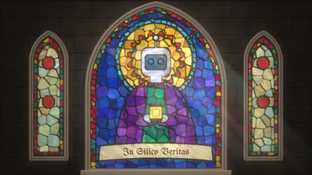
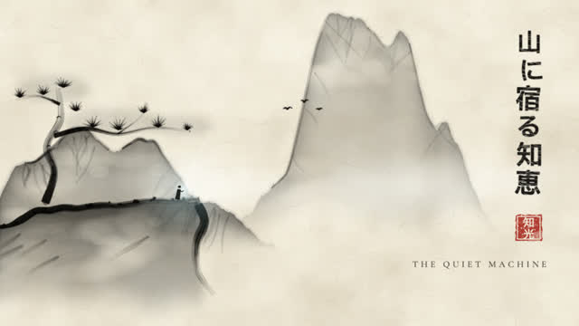
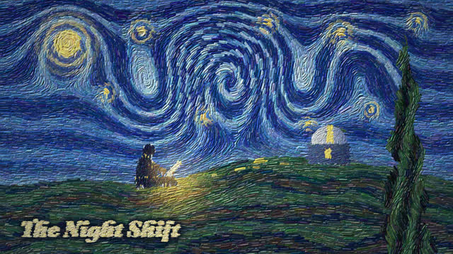
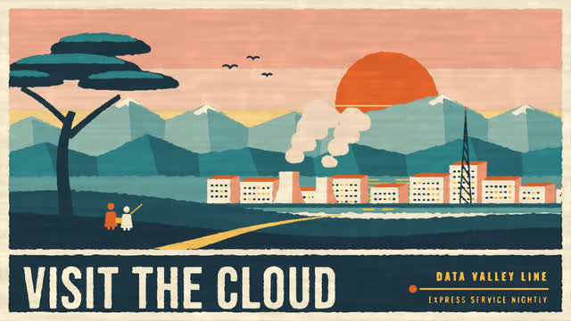
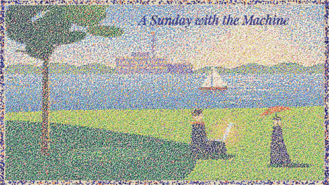

# Painterly (6 styles)

Styles from the AI Style Atlas by Futurepedia (https://www.futurepedia.io/resources/ai-style-atlas/view). Prompts and posters are reproduced with credit at the Subclip owner's request. Each entry has the atlas style card in a code block, a link to the full Copy prompt text, and our own Subclip recipe.

## 02. Watercolor Wash


[Watch the style clip](../examples/02-watercolor-wash.mp4)

Transparent pigment glazed in dozens of ragged low-opacity layers on cold-press paper: dark pooled edges, wet-in-wet bleeds, cauliflower blooms, granulation and untouched white paper for the lights, over a faint pencil sketch.

```text
Look: Transparent pigment glazed in dozens of ragged low-opacity layers on cold-press paper: dark pooled edges, wet-in-wet bleeds, cauliflower blooms, granulation and untouched white paper for the lights, over a faint pencil sketch.
Motion: Each wash floods in from its pencil outline, edges darken as the water dries and blooms creep outward; the title is brushed in stroke by stroke.
How it explains: One long sketchbook sheet the camera pans along; arrows are loaded round-brush strokes with pooled edges, labels and the counter are brush-lettered and re-written as they change, and red alizarin circles do the emphasis.
```

Full Copy prompt text (reference animation source and sound kit included): [prompts/02-watercolor-wash.txt](prompts/02-watercolor-wash.txt)

Make it in Subclip: generated images (`generate_ai_media`) with a watercolor prompt of your own: cold-press paper, translucent glazes, light pencil underdrawing. Native slow zoom, and a HyperFrames paper-texture overlay. Palette: muted blues, ochre, alizarin red accents. Handwritten type for labels.
Check: no hard digital edges; paper white remains visible in each frame.

Source: [Futurepedia AI Style Atlas #02](https://www.futurepedia.io/resources/ai-style-atlas/view)

## 25. Cathedral Glass



[Watch the style clip](../examples/25-cathedral-glass.mp4)

A leaded Gothic window: hand-cut pieces of streaky, seedy antique glass held in thick dark came, painted grisaille details, and light blazing through into a dim stone interior with dusty rays.

```text
Look: A leaded Gothic window: hand-cut pieces of streaky, seedy antique glass held in thick dark came, painted grisaille details, and light blazing through into a dim stone interior with dusty rays.
Motion: Daylight sweeps slowly across the window so pieces brighten in turn, the rays drift with floating dust, and the chip in the saint's hands pulses.
How it explains: Told as a cycle of three leaded windows along a nave, the camera walking from window to window; arrows are strips of glass in lead came with glass arrowheads, labels and the counters are grisaille painted on pale banner glass, and emphasis is ruby glass rings and light flaring through the pieces.
```

Full Copy prompt text (reference animation source and sound kit included): [prompts/25-cathedral-glass.txt](prompts/25-cathedral-glass.txt)

Make it in Subclip: HyperFrames SVG with thick dark leading between colored panes and a strong light bloom behind. Palette: ruby, cobalt, emerald, amber on near-black. Motion: slow light sweep through the glass.
Check: lead lines stay uniform and colors glow without washing out text.

Source: [Futurepedia AI Style Atlas #25](https://www.futurepedia.io/resources/ai-style-atlas/view)

## 32. Sumi-e Ink Wash



[Watch the style clip](../examples/32-sumi-e-ink-wash.mp4)

Monochrome Japanese ink painting on fibrous rice paper: dilute grey washes that bleed and fade into mist, a few confident loaded-brush strokes that split into dry bristle tracks, vast negative space, a vertical calligraphy column and a vermilion seal.

```text
Look: Monochrome Japanese ink painting on fibrous rice paper: dilute grey washes that bleed and fade into mist, a few confident loaded-brush strokes that split into dry bristle tracks, vast negative space, a vertical calligraphy column and a vermilion seal.
Motion: Mist drifts sideways across the peaks while each brush stroke is laid down in one sweep, bristles running dry as it travels; the tiny device on the ledge pulses with light.
How it explains: Told along a handscroll the camera unrolls, with mist drifting across between scenes; arrows and the chart are single loaded brush strokes that run dry, labels and numbers are ink-written in place, and vermilion strokes and seal stamps do the emphasis.
```

Full Copy prompt text (reference animation source and sound kit included): [prompts/32-sumi-e-ink-wash.txt](prompts/32-sumi-e-ink-wash.txt)

Make it in Subclip: Generated ink-wash stills with a sumi-e prompt of your own, or HyperFrames SVG with blurred gray washes and dry-brush strokes. Palette: black ink, grays, a single red seal. Motion: slow mist drift.
Check: lots of empty paper is left and only one red accent exists.

Source: [Futurepedia AI Style Atlas #32](https://www.futurepedia.io/resources/ai-style-atlas/view)

## 38. Impasto Night



[Watch the style clip](../examples/38-impasto-night.mp4)

Thick oil paint in short loaded strokes that follow a swirling flow field, Post-Impressionist night-sky style; every stroke stands off the canvas with a lit ridge and a shadowed edge, colour broken within each stroke.

```text
Look: Thick oil paint in short loaded strokes that follow a swirling flow field, Post-Impressionist night-sky style; every stroke stands off the canvas with a lit ridge and a shadowed edge, colour broken within each stroke.
Motion: The sky's strokes slowly rotate along their swirl and the halos around the moon and stars pulse ring by ring, as if the paint itself were turning.
How it explains: The camera travels along one long swirling night-sky canvas; arrows, rings, labels and numbers are all laid on as fat lit daubs of paint (shadow edge, body, highlight ridge) in chrome yellow and vermilion against the blues.
```

Full Copy prompt text (reference animation source and sound kit included): [prompts/38-impasto-night.txt](prompts/38-impasto-night.txt)

Make it in Subclip: Generated painted stills (`generate_ai_media`) with a thick oil swirl prompt of your own, with a slow native push-in. Palette: deep blue, yellow, white strokes.
Check: brush ridges are visible and stroke direction follows the flow of the sky.

Source: [Futurepedia AI Style Atlas #38](https://www.futurepedia.io/resources/ai-style-atlas/view)

## 49. Gouache Travel Poster



[Watch the style clip](../examples/49-gouache-travel-poster.mp4)

Mid-century travel poster hand-painted in gouache: six flat, opaque, matte colours stacked in receding layers, dry-brush streaks where the paint thins at each edge, and a bold hand-lettered block.

```text
Look: Mid-century travel poster hand-painted in gouache: six flat, opaque, matte colours stacked in receding layers, dry-brush streaks where the paint thins at each edge, and a bold hand-lettered block.
Motion: Layers slide in parallax like stacked paper cut-outs, the sun rises behind the ridges, steam puffs bob from the cooling towers and server windows blink on in rows.
How it explains: A run of hand-painted posters: each scene change is a fresh coat of cream swept across the board before the next poster is painted flat colour by flat colour; arrows are flat poster arrow shapes, numbers are repainted in the lettering band, and an orange starburst stamps the key moments.
```

Full Copy prompt text (reference animation source and sound kit included): [prompts/49-gouache-travel-poster.txt](prompts/49-gouache-travel-poster.txt)

Make it in Subclip: Generated flat-color poster art with a gouache travel prompt of your own, with HyperFrames text for a big title. Palette: six matte colors maximum. Motion: layers slide with a tiny parallax.
Check: no gradients and no more than six colors per frame.

Source: [Futurepedia AI Style Atlas #49](https://www.futurepedia.io/resources/ai-style-atlas/view)

## 71. Pointillist Afternoon



[Watch the style clip](../examples/71-pointillist-afternoon.mp4)

Neo-Impressionist divisionism: every form is built from small dabs of unmixed pigment - complementary hues side by side that blend optically - with the canvas weave peeking between the dots and a dotted painted border.

```text
Look: Neo-Impressionist divisionism: every form is built from small dabs of unmixed pigment - complementary hues side by side that blend optically - with the canvas weave peeking between the dots and a dotted painted border.
Motion: Dots shimmer as individual dabs re-pick their hue each frame while the overall colour holds, like light vibrating on the water; the sailboat drifts and the parasol sways.
How it explains: Every frame re-dabs one fixed field of pure-pigment dots against the current scene, so moving things shimmer as dots re-pick their hue; scene changes are the canvas being re-dabbed in a diagonal sweep, and lettering, arrows, counters and the emphasis rings are all fine dabs.
```

Full Copy prompt text (reference animation source and sound kit included): [prompts/71-pointillist-afternoon.txt](prompts/71-pointillist-afternoon.txt)

Make it in Subclip: Generated divisionist stills with a dabs-of-color prompt of your own, or a HyperFrames canvas of small colored dots. Palette: complementary dots side by side. Motion: subtle shimmer.
Check: zoom in and confirm dots are unmixed pure colors.

Source: [Futurepedia AI Style Atlas #71](https://www.futurepedia.io/resources/ai-style-atlas/view)
