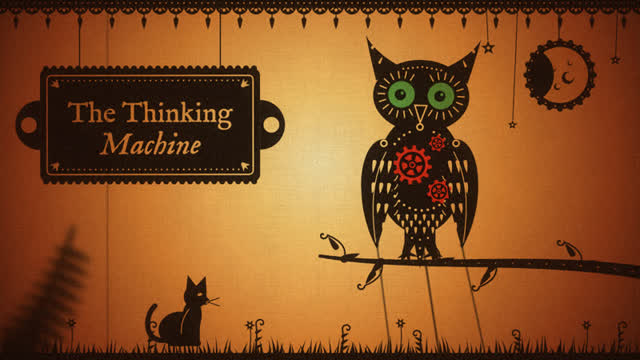
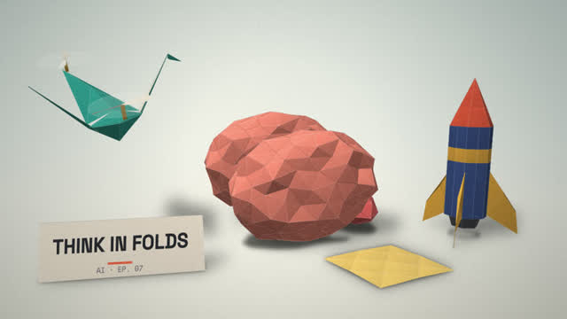
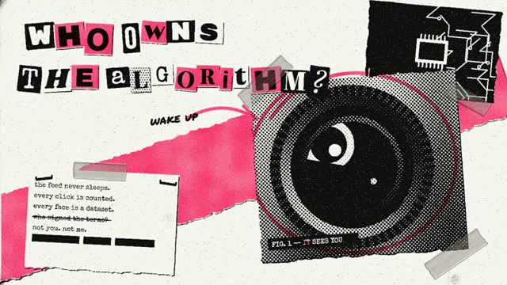
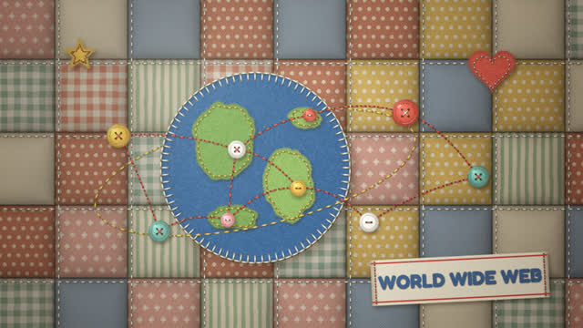
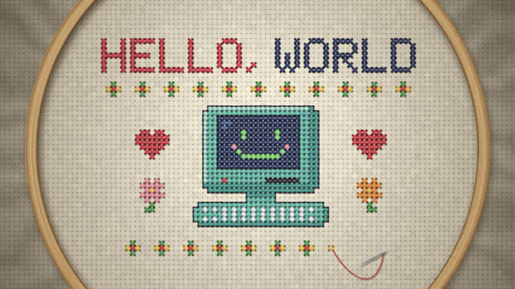

# Paper & Craft (7 styles)

Styles from the AI Style Atlas by Futurepedia (https://www.futurepedia.io/resources/ai-style-atlas/view). Prompts and posters are reproduced with credit at the Subclip owner's request. Each entry has the atlas style card in a code block, a link to the full Copy prompt text, and our own Subclip recipe.

## 03. Shadow Puppet Theatre



Black cut-out silhouettes with punched lace-like cut-work, pinned joints and thin control rods, pressed against a backlit cloth screen glowing amber at the lamp and falling to red-brown at the edges, with coloured gels in the openings.

```text
Look: Black cut-out silhouettes with punched lace-like cut-work, pinned joints and thin control rods, pressed against a backlit cloth screen glowing amber at the lamp and falling to red-brown at the edges, with coloured gels in the openings.
Motion: The oil lamp sputters alight, puppets slide and hop in on their rods with jointed limbs swinging, hanging cards drop and sway on their strings, and the flame keeps the screen gently breathing.
How it explains: Told as a little shadow play: a mechanical owl puppet is fed picture cards on rods, guesses on a hanging tag, a teacher's hand corrects it and its cut-work gears re-set, then it climbs a ladder toward a filling moon; transitions are the medium's own (the owl flies at the lamp so its shadow fills the screen, the lamp is turned down and up, lace curtains close and part), arrows are growing hide vines and labels are punched plaques on strings.
```

Full Copy prompt text (reference animation source and sound kit included): [prompts/03-shadow-puppet-theatre.txt](prompts/03-shadow-puppet-theatre.txt)

Make it in Subclip: HyperFrames SVG silhouettes on a radial amber-to-red-brown gradient with cloth texture. Motion: puppet limbs rotate at pinned joints, small sway, jittery 12 fps feel. Palette: black, amber #F2A33A, red-brown, small gel tints.
Check: silhouettes stay solid black; the glow is brightest at the lamp.

Source: [Futurepedia AI Style Atlas #03](https://www.futurepedia.io/resources/ai-style-atlas/view)

## 18. Claymation Set


A plasticine stop-motion still: chunky hand-squished characters and props with soft waxy subsurface shading, thumbprints, tool marks and lumpy silhouettes on a sculpted clay set, shot with shallow depth of field.

```text
Look: A plasticine stop-motion still: chunky hand-squished characters and props with soft waxy subsurface shading, thumbprints, tool marks and lumpy silhouettes on a sculpted clay set, shot with shallow depth of field.
Motion: Animated on twos: the character boils subtly between frames, fingerprints shift, the waving arm snaps pose-to-pose and the chat-bubble dots pop like little clay balls.
How it explains: Animated on twos on one clay set: every piece is a baked plasticine lump that the "animator" pops on with squash-and-stretch, slides along the table or knocks off so it falls out of frame; arrows are rolled clay coils, labels and the counter are pressed clay letters re-sculpted each time the number changes, and the wrong guess gets a red clay X slapped on with a shake.
```

Full Copy prompt text (reference animation source and sound kit included): [prompts/18-claymation-set.txt](prompts/18-claymation-set.txt)

Make it in Subclip: Generated stills or short clips (`generate_ai_media`) with a plasticine prompt of your own: lumpy forms, thumbprints, soft wax shading. Native step-style moves at 8 to 12 fps feel via short holds.
Check: surfaces show tool marks and the set looks the same in every scene.

Source: [Futurepedia AI Style Atlas #18](https://www.futurepedia.io/resources/ai-style-atlas/view)

## 24. Cut-Paper Diorama


A layered cardstock shadow-box: every shape is a separate scissor-cut sheet with fibre texture, a lit paper edge and a soft drop shadow onto the sheet behind it; torn edges show the white core of the paper.

```text
Look: A layered cardstock shadow-box: every shape is a separate scissor-cut sheet with fibre texture, a lit paper edge and a soft drop shadow onto the sheet behind it; torn edges show the white core of the paper.
Motion: Layers slide in on parallax like a pop-up book, the rocket rises on its wire while paper smoke puffs and the flame tongues flutter.
How it explains: One long paper diorama the camera pans along on parallax; arrows are cut-paper strips that grow, labels are paper tags dropped onto what they name, numbers are swapped cut-out digit tiles, and emphasis is a paper ring or sunburst popping up behind.
```

Full Copy prompt text (reference animation source and sound kit included): [prompts/24-cut-paper-diorama.txt](prompts/24-cut-paper-diorama.txt)

Make it in Subclip: HyperFrames layers of flat shapes, each with a soft drop shadow onto the layer behind and a light paper edge. Motion: slow parallax between layers as the camera pushes in.
Check: shadow depth increases with layer order and never flips.

Source: [Futurepedia AI Style Atlas #24](https://www.futurepedia.io/resources/ai-style-atlas/view)

## 28. Origami Studio



Folded-paper models shot on a seamless studio sweep: every form is flat facets with consistent fold shading, crisp crease lines, two-tone paper and soft table shadows.

```text
Look: Folded-paper models shot on a seamless studio sweep: every form is flat facets with consistent fold shading, crisp crease lines, two-tone paper and soft table shadows.
Motion: Models unfold into place crease by crease, the paper crane-drone bobs on spinning paper rotors while the key light slowly orbits the table.
How it explains: The camera dollies along one long studio table: every prop folds up from flat paper, arrows are creased paper arrows lying on the table with the label printed on them, numbers are printed on tent cards that refold, and the wrong guess gets a camera push-in and a key-light flare.
```

Full Copy prompt text (reference animation source and sound kit included): [prompts/28-origami-studio.txt](prompts/28-origami-studio.txt)

Make it in Subclip: Generated studio stills of folded models (`generate_ai_media`), or HyperFrames SVG polygons with per-facet shading. Palette: two-tone paper with a neutral sweep. Motion: unfold or fold in stages.
Check: every facet has one flat tone and creases are crisp.

Source: [Futurepedia AI Style Atlas #28](https://www.futurepedia.io/resources/ai-style-atlas/view)

## 35. Punk Zine Collage



A photocopied cut-and-paste zine spread: torn halftone scraps, ransom-note letters cut from mismatched magazines, masking tape and staples, crushed to high-contrast black toner with one fluoro-pink spot ink overprinted off-register.

```text
Look: A photocopied cut-and-paste zine spread: torn halftone scraps, ransom-note letters cut from mismatched magazines, masking tape and staples, crushed to high-contrast black toner with one fluoro-pink spot ink overprinted off-register.
Motion: Scraps slam onto the page one per beat with a copier-flash flicker, ransom letters jitter in stop-motion, toner noise boils every frame.
How it explains: Shot on 8 fps steps, each beat is a new photocopied sheet slapped down over the last (copier flash on impact); arrows are marker scrawls, labels are typed strips and ransom letters pasted onto the thing they name, the counter is re-cut from magazine letters every time it ticks, and the wrong guess gets slashed with the pink spot ink.
```

Full Copy prompt text (reference animation source and sound kit included): [prompts/35-punk-zine-collage.txt](prompts/35-punk-zine-collage.txt)

Make it in Subclip: HyperFrames layers with high-contrast torn scraps, mixed-cutout lettering and tape pieces. Palette: black, white, one red or pink. Motion: jittery stop-frame cuts at 8 fps.
Check: headline letters differ in size and font, like cut-out letters.

Source: [Futurepedia AI Style Atlas #35](https://www.futurepedia.io/resources/ai-style-atlas/view)

## 44. Felt & Patchwork



A cosy patchwork quilt of cotton prints with puffy quilted squares, topped with fuzzy felt appliqué edged in blanket stitch, button "nodes" sewn on and joined by running-stitch thread, plus an embroidered label.

```text
Look: A cosy patchwork quilt of cotton prints with puffy quilted squares, topped with fuzzy felt appliqué edged in blanket stitch, button "nodes" sewn on and joined by running-stitch thread, plus an embroidered label.
Motion: Thread draws itself stitch by stitch between the buttons, felt pieces drop on with a soft squash, and the quilt breathes with a slow puff of the padding.
How it explains: The camera pans along one long patchwork quilt; felt pieces drop on with a lifted shadow and soft squash, arrows and emphasis rings are thread sewn on stitch by stitch, labels are woven tags stitched onto what they name, the counter is cut felt digits swapped as it climbs, and the model's weights are buttons whose thread-X turns when it adjusts.
```

Full Copy prompt text (reference animation source and sound kit included): [prompts/44-felt-and-patchwork.txt](prompts/44-felt-and-patchwork.txt)

Make it in Subclip: Generated textile stills with a felt and stitch prompt of your own, or HyperFrames SVG with dashed stitch outlines. Palette: warm cotton prints and wool colors. Motion: gentle sway.
Check: stitches are visible on every shape's edge.

Source: [Futurepedia AI Style Atlas #44](https://www.futurepedia.io/resources/ai-style-atlas/view)

## 57. Cross-Stitch Sampler



Pixel art worked as real counted cross-stitch on cream aida: every cell is an X of two-strand floss with sheen and twist, top legs all leaning the same way, dark backstitch outlines, all stretched in a wooden hoop.

```text
Look: Pixel art worked as real counted cross-stitch on cream aida: every cell is an X of two-strand floss with sheen and twist, top legs all leaning the same way, dark backstitch outlines, all stretched in a wooden hoop.
Motion: The design fills in stitch by stitch in chart order, the needle hopping row to row trailing its floss, while the hoop drifts gently.
How it explains: One long sampler slides through the hoop from motif to motif; everything is stitched cell by cell with the needle chasing the newest stitch, arrows and outlines are backstitch laid one hole at a time, numbers are re-stitched in a 3x5 sampler font, and the wrong guess gets a red running-stitch ring.
```

Full Copy prompt text (reference animation source and sound kit included): [prompts/57-cross-stitch-sampler.txt](prompts/57-cross-stitch-sampler.txt)

Make it in Subclip: HyperFrames canvas with a grid of X stitches, backstitched outline and aida texture. Palette: cream cloth and a limited floss palette. Motion: stitches fill in row by row.
Check: all top stitch legs slant the same direction.

Source: [Futurepedia AI Style Atlas #57](https://www.futurepedia.io/resources/ai-style-atlas/view)
