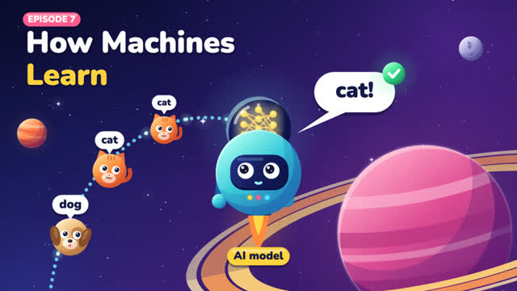
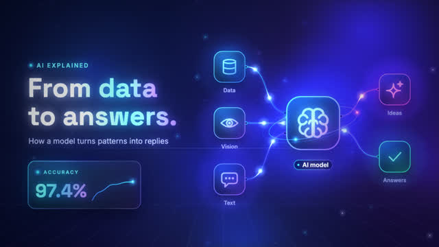
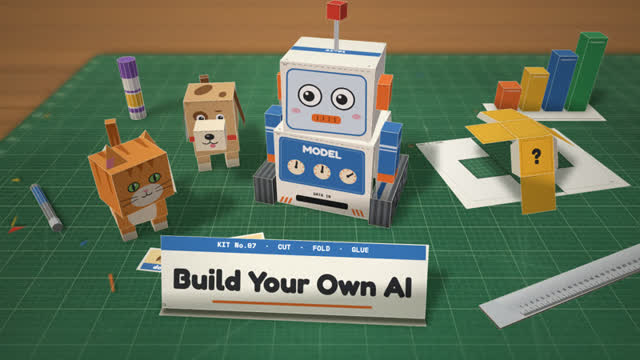
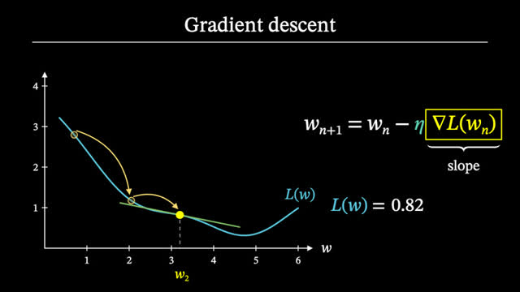
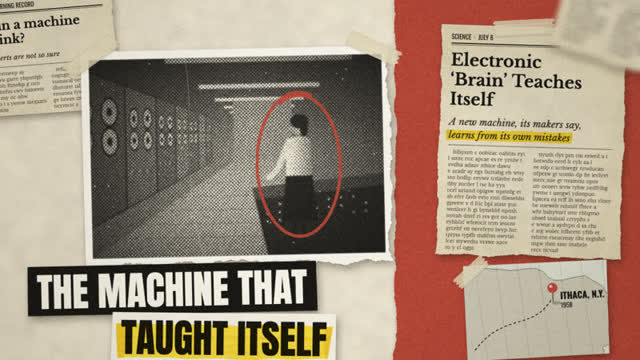
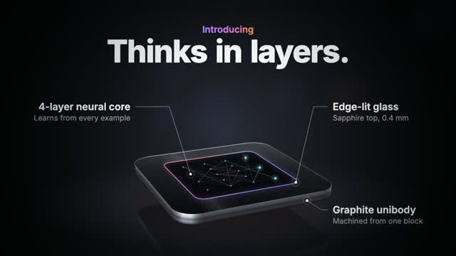
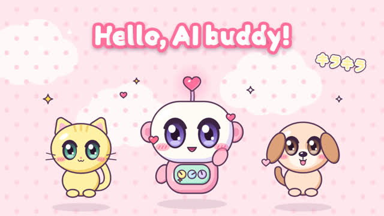

# Popular Explainer Looks (7 styles)

Styles from the AI Style Atlas by Futurepedia (https://www.futurepedia.io/resources/ai-style-atlas/view). Prompts and posters are reproduced with credit at the Subclip owner's request. Each entry has the atlas style card in a code block, a link to the full Copy prompt text, and our own Subclip recipe.

## 01. Flat-Vector Science



[Watch the style clip](../examples/01-flat-vector-science.mp4)

Flat-vector science-explainer illustration: deep navy-to-violet space gradients, chunky outline-free shapes with rich multi-stop gradients, flat crescent shadows and rim highlights, soft radial glows, sparkly star fields, banded ringed planets and cute big-eyed round characters.

```text
Look: Flat-vector science-explainer illustration: deep navy-to-violet space gradients, chunky outline-free shapes with rich multi-stop gradients, flat crescent shadows and rim highlights, soft radial glows, sparkly star fields, banded ringed planets and cute big-eyed round characters.
Motion: Smooth eased motion with gentle overshoot: the camera pulls back through scales, planets drift with parallax, characters bob and pop in, glows pulse.
How it explains: Big smooth camera moves through scale: the model pulls back until a million examples become a spiral galaxy, a foreground planet sweeps across as the wipe, and the camera dives into the glowing brain dome to emerge at a planet whose ring is the accuracy bar; arrows are chunky dotted rounded curves, numbers are big rounded Nunito.
```

Full Copy prompt text (reference animation source and sound kit included): [prompts/01-flat-vector-science.txt](prompts/01-flat-vector-science.txt)

Make it in Subclip: HyperFrames SVG layers, one group per object. Palette: navy #0B1033 to violet #4B2A8A, cyan #26C9D5, warm yellow #FFC857. Motion: slow parallax drift on stars, gentle bob on characters, eased 0.6 s entrances. Captions: rounded sans, white, no outline.
Check: no hard strokes on shapes, and gradients stay smooth at 1080p.

Source: [Futurepedia AI Style Atlas #01](https://www.futurepedia.io/resources/ai-style-atlas/view)

## 06. Tech Glow Explainer



[Watch the style clip](../examples/06-tech-glow-explainer.mp4)

The polished AI / tech YouTube motion-graphics look: deep navy-to-indigo space with drifting electric glows and a perspective grid, gradient-stroked icon tiles wired into node diagrams with light pulses racing along the connectors, dark cards with thin neon borders, gradient headline type and bloom on everything bright.

```text
Look: The polished AI / tech YouTube motion-graphics look: deep navy-to-indigo space with drifting electric glows and a perspective grid, gradient-stroked icon tiles wired into node diagrams with light pulses racing along the connectors, dark cards with thin neon borders, gradient headline type and bloom on everything bright.
Motion: Smooth eased build: glows bloom up, icon tiles pop in with an overshoot and their line icons draw on, connectors trace out and start carrying light pulses, the headline rises word by word and the stat counts up, all under a slow camera push and drifting particles.
How it explains: One continuous camera: the title shrinks to a header while the brain tile flies into place, labelled examples ride glowing lanes into the model, the camera pushes through the brain into its network (light-speed streaks), Guess/Check/Adjust chips light up as light pulses run forward and a red error pulse runs back, then the camera pans to a glowing accuracy chart and pulls back for the takeaway; numbers count up in gradient Space Grotesk with bloom.
```

Full Copy prompt text (reference animation source and sound kit included): [prompts/06-tech-glow-explainer.txt](prompts/06-tech-glow-explainer.txt)

Make it in Subclip: HyperFrames layer. Palette: #0A0F2C base, electric blue #3B6CFF, cyan #26C9D5, magenta accent. Motion: a light pulse travels along each connector as the narration names the step; cards fade up 12 px. Bloom with a blurred duplicate at low opacity.
Check: glows do not wash out text; contrast stays readable on a frame view.

Source: [Futurepedia AI Style Atlas #06](https://www.futurepedia.io/resources/ai-style-atlas/view)

## 07. Papercraft Models



[Watch the style clip](../examples/07-papercraft-models.mp4)

Printed-cardstock kit models: boxy low-poly robots, cats and charts assembled from flat printed faces with dotted fold lines, glue tabs and hairline seam gaps, Lambert-lit by a warm key light on a green self-healing cutting mat with craft tools at the edges.

```text
Look: Printed-cardstock kit models: boxy low-poly robots, cats and charts assembled from flat printed faces with dotted fold lines, glue tabs and hairline seam gaps, Lambert-lit by a warm key light on a green self-healing cutting mat with craft tools at the edges.
Motion: Flat printed templates fold themselves up into 3D models on twos with a stop-motion jitter, pieces hop into place and tags fold into tents, while the camera slides smoothly across the mat.
How it explains: One long cutting mat: the camera slides from beat to beat while flat printed templates fold themselves up into the robot, cards, bars and tent labels (on twos); arrows are creased paper strips that unroll along the mat, labels are tent tags dropped onto what they name, counters are printed tent cards re-posed each step, and the wrong guess gets a camera push-in and a red flag that pops and later spins to green.
```

Full Copy prompt text (reference animation source and sound kit included): [prompts/07-papercraft-models.txt](prompts/07-papercraft-models.txt)

Make it in Subclip: generated image or video (`generate_ai_media`) with a prompt of your own: boxy low-poly paper figures, dotted fold lines, soft warm key light, green cutting mat. Keep the same mat and light in every scene. Native slow push-ins.
Check: every scene shows seams and the same mat color.

Source: [Futurepedia AI Style Atlas #07](https://www.futurepedia.io/resources/ai-style-atlas/view)

## 09. Manim-Style Math



[Watch the style clip](../examples/09-manim-style-math.mp4)

The math-explainer look of Manim, the open-source library behind 3Blue1Brown: pure black, crisp anti-aliased vector lines, a restrained palette of Manim blue, teal, yellow, red and green, LaTeX-like serif math with italic variables, axes with tick marks, curves, arrows, braces and surrounding rectangles.

```text
Look: The math-explainer look of Manim, the open-source library behind 3Blue1Brown: pure black, crisp anti-aliased vector lines, a restrained palette of Manim blue, teal, yellow, red and green, LaTeX-like serif math with italic variables, axes with tick marks, curves, arrows, braces and surrounding rectangles.
Motion: Manim's own vocabulary on a smooth sigmoid ease: equations Write on (glyph outlines trace, then fill), axes and curves Create, a dot slides down the graph in gradient-descent hops, then a SurroundingRectangle draws round the key term and it Indicates with a yellow pulse.
How it explains: One MovingCameraScene: the question Writes on and Transforms into the header, a neural net Creates (edges blue/red by weight sign), pixel pictures fly into the input neurons as a counter climbs, a forward pass runs as ShowPassingFlash, the wrong "dog?" gets a red SurroundingRectangle, the camera pans to a loss curve where a dot descends while edges re-colour, then the axes relabel to accuracy, the curve climbs and the number Transforms into a 97% that Indicates.
```

Full Copy prompt text (reference animation source and sound kit included): [prompts/09-manim-style-math.txt](prompts/09-manim-style-math.txt)

Make it in Subclip: HyperFrames SVG with stroke-dashoffset draw-on, no external math tool. Palette: black, blue #58C4DD, teal, yellow #FFFF00 sparingly, red, green. Motion: draw lines over 1 s, transform one shape into the next.
Check: seek to three frames; strokes must be deterministic and crisp.

Source: [Futurepedia AI Style Atlas #09](https://www.futurepedia.io/resources/ai-style-atlas/view)

## 11. Editorial Essay Collage



[Watch the style clip](../examples/11-editorial-essay-collage.mp4)

The editorial "animated essay" collage: warm grainy paper, archival halftone prints with torn white borders and soft shadows, newspaper clippings in serif type with a translucent yellow highlighter sweep, masking tape, flat colour blocks and big cut-out condensed headlines.

```text
Look: The editorial "animated essay" collage: warm grainy paper, archival halftone prints with torn white borders and soft shadows, newspaper clippings in serif type with a translucent yellow highlighter sweep, masking tape, flat colour blocks and big cut-out condensed headlines.
Motion: Cutouts drop and slide in on 12 fps hand-animated steps while the camera pushes smoothly through parallax layers; the highlighter sweeps left to right and a red marker rings the key detail.
How it explains: Scenes are joined by fast blurred camera whips that hide the cut, plus a new paper sheet slid up on steps; arrows are thin ink route lines and red marker, numbers are re-cut condensed numerals on paper strips, and the emphasis is the yellow highlighter sweep (plus a red marker ring and cross on the wrong guess).
```

Full Copy prompt text (reference animation source and sound kit included): [prompts/11-editorial-essay-collage.txt](prompts/11-editorial-essay-collage.txt)

Make it in Subclip: HyperFrames layers with a paper-grain overlay; use real or generated cutouts (own or licensed only). Motion: pieces slide in with a slight rotation, highlighter wipes across key words. Palette: cream #F2EBDD, ink black, one accent.
Check: shadows and grain match across scenes; headline is readable.

Source: [Futurepedia AI Style Atlas #11](https://www.futurepedia.io/resources/ai-style-atlas/view)

## 13. Product Launch Reveal



[Watch the style clip](../examples/13-product-launch-reveal.mp4)

A big-tech keynote product film: one glossy hero object on a near-black stage, lit like a studio shot with soft key, rim light, a sweeping specular highlight and a floor reflection, huge tight-tracked sans headlines, gradient key numbers with a soft glow and hairline spec callouts.

```text
Look: A big-tech keynote product film: one glossy hero object on a near-black stage, lit like a studio shot with soft key, rim light, a sweeping specular highlight and a floor reflection, huge tight-tracked sans headlines, gradient key numbers with a soft glow and hairline spec callouts.
Motion: Rim light finds the object in the dark, the key light fades up as the camera slowly orbits and pushes in, a highlight glides across the glass, the edge ring ignites, then the headline arrives one word at a time and hairline callouts draw out to their spec labels.
How it explains: Told as a keynote launch film around one hero object (the model, a glass-topped chip): one continuous studio camera that orbits and pushes between beats, hairline callouts and arrows for flow, a clean red strike for the wrong guess while the chip’s inner layers light up backwards to adjust, a giant violet-to-orange 97% with a glow bloom and gleam, and a light-sweep wipe to a pristine white stage for the tagline.
```

Full Copy prompt text (reference animation source and sound kit included): [prompts/13-product-launch-reveal.txt](prompts/13-product-launch-reveal.txt)

Make it in Subclip: generate the hero still with `generate_ai_media` (studio product lighting prompt of your own), then native keyframes for a slow orbit-like push and a HyperFrames text layer with a gradient number. Palette: black, white, one brand accent.
Check: the highlight sweep happens once per scene, not constantly.

Source: [Futurepedia AI Style Atlas #13](https://www.futurepedia.io/resources/ai-style-atlas/view)

## 20. Kawaii Anime



[Watch the style clip](../examples/20-kawaii-anime.mp4)

Flat 2D kawaii anime illustration: chibi characters with big glossy anime eyes and blush marks, chunky rounded shapes in strawberry-milk pink, mint, butter, lavender and sky, soft plum outlines of even weight, one cel-shadow tone and a small highlight, on polka-dot and star patterns.

```text
Look: Flat 2D kawaii anime illustration: chibi characters with big glossy anime eyes and blush marks, chunky rounded shapes in strawberry-milk pink, mint, butter, lavender and sky, soft plum outlines of even weight, one cel-shadow tone and a small highlight, on polka-dot and star patterns.
Motion: Everything pops in on twos with bouncy squash-and-stretch, characters bob and wiggle, sparkles twinkle, and scenes change through star and heart iris wipes.
How it explains: A chibi robot mascot acts the lesson out with anime reaction grammar (swirl eyes, sweat drop and "!?" on the wrong guess, star eyes and confetti at 97%); scenes change through star and heart iris wipes, connectors are dotted candy arrows, and the counters are bouncing outlined numerals.
```

Full Copy prompt text (reference animation source and sound kit included): [prompts/20-kawaii-anime.txt](prompts/20-kawaii-anime.txt)

Make it in Subclip: HyperFrames SVG with rounded shapes and big glossy eyes, or generated stickers in one fixed style prompt. Palette: strawberry pink, mint, butter, lavender, soft outlines. Motion: bouncy squash and stretch.
Check: every character shares the same eye style and outline weight.

Source: [Futurepedia AI Style Atlas #20](https://www.futurepedia.io/resources/ai-style-atlas/view)
