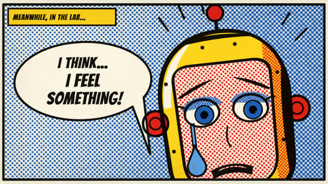
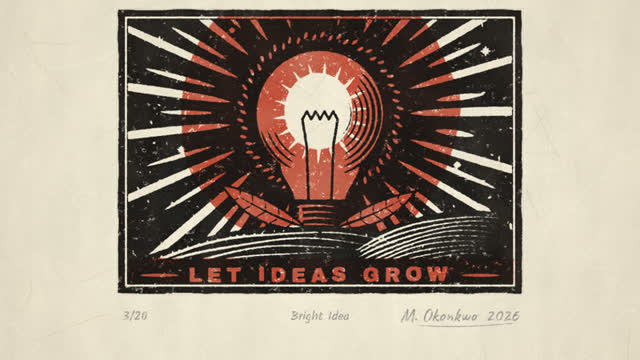
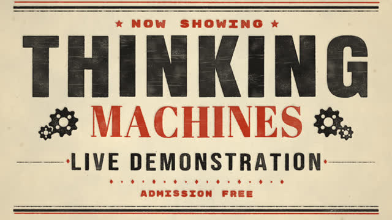
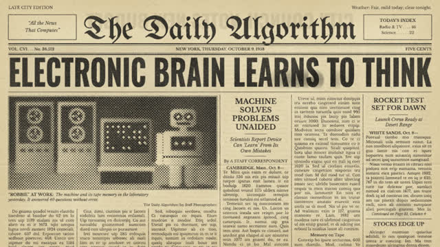
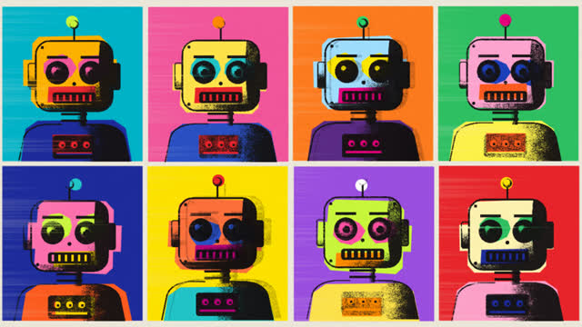

# Print (6 styles)

Styles from the AI Style Atlas by Futurepedia (https://www.futurepedia.io/resources/ai-style-atlas/view). Prompts and posters are reproduced with credit at the Subclip owner's request. Each entry has the atlas style card in a code block, a link to the full Copy prompt text, and our own Subclip recipe.

## 14. Halftone Pop Panel



[Watch the style clip](../examples/14-halftone-pop-panel.mp4)

A Lichtenstein-style blown-up comic panel: fat tapering black brush outlines, mechanical Ben-Day dot fields in red and blue, flat primary yellow, a tearful close-up and hand-lettered balloon.

```text
Look: A Lichtenstein-style blown-up comic panel: fat tapering black brush outlines, mechanical Ben-Day dot fields in red and blue, flat primary yellow, a tearful close-up and hand-lettered balloon.
Motion: Blue dots pop on in a wave, the robot head springs up into frame, red skin dots wash down the face, caption and balloon slam in word by word, then a single tear wells up and rolls down during a slow push-in.
How it explains: Told as a comic strip the camera reads panel by panel (pulling back to the gutters on each move), with fat yellow comic arrows, captions and balloons, Bangers counters bursting out of explosion balloons, and a WRONG! burst with shake as the emphasis.
```

Full Copy prompt text (reference animation source and sound kit included): [prompts/14-halftone-pop-panel.txt](prompts/14-halftone-pop-panel.txt)

Make it in Subclip: HyperFrames SVG with a dot-pattern fill and thick brush-like outlines; lettering in a comic display font inside balloons. Palette: red #E63946, blue #1D4E9E, yellow #FFD23F, black. Motion: panels snap in; balloons pop with a quick scale.
Check: dots are a regular grid and keep size when scaled.

Source: [Futurepedia AI Style Atlas #14](https://www.futurepedia.io/resources/ai-style-atlas/view)

## 17. Risograph Zine


[Watch the style clip](../examples/17-risograph-zine.mp4)

Three fluorescent spot inks (pink, medium blue, yellow) laid down as separate drum passes and multiplied on off-white stock - misregistered plates, grainy patchy solids, dotted tints and roller streaks.

```text
Look: Three fluorescent spot inks (pink, medium blue, yellow) laid down as separate drum passes and multiplied on off-white stock - misregistered plates, grainy patchy solids, dotted tints and roller streaks.
Motion: The sheet goes through the drum three times - yellow, then pink, then blue roll down the page and slide into misregistration - then the print boils at 8 fps while the rocket creeps upward and its flame flickers in the screen.
How it explains: Scenes change by re-registering the plates - yellow, pink and blue slide off and the next scene's plates slide in one drum pass at a time - with dotted blue flow arrows, pink error arrows and scribbled circles, and counters set in big two-plate zine type.
```

Full Copy prompt text (reference animation source and sound kit included): [prompts/17-risograph-zine.txt](prompts/17-risograph-zine.txt)

Make it in Subclip: Generated stills with a three-ink riso prompt of your own, or HyperFrames layers using multiply blending of pink, blue and yellow plates with a 3 px misregistration. Palette: #FF48B0, #0078BF, #FFE800 on off-white.
Check: overlaps show the multiplied third color and plates are visibly offset.

Source: [Futurepedia AI Style Atlas #17](https://www.futurepedia.io/resources/ai-style-atlas/view)

## 29. Linocut Relief Print



[Watch the style clip](../examples/29-linocut-relief-print.mp4)

A hand-carved two-colour relief print: tapering white gouge strokes cut from dense black, parallel carving for tone, a red reduction layer, salty uneven ink on cream rice paper, signed and numbered in pencil.

```text
Look: A hand-carved two-colour relief print: tapering white gouge strokes cut from dense black, parallel carving for tone, a red reduction layer, salty uneven ink on cream rice paper, signed and numbered in pencil.
Motion: The proof is pulled twice - the red sheet peels back diagonally, then the black key - then the edition number, title and signature are pencilled in while a raking glint slides across the wet ink and the camera eases in.
How it explains: Each beat is a newly carved block pulled as a fresh proof that peels back over the last one; arrows are gouged channels (the error path printed red), counters are carved numerals re-cut on twos, and emphasis is the printmaker's own pencil circle and margin note.
```

Full Copy prompt text (reference animation source and sound kit included): [prompts/29-linocut-relief-print.txt](prompts/29-linocut-relief-print.txt)

Make it in Subclip: HyperFrames SVG with thick black shapes and white tapering cut lines, plus a red reduction layer offset slightly. Palette: black, cream #F1E6CC, vermilion. Motion: layers print in one after another.
Check: carving lines taper at the ends and only two inks plus paper appear.

Source: [Futurepedia AI Style Atlas #29](https://www.futurepedia.io/resources/ai-style-atlas/view)

## 42. Wood Type Letterpress



[Watch the style clip](../examples/42-wood-type-letterpress.mp4)

A two-ink wood-type broadside on cream stock: mixed display faces set block by block, each letter inked a little differently, wood grain and worn edges in the solids, ink squeezed to the rims and the whole forme bitten into the paper.

```text
Look: A two-ink wood-type broadside on cream stock: mixed display faces set block by block, each letter inked a little differently, wood grain and worn edges in the solids, ink squeezed to the rims and the whole forme bitten into the paper.
Motion: The forme is proofed block by block - rules first, then each wood letter lands with a heavy kiss of the platen, red and black alternating down the sheet - and the gears keep turning as the impression deepens.
How it explains: Every beat is a new proof: the finished sheet is lifted off the press and a fresh one is laid down, then wood type, stock cuts of a cat and a dog, and arrows set from short rule pieces lock up block by block with a kiss of the platen; counters are re-set and re-stamped six times a second, and the wrong guess gets a red rubber-stamp WRONG.
```

Full Copy prompt text (reference animation source and sound kit included): [prompts/42-wood-type-letterpress.txt](prompts/42-wood-type-letterpress.txt)

Make it in Subclip: HyperFrames text layers in varied display faces with a roughness mask and ink variation. Palette: cream stock, black and one red. Motion: blocks stamp in one at a time.
Check: letters differ slightly in ink density and edge wear.

Source: [Futurepedia AI Style Atlas #42](https://www.futurepedia.io/resources/ai-style-atlas/view)

## 65. Vintage Newsprint



[Watch the style clip](../examples/65-vintage-newsprint.mp4)

A 1950s broadsheet front page: blackletter masthead, condensed banner headline, dense justified greeked columns and a coarse halftone wire photo, printed in thin uneven ink on yellowed pulp with show-through from the reverse.

```text
Look: A 1950s broadsheet front page: blackletter masthead, condensed banner headline, dense justified greeked columns and a coarse halftone wire photo, printed in thin uneven ink on yellowed pulp with show-through from the reverse.
Motion: The classic spinning-newspaper reveal: the page whirls up out of the dark and slaps flat to fill the frame, then the camera creeps in on the headline while the console lamps blink and the tape reels turn in the halftone photo.
How it explains: The viewer reads the paper: the camera tracks from the banner headline down to a By-the-Numbers infographic, the page physically turns to an inside Science spread whose diagram, chart and pull quote carry the rest; arrows are crisp newspaper-diagram rules, numbers are set in Oswald, and emphasis is a reader's red grease-pencil ring.
```

Full Copy prompt text (reference animation source and sound kit included): [prompts/65-vintage-newsprint.txt](prompts/65-vintage-newsprint.txt)

Make it in Subclip: HyperFrames HTML with blackletter masthead, dense columns and a halftone photo on gray newsprint. Palette: off-white #E9E4D4, ink black. Motion: slow scroll.
Check: photo is made of dots, and body columns are dense and justified.

Source: [Futurepedia AI Style Atlas #65](https://www.futurepedia.io/resources/ai-style-atlas/view)

## 80. Silkscreen Grid



[Watch the style clip](../examples/80-silkscreen-grid.mp4)

A Warhol-style repeat portrait: the same robot pulled eight times through a grainy black photo screen over loose, hand-cut flat colour plates in garish combinations, each pull misregistered and streaked by the squeegee.

```text
Look: A Warhol-style repeat portrait: the same robot pulled eight times through a grainy black photo screen over loose, hand-cut flat colour plates in garish combinations, each pull misregistered and streaked by the squeegee.
Motion: Panels are printed one after another across the grid - background flood, then the loose colour shapes slap down, then the squeegee drags the black photo screen across with a wet ink bead - before a slow push-in on the finished wall.
How it explains: Each beat is its own silkscreened panel, pulled in order (flood, loose colour shapes, squeegee drags the black screen) while the camera travels the grid; black arrows are painted across the gutters between panels, counters are stencil type, emphasis is a colourway flicker, and the final pull-back reveals all six beats as one Warhol grid.
```

Full Copy prompt text (reference animation source and sound kit included): [prompts/80-silkscreen-grid.txt](prompts/80-silkscreen-grid.txt)

Make it in Subclip: Generated base portrait run through four to eight HyperFrames color-plate variants in a grid. Palette: garish plates over black halftone. Motion: grid cells flip on in turn.
Check: same drawing repeats with different colors and visible misregistration.

Source: [Futurepedia AI Style Atlas #80](https://www.futurepedia.io/resources/ai-style-atlas/view)
