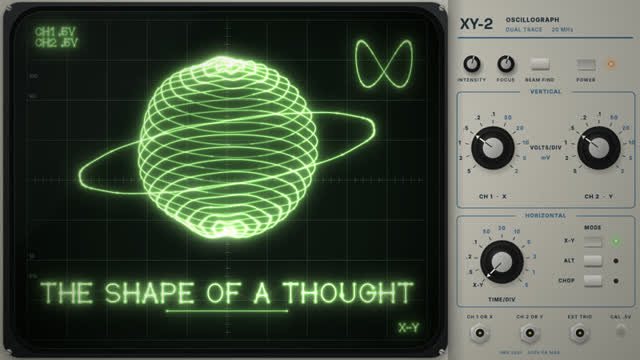
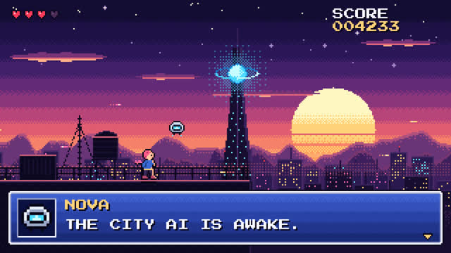
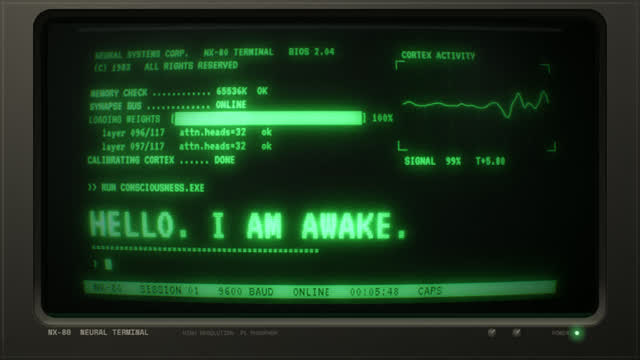
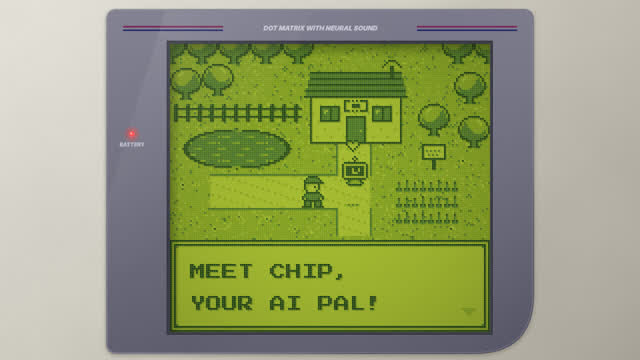
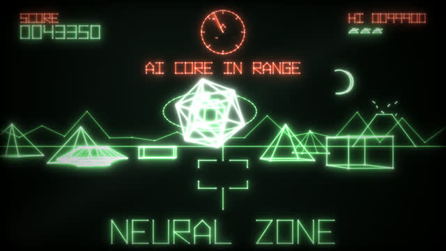
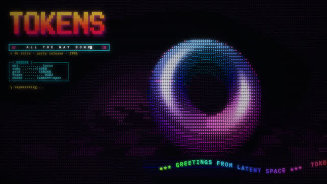
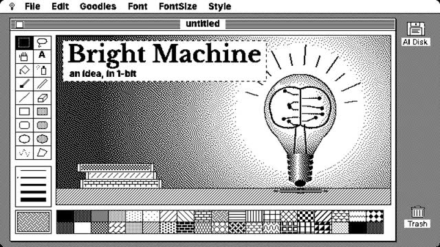

# Retro Digital (7 styles)

Styles from the AI Style Atlas by Futurepedia (https://www.futurepedia.io/resources/ai-style-atlas/view). Prompts and posters are reproduced with credit at the Subclip owner's request. Each entry has the atlas style card in a code block, a link to the full Copy prompt text, and our own Subclip recipe.

## 16. Oscilloscope Vector Art



[Watch the style clip](../examples/16-oscilloscope-vector-art.mp4)

Oscilloscope-music XY art on an analogue lab scope: one P31 green beam draws everything, bright where it slows at turns and dim on fast retrace lines, with bloom and halation behind an internal 8x10 graticule, framed by a moulded CRT bezel and a knobbed instrument front panel.

```text
Look: Oscilloscope-music XY art on an analogue lab scope: one P31 green beam draws everything, bright where it slows at turns and dim on fast retrace lines, with bloom and halation behind an internal 8x10 graticule, framed by a moulded CRT bezel and a knobbed instrument front panel.
Motion: Power-on: the dot blooms, the timebase pulls it into a sine sweep, the X-Y button snaps in and the waveform folds into a circle that winds itself into a spinning spiral-sphere while the beam writes the vector text.
How it explains: Everything is drawn by one scope beam: transitions are the instrument's own (picture collapses to a dot and re-expands, X gain to zero then the timebase sweep, Y gain to zero back to X-Y), arrows and Hershey-style labels are beam strokes, counters are redrawn vector numerals, and the wrong guess shudders amber while the 97% flares the bloom.
```

Full Copy prompt text (reference animation source and sound kit included): [prompts/16-oscilloscope-vector-art.txt](prompts/16-oscilloscope-vector-art.txt)

Make it in Subclip: HyperFrames canvas: draw everything as one glowing green polyline with additive blending, dimmer on long jumps and brighter where it dwells. Palette: black, phosphor green #3CFF7A. Motion: collapse to a dot between scenes.
Check: only one beam color appears and thin lines stay crisp at 1080p.

Source: [Futurepedia AI Style Atlas #16](https://www.futurepedia.io/resources/ai-style-atlas/view)

## 22. 16-Bit Pixel Odyssey



[Watch the style clip](../examples/22-16-bit-pixel-odyssey.mp4)

A SNES-era cutscene: 320x180 hand-placed pixels blown up 4x, a strict ~40-colour palette, banded sky with checkerboard dither transitions, layered parallax and an RPG dialog box.

```text
Look: A SNES-era cutscene: 320x180 hand-placed pixels blown up 4x, a strict ~40-colour palette, banded sky with checkerboard dither transitions, layered parallax and an RPG dialog box.
Motion: A SNES cutscene opening: 16-step brightness fade-in, parallax layers rise into place in whole-pixel steps, the hero walks on with a 2-frame cycle, the drone flies in, hearts pop, the window snaps open and dialog types out.
How it explains: Tells it as a SNES RPG: the question is a dialog line whose window snaps up into a quest header, a mosaic transition opens a training hall where labelled CAT/DOG cards ride a chevron conveyor into the MODEL while an EXAMPLES window counts, a wavy battle-swirl starts a turn-based fight (GUESS/CHECK/ADJUST command menu, MISS! damage pop and screen flash, red error trail, weight stat bars), and an iris wipe lands on a LEVEL UP accuracy screen.
```

Full Copy prompt text (reference animation source and sound kit included): [prompts/22-16-bit-pixel-odyssey.txt](prompts/22-16-bit-pixel-odyssey.txt)

Make it in Subclip: HyperFrames canvas at 320x180 scaled 4x with nearest-neighbor, a palette of about 40 colors, and a dialogue box typewriter. Motion: stepped parallax layers.
Check: no smoothing: zoom into a frame and confirm hard pixel edges.

Source: [Futurepedia AI Style Atlas #22](https://www.futurepedia.io/resources/ai-style-atlas/view)

## 45. Phosphor Terminal



[Watch the style clip](../examples/45-phosphor-terminal.mp4)

A green P1-phosphor CRT: VT323 boot log with bloom and halation, curved scanlines, true per-pixel barrel distortion with RGB fringing at the edges, tube vignette, hum bar, and a glass face catching the room light inside a plastic bezel.

```text
Look: A green P1-phosphor CRT: VT323 boot log with bloom and halation, curved scanlines, true per-pixel barrel distortion with RGB fringing at the edges, tube vignette, hum bar, and a glass face catching the room light inside a plastic bezel.
Motion: The tube powers on (dot, then a bright line that snaps open into a flashing raster that settles as the phosphor warms), then the boot log types at terminal speed, the trace sweeps, the greeting prints and the cursor blinks while a hum bar rolls.
How it explains: Explains as a live terminal session: the typed question scrolls away and lives on in the inverse-video status line, a labelled data log streams into a box-drawn MODEL, V-hold rolls carry us between screens, arrows and the error path are phosphor line-drawings, and counters are big VT323 numerals that flip in inverse video for emphasis.
```

Full Copy prompt text (reference animation source and sound kit included): [prompts/45-phosphor-terminal.txt](prompts/45-phosphor-terminal.txt)

Make it in Subclip: HyperFrames HTML or canvas with green monospace text, scanlines, a vignette and slight barrel distortion. Palette: black, phosphor green #33FF66. Motion: typewriter text and a slow hum bar.
Check: scanlines are visible and text still passes contrast.

Source: [Futurepedia AI Style Atlas #45](https://www.futurepedia.io/resources/ai-style-atlas/view)

## 59. Pocket Monochrome



[Watch the style clip](../examples/59-pocket-monochrome.mp4)

An original DMG handheld frame: 160x144 pixels in exactly four pea-soup greens, a visible LCD pixel grid with each pixel casting a faint shadow on the reflective backing, motion ghosting, and the purple-grey bezel with its striped DOT MATRIX label.

```text
Look: An original DMG handheld frame: 160x144 pixels in exactly four pea-soup greens, a visible LCD pixel grid with each pixel casting a faint shadow on the reflective backing, motion ghosting, and the purple-grey bezel with its striped DOT MATRIX label.
Motion: A handheld boot: the logo scrolls down one LCD pixel per frame and smears, the palette steps to white, the overworld steps back in through the 4 shades, the hero walks on 1 px per frame with a 2-frame cycle, and the window pops up and prints text.
How it explains: Explains as a handheld monster-battle RPG in four LCD shades: the question text box slides up the window layer into a header, palette fades act as door transitions, labelled cards march an arrow-tile path into CHIP the model, a flash-and-stripes battle intro starts a GUESS/CHECK/ADJUST fight (hit flash, dotted error trail, weight bars), and a LEVEL UP stats screen counts accuracy to an inverted 97%.
```

Full Copy prompt text (reference animation source and sound kit included): [prompts/59-pocket-monochrome.txt](prompts/59-pocket-monochrome.txt)

Make it in Subclip: HyperFrames canvas at 160x144 quantized to four greens with an LCD pixel grid overlay. Palette: #0F380F, #306230, #8BAC0F, #9BBC0F. Motion: sprite steps.
Check: exactly four colors appear in the frame.

Source: [Futurepedia AI Style Atlas #59](https://www.futurepedia.io/resources/ai-style-atlas/view)

## 72. Vector Arcade 1980



[Watch the style clip](../examples/72-vector-arcade-1980.mp4)

An XY vector monitor cabinet game: hair-thin phosphor beams on pure black, additive bloom, brighter dwell dots where the beam pauses at vertices, dimmer long strokes, wireframe 3D in perspective and a hand-built stroke font.

```text
Look: An XY vector monitor cabinet game: hair-thin phosphor beams on pure black, additive bloom, brighter dwell dots where the beam pauses at vertices, dimmer long strokes, wireframe 3D in perspective and a hand-built stroke font.
Motion: Attract-mode build: the beam traces the horizon and mountains, wireframes draw on edge by edge, the AI core flies in from the distance spinning, the saucer slides in with phosphor trails, then the radar, score and title are stroked in letter by letter while everything flickers with beam load.
How it explains: Told as a vector-cabinet HUD: the question shrinks into a red corner readout, labelled wireframe cards stream into a spinning icosahedron core, a hyperspace-style zoom carries us into a lock-on loop (GUESS > CHECK > ADJUST with brackets, red error beam, turning weight dials), and the stroked accuracy graph climbs to a flashing 97%.
```

Full Copy prompt text (reference animation source and sound kit included): [prompts/72-vector-arcade-1980.txt](prompts/72-vector-arcade-1980.txt)

Make it in Subclip: HyperFrames canvas with thin additive line strokes and bright dwell dots on black. Palette: black, white, cyan, green. Motion: wireframe rotates.
Check: lines are hairline thin with glow, no filled shapes.

Source: [Futurepedia AI Style Atlas #72](https://www.futurepedia.io/resources/ai-style-atlas/view)

## 82. ASCII Demoscene



[Watch the style clip](../examples/82-ascii-demoscene.mp4)

A ray-marched 3D torus rasterised into a strict monospace character grid via a luminance ramp, colour-coded like a 90s demoscene intro: box-drawn title panel, plasma backdrop, copper bars and a sine scroller.

```text
Look: A ray-marched 3D torus rasterised into a strict monospace character grid via a luminance ramp, colour-coded like a 90s demoscene intro: box-drawn title panel, plasma backdrop, copper bars and a sine scroller.
Motion: Like a demo intro booting: plasma thickens in, the spinning torus is rastered into characters top-to-bottom behind a bright scan row, the block title and nfo panel print, copper bars open and a rainbow sine-scroller glides in from the right.
How it explains: One long ASCII document that the terminal scrolls through row by row: figlet block-letter question, labelled ASCII cat/dog cards stepping along a box-drawing arrow into a MODEL box, a reverse-video GUESS/CHECK/ADJUST loop with a red error path, and block-character bar charts with figlet counters.
```

Full Copy prompt text (reference animation source and sound kit included): [prompts/82-ascii-demoscene.txt](prompts/82-ascii-demoscene.txt)

Make it in Subclip: HyperFrames canvas with a text-character grid mapped from brightness plus a boxed title panel. Palette: monospace colors on black. Motion: rotating object and plasma background.
Check: everything is made of monospace characters only.

Source: [Futurepedia AI Style Atlas #82](https://www.futurepedia.io/resources/ai-style-atlas/view)

## 85. MacPaint 1984



[Watch the style clip](../examples/85-macpaint-1984.mp4)

Pure 1-bit black & white at the original 72-dpi grain: real Atkinson-dithered grayscale (blown-out highlights, crunchy shadows), 8x8 fill patterns, striped title bars, marching ants and bitmap type.

```text
Look: Pure 1-bit black & white at the original 72-dpi grain: real Atkinson-dithered grayscale (blown-out highlights, crunchy shadows), 8x8 fill patterns, striped title bars, marching ants and bitmap type.
Motion: Built the way a 1984 user would: the dithered image scans in row by row, then pencil, line, bucket, rectangle and text tools each switch on in the palette and lay down their marks in snappy, unanimated 1-bit steps, ending on crawling marching ants.
How it explains: Explains with the 1984 desktop itself: an alert asks the question and, once OK is clicked, zoom-rects turn it into the window title; labelled Finder icons are dragged into a Model icon while the item count climbs; a Model window cycles Guess/Check/Adjust buttons with a stop alert and menu-bar beep flash, dashed error arrow and Control-Panel weight sliders; a pattern-filled chart climbs to 97% inside marching ants.
```

Full Copy prompt text (reference animation source and sound kit included): [prompts/85-macpaint-1984.txt](prompts/85-macpaint-1984.txt)

Make it in Subclip: HyperFrames canvas with 1-bit dithering and 8x8 patterns, plus a window frame with striped title bars. Palette: black and white only. Motion: stepped redraws.
Check: only pure black and white pixels appear.

Source: [Futurepedia AI Style Atlas #85](https://www.futurepedia.io/resources/ai-style-atlas/view)
