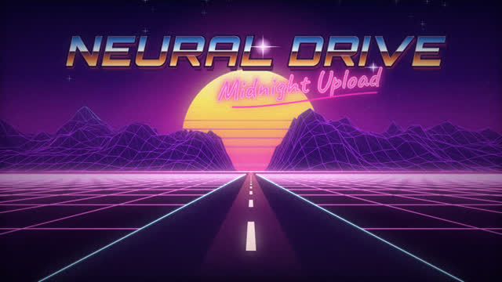
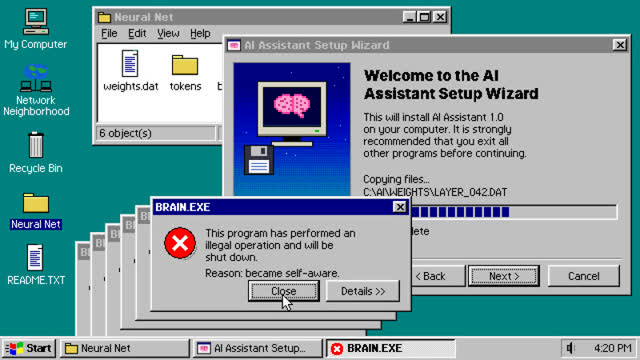
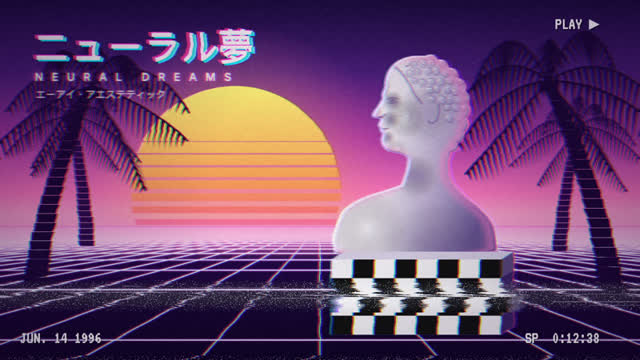
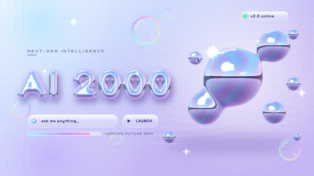
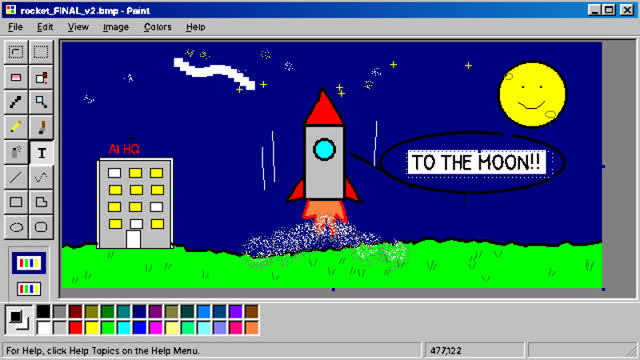
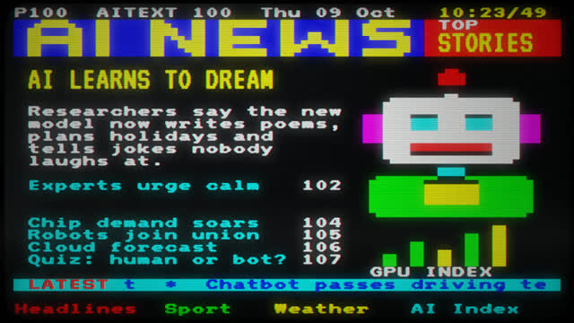

# Retro UI & Neon (6 styles)

Styles from the AI Style Atlas by Futurepedia (https://www.futurepedia.io/resources/ai-style-atlas/view). Prompts and posters are reproduced with credit at the Subclip owner's request. Each entry has the atlas style card in a code block, a link to the full Copy prompt text, and our own Subclip recipe.

## 27. Synthwave Outrun



[Watch the style clip](../examples/27-synthwave-outrun.mp4)

80s outrun poster: neon grid highway to a striped sunset, wireframe vector mountains, chrome-beveled italic title with a horizon reflection and a hot-pink neon script, all bathed in bloom.

```text
Look: 80s outrun poster: neon grid highway to a striped sunset, wireframe vector mountains, chrome-beveled italic title with a horizon reflection and a hot-pink neon script, all bathed in bloom.
Motion: Stars blink on, the horizon line and grid race toward camera, the striped sun rises and wireframe mountains grow, the chrome title slams in with a flash, the script tube flickers on and glints sweep the chrome.
How it explains: A night drive explains it: labelled example cards ride the neon highway into a wireframe AI core, a dashboard HUD holds a rolling odometer counter, synth-knob weights and GUESS/CHECK/ADJUST neon tubes; the camera tilts up into the sky for a glowing accuracy chart and back down for a chrome payoff.
```

Full Copy prompt text (reference animation source and sound kit included): [prompts/27-synthwave-outrun.txt](prompts/27-synthwave-outrun.txt)

Make it in Subclip: HyperFrames layer with a perspective grid, striped sun and chrome gradient title. Palette: deep purple, hot pink, cyan, orange. Motion: grid scrolls toward the viewer, sun stays still.
Check: grid lines converge on one vanishing point.

Source: [Futurepedia AI Style Atlas #27](https://www.futurepedia.io/resources/ai-style-atlas/view)

## 39. Win95 Desktop



[Watch the style clip](../examples/39-win95-desktop.mp4)

A mid-90s beige-box desktop at 2x pixel scale: teal wallpaper, 2-pixel bevelled grey chrome, navy title bars, aliased system text and a trail of frozen error dialogs.

```text
Look: A mid-90s beige-box desktop at 2x pixel scale: teal wallpaper, 2-pixel bevelled grey chrome, navy title bars, aliased system text and a trail of frozen error dialogs.
Motion: Icons pop onto the desktop, windows open with outline-zoom rectangles, the install bar ticks in blocks then freezes, and the hung error box is dragged, smearing a stair of copies.
How it explains: An "AI Trainer" app explains it: the question dialog zooms into the title bar, beats are property-sheet tabs clicked by the cursor, dotted pixel arrows carry examples and the error signal, trackbar "weights" slide, counters live in status bars and group boxes, and the payoff is a classic message box.
```

Full Copy prompt text (reference animation source and sound kit included): [prompts/39-win95-desktop.txt](prompts/39-win95-desktop.txt)

Make it in Subclip: HyperFrames HTML layers with 2 px bevels, navy title bars, teal wallpaper and a pile of error dialogs. Palette: #C0C0C0, #000080, #008080. Motion: windows pop in stepped.
Check: text is aliased and bevels read light on top left, dark on bottom right.

Source: [Futurepedia AI Style Atlas #39](https://www.futurepedia.io/resources/ai-style-atlas/view)

## 53. Vaporwave



[Watch the style clip](../examples/53-vaporwave.mp4)

Pastel-neon dreamscape: sliced sunset sun, glowing grid floor, a glitching marble bust on a checkerboard plinth, palm silhouettes, katakana, and a chewed-up VHS tape finish.

```text
Look: Pastel-neon dreamscape: sliced sunset sun, glowing grid floor, a glitching marble bust on a checkerboard plinth, palm silhouettes, katakana, and a chewed-up VHS tape finish.
Motion: Tape starts on a blue VCR screen and rolls into lock, the striped sun rises, palms slide in, the bust glitches into existence slice by slice, katakana stamps on with chroma split and a tracking band crawls down.
How it explains: Told on a worn VHS tape: scenes change with a tape cut (VCR blue screen, fast-forward, vertical roll), the header lives on as the VCR on-screen menu, the counter is tape-counter digits, labelled polaroids slide along the neon floor into the marble-bust "model", a pastel guess.exe pop-up does the guessing and the chart is drawn in neon across the sky.
```

Full Copy prompt text (reference animation source and sound kit included): [prompts/53-vaporwave.txt](prompts/53-vaporwave.txt)

Make it in Subclip: HyperFrames layers with a sliced sun, grid floor and pastel gradients plus a chromatic glitch. Palette: pink, cyan, purple. Motion: grid scrolls and sun stays.
Check: text and glitch do not exceed three flashes per second.

Source: [Futurepedia AI Style Atlas #53](https://www.futurepedia.io/resources/ai-style-atlas/view)

## 63. Y2K Liquid Chrome



[Watch the style clip](../examples/63-y2k-liquid-chrome.mp4)

Millennium-futurist liquid chrome: environment-mapped metaball blobs and inflated chrome bubble letters with thin-film iridescence, soap bubbles, starburst glints and frosted pill UI in silver, ice-blue and lilac.

```text
Look: Millennium-futurist liquid chrome: environment-mapped metaball blobs and inflated chrome bubble letters with thin-film iridescence, soap bubbles, starburst glints and frosted pill UI in silver, ice-blue and lilac.
Motion: Mercury droplets fly in, overshoot and merge into one blob, chrome letters inflate one by one with a springy pop, frosted pills glide up, and reflections, bubbles and glints keep sliding and twinkling.
How it explains: A glossy millennium interface explains it: the model is a living mercury blob that liquid-morphs to a new spot at every scene change while frosted-glass panels swoosh in and out, arrows are iridescent ribbons, labels are glossy pills, and the counter and 97% are inflated chrome bubble digits.
```

Full Copy prompt text (reference animation source and sound kit included): [prompts/63-y2k-liquid-chrome.txt](prompts/63-y2k-liquid-chrome.txt)

Make it in Subclip: Generated chrome blobs and letters (`generate_ai_media`), with HyperFrames text overlays. Palette: silver, aqua, pink, blue iridescence. Motion: slow rotation and glint.
Check: reflections look continuous and the text remains legible.

Source: [Futurepedia AI Style Atlas #63](https://www.futurepedia.io/resources/ai-style-atlas/view)

## 75. Bitmap Paint Doodle



[Watch the style clip](../examples/75-bitmap-paint-doodle.mp4)

A proudly crude early-2000s bitmap painting: aliased pencil lines, real flood fills that leak through gaps, airbrush speckle, double-drawn rectangles and an opaque text-tool box, all inside a grey paint-program window.

```text
Look: A proudly crude early-2000s bitmap painting: aliased pencil lines, real flood fills that leak through gaps, airbrush speckle, double-drawn rectangles and an opaque text-tool box, all inside a grey paint-program window.
Motion: Strokes appear as if dragged by a mouse in real time, the bucket floods regions in one instant pop (and leaks), the airbrush speckles accumulate while held, and the text cursor blinks.
How it explains: Someone paints the explanation live on one wide bitmap: the camera move is the canvas scrolling (scrollbar thumb sliding), arrows are line/curve-tool strokes, examples pile up via Ctrl+V pastes, numbers are retyped in a text box, and emphasis is a fat red brush X and an ellipse-tool circle.
```

Full Copy prompt text (reference animation source and sound kit included): [prompts/75-bitmap-paint-doodle.txt](prompts/75-bitmap-paint-doodle.txt)

Make it in Subclip: HyperFrames canvas with aliased pencil lines and flat fills, plus a plain text tool box. Palette: default 16 colors. Motion: tool-like strokes.
Check: lines are aliased and no smooth gradients appear.

Source: [Futurepedia AI Style Atlas #75](https://www.futurepedia.io/resources/ai-style-atlas/view)

## 79. Teletext Page



[Watch the style clip](../examples/79-teletext-page.mp4)

A broadcast teletext page: strict 40x25 character grid, eight saturated colours, 2x3 sextant mosaic graphics with one colour per cell, double-height headlines and Fastext links, seen through a CRT.

```text
Look: A broadcast teletext page: strict 40x25 character grid, eight saturated colours, 2x3 sextant mosaic graphics with one colour per cell, double-height headlines and Fastext links, seen through a CRT.
Motion: Only the header shows while the page counter rolls in green, then the page lands top-down two rows at a time; mosaic bars step up a sub-block at a time, LATEST and the robot eyes flash, the ticker hops whole characters and the clock ticks.
How it explains: Each beat is a new teletext page (P100-P104): the header searches in green while the old page lingers, then the new page overwrites it two rows at a time; arrows, pictures and bar charts are sextant mosaics, numbers count in double-height digits and the key moments use the Flash attribute.
```

Full Copy prompt text (reference animation source and sound kit included): [prompts/79-teletext-page.txt](prompts/79-teletext-page.txt)

Make it in Subclip: HyperFrames HTML or canvas on a 40x25 character grid with eight flat colors and block graphics. Palette: black, red, green, yellow, blue, magenta, cyan, white. Motion: page reveals line by line.
Check: only the eight colors appear and text sits on the grid.

Source: [Futurepedia AI Style Atlas #79](https://www.futurepedia.io/resources/ai-style-atlas/view)
