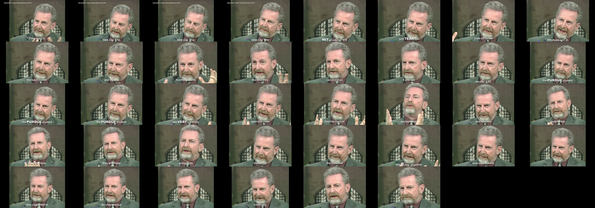

Adapted for Subclip from [nextwork-projects/ai-video-editor-cooked](https://github.com/nextwork-projects/ai-video-editor-cooked) by NextWork, MIT.

# Cooked edit method

<!-- cli:start -->
> Install from your terminal: `npx @subclip/community-skills install ai-video-editor-cooked`
<!-- cli:end -->

A careful method for editing talking-head video in Subclip: cut retakes and false starts with a last-take-wins rule, measure how reference videos are edited into a style, then add captions, zooms and real visuals timed to the spoken words, while avoiding looks that read as AI-made.

Example request: "Cut my take, then edit it like these four reels: same caption size, same zoom rate. Use my screenshots and real captures, no stock."

What changed from the original: the Python pipeline, Remotion renderer, browser review page, cloud render targets, API keys and ffmpeg steps are gone. The original's two plugins (editor and creator teardown) are folded into one skill, since Subclip already has rough cut, clipping, captions, motion and style sampling skills. What is kept is the craft: retake detection and editorial rules, the style measurement framework, the real-visuals rule and the AI-tells ban list. Product videos from a website, the setup flow and the skill maker were left out because Subclip's recorder, motion and skill tools cover them. The original NOTICE is kept as shipped.

<!-- examples:start -->

## Examples

 1. Cooked edit of a real interview take: dead pauses cut, 3-word captions, punch-ins. No AI model. <a href="examples/cooked-edit-reference.mp4">Play with sound</a>

 2. One frame per second of the edit: captions clear of the mouth, four punch-ins. No AI model.

Test outputs made with this skill in Subclip. Footage: Alexander H. King Interview, Purdue University Archives and Special Collections (CC BY). Cut, captions and zooms made in the Subclip editor: no image, video or audio model.

<!-- examples:end -->
