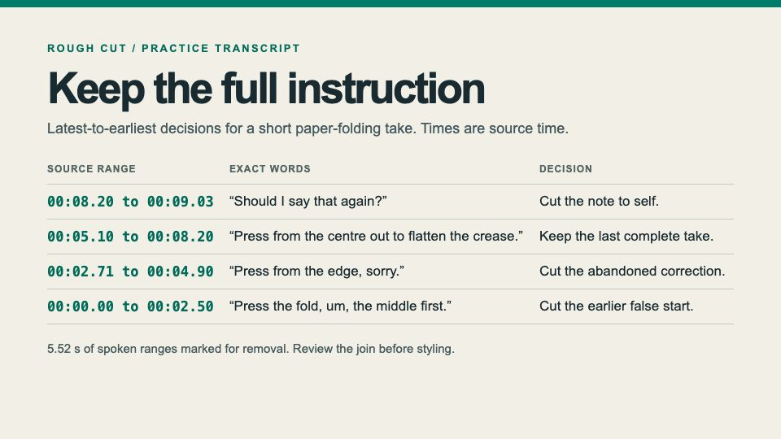
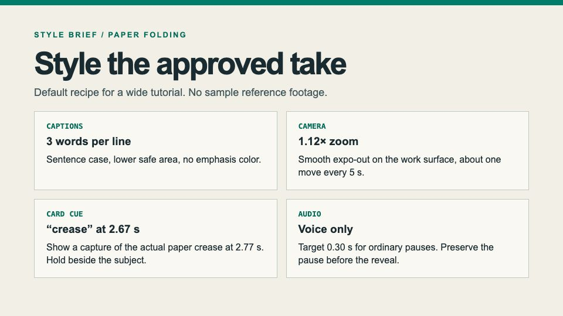

Adapted for Subclip from [nextwork-projects/ai-video-editor-cooked](https://github.com/nextwork-projects/ai-video-editor-cooked) by NextWork, MIT.

# Cooked edit method

A careful method for editing talking-head video in Subclip: cut retakes and false starts with a last-take-wins rule, measure how reference videos are edited into a style, then add captions, zooms and real visuals timed to the spoken words, while avoiding looks that read as AI-made.

Example request: "Cut my take, then edit it like these four reels: same caption size, same zoom rate. Use my screenshots and real captures, no stock."

What changed from the original: the Python pipeline, Remotion renderer, browser review page, cloud render targets, API keys and ffmpeg steps are gone. The original's two plugins (editor and creator teardown) are folded into one skill, since Subclip already has rough cut, clipping, captions, motion and style sampling skills. What is kept is the craft: retake detection and editorial rules, the style measurement framework, the real-visuals rule and the AI-tells ban list. Product videos from a website, the setup flow and the skill maker were left out because Subclip's recorder, motion and skill tools cover them. The original NOTICE is kept as shipped.

<!-- examples:start -->

## Examples

 A last-take-wins cut log with exact words, source ranges and the retained complete take.

 A numeric style brief and a visual cue tied to the exact word that triggers it.

 A retake log marks cuts and keeps the complete instruction, then a style brief shows how to edit the take. <a href="examples/retake-log-to-style-brief.mp4">Play with sound</a>

Test outputs made with this skill in Subclip. Rendered in code (HTML, SVG or canvas, HyperFrames): no image, video or audio model.

<!-- examples:end -->
