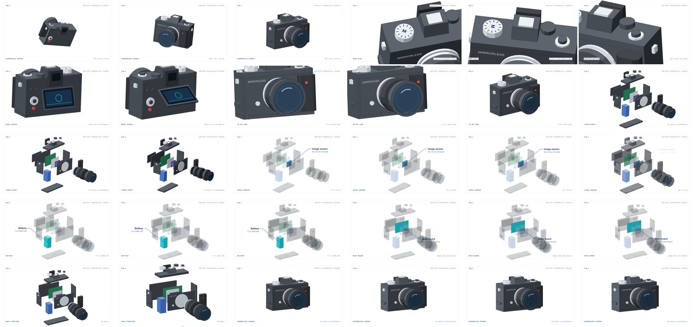

Adapted for Subclip from [annnguyentt/anatomy-reveal-skill](https://github.com/annnguyentt/anatomy-reveal-skill) by Ann Nguyen, MIT

# Anatomy reveal

<!-- cli:start -->
> Install from your terminal: `npx @subclip/community-skills install anatomy-reveal`
<!-- cli:end -->

Exploded views and product highlight shots for any physical product. Your agent builds the product part by part from its real dimensions (every panel, screw, dial, glass element and board is its own small solid), then films it in one continuous take: it tumbles in, whips to close-ups of its details, shows a feature working, comes apart into its parts, lights up one part at a time with a callout, and snaps back together for a hero shot. Everything is one editable HyperFrames layer on your timeline, on a white ground, with zero Subclip AI credits.

It works from a photo of the product or from just its name. Cameras, headphones, kettles, sneakers, watches, drills, perfume bottles: the product is always rebuilt as geometry, never traced from a picture or generated.

## Try asking

- "Make a 30 second exploded view of my mirrorless camera and highlight the sensor and the battery."
- "Here is a photo of our kettle. Take it apart and show the heating element inside."
- "A 10 second product reveal of a mechanical keyboard for a launch post, 9:16."
- "Show the inside of these earbuds, one part at a time with labels."

## What is inside

- [SKILL.md](SKILL.md): when to use it, the workflow, rules and checks.
- [assets/reveal-kit.js](assets/reveal-kit.js): the kit the agent pastes into the layer (convex parts, four-tone shading, painter's order, explode, highlight, callouts, keyed timeline).
- [references/inputs.md](references/inputs.md): from a photo or a name to a parts list.
- [references/building.md](references/building.md): how to build any product from convex parts so it comes apart cleanly.
- [references/shots.md](references/shots.md): the beats, keys and eases of the film.
- [references/look.md](references/look.md): ground, plate, materials and highlight.
- [references/layer-template.md](references/layer-template.md): the layer document and the kit API.
- [references/example-camera.js](references/example-camera.js): the camera from the reference video.

## Changes from the original

The original builds the product with the Anatomy kit in Node and renders the film with a headless browser and an adaptive motion blur. Subclip layers cannot run those scripts, so this edition is a compact rewrite of the same method as one inline kit, keeps the original's beats and eases, adds highlight shots with callouts and uses a white ground. It drops the interactive dissection page and the motion blur.

Credit: Ann Nguyen ([@ann_nnng](https://x.com/ann_nnng)), who asks that remixes keep the credit with the work. The original builds on [Anatomy](https://github.com/wheresryan22/anatomy) by Ryan (MIT).

<!-- examples:start -->

## Examples

 1. A mirrorless camera in 53 parts: details, explode, sensor, battery and board highlights, hero. Music CC0. No AI model. <a href="examples/anatomy-reveal-reference.mp4">Play with sound</a>

 2. The reference at one frame per second, the frame review the agent ran. One HyperFrames layer, no AI model.

Test outputs made with this skill in Subclip: one HyperFrames layer drawn in code, no image or video model. Music: crushed-suspense-001 by Johnmode on Freesound (CC0); whooshes from the Subclip sound library.

<!-- examples:end -->
