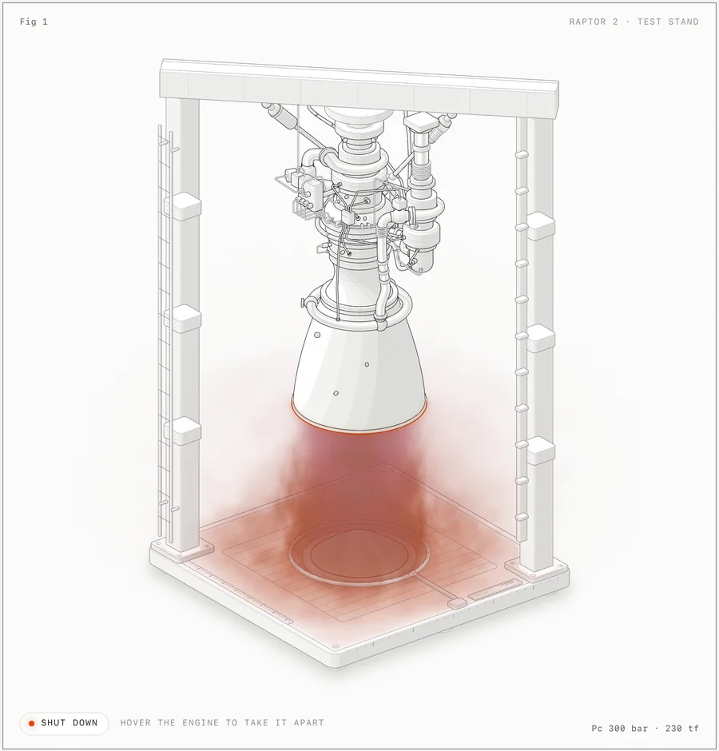
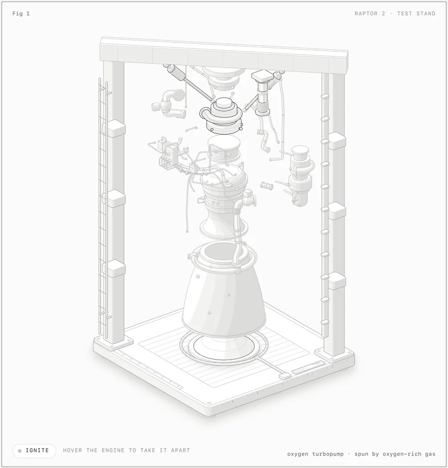
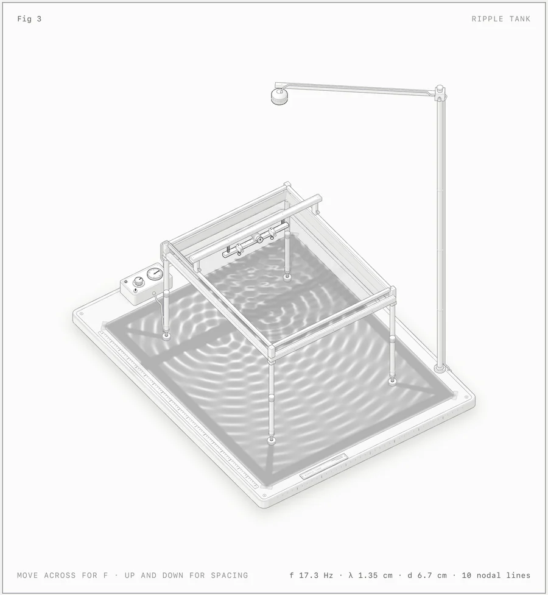
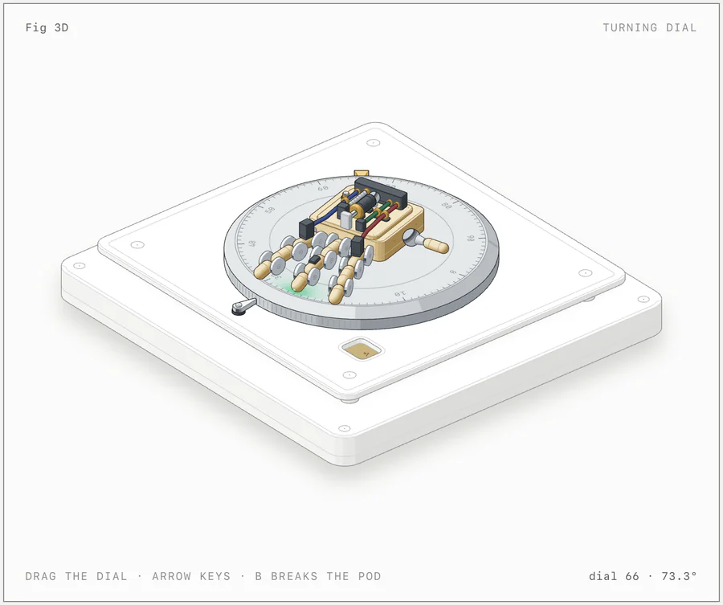
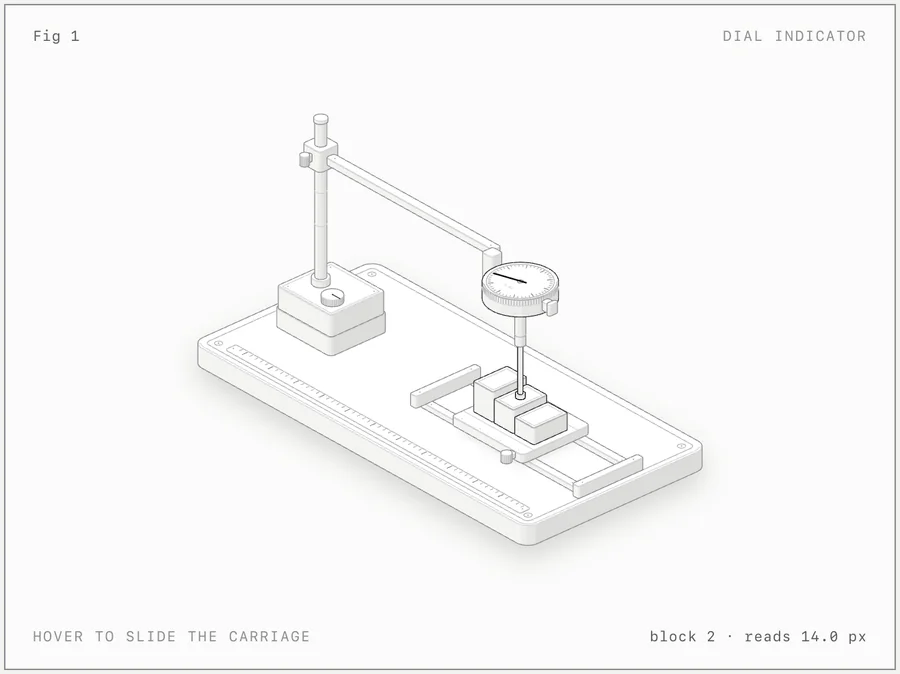

Adapted for Subclip from [wheresryan22/anatomy](https://github.com/wheresryan22/anatomy) by Ryan (wheresryan22), MIT

# Anatomy (Subclip edition)

Isometric explanatory figures for video. The idea is the original's: explain a technical idea by building it as a real, well made physical object (a test rig, a dial gauge, a lock) with many small precise parts, four-tone shading and calm eased motion. Here the figure is an animated scene in a Subclip HyperFrames layer, so it becomes an explainer clip with optional narration, exported as video.

## Use it

Tell your agent: "Use anatomy to make a 30 second explainer clip of how a token bucket rate limiter works". It invents the object, writes the parts list, builds one short layer per scene from a small isometric kit, adds narration if you want it and checks real frames.

## What changed for Subclip

- Output is a video scene (HyperFrames layers on the timeline), not an interactive web page. Motion is a seekable GSAP timeline.
- A compact isometric kit is inlined in `assets/figure-template.html` (projection, boxes, cylinders, coils, ticks). It replaces the original's Node kit.
- Optional narration with `generate_speech` or `generate_local_speech`, scenes timed to the voice.
- Craft rules are kept in `references/craft.md` (condensed).

## Left out, and why

- All scripts (capture, drive, audit, print, publish): Subclip skills do not run executables. Verification uses `view_current_frame` instead.
- The geometry audit and line-end check: they depend on those scripts. The same rules stay as a manual review checklist.
- PDF poster and printable sheet export, and the community gallery publishing: not video work.
- WebGL shaders (fire, water, caustics, lamp light) and the 3D turning mode: they need a live WebGL canvas and per-frame JavaScript that the layer runtime cannot guarantee for seek-by-time rendering. Use plain SVG shapes, gradients and eased motion instead. A deterministic Three.js layer is possible in Subclip but is a different skill.
- React and Next.js figures, pointer and keyboard interaction, reduced-motion code: the output is video, not a page.

<!-- examples:start -->

## Examples

 Isometric rocket engine test stand during a firing.

 Exploded view of the engine, piping and test stand.

 A ripple tank shows where two sets of waves meet.

 A mechanical hand turns a combination dial.

 A dial indicator measures a block on a sliding carriage.

Examples by Ryan, MIT, from github.com/wheresryan22/anatomy

<!-- examples:end -->

## Source and license

Original project: https://github.com/wheresryan22/anatomy. MIT license, kept unchanged in LICENSE. Synced at commit 1482e8469b0a9e0d8cc18ea2740a01423d29ae80 on 2026-11-23.
