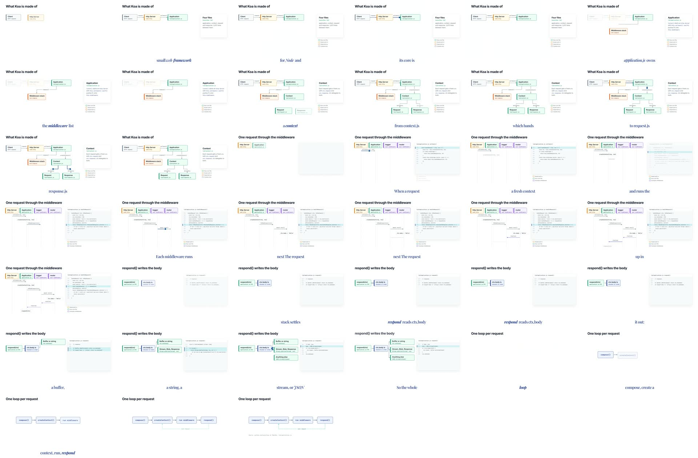

Adapted for Subclip from [tt-a1i/archify](https://github.com/tt-a1i/archify) by tt-a1i, Apache-2.0

# Archify

<!-- cli:start -->
> Install from your terminal: `npx @subclip/community-skills install archify`
<!-- cli:end -->

Archify turns an idea, a plan or a codebase into trustworthy diagrams: 10 diagram types, every node and arrow backed by a source, the main path first, and a guided story that walks the reader through it. This Subclip version points that method at video. Give it a repository, a pull request, a plan or a question, and it makes a narrated explainer in your Subclip project: each scene is an editable HyperFrames layer where nodes enter, edges draw, a token travels the path, one part is in focus and the exact code lines light up, with a voice track, captions and sound.

## What it makes

- **Story videos** of how a system or repo works: 2 to 4 scenes, each a different diagram type (structure, order of calls, decisions).
- **Diagram explainers** for one flow, plan or Mermaid chart.
- **One-page answers**: conclusion first, then panels with native diagrams, for a diagnosis, comparison or test report.
- **PR walkthroughs** with added, modified and removed marks and the changed lines.
- **Architecture Diagnosis** summaries: cycles, coupling and hotspots you can trace to the source.

## How it works in Subclip

1. Reads the evidence: local files, a public PR with `fetch_public_github_pull_request`, or a website with `inspect_public_website`.
2. Picks the diagram type and writes an Archify story brief into the project, with the repository and commit pinned.
3. Voices each scene (Subclip local speech is free), then places every beat on the word that names it.
4. Builds each scene from the scene kit (`references/scene-kit.md`) as a HyperFrames layer, or Remotion on request.
5. Adds navy captions on white, a quiet CC0 bed and soft sound effects, then checks the frames.

Code layers, local speech, local transcription and catalog audio cost 0 credits. Paid steps are quoted first and wait for your yes. No API keys and no scripts.

## Folder

- `SKILL.md`: the rules and the Subclip workflow.
- `references/story-video.md`: the story brief, beat operations and timing, the scene loop.
- `references/diagram-types.md`: the type router, layout in a 1920 by 1080 frame, the palette on white.
- `references/scene-kit.md`: the layer template and the data-driven kit used for the reference video.
- `references/explainer-pr-diagnosis.md`: one-page answers, PR walkthroughs and Architecture Diagnosis as video.
- `upstream/`: the original skill text (`archify/ORIGINAL-SKILL.md`, `archify-pr/ORIGINAL-SKILL.md`), its references, the 14 JSON schemas and 12 examples, kept as published. Only em dashes, middle dots and ellipsis characters were replaced, because this repository does not allow them in text files. The SKILL.md files are renamed so they are not installed as separate skills.
- `LICENSE`, `NOTICE`, `LICENSE-MIT` and `THIRD_PARTY_NOTICES.md`: unchanged from the original.

## Reference

The [Koa story video with sound](examples/archify-koa-reference.mp4) and its [one-frame-per-second sheet](examples/archify-koa-contact.jpg) were made by following the skill on a real open-source repository, koajs/koa at commit 98a19bc, for 0 credits. Edited by Claude Opus 5.5 (claude-opus-5-5) driving Subclip over MCP; no AI generation model (voice: Subclip local speech). The [silent preview](preview.mp4) is the hero.

## Changes and what is not included

The original is a Node package that renders and checks HTML diagrams, exports SVG and video, and runs a local code analysis workbench. Those programs are not included: the renderers, the story player and exporter, the Code Analysis module, the PR attach tools, the viewer, fonts and the brand mark set. The craft is kept: the type router, the authoring defaults, the evidence rules, the story brief and choreography operations, the explainer and PR methods. In Subclip they drive HyperFrames layers, local speech, captions and native audio instead of the command line tool. The full original lives at [tt-a1i/archify](https://github.com/tt-a1i/archify); a backup fork is at [subclip-app/archify](https://github.com/subclip-app/archify).

<!-- examples:start -->

## Examples

 1. How Koa handles a request, from koajs/koa source. Edited by Claude Opus 5.5 (claude-opus-5-5) over MCP. Voice: Subclip local TTS. <a href="examples/archify-koa-reference.mp4">Play with sound</a>

 2. One frame per second: architecture, sequence with code, respond() and the loop. Edited by Claude Opus 5.5, no AI generation model.

Made with this skill in Subclip for 0 credits. Edited by Claude Opus 5.5 (claude-opus-5-5) over MCP; no AI generation model (voice: Subclip local TTS). Source: koajs/koa at 98a19bc. Music: Chill Background Music by Seth_Makes_Sounds (CC0). SFX: Subclip catalog.

<!-- examples:end -->
