Adapted for Subclip from [bangtutorial/bang-motion](https://github.com/bangtutorial/bang-motion) by bangtutorial, MIT.

# Bang Motion

**An agent skill that turns your AI agent into a motion designer, inside Subclip.** 
Openers, promos, product demos, kinetic typography and explainers, built as editable layers on a Subclip timeline that play like video, not like slides.

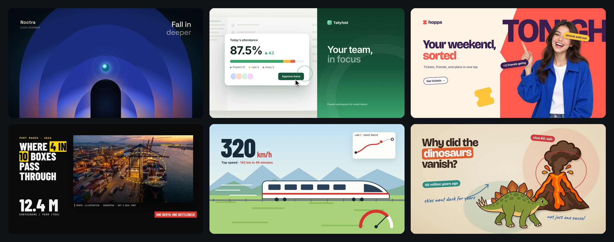

[Watch the silent preview](preview.mp4).

[What you can make](#what-you-can-make) - [Style gallery](#style-gallery) - [Install](#install) - [Example prompts](#example-prompts) - [Models](#models) - [What changed](#what-changed)

---

## Why

Ask an AI agent for "a video" and you usually get **slides**: one section per idea, a title, a photo, a fade between them. Bang Motion encodes what a working motion designer insists on: one continuous world, a camera that actually moves, a subject that persists, text that lives inside the scene: as **rules an agent can check in its own code**, plus starters that make the right architecture the easy path.

It also stops every project from looking the same. The look is **derived from your brand** through a required style brief, the structure is **chosen from a menu of concepts**, and nothing is inherited from the starter or copied from a reference.

## What you can make

| | Output | Typical length |
|---|---|---|
| 🎬 **Openers & promos** | product launches, app promos, campaign spots, teasers | 15-40 s |
| 🖥️ **Product & SaaS demos** | UI assembled and used on screen, camera following the clicks | 20-60 s |
| 🔤 **Kinetic typography** | lyric-style statements, event announcements, manifestos | 10-30 s |
| 📺 **Bumpers, idents, channel intros** | short brand moments that loop | 3-10 s |
| 🧭 **Explainers** | six explainer styles, optional voice-over sync, 16:9 or 9:16 | 30-120 s |
| 🎥 **Video layers** | your own or generated clips placed like footage: inside devices, frames, and masks, locked to the timeline |: |
| ✂️ **Native Subclip edits** | your footage, voice, music and captions on the same timeline, exported from Subclip | any |

Every deliverable is one `index.html`: double-click to play, autoplay + loop, `?debug=1` for a scrub bar, and an optional frame-by-frame export to MP4.

## Style gallery

> Each frame below is a **single static scene** built for this README with **fictional brands and data**. The portrait, product photos, port photo, engraving, and cartoon cutouts were generated with GPT Image 2.5; everything else is HTML, CSS, and SVG. Real projects take their palette, type, and imagery from your brand.

<table>
<tr>
<td width="50%"> <b>Grainy gradient</b> - opener Glowing layered shapes, soft grain, a camera that travels through them. Tech, AI, music, premium launches.</td>
<td width="50%">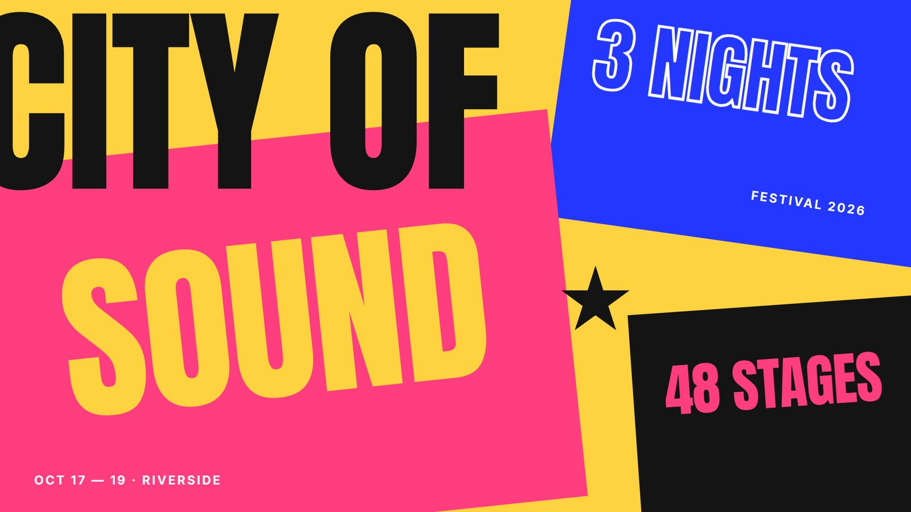 <b>Poster color-block</b> - kinetic typography Huge cropped words, solid color fields that slam in on the beat. Events, music, launches.</td>
</tr>
<tr>
<td>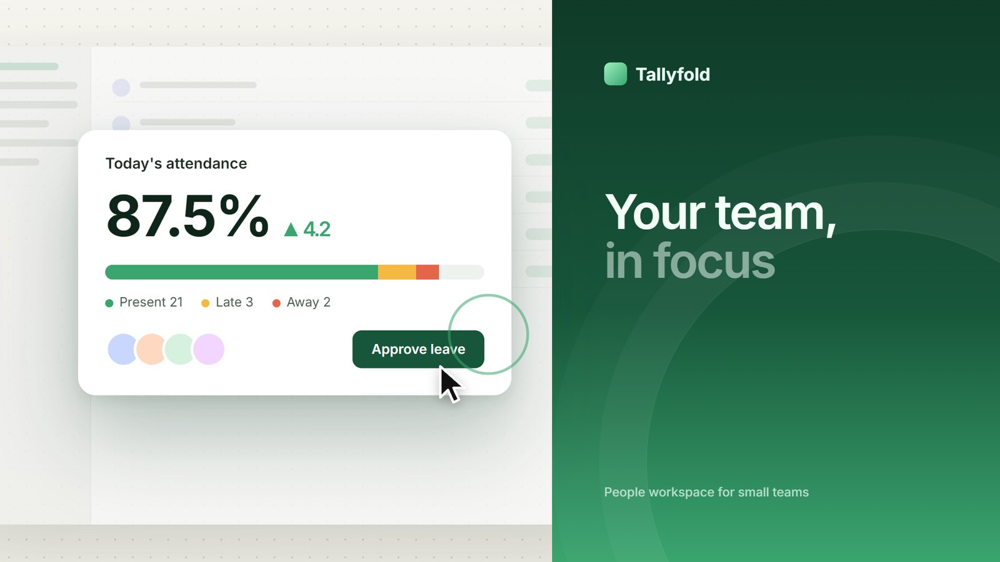 <b>Product tour with claims</b> - SaaS demo Real UI lifted out of the dashboard, the camera zooms into what gets clicked. SaaS, dashboards, B2B.</td>
<td> <b>Flat vector illustration</b> - promo Solid fills, stylized hands, UI drawn flat, shapes with gentle overshoot. Fintech, consumer apps.</td>
</tr>
<tr>
<td>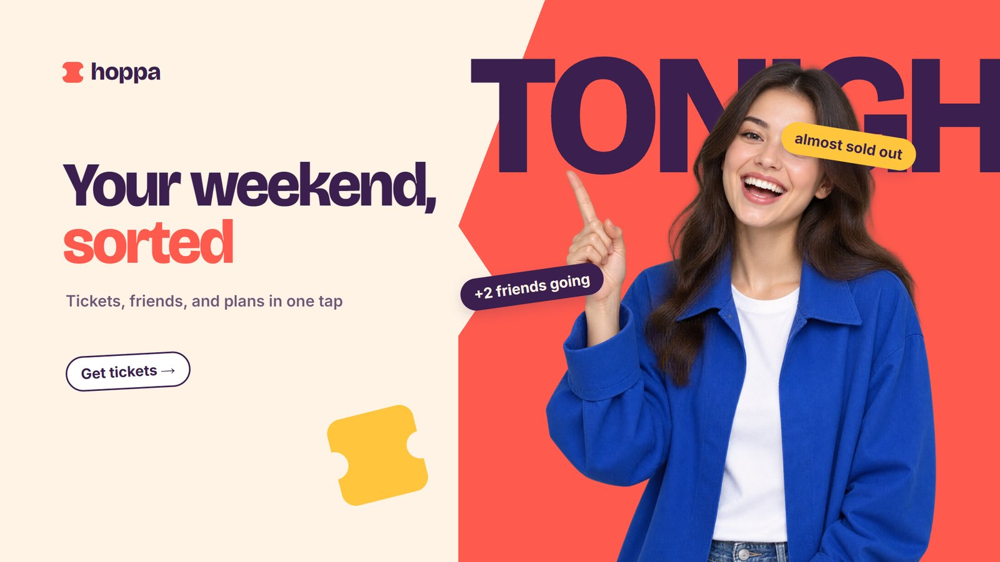 <b>Flat pop with photos</b> - promo Photo cutouts popping in, stickers, brand color fields that change with a visible trigger. Consumer apps, campaigns.</td>
<td>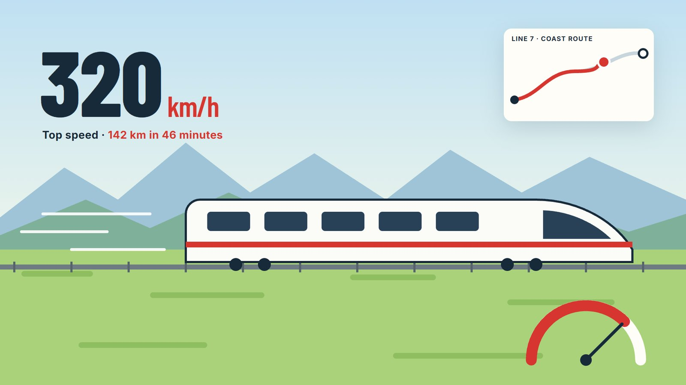 <b>Continuous action</b> - explainer One subject that never stops, numbers and maps living inside the world. Speed, routes, processes.</td>
</tr>
<tr>
<td>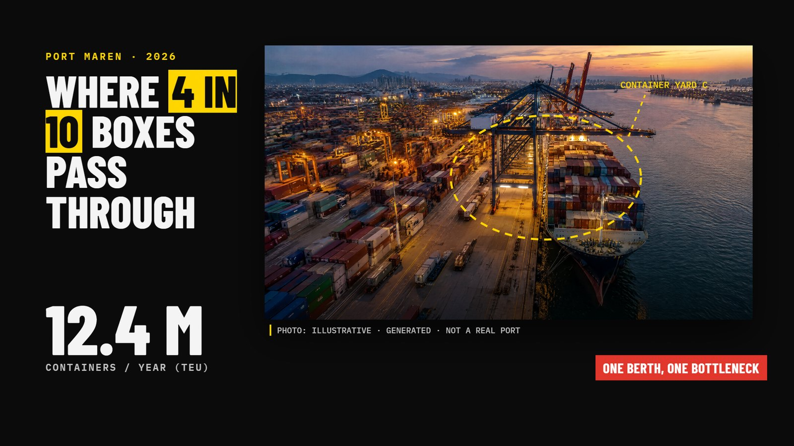 <b>Visual journalism</b> - explainer Black ground, real photos with source tags, highlighter, dashed annotations. News, current issues.</td>
<td>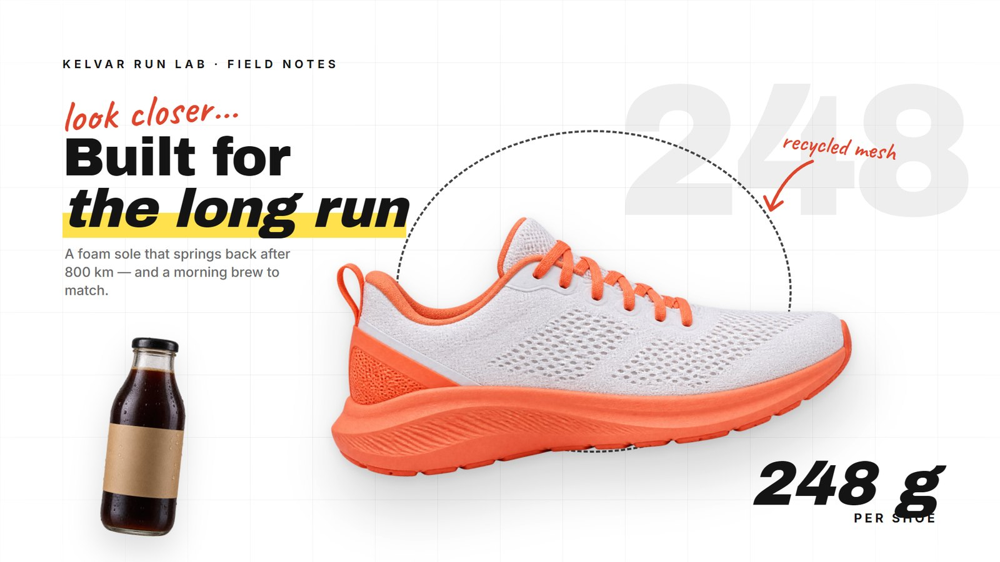 <b>White catalog</b> - explainer White grid, product cutouts, mixed script and heavy sans. Products, brands.</td>
</tr>
<tr>
<td>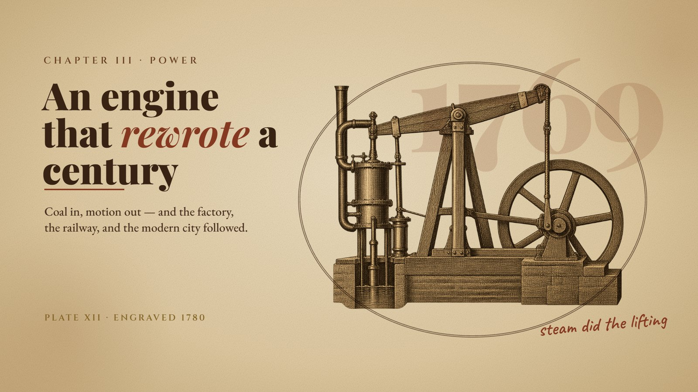 <b>Vintage sketch</b> - explainer Sepia paper, engraving art, classic serifs, rust notes. History, biography.</td>
<td> <b>Cartoon collage</b> - explainer Cream paper, flat illustration cutouts, color pills, handwriting. Science, education.</td>
</tr>
<tr>
<td>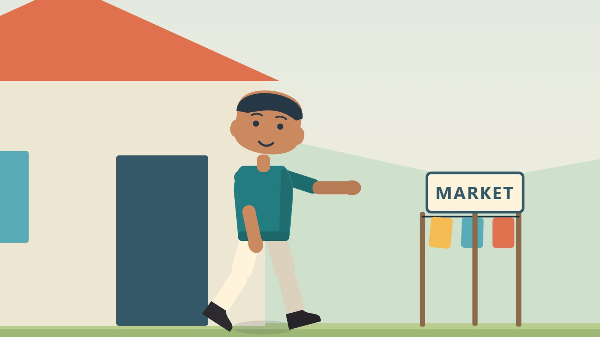 <b>Cartoon stage</b> - explainer One living stage per scene, jointed characters, no captions. Education with characters.</td>
<td>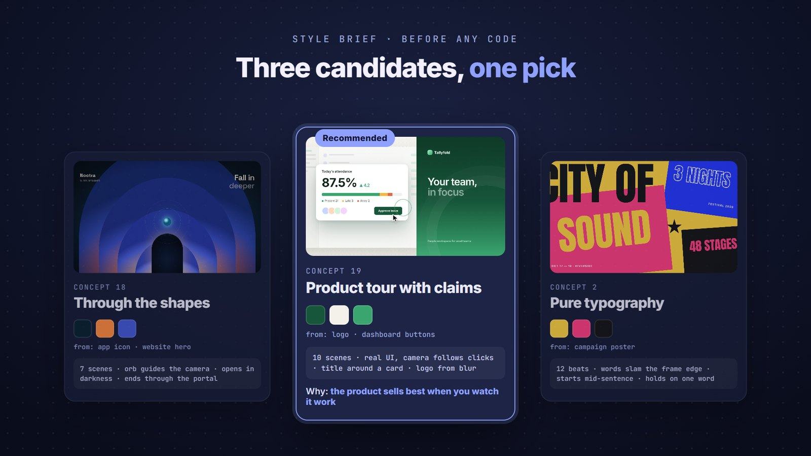 <b>…and many more</b> 10 styles × 19 concepts × 9 render families: three candidates, one pick.</td>
</tr>
</table>

## The menus behind the looks

<b>10 style directions</b>: the skin, derived from your brand

| Direction | Background | Typography | Signature motion | Good for |
|---|---|---|---|---|
| Cinematic dark | near-black gradient, particles, bloom only on objects | bold clean grotesk | push-through, light in front of the lens | creative tools, gaming, tech |
| Poster color-block | large solid color fields changing per scene | ultra-heavy display, giant cropped letters | block wipes, text slamming the frame edge | consumer apps, music, events |
| Editorial light | white/cream, generous space, hairlines | display serif + small grotesk | calm slides, lines that draw | productivity, finance, SaaS |
| Paper & print | paper texture, collage, stamps, tape | handwriting + serif | objects flying in and landing | education, community, food |
| Retro / analog | faded color, grain, scanlines | 70s-90s geometric | controlled glitch, rough zoom, freeze | nostalgia, music, entertainment |
| Brutalist mono | black and white, hard grid | monospace + condensed | hard cuts, shifting blocks, blinking cursor | developer tools |
| Pastel playful | stacked pastels, big round shapes | heavy rounded sans | elastic bounce, blooming shapes | kids, health, lifestyle |
| Luxury dark | black + gold/bronze, soft shadows | tall wide-tracked serif | slow motion, sweeping light, depth | fashion, automotive, property |
| Flat pop with photos | neutral light alternating with solid brand fields | rounded heavy sans + giant cropped words | cutouts popping in, stickers, fields snapping on the beat | consumer apps, fintech, e-commerce |
| Grainy gradient | deep base, saturated glowing shapes, fine grain | small clean grotesk or minimal heavy display | layers opening, camera through the shape, a guiding orb | tech, AI, music, creative launches |

<b>19 opener concepts</b>: the structure, chosen per product

| # | Concept | Good for |
|---|---|---|
| 1 | One continuous shot | creative tools, hardware, spaces |
| 2 | Pure typography | strong taglines, events, releases |
| 3 | Problem → gone | productivity, utilities |
| 4 | Before / after | editors, filters, optimization |
| 5 | Journey inside the UI | apps with a distinctive UI |
| 6 | Product macro | hardware, packaging, F&B, fashion |
| 7 | Object metaphor | security, cloud, finance |
| 8 | Living number | milestones, performance |
| 9 | One feature, fully demoed | apps with one clear edge |
| 10 | Diegetic question → answer | AI, search, support |
| 11 | Rhythmic collage | music, lifestyle, community |
| 12 | Logo as stage | brands with a strong logo shape |
| 13 | Object relay | e-commerce, delivery, marketplaces |
| 14 | Brand system showcase | launches, rebrands, communities |
| 15 | Claim → how → result | new features, generative AI, creative tools |
| 16 | Living UI ecosystem | B2B SaaS, AI assistants, workflows |
| 17 | Flat pop with photos | consumer apps, fintech, campaigns |
| 18 | Through the gradient shapes | tech, AI, security, premium launches |
| 19 | Product tour with claims | SaaS, team tools, dashboards |

Each concept ships as principles and a menu of openings, transitions, and endings: never as a script to copy.

<b>6 explainer styles</b>: each with its own starter

| Style | Look | Best for |
|---|---|---|
| Continuous action | flowing vector world, one subject that never leaves, changing viewpoints | speed, routes, processes |
| Cartoon collage | cream paper, flat illustration cutouts, handwriting, color pills | science, education |
| Visual journalism | black, real photos with source tags, highlighter, dashed annotations | news, current issues |
| White catalog | white grid, photo cutouts, mixed typography, scribbles | products, brands |
| Vintage sketch | sepia paper, engraving art, classic serifs, rust annotations | history, biography |
| Cartoon stage | one stage per scene, jointed characters, no captions | education with characters |

---

## Install

In Subclip, open Skills > Add skill and use this folder's GitHub link. Claude Code, Codex, Cursor and the in-app agent can read SKILL.md and work through Subclip's connected editor tools.

### Example prompts

Ask your agent:

- Make a 30-second opener for my note app. Use the attached logo and screenshots.
- Build a 45-second product tour with short claims and a camera that follows the important clicks.
- Animate our festival announcement as bold color-block typography, 16:9.
- Explain why volcanoes erupt in a bright cartoon stage style, with local draft narration.

The agent reads project and media context, proposes a brief, settles assets and cost, then builds short HyperFrames segments with separate footage, voice and music. Narration sets timing when requested. Captions are off unless requested. The default ratio is 16:9 unless your brief or main video sets another format. Export happens only when requested.

## Models

The original makes its photos, portraits and cutouts with GPT Image 2.5. Images go to your own Codex CLI (GPT image generation) first; on Subclip the default is GPT Image 2.5 (`gpt-image-2.5-flare`). Everything else is drawn in code, so most pieces need no generation credits.

## Cost choices

Code-drawn motion and native edits need no generation credits. Local speech offers a draft voice without credits when available. Subclip AI images, video, cloud speech and music use a live estimate and approved budget. If you have not chosen a generator, the agent offers your working Codex or Grok generator where supported; those use your provider plan rather than Subclip credits.

## What changed

The upstream single index.html delivery became short editable HyperFrames timeline layers. Media, text, captions, audio and device shots use native editor controls. Subclip generation replaces outside image/video services. The After Effects bridge, Python helpers, browser servers and executable assembly/export scripts are omitted. No creator-run scripts or provider credentials are required.

The references retain the concept menu, brand-first brief, anti-slide repairs, typography and camera recipes, UI choreography, six explainer styles and jointed cartoon technique in plain English. Text blur is replaced by transforms and opacity because filters on text can fail in Subclip exports. Raster expression processing is replaced by editable vector faces or approved image variants.

## Included references

| File | Use |
| --- | --- |
| [opener-concepts.md](references/opener-concepts.md) | 19 concepts, fingerprints, openings, endings and UI/photo recipes |
| [anti-ppt.md](references/anti-ppt.md) | Slide patterns and repairs |
| [techniques.md](references/techniques.md) | Type, camera, transitions, backgrounds and deterministic motion |
| [explainers.md](references/explainers.md) | Six modes, evidence, narration and continuous action |
| [cartoon-stages.md](references/cartoon-stages.md) | Stage framing, joints, expressions and live environments |
| [subclip-production.md](references/subclip-production.md) | Current native assembly, generation, timing and verification |

## Verification and limits

Tool names and key fields were checked against the Subclip source catalog on 2026-11-23. Repository build, consistency check, scanner and tests cover packaging. App testing was prohibited for this conversion, so no live frames, speech, playback or export were tested. Future editing runs must perform the visual and audio checks in SKILL.md.

The scanner reports the optional Grok choice required by the conversion guide and skips the binary cover during text scanning. Both findings were reviewed. No scanner exceptions or executable files were added.

There is no automatic equivalent in this skill for the upstream raster pupil/mouth expression script or standalone HTML player delivery. Use the vector face recipe or approved generated variants. Audio-reactive graphics use supplied beat times or a stated procedural approximation, not an invented automatic beat-analysis tool. These limits do not block the native motion workflow.

The cover is the upstream hero grid and the gallery images come from the upstream docs/gallery folder (MIT). The silent preview was built in Subclip with animated headlines, framed gallery cards and editable Remotion layers. Upstream says gallery brands and data are fictional. No executable source scripts are included. Original copyright and MIT terms are preserved byte for byte in [LICENSE](LICENSE).

<!-- examples:start -->

## Examples

 A glowing blue opener with layered shapes and soft grain

 Oversized words cropped across bright poster blocks

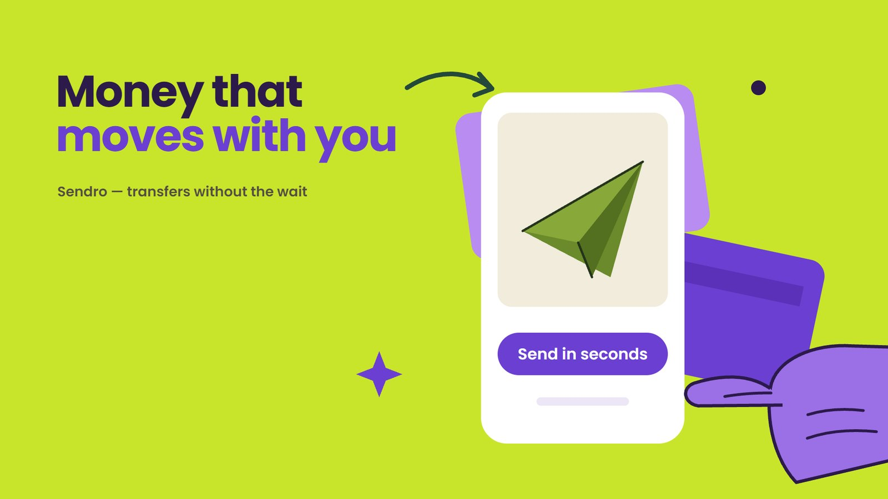 A product promo made with flat shapes and illustrated controls

 A train explainer that places the speed readout in the scene

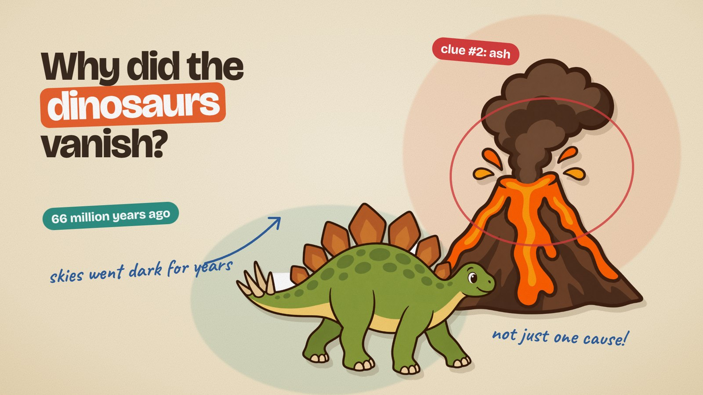 A volcano explainer with illustrated cutouts on a paper background

Examples by bangtutorial, MIT, from github.com/bangtutorial/bang-motion

<!-- examples:end -->
