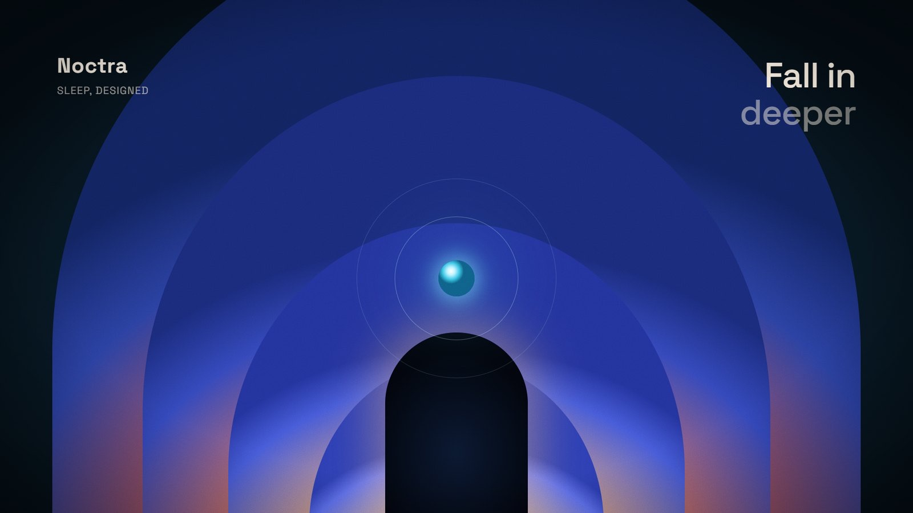

Adapted for Subclip from [bangtutorial/bang-motion](https://github.com/bangtutorial/bang-motion) by bangtutorial, MIT.

# Bang Motion

Make brand-led openers, product tours, kinetic typography and illustrated explainers on an editable Subclip timeline. The craft stays: 19 concept choices, six explainer modes, a persistent world, purposeful camera moves, lively type and checks against slide-like results.

## Use

In Subclip, open Skills > Add skill and use this folder's GitHub link. Claude Code, Codex, Cursor and the in-app agent can read SKILL.md and work through Subclip's connected editor tools.

Example requests:

- Make a 30-second opener for my note app. Use the attached logo and screenshots.
- Build a 45-second product tour with short claims and a camera that follows the important clicks.
- Animate our festival announcement as bold color-block typography, 16:9.
- Explain why volcanoes erupt in a bright cartoon stage style, with local draft narration.

The agent reads project and media context, proposes a brief, settles assets and cost, then builds short HyperFrames segments with separate footage, voice and music. Narration sets timing when requested. Captions are off unless requested. The default ratio is 16:9 unless your brief or main video sets another format. Export happens only when requested.

## Cost choices

Code-drawn motion and native edits need no generation credits. Local speech offers a draft voice without credits when available. Subclip AI images, video, cloud speech and music use a live estimate and approved budget. If you have not chosen a generator, the agent offers your working Codex or Grok generator where supported; those use your provider plan rather than Subclip credits.

## What changed

The upstream single index.html delivery became short editable HyperFrames timeline layers. Media, text, captions, audio and device shots use native editor controls. Subclip generation replaces outside image/video services. The After Effects bridge, Python helpers, browser servers and executable assembly/export scripts are omitted. No creator-run scripts or provider credentials are required.

The references retain the concept menu, brand-first brief, anti-slide repairs, typography and camera recipes, UI choreography, six explainer styles and jointed cartoon technique in plain English. Text blur is replaced by transforms and opacity because filters on text can fail in Subclip exports. Raster expression processing is replaced by editable vector faces or approved image variants.

## Included references

| File | Use |
| --- | --- |
| [opener-concepts.md](references/opener-concepts.md) | 19 concepts, fingerprints, openings, endings and UI/photo recipes |
| [anti-ppt.md](references/anti-ppt.md) | Slide patterns and repairs |
| [techniques.md](references/techniques.md) | Type, camera, transitions, backgrounds and deterministic motion |
| [explainers.md](references/explainers.md) | Six modes, evidence, narration and continuous action |
| [cartoon-stages.md](references/cartoon-stages.md) | Stage framing, joints, expressions and live environments |
| [subclip-production.md](references/subclip-production.md) | Current native assembly, generation, timing and verification |

## Verification and limits

Tool names and key fields were checked against the Subclip source catalog on 2026-11-23. Repository build, consistency check, scanner and tests cover packaging. App testing was prohibited for this conversion, so no live frames, speech, playback or export were tested. Future editing runs must perform the visual and audio checks in SKILL.md.

The scanner reports the optional Grok choice required by the conversion guide and skips the binary cover during text scanning. Both findings were reviewed. No scanner exceptions or executable files were added.

There is no automatic equivalent in this skill for the upstream raster pupil/mouth expression script or standalone HTML player delivery. Use the vector face recipe or approved generated variants. Audio-reactive graphics use supplied beat times or a stated procedural approximation, not an invented automatic beat-analysis tool. These limits do not block the native motion workflow.

The cover is the upstream docs/gallery/01-grainy-gradient.jpg still, resized to 1600 by 900 with sips. It is a design example, not a Subclip test render. Upstream says gallery brands and data are fictional. No demo video or executable source scripts are included. Original copyright and MIT terms are preserved byte for byte in [LICENSE](LICENSE).
