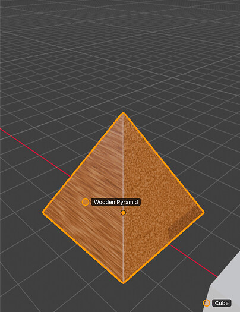

Adapted for Subclip from [ahujasid/mcp-for-blender](https://github.com/ahujasid/mcp-for-blender) by Siddharth Ahuja, MIT.

# Blender to Subclip

Build a short product turntable, stylized diorama or camera move. Review the scene and motion with a connected Blender MCP, render through Blender's interface, and place the result as native media in Subclip. Keep the Blender project for changes to geometry, lights and animation. Edit cuts, framing, titles and audio in Subclip.

The workflow uses local rendering and media import with no Subclip AI credits. A connected Blender MCP is optional for inspection. Scene building and file rendering use Blender's interface through Subclip desktop control when available, or a creator-supplied render when desktop access is unavailable.

Example request: “Make a four-second studio turntable of a blue ceramic mug, leave room for a title on the left, and place the clip at 8 seconds in my Subclip project.”

<!-- examples:start -->

## Examples

 A wooden pyramid selected in the Blender viewport.

Examples by Siddharth Ahuja, MIT, from github.com/ahujasid/mcp-for-blender

<!-- examples:end -->
