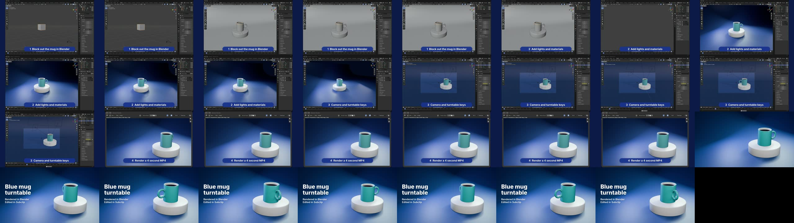

Adapted for Subclip from [ahujasid/mcp-for-blender](https://github.com/ahujasid/mcp-for-blender) by Siddharth Ahuja, MIT.

# Blender to Subclip

<!-- cli:start -->
> Install from your terminal: `npx @subclip/community-skills install blender-to-subclip`
<!-- cli:end -->

Build a short product turntable, stylized diorama or camera move. Review the scene and motion with a connected Blender MCP, render through Blender's interface, and place the result as native media in Subclip. Keep the Blender project for changes to geometry, lights and animation. Edit cuts, framing, titles and audio in Subclip.

The workflow uses local rendering and media import with no Subclip AI credits. A connected Blender MCP is optional for inspection. Scene building and file rendering use Blender's interface through Subclip desktop control when available, or a creator-supplied render when desktop access is unavailable.

Example request: “Make a four-second studio turntable of a blue ceramic mug, leave room for a title on the left, and place the clip at 8 seconds in my Subclip project.”

[Watch the silent preview](preview.mp4). [Watch the reference with sound](examples/mug-turntable-reference.mp4): a blue mug turntable built step by step in Blender (blockout, lights and materials, camera and turntable keys, render), then the 4 second render titled in Subclip, 31 seconds, made with this skill for 0 credits.

<!-- examples:start -->

## Examples

 1. Mug turntable: Blender blockout, lights, camera keys and render, then the clip titled in Subclip. No AI model. <a href="examples/mug-turntable-reference.mp4">Play with sound</a>

 2. One frame per second: four Blender steps and the final turntable with its title in Subclip. No AI model.

Test output made with this skill in Subclip for 0 credits. Blender 5.3 driven through the Blender MCP, EEVEE render, muted step recordings. Music: Electronic Perk loops by aikighost (CC0).

<!-- examples:end -->
