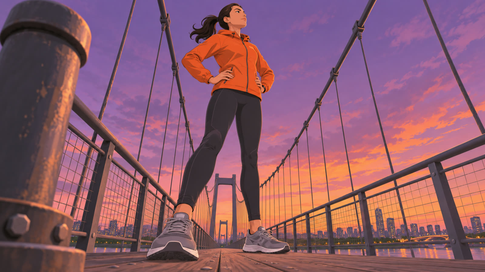
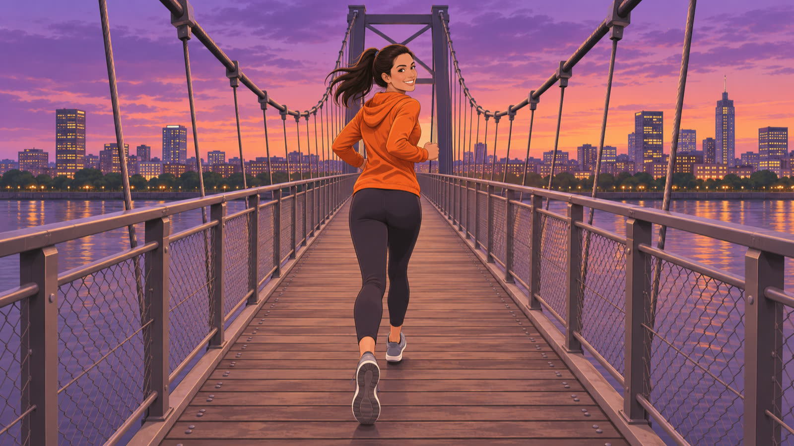
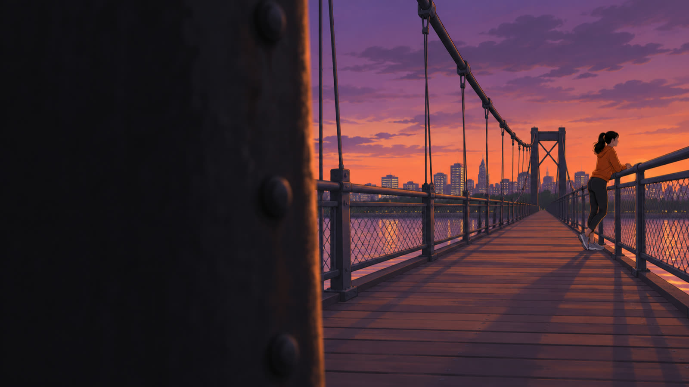
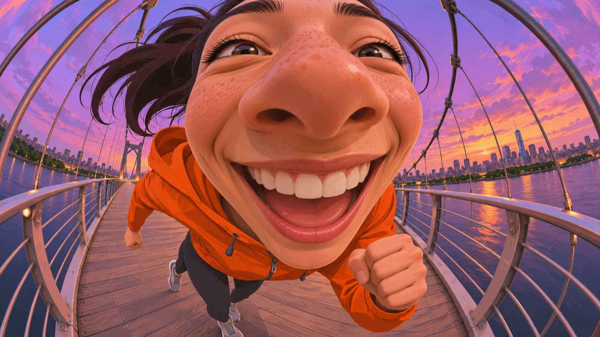
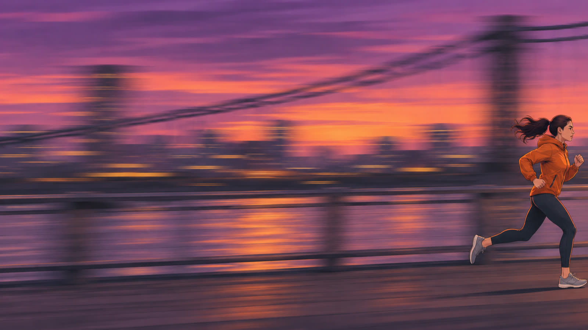
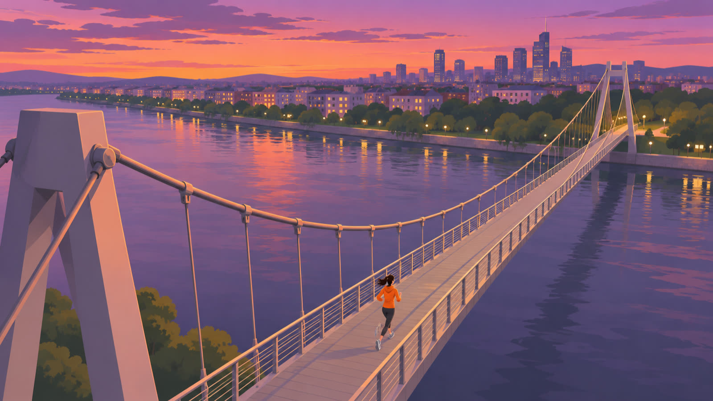
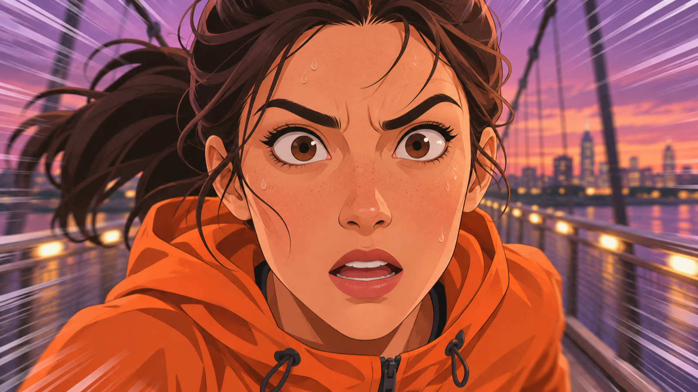
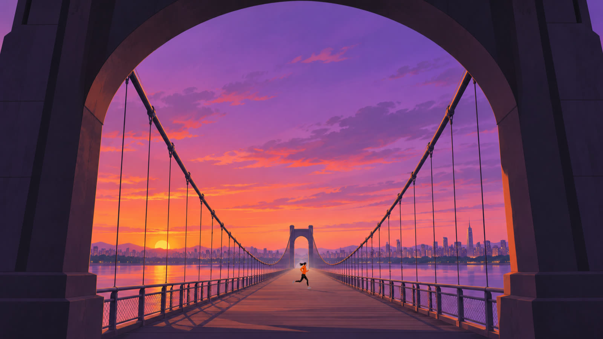
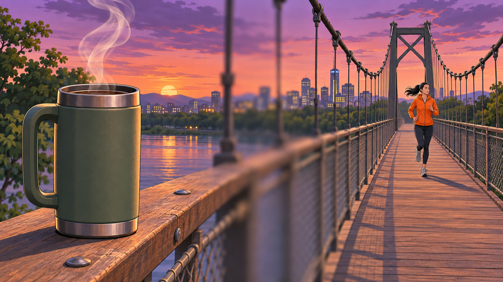

# 44 Cinematic Camera Angles Prompt Guide for AI Video (Digital Windows AI)

A Subclip community skill that turns a list of 44 camera angles into something an agent can use: pick the right angle for the feeling, write the prompt, decide whether Subclip can fake it with a crop, zoom or keyframe or needs a video model, quote the credits, and pair the angles into a cut.

Includes our own guide: how to choose angles, a prompt formula, an angle by emotion and use case table, and pairing rules.

## Install

Add this skill from **Skills > Community** in Subclip, or point your agent at this folder. It works with Claude Code, Codex, Cursor and the in-app agent through Subclip's MCP tools.

## Files

- `SKILL.md`: the workflow the agent follows.
- `references/angle-index.md`: all 44 angles with where each one is written.
- `references/height-and-distance.md`, `references/viewpoint-and-framing.md`, `references/camera-moves.md`, `references/lens-and-focus.md`: 31 angles in full, with a camera sentence, a tip and the Subclip route for each.
- `references/prompt-formula.md`, `references/our-guide.md`, `references/subclip-tools.md`.
- `examples/`: illustrated example frames (fictional runner on a footbridge) and a capability video.

## How it relates to ai-camera-shots

13 of the 44 angles overlap with the `ai-camera-shots` skill, so this skill points there by slug instead of repeating them. It writes the other 31 in full.

<!-- examples:start -->

## Examples

<video src="examples/capability-camera-angles.mp4" controls muted loop playsinline width="720"></video> Capability reference, ten camera angles in one montage with labels

 05 Worm's eye: camera on the floor, subject towers above

 36 Knee level: low height, whole figure in frame

 23 Cowboy shot: head to mid-thigh, hands in view

 14 POV: first person, no hands visible

 29 Hidden camera: a real object blocks part of the frame

 32 Dolly zoom: same face size, stretched background

 34 Fisheye: ultra wide lens inches from the face

 21 Whip pan: heavy motion blur landing on the subject

 20 Drone: sweeping high view of the whole place

 31 Snorricam: face locked, world swings behind

 30 Crash zoom: sudden punch-in to the face

 12 Extreme wide: tiny subject framed through an arch

 24 Insert: detail of the hands, face out of frame

 39 Split diopter: near mug and far subject both sharp

 42 Steadicam: smooth glide behind the subject

 37 Hip shot: loose low camera angled up

Original illustrated frames made for this skill by Subclip. Images: gpt-image-2 (Codex CLI image generation). Montage clip assembled from those frames, no video model.

<!-- examples:end -->

## Credits

The 44 camera angle names and the idea of one prompt per angle come from the free guide [44 Cinematic Camera Angles: The Prompt Guide](https://www.digital-windows.co.uk/guides/camera-angles) by Digital Windows AI (Liverpool, UK; author on Instagram as @digital_windows_ai). The guide states no license. All wording, prompts, tips, tables and images here are our own and no content of the guide is copied. Permission has not been confirmed. If you are the owner and want a change or removal, open an issue.
