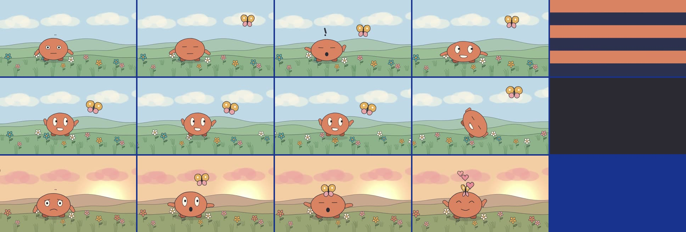

Adapted for Subclip from [JohnHeibel/ClaudeAnimationBase](https://github.com/JohnHeibel/ClaudeAnimationBase) by John Heibel, MIT

# cartoon-animation (Subclip edition)

<!-- cli:start -->
> Install from your terminal: `npx @subclip/community-skills install cartoon-animation`
<!-- cli:end -->

Make a short hand-painted cartoon in Subclip. A character wants something, tries, fails or succeeds and reacts, in flat washes with boiling ink outlines on soft watercolor backgrounds and paper grain. The agent storyboards first (with timed reads so the viewer can follow), builds one shot per editable motion layer, joins shots with brush wipes and irises, and checks frames before it shows you.

The original is a starter kit for animating a mascot in p5.js and p5.brush. Its guide (the three goals, seven rules, animation principles, storyboard format, review loop and list of common failures) is kept. The drawing engine is rebuilt as a small deterministic canvas kit that runs inside a Subclip layer, so there is nothing to install and no render command. The original mascot art is not included; you design your own character.

## Install

In Subclip: **Skills > Add skill**, paste `https://github.com/subclip-app/community-video-editing-skills/tree/main/skills/cartoon-animation`.

## Use

> Make a 15 second cartoon of a little round creature trying to catch a butterfly.

## What's inside

| File | What it covers |
|---|---|
| `SKILL.md` | The workflow in Subclip: storyboard, character, one layer per shot, music, verify |
| `references/acting-guide.md` | The rules, principles, acting vocabulary, storyboard format, review loop, failures, a worked timing example |
| `references/canvas-brush-kit.md` | The canvas painting kit, a starter character, camera and transition helpers, the layer template and an example shot |

## Reference

[bean-and-butterfly-reference.mp4](examples/bean-and-butterfly-reference.mp4) is a 14 second cartoon made with this skill: a bored bean chases a butterfly with three hops and a missed lunge, sulks at sunset, and the butterfly lands on its head. It is painted entirely in code (three HyperFrames canvas layers, no image, video or audio model), cut on a 120 BPM marimba loop with boings and whooshes on native audio lanes. The [contact sheet](examples/one-second-contact-sheet.jpg) shows one frame per second.

## Limits

The p5.brush look (WebGL watercolor, pigment mixing) is approximated in plain canvas. The original mascot and model sheets are left out on purpose, because the character is a brand mascot and the repository license is a code license.

<!-- examples:start -->

## Examples

 1. Bean and butterfly: 14 s cartoon with takes, hops, brush wipes and irises. Code-painted layers, no AI model. <a href="examples/bean-and-butterfly-reference.mp4">Play with sound</a>

 2. One frame per second: morning meadow, chase, tumble, sunset landing. Code-painted layers, no AI model.

Test outputs made with this skill in Subclip. Scenes painted in code (HyperFrames canvas layers): no image, video or audio model. Music: Marimba loop 2 by BrickDeveloper171 (CC0); boing by Hajisounds (CC0); whoosh and pop from the Subclip SFX library.

<!-- examples:end -->

## License

MIT, same as the original code. See `LICENSE`.
