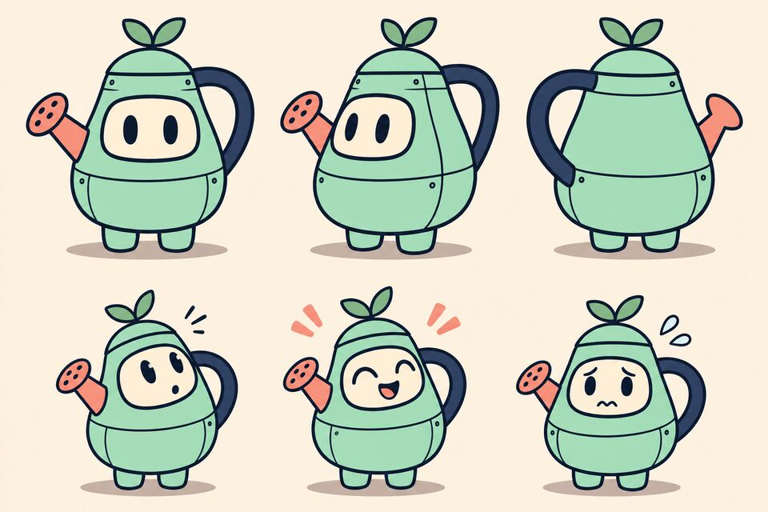

Adapted for Subclip from the Notion list Claude Creative Skill Library Vol 2 (https://app.notion.com/p/Claude-Creative-Skill-Library-Vol-2-3ffb5f1fde2d81938bb9eb76ea6c60d1) by PYNK Society

# Cartoon episodes

<!-- cli:start -->
> Install from your terminal: `npx @subclip/community-skills install cartoon-episodes`
<!-- cli:end -->

Builds an animated series the way a studio does: define the cast, the places and the props once, then describe each scene in a sentence and get a full production prompt that reuses those assets. Clips are cut into an episode on the Subclip timeline.

## Use it

Tell your agent: "Use cartoon-episodes for a show about <your idea>". It writes the show bible, makes the character, place and prop sheets, then plans and generates one scene at a time.

See the [greenhouse episode reference](examples/juniper-blooms-reference.mp4) for a finished scene with voice and captions.

## What changed for Subclip

The original skill runs in Claude Code and hands you prompts to paste into outside generators, then cuts with ffmpeg. This version keeps the creative method and does the work in Subclip: generation through `generate_ai_media` (or your own Codex CLI for images), voice through Subclip speech tools, and assembly on the editable timeline. Nothing here needs an outside key, ffmpeg or a script.

<!-- examples:start -->

## Examples

 1. Juniper's greenhouse scene: wilt, watering, bloom, with voice. Images: gpt-image-2. Video: Seedance 2 720p. <a href="examples/juniper-blooms-reference.mp4">Play with sound</a>

 2. Juniper the watering can robot from three angles, with three expressions. Image: gpt-image-2.

 3. Empty greenhouse establishing view in the same flat ink and pastel style. Image: gpt-image-2.

Test outputs made with this skill in Subclip. Images: gpt-image-2 (Codex CLI image generation). Video: Seedance 2 at 720p. Voice: Subclip local speech and the clip's own voice. Captions: Whisper Small.

<!-- examples:end -->

## Source and license

The skill's own page on the list: https://app.notion.com/p/3ffb5f1fde2d8143b8ead2e99edf1796

The list shows no license for this skill. The skill's page and its download pack were read, and this folder describes the method in new words; no upstream text, code or images are copied. See LICENSE for the notice.

## Credits: Claude Creative Skill Library Vol 2

This skill comes from the Notion list Claude Creative Skill Library Vol 2: https://app.notion.com/p/Claude-Creative-Skill-Library-Vol-2-3ffb5f1fde2d81938bb9eb76ea6c60d1

Author shown on the list: PYNK Society (PYNK Society - AI Creative Lab, https://www.skool.com/pynk-society/about).
