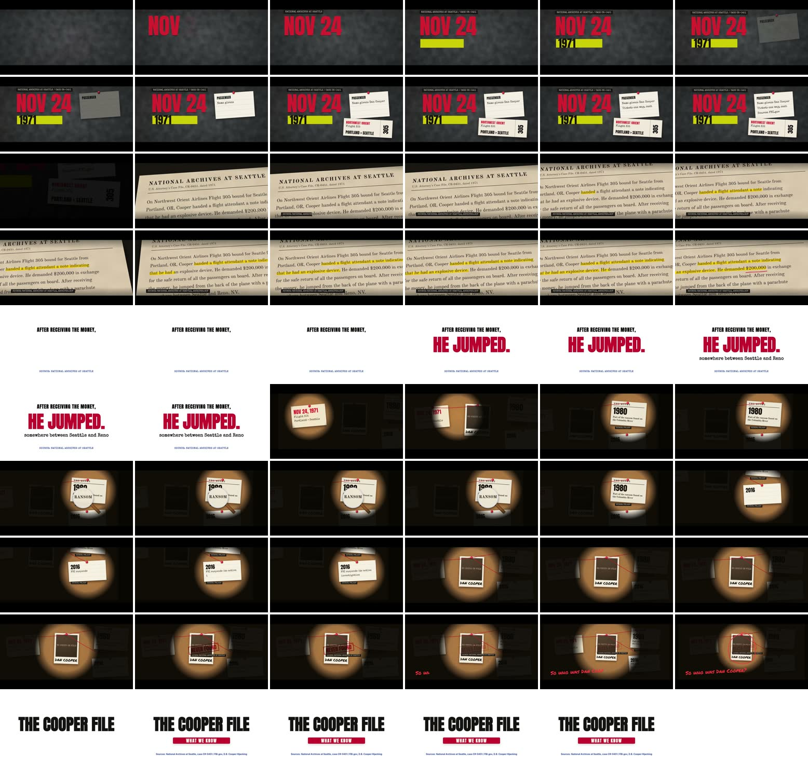

Adapted for Subclip from https://github.com/Tejashmakwana/case-file-doc by Tejas Makwana, Not stated

# Case file doc

<!-- cli:start -->
> Install from your terminal: `npx @subclip/community-skills install case-file-doc`
<!-- cli:end -->

A narrated investigative documentary cold open, the kind that opens a streaming true-story series: a red date
stamp on a concrete wall, the subject's own words under a tilted camera with a highlighter swept on the spoken
words, grunge newsprint type with red and yellow word bars, and a cork board in the dark with a moving spotlight,
red string and a magnifier. One deep narrator, a 2.39:1 letterbox, film grain, 11 scene recipes, every claim
tagged with its source, and an ending that asks a question instead of giving a verdict.

> Make a 60 second case file doc cold open about this story. Use these two articles and the court filing as
> sources, a deep local voice, and keep it to three animated scenes.

In Subclip the scenes are HyperFrames layers on the timeline, the narration comes from local or cloud speech,
word timing comes from `transcribe_project` so each highlight lands on the spoken word, and the score and effects
are native audio items from `search_public_audio` or `generate_music`. A frame and audio checklist replaces the
original's mix script.

## How it differs from nearby skills

- [Documentary case file](https://github.com/subclip-app/community-video-editing-skills/tree/main/skills/documentary-case-file)
  builds a documentary from AI stills and AI clips with a narrator. This skill uses no AI image or video: it is a
  code-built cold open made of paper, type, light and evidence around real, sourced material.
- [Vox director](https://github.com/subclip-app/community-video-editing-skills/tree/main/skills/vox-director)
  and [Vox explainer](https://github.com/subclip-app/community-video-editing-skills/tree/main/skills/vox-explainer)
  make paper-collage explainers. This skill is an investigative trailer: a date hook, documents under a camera,
  a dark evidence board and an open question.

## Files

- [SKILL.md](SKILL.md): rules and the Subclip workflow.
- [Story, script and voice](references/story.md), [look](references/look.md),
  [devices and the 11 scene recipes](references/devices.md), [research and sources](references/research.md),
  [sound](references/sound.md), [building it in Subclip](references/subclip-build.md),
  [frame and audio review](references/review.md).
- `assets/fonts`: Anton, Old Standard TT and Courier Prime under the SIL Open Font License, with
  [their license texts](assets/fonts/LICENSES.md).

<!-- examples:start -->

## Examples

 1. The Cooper File: a 58 s cold open on the 1971 Flight 305 hijacking, sourced to the National Archives. No AI model. <a href="examples/case-file-doc-reference.mp4">Play with sound</a>

 2. One frame per second of The Cooper File: wall date, archive document, cork board, title. No AI model.

 3. By Tejas Makwana, made with the original case-file-doc skill: The T3 Code situation, first 66 s (x.com post). <a href="examples/tejas-t3-code-excerpt.mp4">Play with sound</a>

Examples 1 and 2 made with this skill in Subclip for 0 credits: HyperFrames scenes, local voice, CC0 sound by kkenny101, Qvantor, I.fekry and nvmbky (Freesound). Example 3 by Tejas Makwana with the original skill: x.com/makwanatejas170/status/2125608178385821824

<!-- examples:end -->

## License and credit

The original repository states no license. The Subclip maintainers adapted it with full credit to Tejas
Makwana, and permission from the author is being confirmed. The text here is written in new words; the
original's scene templates, scripts and texture images are not copied (textures are made in code). The first
example is an excerpt of Tejas Makwana's own film, shown with credit. See [LICENSE](LICENSE). The cover is
original artwork.

## Credits

Method, scene list and look by Tejas Makwana ([Tejashmakwana](https://github.com/Tejashmakwana)).
