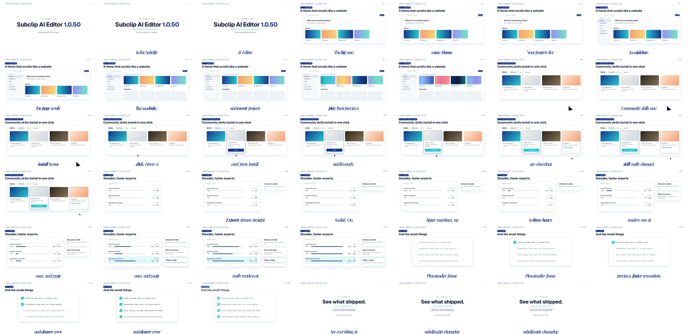

Adapted for Subclip from [heygen-com/hyperframes](https://github.com/heygen-com/hyperframes) (skill `.claude/skills/changelog-video`) by HeyGen, Apache-2.0

# Changelog video

<!-- cli:start -->
> Install from your terminal: `npx @subclip/community-skills install changelog-video`
<!-- cli:end -->

Turn a changelog, release notes or a version entry into a short release video where every theme is acted out by an animated mock of the real UI: a window that scrolls, a card that installs, a render queue that runs. Not a list of bullets. The agent cuts the changelog to 3 or 4 themes with at most 3 spoken items each, routes each theme to a mock through the visualization registry, writes a two-layer script (what is said and what the captions show), voices it one clip per scene and times every beat to the spoken words.

## How it works in Subclip

1. Paste the changelog or give its link (a public page, a GitHub release or merged PRs read with `fetch_public_github_pull_request`).
2. The agent writes the cut, the route per theme and the token-line script into the project brief.
3. It voices each scene with a local voice (free) or a Subclip voice after a quote, and reads the word times with local transcription.
4. It builds one editable HyperFrames layer per scene on a white ground in your brand colors, with one accent moment per scene, then adds dark captions and a quiet music bed.
5. It checks frames on every beat, captions in every spoken stretch and the facts against the changelog. Export when you ask.

Code layers, local voice and CC0 music cost 0 credits. Paid voice or music is quoted first. No API keys and no scripts to run.

## Folder

- `SKILL.md`: the pipeline in Subclip, anti-patterns and gates.
- `references/subclip-build.md`: brand token mapping, the 16:9 scene anatomy, the layer scaffold, beat timing and the tool map.
- `references/visualization-registry.md`, `references/script-voice.md`, `references/build-spec.md`, `references/lexicon.json`: the upstream references (punctuation adjusted in the Markdown files, nothing else).
- `upstream/`: the original SKILL.md, master skeleton, script token example and caption aligner, for reference only.
- `LICENSE`: Apache-2.0, unchanged.

## Reference

The [release recap of the Subclip AI Editor 1.0.50 changelog](examples/changelog-1050-reference.mp4) and its [one-frame-per-second sheet](examples/changelog-1050-contact.jpg) were made by following the skill in Subclip for 0 credits. The [silent preview](preview.mp4) is the hero.

## Changes and what is not included

Modified for Subclip: 16:9 instead of square, white ground and the creator's brand instead of the HeyGen house look, Subclip voices instead of the pinned HeyGen voice, local transcription instead of the caption aligner, native captions instead of the in-composition caption rail, seams written inside each scene layer instead of the seam-stamp script, and Subclip frame checks instead of the repository CLI gates. Not included: the house fonts (ABC Solar Display and TT Norms Pro are commercial fonts), the house music track and the animated background pattern, which are HeyGen brand assets.

Backup fork of the source: [subclip-app/hyperframes](https://github.com/subclip-app/hyperframes).

<!-- examples:start -->

## Examples

 1. Subclip AI Editor 1.0.50 recap: Home, Skills, Exports, Fixes as UI mocks. Edited by Claude Opus 5.5 over MCP. <a href="examples/changelog-1050-reference.mp4">Play with sound</a>

 2. One frame per second of the 1.0.50 recap. Edited by Claude Opus 5.5 (claude-opus-5-5), voice: local Pocket TTS.

Made with this skill in Subclip for 0 credits. Edited by Claude Opus 5.5 (claude-opus-5-5) driving Subclip over MCP. Six HyperFrames layers, voice: Subclip local Pocket TTS (Alba), no cloud AI model. Music: Ambient Lofi Melody Loop by holizna (CC0).

<!-- examples:end -->
