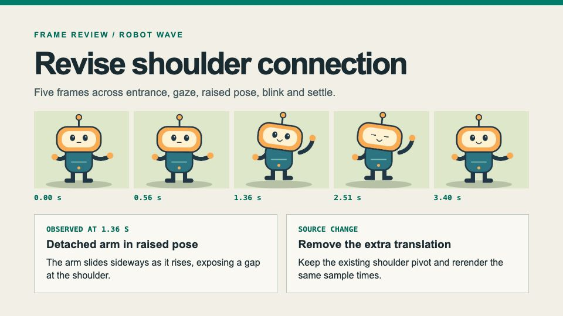
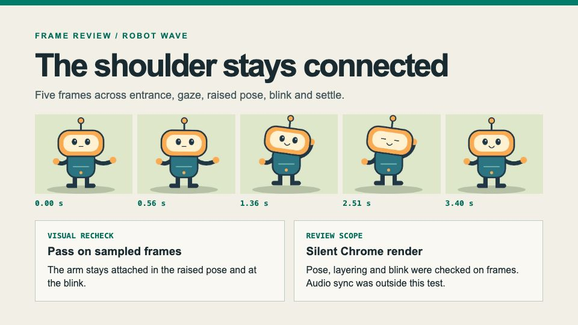

Adapted for Subclip from [OpenMontageInc/OpenMontage](https://github.com/OpenMontageInc/OpenMontage) by OpenMontageInc, AGPL-3.0

# character-animation-qa (Subclip edition)

A review pass for character animation in Subclip. Before the agent shows you a preview, it validates the layer, samples frames across the animation, checks that things actually move, looks for detached limbs, wrong layer order and unreadable faces, and gives a pass, revise or fail verdict with exact items and times.

Playwright and ffprobe from the original are replaced by Subclip's own tools: layer validation, `seek_timeline` with `view_current_frame`, contact sheets and export checks.

## Install

In Subclip: **Skills > Add skill**, paste `https://github.com/subclip-app/community-video-editing-skills/tree/main/skills/character-animation-qa`.

## Use

> Review the mascot scene before I see it.

## What's inside

| File | What it covers |
|---|---|
| `SKILL.md` | The seven review layers, how to sample frames, the verdicts and the report |

## License

AGPL-3.0, same as the original project. The upstream skill file also carried an MIT license line; the repository license (AGPL-3.0) is the one kept here. See `LICENSE`.

## Examples

Before-and-after review sheets built from sampled frames of an original robot animation.

