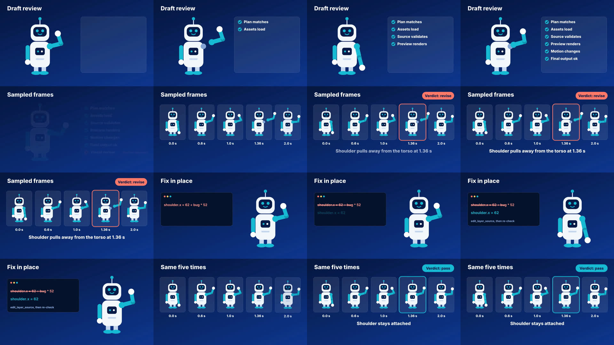

Adapted for Subclip from [OpenMontageInc/OpenMontage](https://github.com/OpenMontageInc/OpenMontage) by OpenMontageInc, AGPL-3.0

# character-animation-qa (Subclip edition)

<!-- cli:start -->
> Install from your terminal: `npx @subclip/community-skills install character-animation-qa`
<!-- cli:end -->

A review pass for character animation in Subclip. Before the agent shows you a preview, it validates the layer, samples frames across the animation, checks that things actually move, looks for detached limbs, wrong layer order and unreadable faces, and gives a pass, revise or fail verdict with exact items and times.

Playwright and ffprobe from the original are replaced by Subclip's own tools: layer validation, `seek_timeline` with `view_current_frame`, contact sheets and export checks.

For a finished example, see the [robot wave review](examples/qa-review-reference.mp4): a draft fails at 1.36 s, the shoulder is fixed in place, and the same five sampled frames pass.

## Install

In Subclip: **Skills > Add skill**, paste `https://github.com/subclip-app/community-video-editing-skills/tree/main/skills/character-animation-qa`.

## Use

> Review the mascot scene before I see it.

## What's inside

| File | What it covers |
|---|---|
| `SKILL.md` | The seven review layers, how to sample frames, the verdicts and the report |

<!-- examples:start -->

## Examples

 1. QA review: a robot wave fails at 1.36 s, gets fixed, then passes. Code-rendered, no AI model. Music: CC0 loops. <a href="examples/qa-review-reference.mp4">Play with sound</a>

 2. One frame per second of the review: draft verdict, fix, pass verdict. Code-rendered, no AI model.

Test outputs made with this skill in Subclip. Scenes rendered in code (HyperFrames: HTML, SVG and GSAP): no image, video or audio model. Music: Electronic Percussion Loops by aikighost on Freesound (CC0). Whooshes from the Subclip sound catalog.

<!-- examples:end -->

## License

AGPL-3.0, same as the original project. The upstream skill file also carried an MIT license line; the repository license (AGPL-3.0) is the one kept here. See `LICENSE`.
