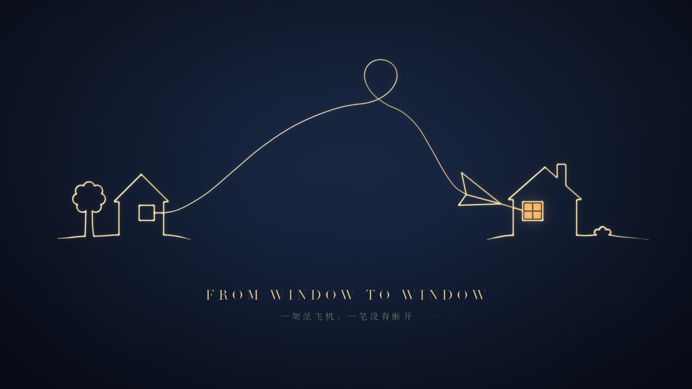
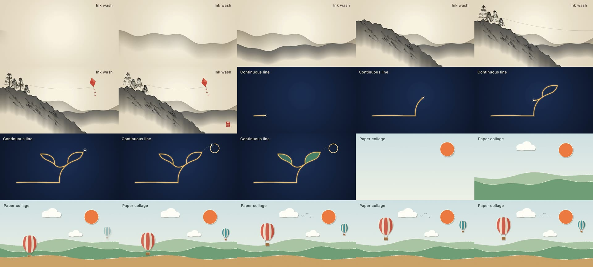
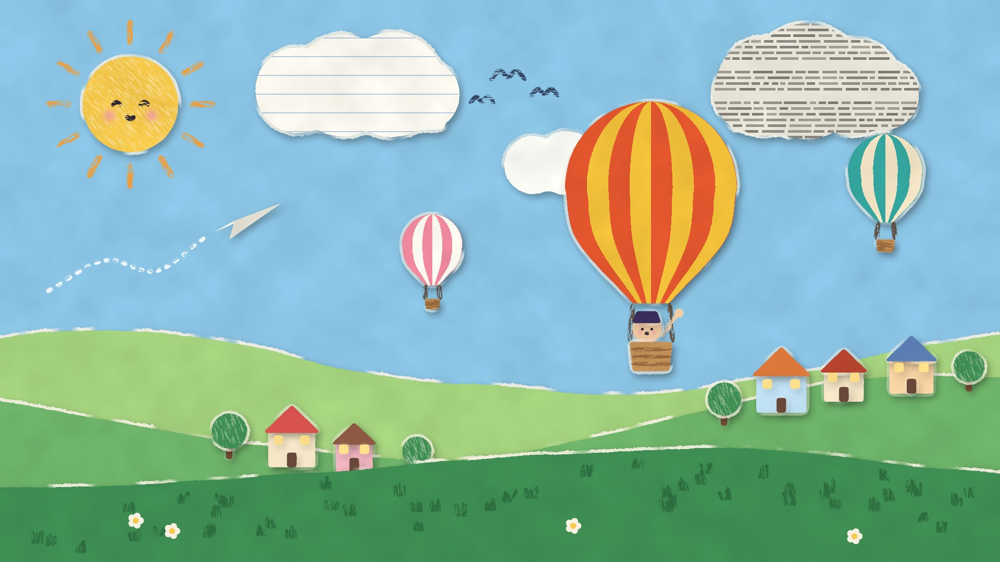
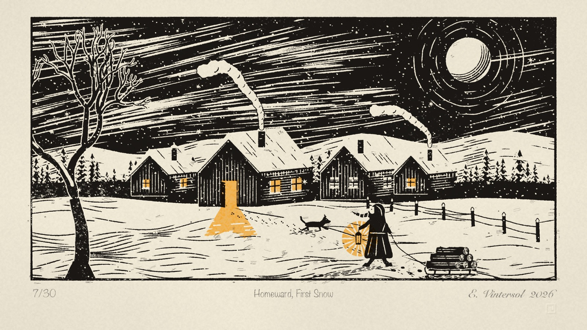
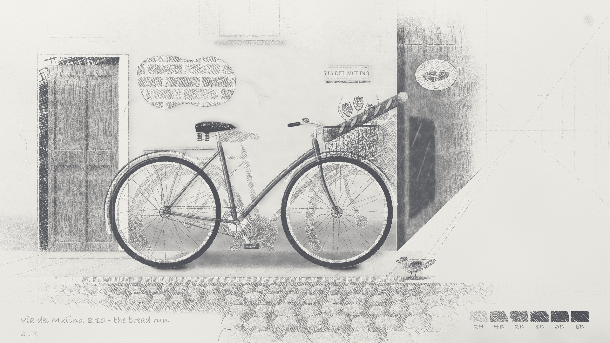
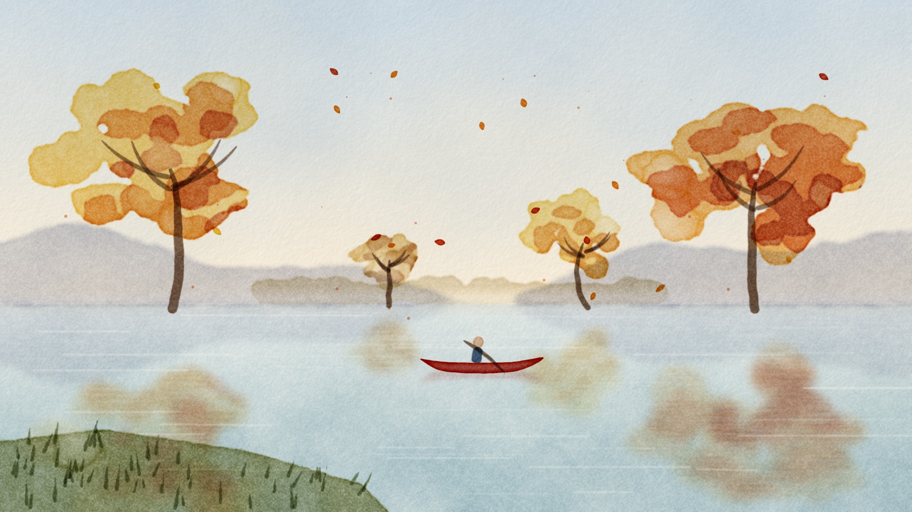
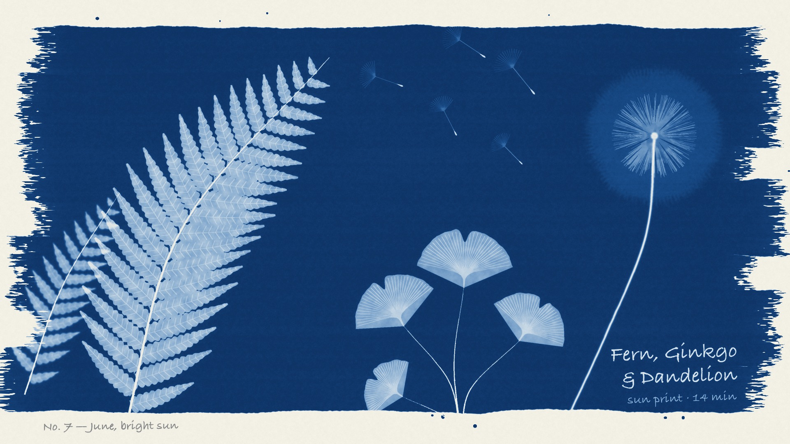

Adapted for Subclip from [cloveric/claude-drawing-skill](https://github.com/cloveric/claude-drawing-skill) by cloveric, MIT.

# Claude Drawing

<!-- cli:start -->
> Install from your terminal: `npx @subclip/community-skills install claude-drawing-skill`
<!-- cli:end -->

Paint with code in Subclip. Build an ink wash, a paper collage, or a continuous-line drawing, then show how it comes together with timed brush passes or a stroke reveal. The artwork and animation stay in an editable Motion layer. Drawing uses zero Subclip AI credits.

Cover art is cloveric's *From Window to Window*, resized from the upstream gallery. The motion recipe in this skill uses a different subject to demonstrate the same technique.

For a finished example, see the [three drawings reference](examples/three-drawings-reference.mp4): an ink wash with a red kite, a continuous gold line and a paper collage with rising balloons, all drawn in code with paper and pencil sounds.

Try asking your agent to draw a small red kite over an ink-wash ridge in six seconds, with the mist settling before the kite appears. Or ask for a gold line that draws itself into a sprout over a quiet part of existing footage.

- [Workflow](SKILL.md)
- [Art direction and style recipes](references/art-direction.md)
- [SVG draw-on recipe](references/svg-draw-on.md)

<!-- examples:start -->

## Examples

 1. Three drawings: ink wash with a red kite, a continuous gold line, a paper collage. Drawn in code. No AI model. <a href="examples/three-drawings-reference.mp4">Play with sound</a>

 2. One frame per second of the three drawings: canvas and SVG marks in HyperFrames layers. No AI model.

 An ink wash landscape takes shape in successive drawing passes <a href="examples/moon-river.mp4">Play with sound</a>

 Layered paper balloons float over a cutout landscape

 A snowy village rendered with the rough marks of a linocut

 A bicycle study with graphite texture and soft shading

 Autumn trees and a red boat painted in soft washes

 Fern and flower silhouettes on a deep blue ground

Examples 3 to 8 by cloveric, MIT, from github.com/cloveric/claude-drawing-skill. Examples 1 and 2 made with this skill in Subclip, drawn in code: no image or video model. Sound: CC0 clips from Freesound, Subclip and Remotion sound libraries.

<!-- examples:end -->
