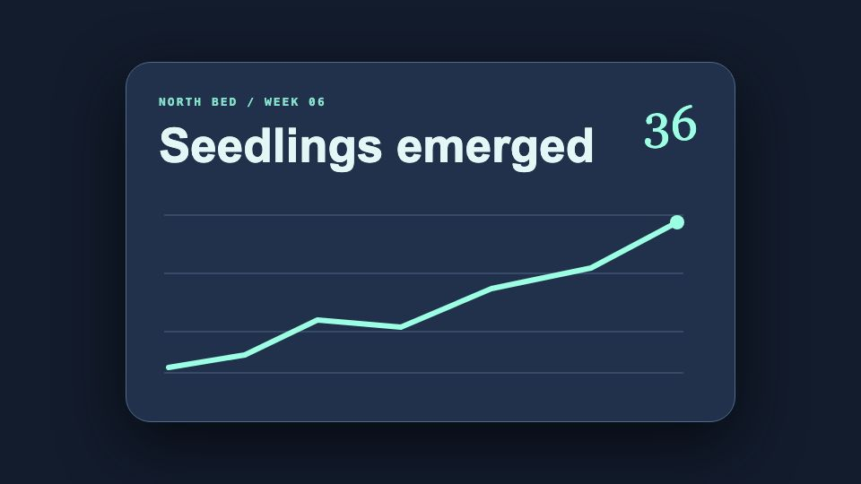
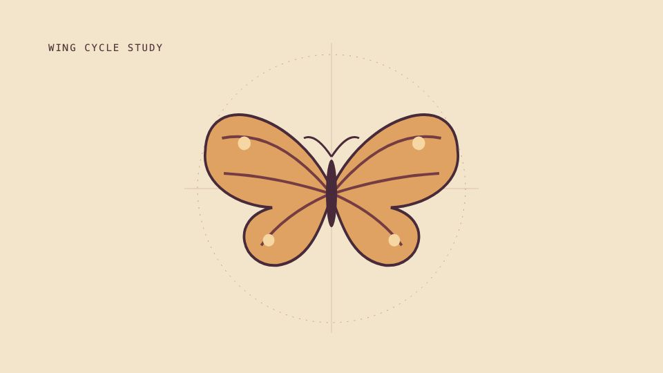

Adapted for Subclip from [awesome-opus5-5-videos](https://github.com/yihui-dev/awesome-opus5-5-videos) by yihui-dev, MIT.

# Code video recipes

Use a code-made video as a reference for an editable Subclip scene. Pick a technique such as staggered type, a musical reveal, a procedural orbit or a scripted walkthrough. Give your agent the subject, assets, duration and aspect ratio.

> Use the music machine recipe for a 20-second spot. Start silently, then sync the moving parts to my percussion track. Keep the end title editable.

[Start with the skill](SKILL.md), [browse the practical recipes](references/recipes.md), or [find a creator or prompt in the catalog](references/catalog.md).

The upstream collection credits each video and prompt to its creator. The catalog links the original posts and prompt records. Some records contain partial prompts or post text only. The recipe text and cover are original to this adaptation.

## Examples

Original SVG and GSAP studies rendered locally from the widget and butterfly recipes.

[Watch the clip](examples/widget-line-draw.mp4)

[Watch the clip](examples/butterfly-wing-loop.mp4)
