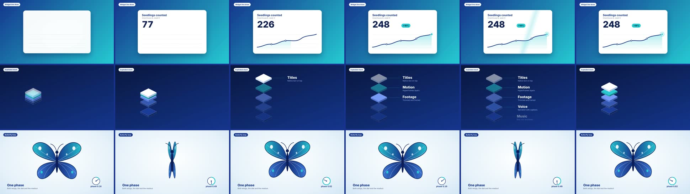

Adapted for Subclip from [awesome-opus5-5-videos](https://github.com/yihui-dev/awesome-opus5-5-videos) by yihui-dev, MIT.

# Code video recipes

<!-- cli:start -->
> Install from your terminal: `npx @subclip/community-skills install code-video-recipes`
<!-- cli:end -->

Use a code-made video as a reference for an editable Subclip scene. Pick a technique such as staggered type, a musical reveal, a procedural orbit or a scripted walkthrough. Give your agent the subject, assets, duration and aspect ratio.

> Use the music machine recipe for a 20-second spot. Start silently, then sync the moving parts to my percussion track. Keep the end title editable.

For a finished example, see the [three-shot reference](examples/code-recipes-reference.mp4): a widget line draw, an exploded stack and a butterfly loop, all rendered in code.

[Start with the skill](SKILL.md), [browse the practical recipes](references/recipes.md), or [find a creator or prompt in the catalog](references/catalog.md).

The upstream collection credits each video and prompt to its creator. The catalog links the original posts and prompt records. Some records contain partial prompts or post text only. The recipe text and cover are original to this adaptation.

<!-- examples:start -->

## Examples

 1. Three code-made shots: widget line draw, exploded stack, butterfly loop. Music: CC0 loops. No AI model. <a href="examples/code-recipes-reference.mp4">Play with sound</a>

 2. One frame per second: each shot is a seekable HyperFrames layer. Rendered in code, no AI model.

Test outputs made with this skill in Subclip. Scenes rendered in code (HyperFrames: HTML, SVG and GSAP): no image or video model. Music: Electronic Percussion Loops by aikighost on Freesound (CC0). Whooshes from the Subclip sound catalog.

<!-- examples:end -->
