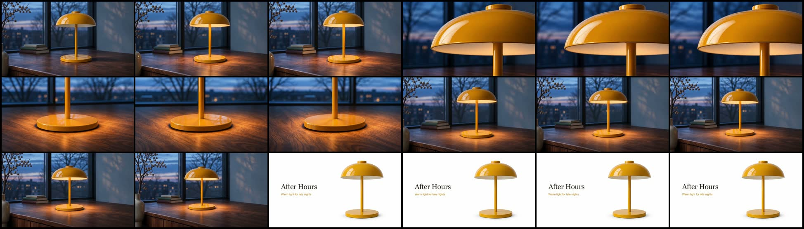
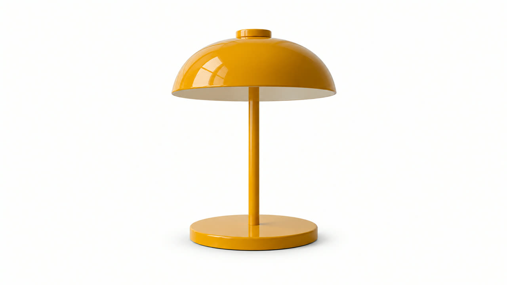

Adapted for Subclip from the Notion list Claude Creative Skill Library Vol 2 (https://app.notion.com/p/Claude-Creative-Skill-Library-Vol-2-3ffb5f1fde2d81938bb9eb76ea6c60d1) by PYNK Society

# Commercial pipeline

<!-- cli:start -->
> Install from your terminal: `npx @subclip/community-skills install commercial-pipeline`
<!-- cli:end -->

A three stage pipeline for a 30 second AI commercial: plan and generate the reference images the film needs, assemble them into one structured video prompt, then fix only what broke.

## Use it

Tell your agent: "Use commercial-pipeline for <product and idea>". Describe the film in a few plain sentences and attach the real logo and product photos.

## What changed for Subclip

The original skill runs in Claude Code and hands you prompts to paste into outside generators, then cuts with ffmpeg. This version keeps the creative method and does the work in Subclip: generation through `generate_ai_media` (or your own Codex CLI for images), voice through Subclip speech tools, and assembly on the editable timeline. Nothing here needs an outside key, ffmpeg or a script.

## Reference output

[After Hours](examples/after-hours-commercial.mp4) is a 17 second concept ad for a mustard desk lamp made with this skill in Subclip: blue hour, a switch-on with a click, an enamel detail, a lit hero shot and a packshot. Stills: gpt-image-2. Video: Seedance 2 at 720p. Music: Lyria 3 Pro.

<!-- examples:start -->

## Examples

 1. After Hours lamp ad: switch on, enamel detail, lit hero, packshot. Images: gpt-image-2. Video: Seedance 2 720p. Music: Lyria 3 Pro. <a href="examples/after-hours-commercial.mp4">Play with sound</a>

 2. The After Hours ad one frame per second, cut by cut. Images: gpt-image-2. Video: Seedance 2 720p.

 3. Hero product reference on white, the locked asset every shot matches. Image: gpt-image-2.

Test outputs made with this skill in Subclip. Images: gpt-image-2 (Codex CLI image generation). Video: Seedance 2 at 720p, image to video from the reviewed stills. Music: Lyria 3 Pro. Switch click: CC0 by jsbarrett on Freesound.

<!-- examples:end -->

## Source and license

The skill's own page on the list: https://app.notion.com/p/3f3b5f1fde2d81ebad88d8fb334405e5

The list shows no license for this skill. The skill's page and its download pack were read, and this folder describes the method in new words; no upstream text, code or images are copied. See LICENSE for the notice.

## Credits: Claude Creative Skill Library Vol 2

This skill comes from the Notion list Claude Creative Skill Library Vol 2: https://app.notion.com/p/Claude-Creative-Skill-Library-Vol-2-3ffb5f1fde2d81938bb9eb76ea6c60d1

Author shown on the list: PYNK Society (PYNK Society - AI Creative Lab, https://www.skool.com/pynk-society/about).
