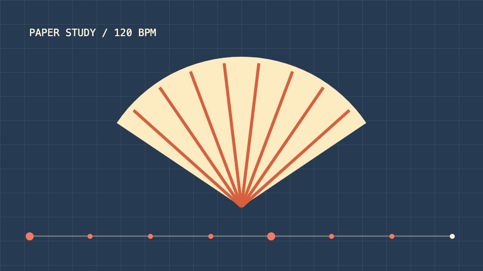

Written for Subclip. Beat tracking method after [librosa/librosa](https://github.com/librosa/librosa) by the librosa development team, ISC.

# cut-to-the-beat

Cut footage, captions and motion to the beat of your music in Subclip. The agent builds a beat map, turns it into a frame-snapped cut list, chooses how often to cut in each part of the song (slow in calm sections, every beat in dense ones, accelerating through a build), then splits and trims clips, moves caption changes to beats and adds pulses and hits.

librosa's method (onset strength, tempo estimate, evenly spaced beats on strong onsets) is the model. Subclip runs no Python, so the agent applies it by hand to the audio waveform, a known tempo or numbers you give it.

## Important limit

Subclip has no beat detection tool yet. The beat grid is measured from the waveform or taken from a tempo you know, and it needs a human listen. A native tool returning tempo, beat times, downbeats and onsets would make this skill exact.

## Install

In Subclip: **Skills > Add skill**, paste `https://github.com/subclip-app/community-video-editing-skills/tree/main/skills/cut-to-the-beat`.

## Use

> Cut these 12 clips to this track. Cut on every beat in the chorus and every two beats in the verses.

## What's inside

| File | What it covers |
|---|---|
| `SKILL.md` | The eight steps and checks |
| `references/beat-map.md` | Building the beat map, trust rules, sync offset |
| `references/cut-patterns.md` | Frame math, cut density by energy, what lands on which beat, footage, captions and layer recipes |

<!-- examples:start -->

## Examples

 The final fan angle lands one frame ahead of the 3-second beat on a 30 fps grid.

 Paper studies change from a four-beat hold to two-beat shots, with small pulses on beats two and four. <a href="examples/paper-beat-cuts.mp4">Play with sound</a>

Test outputs made with this skill in Subclip. Rendered in code (HTML, SVG or canvas, HyperFrames, ffmpeg): no image, video or audio model.

<!-- examples:end -->

## License

The librosa license text (ISC) is kept in `LICENSE` because this skill's method credits it.
