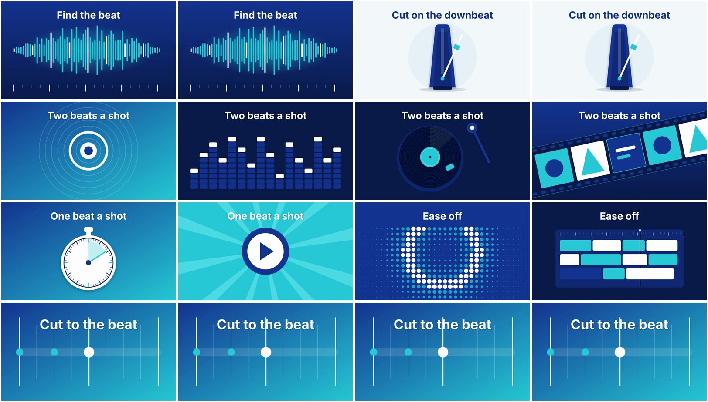

Written for Subclip. Beat tracking method after [librosa/librosa](https://github.com/librosa/librosa) by the librosa development team, ISC.

# cut-to-the-beat

<!-- cli:start -->
> Install from your terminal: `npx @subclip/community-skills install cut-to-the-beat`
<!-- cli:end -->

Cut footage, captions and motion to the beat of your music in Subclip. The agent builds a beat map, turns it into a frame-snapped cut list, chooses how often to cut in each part of the song (slow in calm sections, every beat in dense ones, accelerating through a build), then splits and trims clips, moves caption changes to beats and adds pulses and hits.

librosa's method (onset strength, tempo estimate, evenly spaced beats on strong onsets) is the model. Subclip runs no Python, so the agent applies it by hand to the audio waveform, a known tempo or numbers you give it.

## Important limit

Subclip has no beat detection tool yet. The beat grid is measured from the waveform or taken from a tempo you know, and it needs a human listen. A native tool returning tempo, beat times, downbeats and onsets would make this skill exact.

## Reference

See the finished [beat-cut reference video](examples/beat-cut-reference.mp4): 13 shots cut to a 120 BPM loop, with the four-beat, two-beat and one-beat sections described in `SKILL.md`.

## Install

In Subclip: **Skills > Add skill**, paste `https://github.com/subclip-app/community-video-editing-skills/tree/main/skills/cut-to-the-beat`.

## Use

> Cut these 12 clips to this track. Cut on every beat in the chorus and every two beats in the verses.

## What's inside

| File | What it covers |
|---|---|
| `SKILL.md` | The eight steps and checks |
| `references/beat-map.md` | Building the beat map, trust rules, sync offset |
| `references/cut-patterns.md` | Frame math, cut density by energy, what lands on which beat, footage, captions and layer recipes |

<!-- examples:start -->

## Examples

 1. Beat-cut montage: 13 shots at 120 BPM, four-beat to one-beat cuts. Code-rendered scenes, CC0 loop. No AI model. <a href="examples/beat-cut-reference.mp4">Play with sound</a>

 2. One frame per second: each shot change lands on a bar line or beat. Code-rendered scenes, no AI model.

Test outputs made with this skill in Subclip. Scenes rendered in code (HTML and SVG): no image or video model. Music: drum and bass loop at 120 BPM by josefpres on Freesound (CC0).

<!-- examples:end -->

## License

The librosa license text (ISC) is kept in `LICENSE` because this skill's method credits it.
