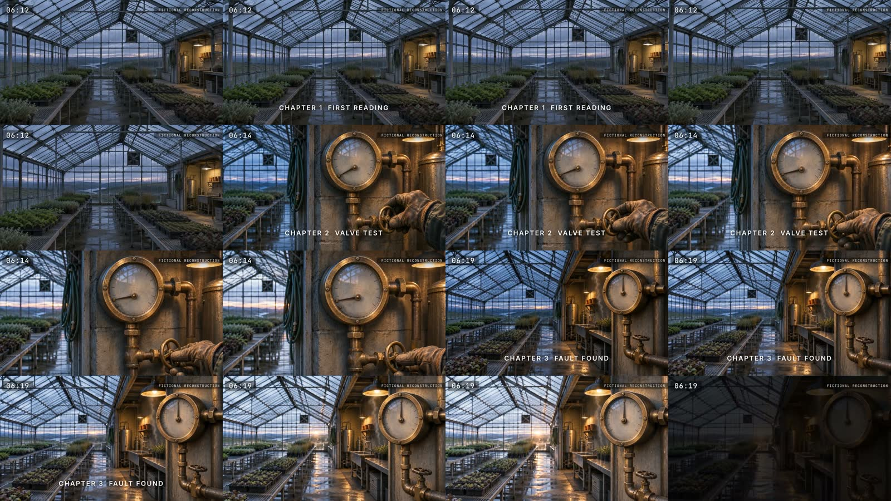

Adapted for Subclip from the Notion list Claude Creative Skill Library Vol 2 (https://app.notion.com/p/Claude-Creative-Skill-Library-Vol-2-3ffb5f1fde2d81938bb9eb76ea6c60d1) by PYNK Society

# Documentary case file

<!-- cli:start -->
> Install from your terminal: `npx @subclip/community-skills install documentary-case-file`
<!-- cli:end -->

Plans and builds a cinematic 3D documentary from a single sentence. It produces a case file with chapters and a scene table, locked stills for every character, place and prop, one video prompt per scene with sound design, and one narrator script, then assembles it on the Subclip timeline.

## Use it

Tell your agent: "Use documentary-case-file: <one sentence about the story>". Approve the case file, then it makes the stills, scenes and narration.

## Reference film

[The Empty Gauge](examples/empty-gauge-reference.mp4) is a fictional greenhouse incident built with this skill in Subclip: three chapters with clock overlays, two Seedance 2 shots (720p) made from gpt-image-2 stills, a local narrator voice, and a CC0 drone and pump hum from Freesound. See the [contact sheet](examples/empty-gauge-contact-sheet.jpg) and the [silent hero](preview.mp4).

## What changed for Subclip

The original skill runs in Claude Code and hands you prompts to paste into outside generators, then cuts with ffmpeg. This version keeps the creative method and does the work in Subclip: generation through `generate_ai_media` (or your own Codex CLI for images), voice through Subclip speech tools, and assembly on the editable timeline. Nothing here needs an outside key, ffmpeg or a script.

<!-- examples:start -->

## Examples

 1. The Empty Gauge: a fictional 3 chapter case file with a narrator. Images: gpt-image-2. Video: Seedance 2 720p. Voice: local TTS. <a href="examples/empty-gauge-reference.mp4">Play with sound</a>

 2. Contact sheet: one frame per second of the film. Images: gpt-image-2. Video: Seedance 2 720p. Voice: local TTS.

 3. LOC-01: the empty greenhouse plate, used as the opening shot with a slow push in. Image: gpt-image-2.

Made in Subclip with this skill. Stills: gpt-image-2. Valve and reveal shots: Seedance 2 at 720p from the stills. Narration: Subclip local voice. CC0 drone by CVLTIV8R and pump hum by gecop on Freesound.

<!-- examples:end -->

## Source and license

The skill's own page on the list: https://app.notion.com/p/3ecb5f1fde2d81d38618c797fe848179

The list shows no license for this skill. The skill's page and its download pack were read, and this folder describes the method in new words; no upstream text, code or images are copied. See LICENSE for the notice.

## Credits: Claude Creative Skill Library Vol 2

This skill comes from the Notion list Claude Creative Skill Library Vol 2: https://app.notion.com/p/Claude-Creative-Skill-Library-Vol-2-3ffb5f1fde2d81938bb9eb76ea6c60d1

Author shown on the list: PYNK Society (PYNK Society - AI Creative Lab, https://www.skool.com/pynk-society/about).
