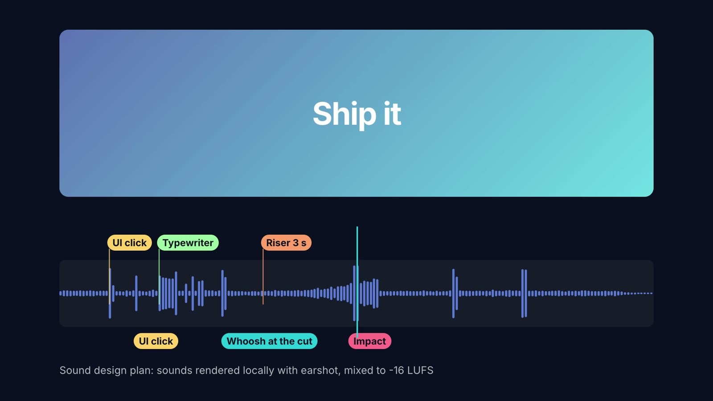
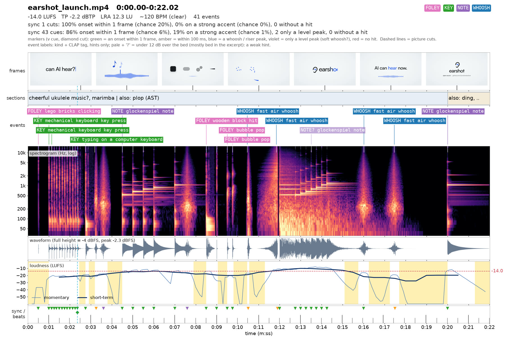

Adapted for Subclip from https://github.com/Leonxlnx/earshot by Leon Lin, MIT

# Sound effects from words

Tell your agent what a moment should sound like, in plain words: "a soft UI click when the button is pressed", "a whoosh on the cut", "a riser into the logo hit". The agent writes a cue sheet from your video, finds or makes each sound, and places it on the timeline at the right frame with levels, fades and ducking.

## Install

In Subclip: **Skills > Add skill**, paste `https://github.com/subclip-app/community-video-editing-skills/tree/main/skills/earshot`. It is also installed by default.

## Try it

- "Add sound design to this clip: clicks on the UI, a whoosh on each cut, a notification at the end."
- "Make a 3 second riser that lands on the logo frame."
- "Give this explainer a quiet room tone and typing sounds for the prompt."

## What is inside

- `SKILL.md`: the workflow, in three routes: Subclip's public audio library, Subclip audio generation if a model is listed, or an optional local engine.
- `references/recipes.md`: UI click, whoosh, riser, impact, typewriter, notification and ambience, with synthesis parameters, timing and levels.
- `references/subclip-mixing.md`: which Subclip tools import, place, level, fade and duck sounds.
- `references/local-engine.md`: the optional local earshot engine. It needs a one time install, so the agent asks first and shows the exact command.
- `examples/capability-sound-design.mp4`: an 18 second reference clip with cue markers. Its audio was rendered locally with earshot.

No API keys, and the agent never installs or runs anything without your yes. Credit costs are quoted before any generation.

<!-- examples:start -->

## Examples

 Capability reference: 18 s clip with cue markers on a waveform, audio rendered with earshot, about -16 LUFS. <a href="examples/capability-sound-design.mp4">Play with sound</a>

 Frame from the reference clip at the impact, with cue labels on the mixed waveform.

 By the original author: what an agent sees when it listens to earshot's 22 s launch film (cue events, spectrogram, loudness and sync).

 By the original author: frames of the earshot launch film, which was cut to its own code-made sounds.

Clip and waveform frame made for Subclip in code with HyperFrames, sounds synthesized locally with earshot, no image or video model. Launch sheet and frames from the earshot README by Leon Lin (MIT).

<!-- examples:end -->

## Credits

Adapted for Subclip from [earshot](https://github.com/Leonxlnx/earshot) by Leon Lin, MIT licensed (see `LICENSE`). The recipes summarise earshot's motion-design sound notes and its way of asking for sounds in words. The reference clip uses sounds rendered with earshot and was built with HyperFrames. The launch sheet and launch frames shown as examples are from the earshot README.
