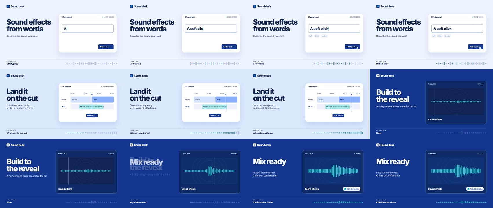
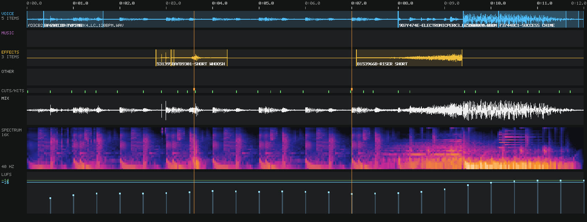
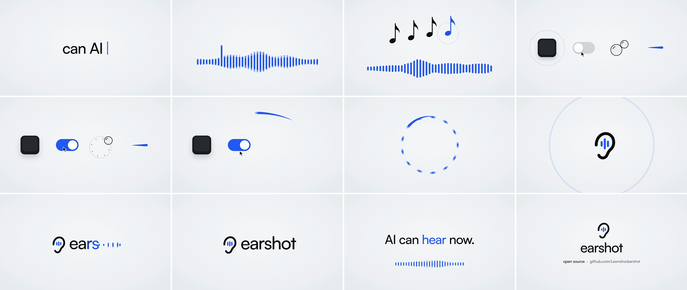

Adapted for Subclip from https://github.com/Leonxlnx/earshot by Leon Lin, MIT

# Sound effects from words

<!-- cli:start -->
> Install from your terminal: `npx @subclip/community-skills install earshot`
<!-- cli:end -->

Tell your agent what a moment should sound like, in plain words: "a soft UI click when the button is pressed", "a whoosh on the cut", "a riser into the logo hit". The agent writes a cue sheet from your video, finds or makes each sound, and places it on the timeline at the right frame with levels, fades and ducking.

## Install

In Subclip: **Skills > Add skill**, paste `https://github.com/subclip-app/community-video-editing-skills/tree/main/skills/earshot`. It is also installed by default.

## Try it

- "Add sound design to this clip: clicks on the UI, a whoosh on each cut, a notification at the end."
- "Make a 3 second riser that lands on the logo frame."
- "Give this explainer a quiet room tone and typing sounds for the prompt."

## What is inside

- `SKILL.md`: the workflow, in three routes: Subclip's public audio library, Subclip audio generation if a model is listed, or an optional local engine.
- `references/recipes.md`: UI click, whoosh, riser, impact, typewriter, notification and ambience, with synthesis parameters, timing and levels.
- `references/subclip-mixing.md`: which Subclip tools import, place, level, fade and duck sounds.
- `references/local-engine.md`: the optional local earshot engine. It needs a one time install, so the agent asks first and shows the exact command.
- `examples/sound-design-reference.mp4`: a 12 second reference made with this skill in Subclip, with typing, a click, a whoosh on the cut, a riser into an impact and a chime, all from the free library. Its contact sheet and the audio sheet the agent checked are next to it.

No API keys, and the agent never installs or runs anything without your yes. Credit costs are quoted before any generation.

<!-- examples:start -->

## Examples

 1. Sound design: typing, click, whoosh, riser, impact and chime placed on cue in Subclip. Sounds: CC0 and Subclip library. No AI model. <a href="examples/sound-design-reference.mp4">Play with sound</a>

 2. Contact sheet: one frame per second of the sound design reference. No AI model.

 3. Audio sheet: lanes, cut sync, spectrogram and loudness the agent read to check the mix. No AI model.

 4. By the original author: what an agent sees when it listens to the earshot launch film: cue events, loudness and sync. No AI model.

 5. By the original author: frames of the earshot launch film, cut to its own code-made sounds. No AI model.

Made for Subclip in the AI Editor from code scenes, no AI model. Sounds: Subclip SFX library, Remotion mouse-click, Freesound CC0 by aikighost (ElectronicPerk3, ElectronicPerk4) and Qvantor (Success chime). Launch sheet and frames from the earshot README by Leon Lin (MIT).

<!-- examples:end -->

## Credits

Adapted for Subclip from [earshot](https://github.com/Leonxlnx/earshot) by Leon Lin, MIT licensed (see `LICENSE`). The recipes summarise earshot's motion-design sound notes and its way of asking for sounds in words. The reference clip and the silent hero were made for Subclip in the Subclip AI Editor from code-rendered scenes, with no image, video or voice model. Sounds in the reference: Typing, Short whoosh, Riser short and Boom from the Subclip SFX library; mouse-click from the Remotion sound library; [ElectronicPerk3](https://freesound.org/s/19066/) and [ElectronicPerk4](https://freesound.org/s/19067/) by aikighost and [Success chime](https://freesound.org/s/878601/) by Qvantor on Freesound (CC0). The launch sheet and launch frames shown as examples are from the earshot README.
