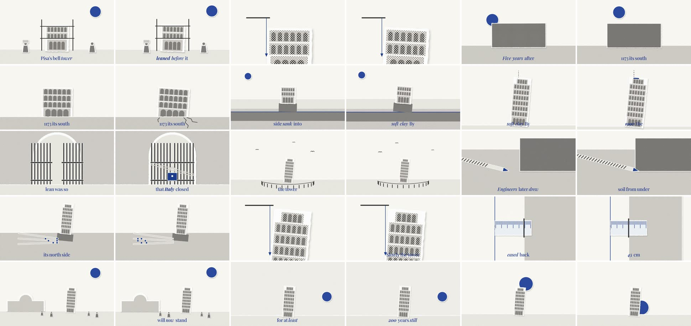

Adapted for Subclip from [higgsfield-ai/skills](https://github.com/higgsfield-ai/skills) by Higgsfield AI, MIT

# Faceless channel video

<!-- cli:start -->
> Install from your terminal: `npx @subclip/community-skills install faceless-channel-video`
<!-- cli:end -->

Narrated faceless episodes for a YouTube, TikTok or Shorts channel: history, science, stories and children's videos where nobody is on camera. The agent plans the episode as an arc (hook, build, turn, payoff) with one through-line object or character that changes and resolves, writes five sized shots per 10 second block that show exactly what the narrator says, checks every narration line against a pacing gate, locks one look, checks the first scene before building the rest, and assembles everything as editable layers in Subclip.

Source: the `higgsfield-faceless-video` skill from [higgsfield-ai/skills](https://github.com/higgsfield-ai/skills). Its `higgsfield-video-explainer` skill is only a redirect to `higgsfield-faceless-video`, so this one skill covers both. Backup fork: [subclip-app/higgsfield-skills](https://github.com/subclip-app/higgsfield-skills).

## What it keeps from the original

- **Arc plan file:** hook, build, turn and payoff, plus a `through_line` with progression and resolution, and sources for factual work.
- **Five shots per block:** each starts with WIDE, MEDIUM, CU or DETAIL, sizes alternate, adjacent shots differ, every shot shows the spoken words (four shots for kids).
- **Pacing gate:** about 20 to 23 words per 10 second block (17 to 21 for kids), spoken in 7.8 to 9.5 seconds at 2.9 words per second or slower. A failing line is rewritten, never sped up.
- **Style lock:** one written style key, a first-scene check, and retries for failed assets only.
- **Five looks:** editorial collage, paper diorama, cinematic storybook, mannequin, children's.
- **Modes:** children's song, still-picture story and presenter overlay, plus talking characters and block edits.

## How it differs from nearby skills

- **paper-cut-motion** turns one image into a torn paper collage that assembles piece by piece. It is a single visual effect. This skill writes a whole narrated episode with a story arc; its collage and diorama looks are only the paint.
- **cartoon-episodes** defines a show bible and turns one-sentence scenes into consistent AI cartoon clips. It is about character consistency across episodes. This skill is narrator-led: the voice and its pacing drive every cut, and the pictures can be free code scenes.
- **documentary-case-file** plans chapters, locked stills and scene clips for a longer documentary. This skill works in strict 10 second blocks with five sized shots each and a word budget per block, made for short channel episodes.
- **vox-explainer** makes a Vox-style explainer with charts, maps and archive texture, scored with music. This skill is for faceless channel formats (history, stories, kids, songs), with the arc and through-line rules and the per-block pacing gate as its core.

## How it works in Subclip

1. Tell it a topic, a length in 10 second blocks, a look and whether you want music and captions.
2. It writes the arc plan into the project brief and checks the hook, shot and narration rules.
3. It voices each block first (free local voice, or ElevenLabs v3 for a paid voice since Subclip does not list the ElevenLabs v4 the original named) and rewrites any line that misses the pacing gate.
4. It builds block 1, checks it, then the rest: HyperFrames code scenes for collage, diorama and flat children's looks (0 credits), or generated stills and clips for painted, clay or 3D looks (quoted first).
5. Captions from local transcription, an optional quiet music bed, review at one frame per second, export when you ask.

Code scenes, local voice and catalog audio cost 0 credits. Paid steps are quoted with `estimate_ai_generation` and wait for your yes. No API keys and no scripts to run.

## Folder

- `SKILL.md`: the Subclip workflow.
- `references/arc-and-shots.md`: the arc, through-line and shot rules, with the reference episode's plan.
- `references/pacing-gate.md`: the word budget, the timing gate and how to fix a failing line.
- `references/looks.md`: the five looks and the style lock.
- `references/modes.md`: children's song, still-picture story, presenter, talking characters and block edits.
- `upstream/`: the original `higgsfield-faceless-video` (with its references and scripts) and `higgsfield-video-explainer`, unchanged. Their `SKILL.md` files are renamed `SKILL.upstream.md` so Subclip does not load them as extra skills; their content is byte for byte the original. The scripts are kept as reading material and are never run.
- `LICENSE`: the original MIT license, unchanged.

## Reference

The [Pisa reference episode with sound](examples/pisa-reference.mp4) and its [one-frame-per-second sheet](examples/pisa-contact.jpg) were made by following the skill for 0 credits: why the Tower of Pisa still leans, three 10 second blocks (hook, turn, payoff), the tower's lean as the through-line, 15 sized shots in the editorial collage look, local voice that passed the pacing gate on every line. The [silent preview](preview.mp4) is the hero.

## Changes and what is not included

Modified for Subclip: every Higgsfield CLI call (presets, voices, `seed_audio`, `elevenlabs_v4`, `minimax_h3`, `sonilo_music`, `gpt_image_2_5`, `gemini_omni_flash_1_1`, `voice_change`, uploads) is replaced by Subclip tools and the closest listed model; the Python gates are applied by the agent as written rules; the shell assembly, caption burn and compositing scripts are replaced by native timeline layers, local transcription and dynamic captions. Not included as working parts: the Higgsfield preset catalog and account checks, which belong to Higgsfield's own service.

<!-- examples:start -->

## Examples

 1. Why Pisa still leans, 30 s, hook to payoff. Edited by Claude Opus 5.5 (claude-opus-5-5). Voice: Pocket TTS. No image model. <a href="examples/pisa-reference.mp4">Play with sound</a>

 2. One frame per second: 15 sized shots, editorial collage, the lean as through-line. Claude Opus 5.5, no image model.

Made with this skill in Subclip for 0 credits by Claude Opus 5.5 (claude-opus-5-5) over MCP. HyperFrames code scenes, voice Eponine (Pocket TTS), Whisper captions. Music: Sleepy Upright Piano by blankie.rest (CC0). No image or video model.

<!-- examples:end -->
