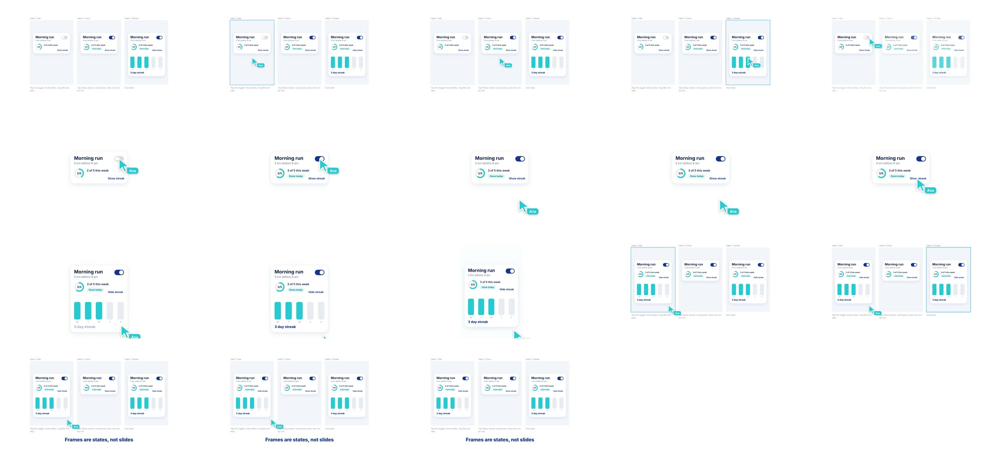

Adapted for Subclip from [heygen-com/hyperframes](https://github.com/heygen-com/hyperframes) by HeyGen, Apache-2.0

# Figma to motion

<!-- cli:start -->
> Install from your terminal: `npx @subclip/community-skills install figma-to-motion`
<!-- cli:end -->

Bring a Figma design into a Subclip video. Exported logos, layers and brand tokens become editable HyperFrames layers. Storyboard frames are read as states of one element, not as slides: the element moves from one state to the next, and product UI frames become a live mock where a cursor click causes each change.

## What it adds

Subclip had no Figma route. This skill keeps the original's storyboard method (frames are keyframes, match elements by name then by size and position, notes under frames are motion notes, UI frames are interactions) and swaps the Figma REST token and the HyperFrames CLI for files the creator exports from Figma. No Figma account details ever reach the agent.

## How it works in Subclip

1. Export frames and layers from Figma as SVG or PNG at 2x (or let your own Figma connector export them) and attach them.
2. The agent imports them into Project Media, writes the token table and the element matches into the brief.
3. It builds the storyboard and the live element as HyperFrames layers, with a click for every state change.
4. Music and clicks from the public audio search, optional local voice. 0 credits for code layers and local speech.
5. It checks a contact sheet: every shared element moves, no frame plays as a still.

## Folder

- `SKILL.md`: the Subclip workflow.
- `references/storyboard-layer.md`: the layer skeleton and beat table from the reference video.
- `upstream/figma/`: the original skill and its scripts, unchanged (reference only, not run).
- `LICENSE`: Apache-2.0, unchanged.

Backup fork: [subclip-app/hyperframes](https://github.com/subclip-app/hyperframes).

## Reference

The [reference with sound](examples/figma-to-motion-reference.mp4) and its [one-frame-per-second sheet](examples/figma-to-motion-contact.jpg): a three-frame habit card storyboard designed for the test becomes one live card that two clicks move through its states. Edited by Claude Opus 5.5 (claude-opus-5-5) driving Subclip over MCP, no AI generation model. The [silent preview](preview.mp4) is the hero.

<!-- examples:start -->

## Examples

 1. Three storyboard frames become one live habit card moved by two clicks. Edited by Claude Opus 5.5 over MCP, no AI model. <a href="examples/figma-to-motion-reference.mp4">Play with sound</a>

 2. One frame per second of the storyboard film. Edited by Claude Opus 5.5 (claude-opus-5-5), no AI generation model.

Made with this skill in Subclip for 0 credits from a storyboard designed for the test. Edited by Claude Opus 5.5 (claude-opus-5-5) driving Subclip over MCP. One HyperFrames layer, no AI generation model. Music: cute loop ambient by deadrobotmusic (CC0). Click and whoosh from the Subclip catalog.

<!-- examples:end -->
