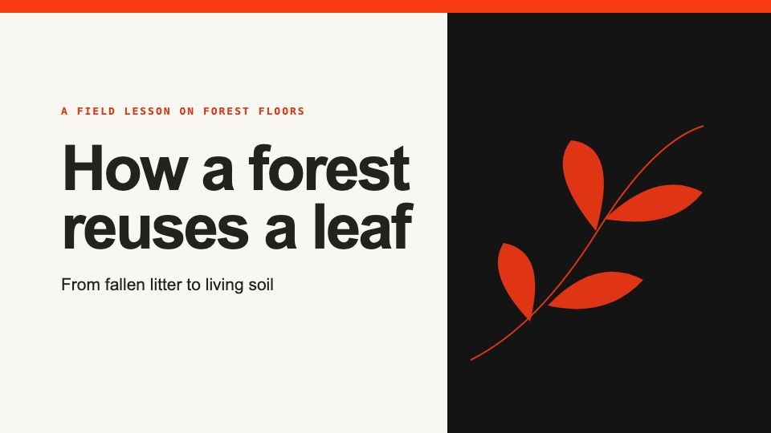

Adapted for Subclip from https://github.com/zarazhangrui/frontend-slides by zarazhangrui, MIT.

# Frontend Slides

Make a pitch, lesson, talk, or report into a slide video. Compare three treatments of the same opening slide, then build the chosen look as timed, editable HyperFrames scenes. Add voice and native captions if needed. Export the finished video from Subclip.

Start with a topic, an outline, an existing Subclip slide project, or slide copy and assets from a deck. Subclip's editor tools lack native PowerPoint extraction. For a deck rebuild, supply slide text, notes, and original assets. Slide images can serve as visual references or as timed stills, with their text baked into the images.

[Skill workflow](SKILL.md) | [Style recipes](references/styles.md)

## Examples

Three opening slide variants for the same lesson. These settled frames come from short HTML and GSAP slide entrances rendered in headless Chrome.

