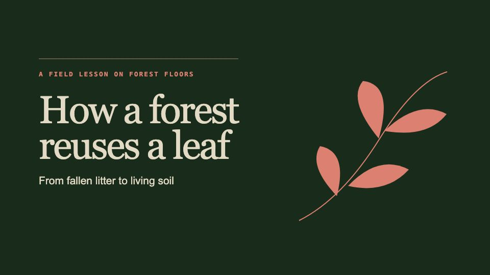
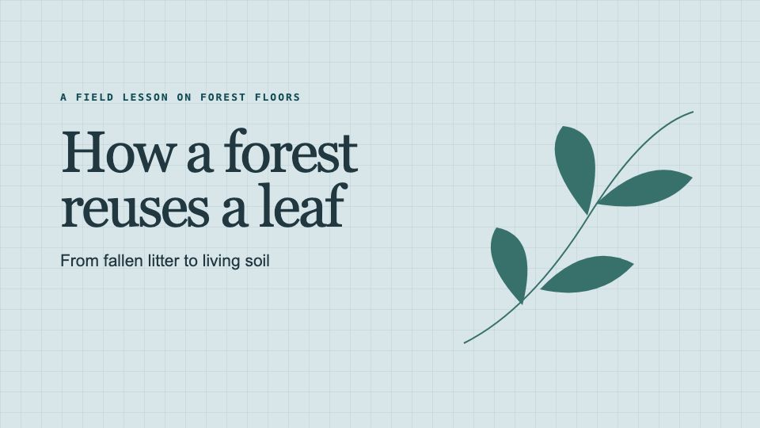

Adapted for Subclip from https://github.com/zarazhangrui/frontend-slides by zarazhangrui, MIT.

# Frontend Slides

Make a pitch, lesson, talk, or report into a slide video. Compare three treatments of the same opening slide, then build the chosen look as timed, editable HyperFrames scenes. Add voice and native captions if needed. Export the finished video from Subclip.

Start with a topic, an outline, an existing Subclip slide project, or slide copy and assets from a deck. Subclip's editor tools lack native PowerPoint extraction. For a deck rebuild, supply slide text, notes, and original assets. Slide images can serve as visual references or as timed stills, with their text baked into the images.

[Skill workflow](SKILL.md) | [Style recipes](references/styles.md)

<!-- examples:start -->

## Examples

 Swiss Modern opener with a stark asymmetric grid and red botanical accent.

 Grove opener with forest green, warm serif type, and a terracotta leaf study.

 Field notebook wildcard with ruled paper and a teal specimen drawing.

 Three animated openers for the same forest lesson in Swiss Modern, Grove and Field Notebook styles. <a href="examples/forest-slide-openers.mp4">Play with sound</a>

Test outputs made with this skill in Subclip. Rendered in code (HTML, SVG or canvas, HyperFrames): no image, video or audio model. The hero preview adds text from Subclip's own text templates.

<!-- examples:end -->
