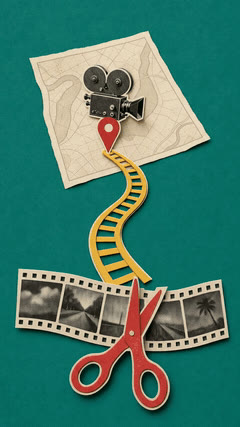

Adapted for Subclip from [pyang5166/gbro-collage-broll](https://github.com/pyang5166/gbro-collage-broll) by pyang5166, MIT.

# Collage B-roll

Turn one spoken line of about 5 seconds into a halftone paper-collage B-roll clip that assembles itself from an empty color field. The creator approves the metaphor, then the still, then the animation, so credits go only to approved ideas.

Example request: "Make collage b-roll for the line 'every edit starts from scratch'. Vertical, 5 seconds, burnt orange."

What changed from the original: the Python scripts, Gemini API key setup, ffmpeg steps and evals are gone. Stills and video use the creator's Codex or Grok CLI, or Subclip's own models with a credit quote first. The clip is placed on the Subclip timeline and checked with real frames. A second route builds the assembly as an editable HyperFrames layer. The Chinese-language workflow, gates, color rules and prompt templates are kept in English.

<!-- examples:start -->

## Examples

<video src="examples/chessboard-blocking.mp4" controls muted loop playsinline width="720"></video> A paper chessboard becomes a staging plan under a projector beam.

<video src="examples/cutting-film.mp4" controls muted loop playsinline width="720"></video> A map, camera and filmstrip assemble before scissors cut the strip.

<video src="examples/printing-press.mp4" controls muted loop playsinline width="720"></video> A printing press turns one flawed picture into a run of copies.

 The finished teal collage shows a camera, a filmstrip and red scissors.

Examples by pyang5166, MIT, from github.com/pyang5166/gbro-collage-broll

<!-- examples:end -->
